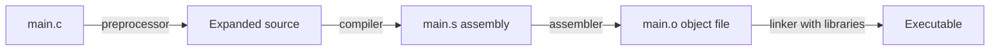

## Introduction

Python runs your source code through an interpreter, but C works differently: before a C program can run, a **toolchain** translates it into machine code for your processor. Knowing the stages of that translation explains many puzzling messages, such as why a missing semicolon and a missing function definition produce completely different errors, and it is the foundation for understanding headers, libraries, and multi-file programs.

**Before you start:** you should be able to write and run a simple program in any language and use a terminal.

## Core theory

### The shape of a C program

```c
#include <stdio.h>

int main(void) {
    printf("Hello, C!\n");
    return 0;
}
```

- `#include <stdio.h>` is a **preprocessor directive** that pulls in the declarations of the standard input/output functions, including `printf`.
- Every program starts executing at `main`. `int` is its return type, and `return 0;` reports success to the operating system.
- Statements end with semicolons; braces group statements into blocks. C is **statically typed**: every variable has a type fixed at compile time.

### Stage 1: preprocessing

The **preprocessor** works on text. It replaces each `#include` with the contents of the header file, expands macros defined with `#define`, removes comments, and keeps or drops code inside `#if` / `#ifdef` blocks. Its output is a single, expanded **translation unit**. `gcc -E main.c` shows it.

### Stage 2: compilation

The **compiler** parses the translation unit, checks types and syntax, optimises, and emits **assembly language** for the target processor. Syntax errors, type errors, and undeclared identifiers are reported here. `gcc -S main.c` stops after this stage and writes `main.s`.

### Stage 3: assembly

The **assembler** converts assembly into machine code, producing an **object file** (`main.o`). An object file contains the machine code for the functions defined in that file plus a **symbol table** listing which names it defines and which it uses but does not define, such as `printf`. `gcc -c main.c` stops here.

### Stage 4: linking

The **linker** combines one or more object files with libraries, such as the C standard library, and resolves every symbol: each call to `printf` is connected to the actual code of `printf`. The result is an **executable**. If a function is declared and called but never defined anywhere, the linker reports an **undefined reference**; if two files define the same global function, it reports a **multiple definition**.



Running `gcc main.c -o main` performs all four stages in one command. Useful flags: `-Wall -Wextra` enable warnings, `-std=c11` selects the language standard, `-g` adds debugging information, and `-O2` optimises.

## Worked examples

### Example 1: A complete program with a function

```c
#include <stdio.h>

int square(int x);

int main(void) {
    int total = 0;
    for (int i = 1; i <= 4; i++) {
        total += square(i);
    }
    printf("Sum of squares 1..4 = %d\n", total);
    return 0;
}

int square(int x) {
    return x * x;
}
```

Output:

```text
Sum of squares 1..4 = 30
```

The **prototype** `int square(int x);` before `main` tells the compiler the function's type, so the call compiles even though the definition comes later. The linker is not involved in this check; it only needs the definition to exist somewhere.

### Example 2: Compile error versus link error

Suppose we delete the definition of `square` but keep the prototype and the call. Compilation succeeds, because the compiler has a declaration and can check the call. Linking fails:

```text
/usr/bin/ld: main.o: in function `main':
main.c:(.text+0x1e): undefined reference to `square'
collect2: error: ld returned 1 exit status
```

If instead we delete the prototype and the definition, a modern compiler stops earlier with "implicit declaration of function 'square'", a compile-time error in C99 and later. Reading which tool produced the message (`ld` is the linker) tells you where to look: a missing semicolon or wrong type is a compile problem; an undefined reference is a missing definition, object file, or library.

## Applications

- **Build systems:** `make` and CMake compile each `.c` file separately into `.o` files and relink only what changed.
- **Libraries:** static (`.a`) and shared (`.so`, `.dll`) libraries are collections of object files that the linker attaches.
- **Embedded systems:** cross-compilers run the same stages but emit code for microcontrollers.
- **Debugging builds:** `-E` reveals macro problems; `-S` shows how code maps to instructions.

## Common mistakes

- **Forgetting `#include <stdio.h>`.** The compiler then has no declaration for `printf`.
- **Treating warnings as harmless.** Compile with `-Wall -Wextra` and fix every warning; many are real bugs.
- **Confusing declarations and definitions.** A prototype promises a function exists; a definition provides its body, and exactly one definition must exist.
- **Compiling only one file of a multi-file program.** The linker then reports undefined references for functions in the other files.

## Revision notes

- Pipeline: preprocess (`-E`) → compile to assembly (`-S`) → assemble to object (`-c`) → link to executable.
- The preprocessor handles `#include`, `#define`, and `#if` as text substitution.
- The compiler checks syntax and types; the linker resolves symbols across files and libraries.
- "undefined reference" is a **link** error; "expected ';'" is a **compile** error.
- `main` returns an `int`; 0 means success.
- Use `-Wall -Wextra -std=c11`.

## Practice questions

:::question basic
Which stage of the C toolchain replaces `#include <stdio.h>` with the header's contents?
:::answer
The preprocessor. It performs text substitution before compilation begins, so the compiler sees the declarations from `stdio.h` as if they were typed into the file.
:::

:::question basic
What does an object file contain that a source file does not?
:::answer
Machine code for the functions defined in that file, together with a symbol table listing the symbols it defines and the ones it still needs from elsewhere. It is not yet runnable because those external references are unresolved until linking.
:::

:::question intermediate
A program compiles without errors but `gcc` prints "undefined reference to `area'". What are two likely causes?
:::answer
The function `area` was declared (so the call compiled) but never defined, or it is defined in another source file or library that was not included in the link command, for example `gcc main.c` instead of `gcc main.c shapes.c`. Both mean the linker cannot find any definition of the symbol.
:::

:::question intermediate
Why does placing a prototype `int square(int x);` above `main` let you define `square` after `main`?
:::answer
The compiler reads the file from top to bottom and needs to know a function's parameter and return types when it compiles a call. The prototype supplies that information early; the definition later in the file provides the body, which the linker connects to the call.
:::

:::question advanced
In a project of 200 source files, why do build tools compile each file to an object file separately instead of compiling everything in one command every time?
:::answer
Compilation of each translation unit is independent, so only files that changed (or whose headers changed) need recompiling; unchanged object files are reused and simply relinked. This turns a full rebuild of 200 files into recompiling one or two, which saves a lot of time, and independent units can also be compiled in parallel.
:::

## Further learning

- **Next:** *Data Types, Operators & Expressions* covers the types the compiler checks.
- **Related:** *Preprocessor, Macros & Multi-File Programs* goes deeper into headers and separate compilation.
