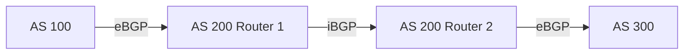

## Introduction

The global internet is not a single, monolithic network managed by one entity. Instead, it is a "network of networks"—a massive collection of over 100,000 independent networks known as **Autonomous Systems (ASes)**. While protocols like OSPF or IS-IS efficiently handle routing within a single organization, they cannot scale to the size of the entire planet, nor can they handle the complex commercial and political requirements of global connectivity.

Imagine an ISP in London that wants to send traffic to a university in Tokyo. The traffic must traverse several intermediate networks. Should the ISP send the traffic through a provider in New York or a peer in Frankfurt? The choice isn't just about the shortest physical distance; it is about cost, trust, and contractual agreements. This is where the **Border Gateway Protocol (BGP)** comes in. BGP is the "glue" that holds the internet together, allowing disparate networks to exchange reachability information while maintaining strict control over their own traffic policies.

In this lesson, we will explore how BGP uses path-vector routing to prevent loops, how it manages peering relationships, and how routers decide the "best" path when multiple options exist.

**Before you start:** You should be familiar with the concepts in *Routing Concepts & Distance Vector vs Link State* and understand how IP prefixes work from *IPv4 Subnetting & CIDR Calculation*.

## Core theory

### The Autonomous System (AS)

An **Autonomous System (AS)** is a collection of IP networks and routers under the control of a single administrative entity (such as an ISP, a large corporation, or a university) that presents a common routing policy to the internet. 

Each AS is identified by a unique **Autonomous System Number (ASN)**. Originally 16-bit integers (1–65,535), ASNs are now 32-bit integers to accommodate the growth of the internet. ASes are categorized based on their connectivity:
*   **Stub AS:** Connected to only one other AS. It does not carry transit traffic (e.g., a small corporate network).
*   **Multihomed AS:** Connected to more than one AS but refuses to carry transit traffic (e.g., a large company with two ISPs for redundancy).
*   **Transit AS:** Connected to multiple ASes and allows traffic to pass through it to reach other destinations (e.g., Tier-1 or Tier-2 ISPs).

### Path Vector Routing

BGP is classified as a **Path Vector** protocol. It is an evolution of distance-vector routing designed to solve the "count-to-infinity" problem and handle the scale of the global internet. 

In a distance-vector protocol, a router only knows the distance (metric) and the next hop to a destination. In path-vector routing, when a BGP router advertises a prefix, it includes the entire list of ASes that the advertisement has passed through. This list is known as the **AS-PATH** attribute.

Path-vector routing provides two critical benefits:
1.  **Loop Prevention:** If a router receives an advertisement where its own ASN is already present in the AS-PATH, it knows a loop has occurred and rejects the advertisement.
2.  **Policy Enforcement:** Routers can examine the ASes in the path and decide to accept or reject a route based on which networks it traverses (e.g., avoiding a specific country or a competitor's network).

### BGP Peering: eBGP and iBGP

BGP does not use broadcast or multicast to find neighbors. Instead, neighbors (called **peers**) must be manually configured. They communicate over a semi-permanent **TCP connection on port 179**. This ensures reliable delivery of routing updates.

There are two distinct types of BGP sessions:
*   **External BGP (eBGP):** Used between routers in different ASes. These routers are typically directly connected. The primary goal is to learn routes from other networks.
*   **Internal BGP (iBGP):** Used between routers within the same AS. The goal is to distribute the routes learned via eBGP to all other routers inside the AS.

A critical rule of iBGP is that a router does not re-advertise a route learned from one iBGP peer to another iBGP peer. This is a loop-prevention mechanism because the AS-PATH does not change within an AS. Consequently, iBGP requires a **full mesh** (every iBGP router must connect to every other iBGP router) or the use of **Route Reflectors**.

### BGP Attributes and the Decision Process

Unlike OSPF, which uses a simple "cost" metric based on bandwidth, BGP uses a complex set of **attributes** to determine the best path. When a router receives multiple paths to the same prefix, it runs the following tie-breaking algorithm (simplified):

1.  **Weight:** A local, Cisco-proprietary value. Higher is better.
2.  **Local Preference:** Used to tell the AS which exit point is preferred for a specific destination. Higher is better.
3.  **Self-Originated:** Prefer routes originated by this router.
4.  **AS-PATH Length:** Prefer the path with the fewest ASes.
5.  **Origin Type:** Prefer IGP over EGP, and EGP over Incomplete.
6.  **Multi-Exit Discriminator (MED):** Used to suggest to an external neighbor which entry point into your AS is preferred. Lower is better.
7.  **eBGP over iBGP:** Prefer paths learned via eBGP.
8.  **IGP Metric:** Prefer the path with the lowest internal cost to the BGP next-hop.

### Peering Policies: The Gao-Rexford Model

Routing on the internet is driven by economics. The **Gao-Rexford model** describes the standard commercial relationships between ASes:

*   **Customer-Provider:** The customer pays the provider for internet access.
*   **Peer-to-Peer:** Two ASes (usually of similar size) agree to exchange traffic between their respective customers for free. This is called **settlement-free peering**.

These relationships lead to two fundamental rules for **Policy-Based Routing**:

1.  **Preference Rule:** An AS prefers routes in this order: $Customer > Peer > Provider$. This is because sending traffic to a customer generates revenue, peering is free, and sending traffic to a provider costs money.
2.  **Export Rule (No-Valley Routing):** An AS will only advertise its customers' routes to its providers and peers. It will **not** advertise routes learned from one provider to another provider, nor routes from a provider to a peer. Doing so would turn the AS into a "transit" network for traffic it isn't getting paid to carry.

### The BGP State Machine

A BGP session progresses through several states before it can exchange prefixes:
1.  **Idle:** The initial state; the router is waiting for a start event.
2.  **Connect:** The router is waiting for the TCP connection to complete.
3.  **Active:** The router is attempting to initiate a TCP connection.
4.  **OpenSent:** TCP is up; the router has sent a BGP OPEN message.
5.  **OpenConfirm:** The router has received an OPEN message from the peer and is waiting for a KEEPALIVE.
6.  **Established:** The session is fully up; routers can now exchange UPDATE messages containing prefix information.

## Worked examples

### Example 1: Loop Detection in AS-PATH

Consider three Autonomous Systems: AS 10, AS 20, and AS 30. 
1. AS 10 originates prefix `1.1.1.0/24`. It sends an update to AS 20. The AS-PATH is `(10)`.
2. AS 20 receives the update and sends it to AS 30. It prepends its own ASN. The AS-PATH is now `(20, 10)`.
3. Due to a misconfiguration, AS 30 has a physical link back to AS 10 and sends the update to AS 10. It prepends its ASN. The AS-PATH is now `(30, 20, 10)`.

**Question:** What happens when AS 10 receives this update?

**Step-by-step Solution:**
1. AS 10 receives the BGP UPDATE for `1.1.1.0/24`.
2. AS 10 inspects the AS-PATH attribute: `(30, 20, 10)`.
3. AS 10 looks for its own ASN (10) in the list.
4. AS 10 finds `10` at the end of the list.
5. **Result:** AS 10 identifies a routing loop. It silently discards the update and does not install the route in its routing table.

### Example 2: Selecting the Best Path via Policy

Router R1 in AS 500 receives three different advertisements for the prefix `8.8.8.0/24`.

| Path | Learned via | Local Preference | AS-PATH Length | MED |
| :--- | :--- | :--- | :--- | :--- |
| Path A | eBGP (Provider) | 100 | 2 | 50 |
| Path B | eBGP (Peer) | 200 | 3 | 100 |
| Path C | iBGP (Customer) | 300 | 4 | 20 |

**Question:** Which path will R1 select as the "Best Path"?

**Step-by-step Solution:**
1. **Compare Local Preference:** Path C has a Local Preference of 300, Path B has 200, and Path A has 100.
2. In the BGP decision process, Local Preference is evaluated very early (Step 2).
3. Since $300 > 200 > 100$, Path C is immediately preferred.
4. **Result:** Path C is selected. Note that Path C has the *longest* AS-PATH and the *lowest* MED, but those attributes are never even considered because Local Preference is a higher-priority tie-breaker. This demonstrates how policy (Local Preference) overrides shortest-path logic (AS-PATH).

### Example 3: Calculating iBGP Full Mesh

An ISP has an Autonomous System with $N$ routers. To ensure all routers can share eBGP-learned routes without using Route Reflectors, they must be connected in a full iBGP mesh.

**Question:** If the ISP has 10 routers, how many iBGP sessions are required?

**Step-by-step Solution:**
1. In a full mesh, every router must have a session with every other router.
2. This is a combinatorics problem: "N choose 2".
3. The formula is: $$\frac{N \times (N - 1)}{2}$$
4. For $N = 10$: $$\frac{10 \times 9}{2} = 45$$
5. **Result:** 45 iBGP sessions are required. This quadratic growth ($O(N^2)$) is why large networks use Route Reflectors or BGP Confederations instead of a full mesh.

## Applications

*   **Internet Traffic Engineering:** ISPs use BGP attributes like Local Preference to shift outgoing traffic to cheaper providers and MED or AS-PATH prepending to influence how incoming traffic enters their network.
*   **DDoS Mitigation:** Using **BGP Flowspec** or **Remote Triggered Black Hole (RTBH)** routing, network admins can advertise specific "discard" routes to drop malicious traffic at the edge of the internet before it reaches the target.
*   **Anycast Services:** DNS providers (like 8.8.8.8) and CDNs use BGP to advertise the same IP prefix from multiple geographic locations. BGP naturally routes users to the "closest" instance based on AS-PATH length.
*   **Multi-homing:** Businesses use BGP to connect to two different ISPs simultaneously. If one ISP fails, BGP automatically reroutes traffic through the other, providing high availability.

## Common mistakes

*   **Confusing iBGP with an IGP:** iBGP is not a replacement for OSPF or IS-IS. iBGP is used to carry *external* internet routes, while an IGP (Interior Gateway Protocol) is still needed to provide reachability between the routers' loopback addresses within the AS.
*   **Assuming BGP finds the fastest path:** BGP is a policy protocol, not a performance protocol. The "shortest" AS-PATH might go over a slow satellite link, while a "longer" AS-PATH might go over high-speed fiber. BGP only cares about the number of ASes, not latency or bandwidth.
*   **Forgetting the iBGP Split-Horizon Rule:** A common mistake in lab environments is forgetting that iBGP routers do not pass routes learned from one iBGP peer to another. Without a full mesh or a Route Reflector, routes will not propagate across the AS.
*   **AS-PATH Prepending Errors:** To make a path less attractive, admins sometimes "prepend" their own ASN multiple times (e.g., `AS-PATH: 10 10 10`). A common mistake is prepending the *wrong* ASN, which can lead to the route being rejected as a loop.
*   **BGP Hijacking:** This occurs when an AS accidentally (or maliciously) advertises a prefix it does not own. Because BGP historically trusts advertisements, the "shortest path" rule might cause global traffic for that prefix to be diverted to the wrong AS.

## Revision notes

*   **BGP** is a Path Vector protocol used for inter-domain routing.
*   **Autonomous Systems (AS)** are identified by 16-bit or 32-bit **ASNs**.
*   **eBGP** sessions are between different ASes; **iBGP** sessions are within the same AS.
*   **Loop Prevention:** BGP rejects any update where its own ASN appears in the **AS-PATH**.
*   **Local Preference** is for **outbound** traffic control (higher is preferred).
*   **MED (Multi-Exit Discriminator)** is for **inbound** traffic control (lower is preferred).
*   **Gao-Rexford Model:** Prefer Customer > Peer > Provider.
*   **iBGP Requirement:** Requires a full mesh because of the split-horizon rule (routes learned via iBGP are not re-advertised to other iBGP peers).
*   **TCP Port 179:** The reliable transport used by BGP.

## Practice questions

:::question basic
What is the primary mechanism BGP uses to prevent routing loops between different Autonomous Systems?
:::answer
BGP uses the **AS-PATH** attribute for loop prevention. When a router receives a route advertisement, it checks the list of ASNs in the path; if its own ASN is already in the list, it discards the update to prevent a loop.
:::

:::question basic
Which BGP attribute is used to influence the exit point of an AS for outbound traffic, and is it shared with external neighbors?
:::answer
**Local Preference** is used to influence outbound traffic. It is a "well-known discretionary" attribute that is shared among iBGP peers within an AS but is **never** sent to eBGP peers in other ASes.
:::

:::question intermediate
Explain why an AS would typically prefer a "Peer" route over a "Provider" route, even if the Provider route has a shorter AS-PATH.
:::answer
This is based on the **Gao-Rexford model** of economic incentives. Peering is usually settlement-free (free of charge), whereas a Provider charges the AS for transit. Therefore, the AS will set a higher **Local Preference** for the Peer route to save money, overriding the default shortest AS-PATH logic.
:::

:::question intermediate
A network engineer sets up two routers, R1 and R2, in AS 100. R1 learns a route from an eBGP neighbor. R1 passes this route to R2 via iBGP. R2 has an iBGP session with R3 (also in AS 100). Why does R3 not receive the route from R2?
:::answer
This is due to the **iBGP split-horizon rule**, which states that a route learned from an iBGP peer cannot be advertised to another iBGP peer. This rule exists to prevent loops within an AS since the AS-PATH is not updated in iBGP; to fix this, R1 must have a direct iBGP session with R3 (full mesh) or use a Route Reflector.
:::

:::question advanced
Suppose AS 200 receives a prefix from its Provider (AS 100). According to standard no-valley routing policies, to which of its neighbors will AS 200 advertise this prefix: its other Provider (AS 300), its Peer (AS 400), or its Customer (AS 500)?
:::answer
AS 200 will **only** advertise the prefix to its **Customer (AS 500)**. Advertising a provider's route to another provider or a peer would make AS 200 a transit provider for traffic it doesn't get paid for, violating the Gao-Rexford export rules.
:::

:::question advanced
In the BGP decision process, if all attributes including Local Preference, AS-PATH length, and MED are identical, and one route was learned via eBGP while the other was learned via iBGP, which is chosen and why?
:::answer
The **eBGP route** is preferred over the iBGP route. This is a tie-breaking rule designed to move traffic out of the local Autonomous System as quickly as possible (hot-potato routing), reducing the internal resources consumed by transit traffic.
:::

## Further learning

*   **Next:** *TCP 3-Way Handshake & Flow Control* to understand the reliable transport layer that BGP relies on for its peering sessions.
*   **Related:** *IPv4 Subnetting & CIDR Calculation* to master the prefix notation used in BGP UPDATE messages.
*   **Related:** *Routing Concepts & Distance Vector vs Link State* to compare how BGP's path-vector logic differs from OSPF's link-state logic.
*   **Textbook:** James Kurose and Keith Ross, *Computer Networking: A Top-Down Approach*.
