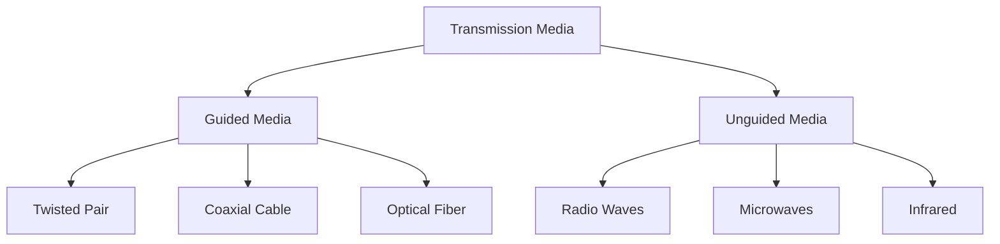

## Introduction

Imagine streaming high-definition video over an old copper telephone wire versus a modern optical fiber connection. While both physically transfer electromagnetic energy, the optical fiber delivers gigabits per second over tens of kilometers, whereas the telephone wire struggles to deliver a fraction of that speed across a few hundred meters. Why do physical media have such drastically different data rates, and what fundamental laws govern how fast information can travel without errors?

At the physical layer of the OSI model, information is converted into continuous signals and transmitted across physical media. Every medium imposes physical bounds on transmission speed: signals lose strength over distance, random thermal noise distorts waveform shapes, and physical limitations restrict the range of frequencies the medium can transport.

This lesson explores the theoretical foundations of physical channel limits and physical transmission media. You will master signal attenuation calculations using decibels, evaluate maximum achievable bit rates using the Nyquist and Shannon theorems, and examine the physical media used in real-world networking.

**Before you start:** you need to be familiar with basic network topologies and performance metrics from *Network Fundamentals, Topologies & Performance* and understand the OSI model from *OSI vs TCP/IP Protocol Stacks*.

## Core theory

### Signal attenuation and decibel metrics

As an electromagnetic signal propagates along any physical medium, it loses energy. This reduction in signal amplitude and power over distance is called **attenuation**. If a signal attenuates too much, the receiving equipment cannot distinguish the original signal from background noise. To compensate for attenuation, networks employ amplifiers or repeaters to boost signal strength, a process called **amplification**.

Because signal power spans many orders of magnitude, power ratios and losses are expressed on a logarithmic scale using the **decibel** ($\text{dB}$). The power ratio of an output signal $P_2$ relative to an input signal $P_1$ in decibels is defined as:

$$\text{dB} = 10 \log_{10}\left(\frac{P_2}{P_1}\right)$$

If $P_2 < P_1$, the result is negative, representing power loss (attenuation). If $P_2 > P_1$, the result is positive, representing power gain (amplification). A major advantage of using decibels is that successive gains and losses along a transmission path add directly:

$$\text{dB}_{\text{total}} = \text{dB}_1 + \text{dB}_2 + \dots + \text{dB}_k$$

Absolute power levels are often measured in **dBm**, where power is referenced relative to 1 milliwatt ($1 \text{ mW}$):

$$\text{P}_{\text{dBm}} = 10 \log_{10}\left(\frac{P}{1 \text{ mW}}\right)$$

### Noise and Signal-to-Noise Ratio (SNR)

Noise refers to any unwanted electrical or electromagnetic energy that degrades the transmitted signal. Key types of noise include:

- **Thermal noise**: Random motion of electrons in conductors, present in all electronic media. It is proportional to temperature and channel bandwidth.
- **Crosstalk**: Energy coupling between adjacent wire pairs or channels, often caused by electromagnetic induction.
- **Impulse noise**: Short, high-amplitude spikes caused by power surges, lightning, or industrial machinery.

To evaluate signal quality in the presence of noise, engineers use the **signal-to-noise ratio** ($\text{SNR}$), defined as the ratio of average signal power $P_{\text{signal}}$ to average noise power $P_{\text{noise}}$:

$$\text{SNR} = \frac{P_{\text{signal}}}{P_{\text{noise}}}$$

Because $\text{SNR}$ is a power ratio, it is frequently expressed in decibels ($\text{SNR}_{\text{dB}}$):

$$\text{SNR}_{\text{dB}} = 10 \log_{10}\left(\frac{P_{\text{signal}}}{P_{\text{noise}}}\right)$$

A high $\text{SNR}$ indicates a clean signal where message extraction is straightforward. A low $\text{SNR}$ means the noise power approaches or exceeds the signal power, increasing transmission error rates.

### Nyquist bit rate for noiseless channels

In 1928, Harry Nyquist derived the theoretical upper bound on the data rate for an ideal, noiseless channel of limited bandwidth. The fundamental constraint of a channel is its **bandwidth** ($B$), measured in Hertz ($\text{Hz}$), which represents the range of frequencies the medium can pass without excessive attenuation.

Nyquist showed that an ideal low-pass channel of bandwidth $B$ can carry at most $2B$ discrete signal changes per second. The rate of signal element changes per second is called the **baud rate** or modulation rate. If a signal uses $M$ distinct discrete voltage or phase levels (where each level represents $\log_2 M$ bits), the **Nyquist bit rate theorem** gives the maximum capacity $C$ in bits per second ($\text{bps}$):

$$C = 2 B \log_2(M)$$

| Parameter | Description | Standard Unit |
| :--- | :--- | :--- |
| $C$ | Channel capacity (maximum data rate) | Bits per second ($\text{bps}$) |
| $B$ | Channel bandwidth | Hertz ($\text{Hz}$) |
| $M$ | Number of discrete **signal levels** | Unitless ($M \ge 2$) |

Increasing the number of signal levels $M$ increases the bit rate for a given bandwidth. However, in real physical systems, $M$ cannot be made arbitrarily large because receiver hardware cannot reliably distinguish minute voltage differences in the presence of noise.

### Shannon capacity theorem for noisy channels

Real physical channels are always subject to noise. In 1948, Claude Shannon extended channel capacity theory by considering thermal (white) noise. The **Shannon capacity theorem** defines the maximum theoretical bit rate $C$ of a noisy channel:

$$C = B \log_2(1 + \text{SNR})$$

In this equation, $B$ is the bandwidth in Hertz ($\text{Hz}$) and $\text{SNR}$ is the **linear power ratio** ($P_{\text{signal}} / P_{\text{noise}}$), **not** the decibel value $\text{SNR}_{\text{dB}}$. Shannon's formula establishes an absolute physical ceiling. No encoding scheme, modulation technique, or error-control mechanism can achieve error-free data transmission above this rate for a given bandwidth and noise level. The term $C/B$ is known as the **spectral efficiency**, measured in bits per second per Hertz ($\text{bps/Hz}$).

### Guided transmission media

Physical media are categorized into guided and unguided forms. **Guided media** conduct electromagnetic waves along a bounded physical path.



1. **Twisted Pair**: Consists of pairs of insulated copper wires twisted together. Twisting reduces electromagnetic induction and **crosstalk** between adjacent pairs.
   - *Unshielded Twisted Pair (UTP)*: Standard in Ethernet networks (Cat 5e, Cat 6). Inexpensive and flexible.
   - *Shielded Twisted Pair (STP)*: Includes a metallic conductive shield around pairs to prevent external electromagnetic interference (EMI).
2. **Coaxial Cable**: Features an inner copper conductor surrounded by an insulating layer, a conductive metallic shield, and a protective outer jacket. It offers higher bandwidth and superior noise immunity over twisted pair.
3. **Optical Fiber**: Transmits pulses of light through a glass or plastic core using **total internal reflection**.
   - *Multi-mode Fiber (MMF)*: Larger core diameter allows light to travel along multiple reflection paths. Causes **modal dispersion** over distance.
   - *Single-mode Fiber (SMF)*: Small core diameter permits only one mode of light propagation, eliminating modal dispersion and offering massive bandwidth across tens of kilometers.

### Unguided transmission media

**Unguided media** transport electromagnetic signals without a physical conductor, propagating through air, space, or water.

1. **Radio Waves** ($3 \text{ kHz}$ to $1 \text{ GHz}$): Omnidirectional transmission. Waves travel in all directions from the antenna, easily penetrating walls.
2. **Microwaves** ($1 \text{ GHz}$ to $300 \text{ GHz}$): Line-of-sight directional transmission. Waves do not penetrate obstacles efficiently and require aligned parabolic dish antennas. Used in satellite communication and modern Wi-Fi.
3. **Infrared** ($300 \text{ GHz}$ to $400 \text{ THz}$): High-frequency, short-range directional transmission. Cannot penetrate solid walls, making it secure against external eavesdropping.

## Worked examples

### Example 1: Decibel loss and power levels

A signal with an initial power of $100 \text{ mW}$ is transmitted along a $5 \text{ km}$ copper line that has an attenuation rate of $2.0 \text{ dB/km}$. The output signal then passes through an amplifier with a power gain of $+6.0 \text{ dB}$.

Calculate:
1. The total decibel attenuation over the $5 \text{ km}$ line.
2. The signal power at the end of the line before amplification.
3. The final output signal power after amplification.

**Step 1: Total attenuation over the cable.**
$$\text{Loss}_{\text{dB}} = 2.0 \text{ dB/km} \times 5.0 \text{ km} = 10.0 \text{ dB}$$
Since attenuation is a loss, the change in signal level is $-10.0 \text{ dB}$.

**Step 2: Signal power before amplification ($P_2$).**
$$-10.0 = 10 \log_{10}\left(\frac{P_2}{100}\right) \implies -1.0 = \log_{10}\left(\frac{P_2}{100}\right)$$
$$\frac{P_2}{100} = 10^{-1.0} = 0.1 \implies P_2 = 10.0 \text{ mW}$$

**Step 3: Signal power after amplification ($P_3$).**
$$+6.0 = 10 \log_{10}\left(\frac{P_3}{10.0}\right) \implies 0.6 = \log_{10}\left(\frac{P_3}{10.0}\right)$$
$$\frac{P_3}{10.0} = 10^{0.6} \approx 3.981 \implies P_3 \approx 39.81 \text{ mW}$$

```python
import math

p1 = 100.0  # initial power in mW
attenuation_per_km = 2.0  # dB/km
distance = 5.0  # km
amp_gain_db = 6.0  # dB

total_loss_db = attenuation_per_km * distance
p2 = p1 * (10 ** (-total_loss_db / 10.0))
p3 = p2 * (10 ** (amp_gain_db / 10.0))

print(f"Total loss: {total_loss_db:.1f} dB")
print(f"Power after cable: {p2:.2f} mW")
print(f"Power after amp: {p3:.2f} mW")
```

Output:

```text
Total loss: 10.0 dB
Power after cable: 10.00 mW
Power after amp: 39.81 mW
```

### Example 2: Shannon capacity vs. Nyquist signal levels

A telephone channel has an available bandwidth $B = 3000 \text{ Hz}$ and a signal-to-noise ratio $\text{SNR}_{\text{dB}} = 30 \text{ dB}$.

1. Calculate the maximum theoretical channel capacity $C$ using Shannon's theorem.
2. If a transmission system must carry data at $24 \text{ kbps}$ across a channel with $B = 3000 \text{ Hz}$, determine the minimum number of discrete signal levels $M$ required by Nyquist's theorem.

**Step 1: Shannon capacity calculation.**
First convert $\text{SNR}_{\text{dB}}$ into a linear ratio $\text{SNR}$:
$$\text{SNR} = 10^{(30/10)} = 10^3 = 1000$$
Now evaluate Shannon's capacity:
$$C = 3000 \times \log_2(1 + 1000) = 3000 \times \log_2(1001)$$
Using $\log_2(1001) \approx 9.967226$:
$$C \approx 3000 \times 9.967226 \approx 29901.68 \text{ bps}$$

**Step 2: Required Nyquist signal levels.**
To achieve $C = 24000 \text{ bps}$ with $B = 3000 \text{ Hz}$:
$$24000 = 2 \times 3000 \times \log_2(M) \implies 4 = \log_2(M) \implies M = 2^4 = 16 \text{ levels}$$

```python
import math

bandwidth = 3000  # Hz
snr_db = 30.0

snr_linear = 10 ** (snr_db / 10.0)
shannon_capacity = bandwidth * math.log2(1.0 + snr_linear)

target_rate = 24000  # bps
log2_m = target_rate / (2.0 * bandwidth)
m_levels = 2 ** log2_m

print(f"Linear SNR: {snr_linear:.0f}")
print(f"Shannon Capacity: {shannon_capacity:.2f} bps")
print(f"Required Nyquist levels M: {int(m_levels)}")
```

Output:

```text
Linear SNR: 1000
Shannon Capacity: 29901.68 bps
Required Nyquist levels M: 16
```

## Applications

- **Adaptive Modulation in Wi-Fi and 5G**: Modern wireless protocols dynamically monitor channel $\text{SNR}$. When signal quality is high, the radio switches to high-order modulation (e.g., 1024-QAM, where $M = 1024$). When interference degrades $\text{SNR}$, the system drops to simpler modulation (e.g., QPSK, $M = 4$) to preserve connection stability.
- **DSL Broadband over Copper**: Digital Subscriber Line (DSL) technology repurposes standard copper telephone wire pairs. By calculating Shannon limits for hundreds of narrow sub-channels, DSL achieves megabit speeds over wires originally designed for $3 \text{ kHz}$ voice calls.
- **Data Center Optical Interconnects**: Fiber optics support massive bandwidth-distance products. Transceivers inside data centers use Single-mode Fiber with laser transmitters to achieve multi-hundred-gigabit link speeds across kilometers without signal regeneration.
- **Deep-space Communications**: Spacecraft transmitting signals over millions of kilometers face extreme path attenuation and tiny received power levels. Mission engineers apply Shannon bounds to select low-bandwidth channels combined with intense forward error correction to ensure data integrity.
- **Satellite Internet**: Low Earth Orbit (LEO) constellations like Starlink use microwave frequencies to provide high-bandwidth, low-latency internet to remote areas, relying on line-of-sight propagation through the vacuum of space and the atmosphere.

## Common mistakes

- **Using decibels directly in Shannon's capacity formula.** Why it is wrong and how to avoid it: Shannon's equation $C = B \log_2(1 + \text{SNR})$ requires the unitless linear ratio $\text{SNR} = P_{\text{signal}} / P_{\text{noise}}$. Always convert decibels to linear ratio using $\text{SNR} = 10^{(\text{SNR}_{\text{dB}} / 10)}$ before calculating capacity.
- **Confusing baud rate with bit rate.** Why it is wrong and how to avoid it: Baud rate is the number of signal state changes per second, whereas bit rate is the total number of data bits transferred per second. They are equal only when binary signaling ($M = 2$) is used. Remember that $\text{Bit Rate} = \text{Baud Rate} \times \log_2(M)$.
- **Assuming Nyquist's theorem applies to noisy channels.** Why it is wrong and how to avoid it: Nyquist derived his capacity bound assuming a complete absence of noise. For real-world noisy channels, Shannon's formula sets the true theoretical upper bound on throughput.
- **Expressing bandwidth in non-Hertz units in capacity equations.** Why it is wrong and how to avoid it: Standard formulas expect bandwidth $B$ in Hertz ($\text{Hz}$). If given bandwidth in $\text{kHz}$ or $\text{MHz}$, convert the value to $\text{Hz}$ ($1 \text{ MHz} = 10^6 \text{ Hz}$) prior to computing bit rates.
- **Using the wrong logarithm base.** Why it is wrong and how to avoid it: Both Nyquist and Shannon formulas use $\log_2$ because information is measured in bits. If your calculator only has $\log_{10}$ or $\ln$, use the change-of-base formula: $\log_2(x) = \ln(x) / \ln(2)$.
- **Adding decibel powers incorrectly.** Why it is wrong and how to avoid it: Decibels represent logarithmic ratios, so path losses and gains add linearly (e.g., $-10 \text{ dB} + 6 \text{ dB} = -4 \text{ dB}$). However, absolute power levels in Watts do not add directly; convert Watts to decibels or vice versa before performing multi-stage calculations.

## Revision notes

- **Attenuation**: Signal strength decay over distance, measured logarithmically in decibels ($\text{dB} = 10 \log_{10}(P_2 / P_1)$).
- **Decibel Addition**: Cumulative gain or loss along a transmission path is calculated by summing individual $\text{dB}$ values.
- **Signal-to-Noise Ratio**: Linear ratio $\text{SNR} = P_{\text{signal}} / P_{\text{noise}}$; in decibels $\text{SNR}_{\text{dB}} = 10 \log_{10}(\text{SNR})$.
- **Nyquist Bit Rate Theorem**: For ideal noiseless channels: $C = 2 B \log_2(M)$, where $B$ is bandwidth in $\text{Hz}$ and $M$ is the number of signal levels.
- **Shannon Capacity Theorem**: For noisy channels with thermal noise: $C = B \log_2(1 + \text{SNR})$, defining the absolute upper bit rate ceiling.
- **Baud vs Bit Rate**: Baud measures signal symbol changes per second; $\text{bps} = \text{Baud} \times \log_2(M)$.
- **Guided Media**: Physical paths including Twisted Pair (UTP/STP), Coaxial Cable, and Optical Fiber (Single-mode vs Multi-mode).
- **Unguided Media**: Wireless communication through air/space via Radio Waves (omnidirectional), Microwaves (line-of-sight), and Infrared (short-range).
- **Total Internal Reflection**: The principle that allows light to propagate through optical fiber by reflecting off the boundary between the core and the cladding.

## Practice questions

:::question basic
A transmitter emits a signal at a power level of $50 \text{ mW}$. After passing through a channel, the received power is measured at $5 \text{ mW}$. What is the signal attenuation in decibels?
:::answer
The power ratio $P_2 / P_1$ is $5 / 50 = 0.1$. Applying the decibel formula yields $\text{dB} = 10 \log_{10}(0.1) = 10 \times (-1) = -10 \text{ dB}$. Thus, the channel introduces $10 \text{ dB}$ of signal attenuation.
:::

:::question basic
A noiseless communication channel has a bandwidth of $10 \text{ MHz}$. If the signal uses 4 discrete voltage levels ($M = 4$), what is the maximum theoretical bit rate?
:::answer
Nyquist's theorem states that $C = 2 B \log_2(M)$. Substituting $B = 10 \times 10^6 \text{ Hz}$ and $M = 4$ gives $C = 2 \times (10 \times 10^6) \times \log_2(4) = 20 \times 10^6 \times 2 = 40 \text{ Mbps}$. The maximum bit rate for this noiseless channel is $40 \text{ Mbps}$.
:::

:::question intermediate
A noisy channel has a bandwidth of $1 \text{ MHz}$ and a signal-to-noise ratio $\text{SNR}_{\text{dB}}$ of $20 \text{ dB}$. Compute the theoretical Shannon channel capacity.
:::answer
First, convert $\text{SNR}_{\text{dB}}$ to a linear power ratio: $\text{SNR} = 10^{(20/10)} = 10^2 = 100$. Next, apply Shannon's formula: $C = B \log_2(1 + \text{SNR}) = 10^6 \times \log_2(1 + 100) = 10^6 \times \log_2(101)$. Since $\log_2(101) \approx 6.658$, the channel capacity is approximately $6.658 \text{ Mbps}$.
:::

:::question intermediate
An engineer wants to achieve a bit rate of $1.544 \text{ Mbps}$ over a noiseless channel with a bandwidth of $200 \text{ kHz}$. How many signal levels $M$ are required?
:::answer
Using Nyquist's formula $C = 2 B \log_2(M)$, plug in $C = 1.544 \times 10^6 \text{ bps}$ and $B = 200 \times 10^3 \text{ Hz}$. This gives $1.544 \times 10^6 = 400 \times 10^3 \times \log_2(M)$, which simplifies to $\log_2(M) = 3.86$. Dividing both sides yields $M = 2^{3.86} \approx 14.52$. Because signal levels must be integers, the system requires at least $M = 16$ levels.
:::

:::question advanced
A physical channel has a bandwidth of $4 \text{ MHz}$ and an $\text{SNR}_{\text{dB}}$ of $15 \text{ dB}$. Determine the maximum theoretical data rate, and then find the maximum number of signal levels $M$ that can be practically utilized without exceeding this theoretical capacity.
:::answer
First convert $\text{SNR}_{\text{dB}}$ to linear scale: $\text{SNR} = 10^{1.5} \approx 31.623$. Calculate Shannon capacity: $C = 4 \times 10^6 \times \log_2(1 + 31.623) \approx 20.11 \text{ Mbps}$. Now set Nyquist's formula equal to this maximum capacity to find $M$: $20.11 \times 10^6 = 2 \times (4 \times 10^6) \times \log_2(M) \implies \log_2(M) = 2.51375$. Therefore, $M = 2^{2.51375} \approx 5.71$. Since using $M = 8$ levels would yield a Nyquist rate of $24 \text{ Mbps}$ (exceeding the Shannon limit), the maximum allowable signal levels is $M = 4$.
:::

:::question advanced
Compare optical fiber and unshielded twisted pair (UTP) copper cabling in terms of attenuation mechanisms and susceptibility to electromagnetic interference (EMI).
:::answer
UTP copper cables suffer from resistive power loss that increases with signal frequency and high susceptibility to external EMI because copper acts as an antenna. In contrast, optical fibers carry light pulses using total internal reflection, rendering them completely immune to electrical EMI and crosstalk. Furthermore, optical fibers experience extremely low attenuation (as low as $0.2 \text{ dB/km}$) compared to several $\text{dB}$ per hundred meters for UTP, enabling vastly longer transmission distances.
:::

## Further learning

- **Next:** *Framing, CRC & CSMA/CD Protocol* explores how bit streams created at the physical layer are packaged into discrete frames with synchronization bits and medium access control.
- **Related:** *Ethernet, MAC Addressing & Switching* examines how physical layer cabling standards integrate into local area network hardware and switches.
- **Related:** *Error Correction & Sliding-Window Protocols* covers how upper layers recover from bit errors caused when noisy physical channels degrade below Shannon bounds.
- Andrew S. Tanenbaum and David J. Wetherall, Computer Networks.
