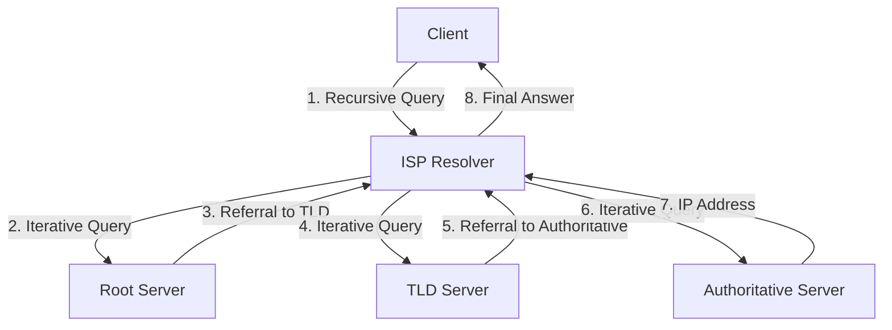

## Introduction

Imagine you type `www.luminalearn.com` into your browser. Within milliseconds, a webpage appears. This seemingly simple act triggers a complex chain of events across the globe. First, your computer must translate that human-readable name into a machine-readable IP address—a process handled by the **Domain Name System (DNS)**. Once the address is known, your browser uses the **Hypertext Transfer Protocol (HTTP)** to request the specific files that make up the page.

In the early days of the web, these protocols were simple but inefficient. As websites grew from basic text documents to complex applications with hundreds of assets (images, scripts, styles), the underlying protocols had to evolve. We moved from the "one-request-per-connection" model of HTTP/1.0 to the persistent connections of HTTP/1.1, the multiplexed streams of HTTP/2, and finally to the UDP-based efficiency of HTTP/3.

This lesson covers how DNS organizes the internet's address book and how modern HTTP versions optimize the delivery of web content. We will explore why the transition from TCP to UDP was necessary for the next generation of web performance and how these protocols maintain security and speed in a crowded network.

**Before you start:** You should be familiar with the *OSI vs TCP/IP Protocol Stacks*, the *TCP 3-Way Handshake & Flow Control*, and the basics of *IPv4 Subnetting & CIDR Calculation*.

## Core theory

### The DNS Hierarchy

The **Domain Name System (DNS)** is a distributed, hierarchical database. It is often called the "phonebook of the internet" because its primary job is mapping **Fully Qualified Domain Names (FQDNs)** to IP addresses. Instead of storing every mapping on one giant server, DNS distributes the data across millions of servers organized in a tree structure.

1.  **Root Name Servers:** At the top of the hierarchy are the root servers. There are 13 logical root server addresses (named `a.root-servers.net` through `m.root-servers.net`), though each is implemented by hundreds of physical servers worldwide using anycast routing. They do not know the IP of `google.com`, but they know who manages the `.com` zone.
2.  **Top-Level Domain (TLD) Servers:** These servers manage specific suffixes like `.com`, `.org`, `.edu`, or country codes like `.uk`.
3.  **Authoritative Name Servers:** These are the final stop. They are managed by organizations or hosting providers and hold the actual mapping (e.g., `www.example.com` $\to$ `192.0.2.1`).

### Recursive vs. Iterative Resolution

When your computer needs an IP, it talks to a **Recursive Resolver** (usually provided by your ISP or a provider like Google at `8.8.8.8`). The resolver performs the heavy lifting.

*   **Recursive Query:** The client asks the resolver: "Give me the IP for this name." The resolver is now responsible for finding it.
*   **Iterative Query:** The resolver asks a name server: "Do you know this IP?" The name server replies: "No, but ask this other server instead." The resolver repeats this until it reaches the authoritative source.



### DNS Record Types

DNS stores different types of information in **Resource Records (RRs)**. The most common types are:

| Record Type | Name | Purpose |
| :--- | :--- | :--- |
| **A** | Address | Maps a hostname to an IPv4 address. |
| **AAAA** | IPv6 Address | Maps a hostname to an IPv6 address. |
| **CNAME** | Canonical Name | An alias; maps one domain name to another. |
| **MX** | Mail Exchange | Identifies the mail servers for a domain. |
| **NS** | Name Server | Identifies the authoritative servers for a zone. |
| **TXT** | Text | Arbitrary text, often used for security (SPF, DKIM). |

### HTTP/1.1: Persistence and Pipelining

HTTP/1.1 was the standard for over 15 years. Its greatest contribution was **Persistent Connections** (also known as **HTTP Keep-Alive**). In HTTP/1.0, every single request (an image, a CSS file) required a new TCP 3-way handshake. HTTP/1.1 allows multiple requests to be sent over the same TCP connection.

However, HTTP/1.1 suffers from **Head-of-Line (HoL) Blocking** at the application layer. If a browser requests `script.js` and then `image.jpg`, the server must finish sending the script before it can start sending the image. If the script is large or the server is slow to generate it, all subsequent requests on that connection are blocked.

### HTTP/2: Binary Framing and Multiplexing

Released in 2015, HTTP/2 was designed to solve the HoL blocking problem without changing the semantics of HTTP (the methods like GET and POST remained the same).

*   **Binary Framing Layer:** HTTP/1.1 sends plain text headers. HTTP/2 breaks communication into small **frames** encoded in binary.
*   **Multiplexing:** Multiple **streams** can coexist on a single TCP connection. Frames from different streams (e.g., part of an image and part of a script) are interleaved. This means a slow request no longer blocks others.
*   **Header Compression (HPACK):** HTTP headers are often repetitive. HPACK compresses them by maintaining a dynamic table of previously seen headers between the client and server.
*   **Server Push:** The server can proactively send resources it knows the client will need (like a CSS file) before the client even asks for it.

### HTTP/3 and QUIC: Solving Transport HoL Blocking

While HTTP/2 solved HoL blocking at the *application* layer, it still suffered from it at the *transport* layer. Because HTTP/2 runs over TCP, the TCP stack sees the entire connection as a single stream of bytes. If one TCP packet is lost, TCP stops everything to retransmit it, even if the lost packet only belonged to one of the many multiplexed HTTP streams.

**HTTP/3** solves this by replacing TCP with **QUIC (Quick UDP Internet Connections)**.

1.  **UDP-Based:** QUIC runs on top of UDP. It implements its own reliability and congestion control.
2.  **Stream-Aware Transport:** Unlike TCP, QUIC understands that there are multiple streams. If a packet for Stream A is lost, Stream B can continue being processed by the application.
3.  **Connection Migration:** QUIC uses a **Connection ID** rather than the IP/Port 4-tuple. If you switch from Wi-Fi to 4G, your IP changes, but your QUIC connection stays alive.
4.  **0-RTT Handshake:** QUIC integrates the TLS handshake into the initial connection setup. If a client has connected to a server before, it can send encrypted data in the very first packet (Zero Round-Trip Time).

## Worked examples

### Example 1: Tracing a DNS Resolution

Suppose a resolver needs to find the IP for `blog.dev.example.com`. Assume the resolver's cache is empty.

1.  **Root Query:** The resolver asks a Root Server for `blog.dev.example.com`. The Root Server doesn't know the full name, but it sees the `.com` suffix. It returns the NS records for the `.com` TLD servers.
2.  **TLD Query:** The resolver asks a `.com` TLD server. The TLD server sees `example.com` and returns the NS records for the authoritative servers of `example.com` (e.g., `ns1.example.com`).
3.  **Authoritative Query (Level 1):** The resolver asks `ns1.example.com` for `blog.dev.example.com`. This server manages `example.com`. It sees a sub-zone `dev.example.com` and returns the NS records for the servers managing that sub-zone.
4.  **Authoritative Query (Level 2):** The resolver asks the `dev.example.com` name server. This server finds the **A record** for `blog` in its zone file.
5.  **Result:** The resolver receives the IP address (e.g., `93.184.216.34`) and returns it to the client.

**Key takeaway:** DNS resolution is a "walk" down the domain tree, narrowing the scope at each step.

### Example 2: Calculating Latency in HTTP/1.1 vs. HTTP/3

Consider a network with a Round-Trip Time ($RTT$) of $100\text{ ms}$. A client wants to fetch a small webpage from a server it has visited before.

**Scenario A: HTTP/1.1 over TCP + TLS**
1.  TCP Handshake (SYN/ACK): $1\text{ RTT}$ ($100\text{ ms}$)
2.  TLS Handshake (Key Exchange): $2\text{ RTTs}$ ($200\text{ ms}$)
3.  HTTP GET Request and Response: $1\text{ RTT}$ ($100\text{ ms}$)
**Total Time:** $400\text{ ms}$

**Scenario B: HTTP/3 (QUIC) with 0-RTT**
1.  QUIC Handshake + Encrypted Data: $0\text{ RTT}$ (The request is sent with the first packet because the client has a saved secret from a previous session).
2.  Server Response: $0.5\text{ RTT}$ (The time for the data to travel back).
**Total Time:** $100\text{ ms}$ (The time from the request being sent to the full response being received).

*Note: In the first-ever connection, QUIC would take 1 RTT for the combined transport and security handshake, still beating the 3 RTTs of TCP+TLS.*

### Example 3: Simulating a DNS Cache TTL

DNS records have a **Time to Live (TTL)**, which tells resolvers how many seconds to cache the result. Let's look at how a simple cache might behave in Python.

```python
import time

class DNSCache:
    def __init__(self):
        self.store = {} # Maps domain -> (ip, expiry_time)

    def add(self, domain, ip, ttl):
        expiry = time.time() + ttl
        self.store[domain] = (ip, expiry)

    def lookup(self, domain):
        if domain in self.store:
            ip, expiry = self.store[domain]
            if time.time() < expiry:
                return f"Cache Hit: {ip}"
            else:
                del self.store[domain]
                return "Cache Expired"
        return "Cache Miss"

cache = DNSCache()
cache.add("luminalearn.com", "1.2.3.4", 2) # 2 second TTL

print(cache.lookup("luminalearn.com"))
time.sleep(3)
print(cache.lookup("luminalearn.com"))
```

Output:
```text
Cache Hit: 1.2.3.4
Cache Expired
```

## Applications

*   **Content Delivery Networks (CDNs):** CDNs like Cloudflare or Akamai use DNS to direct users to the nearest edge server. When you query `images.example.com`, the CDN's authoritative server looks at your IP and returns the address of a server in your city.
*   **Web Performance Optimization:** Modern browsers open a single HTTP/2 or HTTP/3 connection per domain. Developers no longer need "domain sharding" (spreading images across `img1.example.com` and `img2.example.com`), which was a workaround for HTTP/1.1's connection limits.
*   **Mobile Networking:** HTTP/3 is particularly useful for mobile users. Because QUIC supports connection migration, a user's video stream won't drop when their phone switches from a weak Wi-Fi signal to a cellular tower.
*   **Email Routing:** The MX (Mail Exchange) record in DNS is what allows an email sent to `user@gmail.com` to find the specific Google servers responsible for receiving mail, which are often different from the servers hosting the `www.gmail.com` website.

## Common mistakes

*   **The mistake.** Thinking HTTP/2 is always faster than HTTP/1.1. **Why it is wrong and how to avoid it.** On high-latency connections with high packet loss, HTTP/2 can actually be slower because TCP's transport-layer HoL blocking affects all multiplexed streams at once. HTTP/3 was specifically created to fix this.
*   **The mistake.** Confusing Recursive and Authoritative servers. **Why it is wrong and how to avoid it.** A recursive server (like your ISP's) is a "client" to the DNS hierarchy that hunts for answers. An authoritative server is the "source of truth" that actually holds the records for a domain.
*   **The mistake.** Assuming DNS only uses UDP. **Why it is wrong and how to avoid it.** While most DNS queries use UDP port 53 for speed, DNS uses TCP for "Zone Transfers" (copying the whole database between servers) or when the response message exceeds 512 bytes.
*   **The mistake.** Believing HTTP/3 is "HTTP over UDP." **Why it is wrong and how to avoid it.** While it uses UDP as a base, HTTP/3 actually runs over **QUIC**, which provides the reliability, ordering, and security that raw UDP lacks.
*   **The mistake.** Setting a DNS TTL to zero to "be safe." **Why it is wrong and how to avoid it.** A TTL of zero forces every single request to go all the way to the authoritative server, significantly increasing latency for the user and load on the infrastructure. Use a reasonable TTL (e.g., 300 to 3600 seconds).

## Revision notes

*   **DNS Hierarchy:** Root $\to$ TLD $\to$ Authoritative.
*   **Recursive Resolver:** The server that performs the iterative search on behalf of the client.
*   **A vs. AAAA:** A is for IPv4; AAAA is for IPv6.
*   **HTTP/1.1 HoL Blocking:** Occurs when a slow request at the front of the queue prevents subsequent requests on the same TCP connection from being processed.
*   **HTTP/2 Multiplexing:** Uses a binary framing layer to interleave multiple requests/responses over one TCP connection.
*   **HPACK:** The compression algorithm used for HTTP/2 headers to reduce overhead.
*   **QUIC:** A transport protocol that combines the features of TCP (reliability) and TLS (security) but runs over UDP to avoid transport-layer HoL blocking.
*   **Connection Migration:** A QUIC feature allowing connections to survive IP address changes by using a unique Connection ID.
*   **0-RTT:** A feature of QUIC/TLS 1.3 that allows data to be sent in the first packet of a resumed connection.

## Practice questions

:::question basic
Which DNS record type is used to create an alias, such as pointing `blog.example.com` to `example.github.io`?
:::answer
The **CNAME (Canonical Name)** record. It maps one domain name to another, allowing the administrator to point multiple subdomains to a single external target without needing to manage multiple IP address records.
:::

:::question basic
What is the primary difference between HTTP/1.0 and HTTP/1.1 regarding connection management?
:::answer
HTTP/1.1 introduced **Persistent Connections** (Keep-Alive) by default. While HTTP/1.0 required a new TCP connection for every request, HTTP/1.1 allows multiple requests and responses to be sent over a single, long-lived TCP connection, reducing the overhead of repeated handshakes.
:::

:::question intermediate
Explain how HTTP/2's multiplexing differs from HTTP/1.1's pipelining.
:::answer
In HTTP/1.1 pipelining, a client can send multiple requests without waiting for responses, but the server **must** respond in the order the requests were received (leading to Head-of-Line blocking). In HTTP/2 multiplexing, the binary framing layer allows the server to send pieces (frames) of different responses in any order; the client then reassembles them based on their stream ID, eliminating application-layer HoL blocking.
:::

:::question intermediate
Why does HTTP/2 still suffer from Head-of-Line blocking if a packet is lost at the network level?
:::answer
HTTP/2 runs over **TCP**, which is a reliable, ordered byte-stream protocol. TCP does not know that the data it is carrying consists of multiple independent HTTP streams; it only sees one sequence of bytes. If a packet containing data for "Stream 1" is lost, TCP will buffer all subsequent packets (including those for "Stream 2") until the missing "Stream 1" data is successfully retransmitted.
:::

:::question advanced
A user moves from their home Wi-Fi to a cellular network while downloading a large file. Explain why an HTTP/2 connection would fail while an HTTP/3 connection would likely continue.
:::answer
An HTTP/2 connection is tied to a **TCP 4-tuple** (Source IP, Source Port, Destination IP, Destination Port). When the user switches networks, their Source IP changes, which breaks the TCP connection and requires a new handshake. HTTP/3 uses **QUIC**, which identifies connections using a **Connection ID** that is independent of the IP address. As long as the Connection ID remains the same, the QUIC server can accept packets from the new IP and continue the session without interruption.
:::

:::question advanced
Describe the trade-off involved in using QUIC's 0-RTT (Zero Round-Trip Time) feature.
:::answer
The main advantage of 0-RTT is **reduced latency**, as the client can send encrypted application data (like an HTTP GET) in the very first packet. However, the trade-off is a vulnerability to **Replay Attacks**. Since the first packet does not require a fresh handshake, an attacker could capture that packet and send it to the server again later, potentially causing the server to process a duplicate request (e.g., a POST request to "buy an item"). To mitigate this, 0-RTT is typically only used for "idempotent" requests like GET that do not change server state.
:::

## Further learning

*   **Next:** *TLS Handshake & Firewall Architectures* explores the cryptographic details of how the handshakes mentioned here (especially in HTTP/2 and HTTP/3) actually secure your data.
*   **Related:** *TCP 3-Way Handshake & Flow Control* provides the necessary background to understand why the transition from TCP to QUIC was such a significant architectural shift.
*   **Related:** *OSI vs TCP/IP Protocol Stacks* helps place DNS and HTTP at the Application Layer and explains how they interact with the Transport Layer (TCP/UDP).
*   **Textbook:** Kurose and Ross, *Computer Networking: A Top-Down Approach*.
