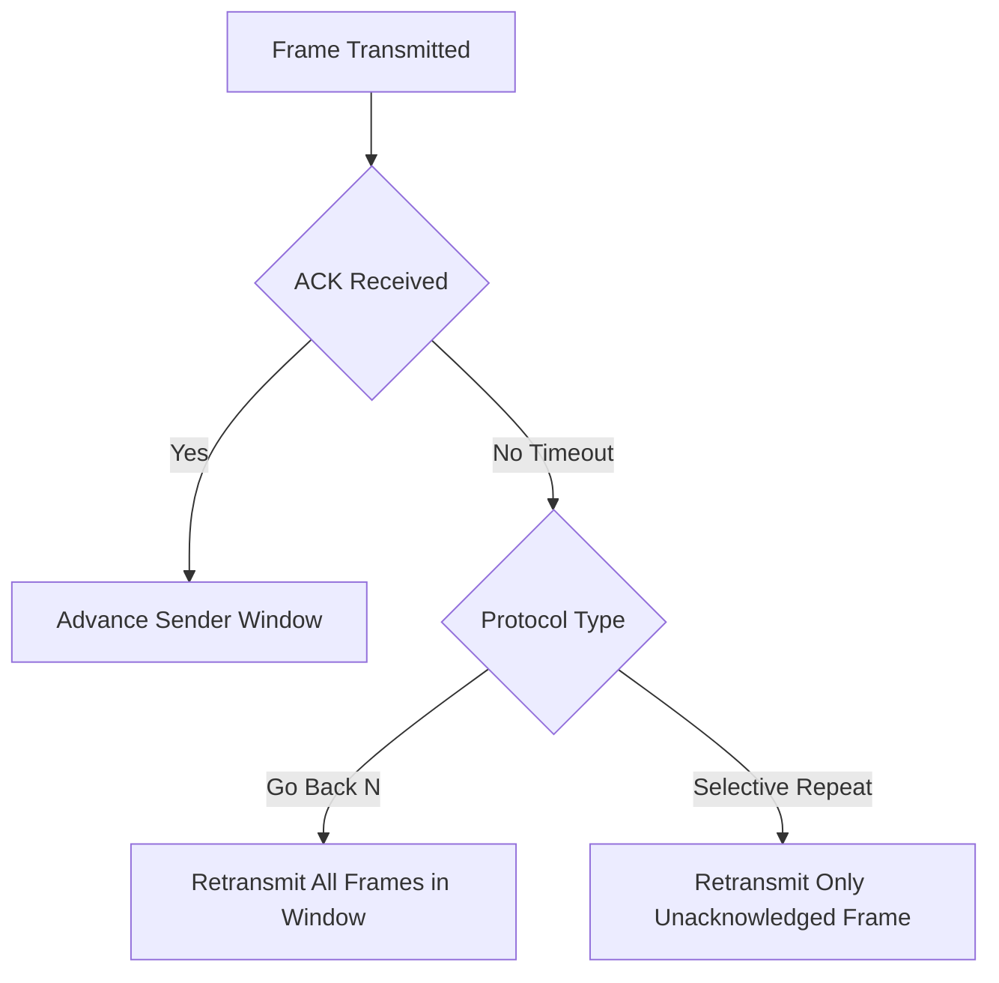

## Introduction

When data frames travel across physical channels—whether copper wire, optical fiber, or radio waves—they encounter noise, attenuation, and interference. These physical phenomena can flip bits or drop entire frames. A network protocol must guarantee that data delivered to higher layers is complete, uncorrupted, and in order.

To achieve reliable communication over unreliable channels, networks use two primary strategies: **Forward Error Correction (FEC)**, which embeds redundant information so the receiver can detect and correct bit errors directly, and **Automatic Repeat reQuest (ARQ)**, which uses feedback acknowledgments and timeouts to retransmit missing or corrupted frames.

This lesson explores how **Hamming codes** enable bit-level error correction, how propagation delays affect channel utilization, and how **sliding-window protocols** (Stop-and-Wait, Go-Back-N, and Selective Repeat) maximize throughput while guaranteeing reliable data delivery.

**Before you start:** You should be comfortable with *Network Fundamentals, Topologies & Performance*, *OSI vs TCP/IP Protocol Stacks*, *Channel Capacity & Transmission Media*, and *Framing, CRC & CSMA/CD Protocol*.

## Core theory

### Forward error correction and Hamming distance

Error control techniques fall into two broad categories: error detection with retransmission (ARQ) and **forward error correction (FEC)**. In FEC, the sender appends redundant parity bits to the original data bits, forming a **codeword**. The receiver uses these extra bits to detect and correct errors without requesting retransmission. FEC is essential in high-latency environments (such as satellite communication) or simplex (one-way) links where retransmission is impossible or too slow.

The error-detecting and error-correcting capabilities of a block code depend on its **Hamming distance**. The Hamming distance between two binary codewords of equal length is the number of bit positions in which they differ. For example, the distance between `10110` and `10011` is 2 because bits 3 and 5 differ.

The **minimum Hamming distance** ($d_{\min}$) of a block code is the smallest Hamming distance between any pair of valid codewords in the codebook.

- To **detect** up to $e$ single-bit errors, the code must satisfy:

$$d_{\min} \ge e + 1$$

- To **correct** up to $t$ single-bit errors, the code must satisfy:

$$d_{\min} \ge 2t + 1$$

To correct $t = 1$ error, a code needs $d_{\min} \ge 3$. If two valid codewords differ by at least 3 bits, a 1-bit error moves the transmitted codeword to an invalid pattern that is still closer to the original codeword than to any other valid codeword.

```
Valid Codeword A  <--- distance 1 --->  Received Word  <--- distance 2 --->  Valid Codeword B
```

To construct a code that corrects single-bit errors in $m$ data bits using $r$ parity bits, the total codeword length is $n = m + r$. The $r$ parity bits must be able to indicate $n$ possible single-bit error locations plus the "no error" condition. This yields the **Hamming rule**:

$$2^r \ge m + r + 1$$

| Data bits ($m$) | Redundancy bits ($r$) | Total length ($n$) | Code designation |
| :--- | :--- | :--- | :--- |
| 1 | 2 | 3 | Hamming(3,1) |
| 4 | 3 | 7 | Hamming(7,4) |
| 11 | 4 | 15 | Hamming(15,11) |
| 26 | 5 | 31 | Hamming(31,26) |

### Hamming(7,4) structure and syndrome decoding

Richard Hamming introduced an elegant arrangement for error-correcting codes. In a **Hamming(7,4)** code, $m = 4$ data bits are encoded with $r = 3$ parity bits into an $n = 7$ bit codeword.

Bit positions in the codeword are 1-indexed from 1 to 7. Parity bits are placed at bit positions that are powers of 2 ($1, 2, 4$), while data bits occupy the remaining positions ($3, 5, 6, 7$).

$$\begin{array}{|c|c|c|c|c|c|c|}
\hline
\text{Bit 1} & \text{Bit 2} & \text{Bit 3} & \text{Bit 4} & \text{Bit 5} & \text{Bit 6} & \text{Bit 7} \\
\hline
P_1 & P_2 & D_3 & P_4 & D_5 & D_6 & D_7 \\
\hline
\end{array}$$

Each parity bit calculates even parity over a specific subset of bit positions. A bit position $k$ is covered by parity bit $P_{2^i}$ if the binary representation of $k$ has a 1 in position $i$:

- **$P_1$ (position $1 = 001_2$):** checks positions with binary format $xx1_2 \implies$ positions $\{1, 3, 5, 7\}$.
- **$P_2$ (position $2 = 010_2$):** checks positions with binary format $x1x_2 \implies$ positions $\{2, 3, 6, 7\}$.
- **$P_4$ (position $4 = 100_2$):** checks positions with binary format $1xx_2 \implies$ positions $\{4, 5, 6, 7\}$.

Using XOR ($\oplus$) for even parity, the sender calculates:

$$P_1 = D_3 \oplus D_5 \oplus D_7$$

$$P_2 = D_3 \oplus D_6 \oplus D_7$$

$$P_4 = D_5 \oplus D_6 \oplus D_7$$

When the receiver receives the 7-bit vector $(b_1, b_2, b_3, b_4, b_5, b_6, b_7)$, it calculates three **syndrome** bits $S = (S_4 S_2 S_1)_2$:

$$S_1 = b_1 \oplus b_3 \oplus b_5 \oplus b_7$$

$$S_2 = b_2 \oplus b_3 \oplus b_6 \oplus b_7$$

$$S_4 = b_4 \oplus b_5 \oplus b_6 \oplus b_7$$

If $S = 000_2$, no single-bit error occurred. If $S \ne 000_2$, the integer value of $S$ equals the exact 1-indexed position of the corrupted bit. Flipping that bit recovers the original codeword.

### Stop-and-Wait ARQ and link utilization

While FEC fixes corrupted bits inline, ARQ protocols handle lost or damaged frames by requesting retransmissions. The simplest ARQ protocol is **Stop-and-Wait ARQ**.

In Stop-and-Wait ARQ:
1. The sender transmits a single frame and starts a control timer.
2. The sender stops and waits for an acknowledgment frame (**ACK**) from the receiver.
3. If the ACK arrives before the timer expires, the sender advances to the next frame.
4. If the timer expires (due to frame loss or ACK loss), the sender retransmits the frame.

To distinguish between a new frame and a duplicate retransmission, frames and ACKs carry alternating sequence numbers ($0$ and $1$). A 1-bit sequence number space is sufficient for Stop-and-Wait.

```
Sender                      Receiver
  |                            |
  |-------- Frame 0 ---------->|
  |                            | (Processes Frame 0)
  |<------- ACK 1 -------------|
  |                            |
  |-------- Frame 1 ---------->|
  |     X (Frame Lost)         |
  | (Timeout)                  |
  |-------- Frame 1 ---------->|
  |                            |
```

To evaluate protocol performance, define:
- $L$: Frame length in bits.
- $R$: Link transmission rate in bits per second (bps).
- $T_{\text{trans}} = \frac{L}{R}$: **Transmission delay** (time to inject all frame bits into the medium).
- $T_{\text{prop}}$: **Propagation delay** (time for one bit to travel from sender to receiver).
- $a = \frac{T_{\text{prop}}}{T_{\text{trans}}}$: Ratio of propagation delay to transmission delay.

Assuming acknowledgment processing and transmission time are negligible, the total time to transmit one frame and receive its ACK (the Round-Trip Time plus transmission time) is:

$$T_{\text{cycle}} = T_{\text{trans}} + 2 T_{\text{prop}}$$

**Channel utilization** ($\eta$) is the fraction of time the link is actively transmitting user data:

$$\eta = \frac{T_{\text{trans}}}{T_{\text{cycle}}} = \frac{T_{\text{trans}}}{T_{\text{trans}} + 2 T_{\text{prop}}} = \frac{1}{1 + 2a}$$

When $a$ is large (such as in high-speed optical lines or long-distance satellite links), Stop-and-Wait utilization approaches zero because the channel remains idle while waiting for ACKs.

### Pipelining and Go-Back-N ARQ

To overcome the inefficiency of Stop-and-Wait, protocols use **pipelining**: allowing the sender to transmit multiple frames before receiving an ACK. This requires a **sliding-window protocol**.

In **Go-Back-N (GBN) ARQ**, the sender can transmit up to $W_T$ frames without waiting for an ACK. $W_T$ is the **sender window size**. The receiver has a window size of $W_R = 1$.

```
Sender Window (WT = 4):
[ ACKed ] [ 0  1  2  3 ] [ 4  5  6 ... ]
           ^          ^
           base       next_seq_num
```

Key mechanics of Go-Back-N:
- **Cumulative Acknowledgment:** An $\text{ACK}(n)$ acknowledges all frames up to and including $n$. It informs the sender that the receiver has correctly received every frame through $n$.
- **Receiver Behavior:** The receiver accepts frames **only in strict order**. If frame $k$ is expected, but frame $k+1$ arrives (because frame $k$ was lost), the receiver discards frame $k+1$ and re-sends $\text{ACK}(k-1)$.
- **Sender Timeout:** The sender maintains a single timer for the oldest unacknowledged frame. If a timeout occurs, the sender retransmits **all** unacknowledged frames currently in its window (it "goes back $N$" frames).

For an $m$-bit sequence number field, the sequence numbers range from $0$ to $2^m - 1$. To prevent ambiguity at the receiver when all ACKs in a window are lost, the maximum sender window size must satisfy:

$$W_T \le 2^m - 1$$

If $W_T = 2^m$, sequence numbers wrap around completely. If the sender transmits frames $0$ through $2^m - 1$ and all ACKs are lost, the sender will time out and retransmit frame $0$. But the receiver, having accepted all $2^m$ frames, is now expecting the *new* frame $0$. It cannot determine whether the incoming frame $0$ is a retransmission or new data.

Assuming an error-free link, the utilization of a pipelined window $W_T$ is:

$$\eta = \min\left(1, \frac{W_T}{1 + 2a}\right)$$

### Selective Repeat ARQ and receiver buffering

Go-Back-N wastes bandwidth by retransmitting correctly received frames that arrived out of order after a lost frame. **Selective Repeat (SR) ARQ** solves this by maintaining a receiver window $W_R > 1$.

Key mechanics of Selective Repeat:
- **Individual/Selective Acknowledgment:** The receiver acknowledges frames individually using positive ACKs (or Selective ACKs / SACKs).
- **Receiver Buffering:** Out-of-order frames within the receiver's window are stored in a buffer rather than discarded.
- **Selective Retransmission:** The sender maintains an independent timer for *each* unacknowledged frame. When a specific timer expires, the sender retransmits **only that single lost frame**.
- **Window Slide:** The sender slides its window forward only when the oldest frame in the window is acknowledged. The receiver slides its window forward only when the contiguous sequence of frames starting from the window base is complete.

To prevent sequence number overlap between the current window and the previous window in Selective Repeat, the sum of sender and receiver window sizes cannot exceed the sequence number space:

$$W_T + W_R \le 2^m$$

If sender and receiver windows are chosen to be equal ($W_T = W_R$), the maximum allowed window size for $m$-bit sequence numbers is:

$$W_T \le 2^{m-1}$$



### Comparison of ARQ protocols

| Parameter | Stop-and-Wait | Go-Back-N | Selective Repeat |
| :--- | :--- | :--- | :--- |
| **Sender Window ($W_T$)** | $1$ | $\le 2^m - 1$ | $\le 2^{m-1}$ |
| **Receiver Window ($W_R$)** | $1$ | $1$ | $\le 2^{m-1}$ (typically $= W_T$) |
| **ACK Type** | Individual | Cumulative | Individual / Selective |
| **Receiver Buffering** | None | None | Out-of-order buffer required |
| **Retransmission** | Single frame | Entire window from loss | Single lost frame |
| **Complexity** | Lowest | Moderate | Highest |

## Worked examples

### Example 1: Hamming(7,4) encoding and single-bit error correction

Given 4 data bits $D = (1, 0, 1, 1)$, perform Hamming(7,4) encoding using even parity. Then, simulate a single-bit corruption at position 5 and show how syndrome decoding corrects the error.

**Step 1: Assign data bits to codeword positions.**
The data bits are $D_3 = 1$, $D_5 = 0$, $D_6 = 1$, $D_7 = 1$. Parity bits $P_1, P_2, P_4$ occupy positions 1, 2, and 4.

**Step 2: Calculate parity bits.**
- $P_1 = D_3 \oplus D_5 \oplus D_7 = 1 \oplus 0 \oplus 1 = 0$
- $P_2 = D_3 \oplus D_6 \oplus D_7 = 1 \oplus 1 \oplus 1 = 1$
- $P_4 = D_5 \oplus D_6 \oplus D_7 = 0 \oplus 1 \oplus 1 = 0$

The complete transmitted codeword is $(P_1, P_2, D_3, P_4, D_5, D_6, D_7) = (0, 1, 1, 0, 0, 1, 1)$.

**Step 3: Introduce an error.**
Suppose noise flips bit 5 ($D_5$) from 0 to 1. The received vector is:

$$b = (0, 1, 1, 0, 1, 1, 1)$$

**Step 4: Calculate syndrome bits.**
- $S_1 = b_1 \oplus b_3 \oplus b_5 \oplus b_7 = 0 \oplus 1 \oplus 1 \oplus 1 = 1$
- $S_2 = b_2 \oplus b_3 \oplus b_6 \oplus b_7 = 1 \oplus 1 \oplus 1 \oplus 1 = 0$
- $S_4 = b_4 \oplus b_5 \oplus b_6 \oplus b_7 = 0 \oplus 1 \oplus 1 \oplus 1 = 1$

**Step 5: Locate and correct the error.**
The syndrome vector is $S = (S_4 S_2 S_1)_2 = (101)_2 = 5$.
Because $S = 5$, the error is located at bit position 5.

Flipping bit 5 ($b_5 = 1 \implies 0$) yields the corrected vector $(0, 1, 1, 0, 0, 1, 1)$. Extracting positions 3, 5, 6, and 7 gives the original data: `1011`.

### Example 2: Analyzing sliding-window utilization

A satellite link operates at $10\text{ Mbps}$ with a one-way propagation delay of $20\text{ ms}$. Data frames are $1,000\text{ bytes}$ ($8,000\text{ bits}$) long.

Write a Python script to compute:
1. Transmission delay $T_{\text{trans}}$ and normalized delay parameter $a$.
2. Link utilization for Stop-and-Wait ARQ.
3. Link utilization for Go-Back-N with 3-bit, 4-bit, and 6-bit sequence numbers.

```python
def calculate_utilization(frame_bits, data_rate_bps, prop_delay_sec, window_size):
    trans_delay = frame_bits / data_rate_bps
    a = prop_delay_sec / trans_delay
    u_ideal = min(1.0, window_size / (1 + 2 * a))
    return trans_delay, a, u_ideal

frame_bits = 8000
data_rate = 10_000_000  # 10 Mbps
prop_delay = 0.020      # 20 ms

t_trans, a, u_saw = calculate_utilization(frame_bits, data_rate, prop_delay, 1)

# Sequence space sizes (m bits -> max sender window = 2^m - 1)
w_3bit = 2**3 - 1  # 7
w_4bit = 2**4 - 1  # 15
w_6bit = 2**6 - 1  # 63

_, _, u_gbn7 = calculate_utilization(frame_bits, data_rate, prop_delay, w_3bit)
_, _, u_gbn15 = calculate_utilization(frame_bits, data_rate, prop_delay, w_4bit)
_, _, u_gbn63 = calculate_utilization(frame_bits, data_rate, prop_delay, w_6bit)

print(f"Transmission delay: {t_trans * 1000:.1f} ms")
print(f"Parameter a: {a:.1f}")
print(f"Stop-and-Wait utilization: {u_saw * 100:.2f}%")
print(f"Go-Back-N (W=7) utilization: {u_gbn7 * 100:.2f}%")
print(f"Go-Back-N (W=15) utilization: {u_gbn15 * 100:.2f}%")
print(f"Go-Back-N (W=63) utilization: {u_gbn63 * 100:.2f}%")
```

Output:

```text
Transmission delay: 0.8 ms
Parameter a: 25.0
Stop-and-Wait utilization: 1.96%
Go-Back-N (W=7) utilization: 13.73%
Go-Back-N (W=15) utilization: 29.41%
Go-Back-N (W=63) utilization: 100.00%
```

**Step-by-step mathematical verification:**
1. Transmission delay: $T_{\text{trans}} = \frac{8000\text{ bits}}{10^7\text{ bps}} = 0.0008\text{ s} = 0.8\text{ ms}$.
2. Parameter $a$: $a = \frac{20\text{ ms}}{0.8\text{ ms}} = 25.0$.
3. Stop-and-Wait utilization: $\eta = \frac{1}{1 + 2(25)} = \frac{1}{51} \approx 0.019608 \implies 1.96\%$.
4. For $m=3$, $W_T = 7$: $\eta = \frac{7}{51} \approx 0.137255 \implies 13.73\%$.
5. For $m=4$, $W_T = 15$: $\eta = \frac{15}{51} \approx 0.294118 \implies 29.41\%$.
6. For $m=6$, $W_T = 63$: $\frac{63}{51} > 1 \implies \eta = 100.00\%$ (the channel is fully saturated).

## Applications

- **Satellite and Deep-Space Communications:** Deep-space probes use low-rate Forward Error Correction (such as Low-Density Parity-Check or Turbo codes) because round-trip delays span minutes to hours, making ARQ retransmissions impractical.
- **Wireless Networks (Wi-Fi and Cellular):** IEEE 802.11 and 5G NR combine physical-layer FEC with Link-Layer Automatic Repeat reQuest (Hybrid ARQ / HARQ) to handle bursty radio channel noise without burdening higher protocol layers.
- **Data Link Control Protocols:** Standards like High-Level Data Link Control (HDLC) and Point-to-Point Protocol (PPP) implement sliding-window ARQ mechanics for reliable link-level framing.
- **Transport Layer (TCP):** Transmission Control Protocol incorporates sliding-window flow control, cumulative ACKs, and Selective Acknowledgment (SACK) directly inspired by data-link ARQ algorithms.

## Common mistakes

- **Confusing bit indexing when placing Hamming parity bits.** Assuming parity bits go at the end of the data vector. Parity bits must be placed at bit positions that are powers of two ($1, 2, 4, 8, \dots$), with data bits occupying the remaining positions.
- **Setting Go-Back-N sender window size to $2^m$.** Using $W_T = 2^m$ instead of $2^m - 1$ leads to sequence number ambiguity at the receiver when all ACKs in a window are lost.
- **Forgetting that propagation delay is doubled in utilization formulas.** Calculating round-trip time as $T_{\text{trans}} + T_{\text{prop}}$ instead of $T_{\text{trans}} + 2 T_{\text{prop}}$. The ACK must travel back across the link.
- **Assuming Selective Repeat requires no receiver buffer.** Assuming $W_R = 1$ for Selective Repeat. SR requires $W_R > 1$ (typically $W_R = W_T$) to buffer out-of-order frames until missing frames arrive.
- **Assuming Hamming(7,4) corrects two-bit errors.** Believing standard Hamming(7,4) can correct multi-bit corruptions. Standard Hamming(7,4) has $d_{\min} = 3$, meaning it can correct 1-bit errors or detect 2-bit errors, but multiple errors lead to miscorrection if not augmented with an overall parity bit (SEC-DED).

## Revision notes

- Minimum Hamming distance $d_{\min} \ge e + 1$ to detect $e$ errors; $d_{\min} \ge 2t + 1$ to correct $t$ errors.
- Hamming redundancy constraint for $m$ data bits and $r$ parity bits: $2^r \ge m + r + 1$.
- In Hamming(7,4), parity bits $P_1, P_2, P_4$ reside at positions 1, 2, and 4. The syndrome $(S_4 S_2 S_1)_2$ gives the 1-indexed error bit position.
- Normalized delay $a = T_{\text{prop}} / T_{\text{trans}}$. Stop-and-Wait efficiency is $\eta = \frac{1}{1 + 2a}$.
- Stop-and-Wait uses window sizes $W_T = 1, W_R = 1$ and 1-bit sequence numbers ($0$ and $1$).
- Go-Back-N uses cumulative ACKs, $W_R = 1$, and maximum $W_T = 2^m - 1$.
- Selective Repeat uses individual ACKs, receiver buffering ($W_R > 1$), and maximum $W_T = W_R = 2^{m-1}$.
- Pipelining improves link utilization to $\eta = \min\left(1, \frac{W_T}{1 + 2a}\right)$.

## Practice questions

:::question basic
A block code has a minimum Hamming distance $d_{\min} = 5$. How many bit errors can it detect, and how many bit errors can it correct?
:::answer
The code can detect up to $d_{\min} - 1 = 5 - 1 = 4$ bit errors. It can correct up to $\lfloor (d_{\min} - 1)/2 \rfloor = \lfloor (5 - 1)/2 \rfloor = 2$ bit errors. This is because detecting $e$ errors requires $d_{\min} \ge e + 1$, while correcting $t$ errors requires $d_{\min} \ge 2t + 1$.
:::

:::question basic
A channel has a transmission delay $T_{\text{trans}} = 2\text{ ms}$ and a one-way propagation delay $T_{\text{prop}} = 18\text{ ms}$. What is the parameter $a$, and what is the maximum channel utilization for Stop-and-Wait ARQ?
:::answer
The normalized delay parameter is $a = T_{\text{prop}} / T_{\text{trans}} = 18 / 2 = 9$. The Stop-and-Wait channel utilization is $\eta = \frac{1}{1 + 2a} = \frac{1}{1 + 2(9)} = \frac{1}{19} \approx 5.26\%$.
:::

:::question intermediate
In a Go-Back-N protocol with a 4-bit sequence number field ($m = 4$), what is the maximum allowable sender window size $W_T$? Explain what happens if $W_T$ is set to $2^4 = 16$.
:::answer
The maximum sender window size is $W_T = 2^m - 1 = 2^4 - 1 = 15$. If $W_T = 16$, sequence numbers wrap around completely across the window. If the sender transmits frames 0 through 15 and all ACKs are lost in transit, the sender will time out and retransmit frame 0. However, the receiver (having successfully accepted frames 0 through 15) is now expecting frame 0 of the *next* sequence cycle and cannot distinguish whether the incoming frame 0 is a duplicate retransmission or brand-new data.
:::

:::question intermediate
A receiver using Hamming(7,4) receives the bit sequence $(1, 1, 0, 1, 1, 0, 1)$ corresponding to positions 1 through 7. Assuming even parity, compute the syndrome bits $S_1, S_2, S_4$ and identify if an error occurred.
:::answer
Evaluating the syndrome bit formulas:
$S_1 = b_1 \oplus b_3 \oplus b_5 \oplus b_7 = 1 \oplus 0 \oplus 1 \oplus 1 = 1$.
$S_2 = b_2 \oplus b_3 \oplus b_6 \oplus b_7 = 1 \oplus 0 \oplus 0 \oplus 1 = 0$.
$S_4 = b_4 \oplus b_5 \oplus b_6 \oplus b_7 = 1 \oplus 1 \oplus 0 \oplus 1 = 1$.
The syndrome vector is $S = (S_4 S_2 S_1)_2 = (101)_2 = 5$. Thus, a single-bit error occurred at bit position 5 ($b_5$).
:::

:::question advanced
In a Selective Repeat ARQ protocol using 3-bit sequence numbers ($m = 3$), show why setting $W_T = W_R = 5$ fails by providing a scenario where the receiver incorrectly accepts a duplicate frame.
:::answer
With $m = 3$, valid sequence numbers are 0 to 7. If $W_T = W_R = 5$, suppose the sender transmits frames 0, 1, 2, 3, 4. The receiver correctly receives all 5 frames, buffers them, advances its window to $[5, 6, 7, 0, 1]$, and sends ACKs 0 through 4. If all ACKs are lost, the sender times out and retransmits frame 0. The receiver's current window includes sequence number 0 (as the 4th slot of its new window $[5, 6, 7, 0, 1]$). Consequently, the receiver accepts retransmitted frame 0 as new data for the next sequence cycle instead of ignoring it as a duplicate, causing silent data corruption.
:::

:::question advanced
Derive the throughput efficiency $\eta_{\text{GBN}}$ of Go-Back-N ARQ over a noisy channel where each frame has an independent frame loss probability $P$, assuming ACKs are never lost and the sender window size $W_T$ is large enough to keep the pipe full ($W_T \ge 1 + 2a$).
:::answer
When a frame is lost, the sender must go back and retransmit that frame plus the $W-1$ subsequent frames in the window. The expected number of transmission attempts to successfully deliver 1 frame follows a geometric distribution: on average, $1 / (1 - P)$ attempts are made to get a successful frame start. Once an error occurs, every single attempt wastes $W$ frame times before recovery continues, so the expected number of transmitted frames per successfully delivered frame is $1 + \frac{W \cdot P}{1 - P} = \frac{1 - P + W \cdot P}{1 - P}$. Taking the reciprocal gives the effective throughput efficiency: $\eta_{\text{GBN}} = \frac{1 - P}{1 + (W - 1)P}$. When $P = 0$, efficiency reduces to 1 (or 100%), but as $P$ increases, efficiency drops rapidly due to the window retransmission penalty $W$.
:::

## Further learning

- **Next:** *Ethernet, MAC Addressing & Switching* explains how data-link framing and error detection mechanisms are realized in physical LAN controllers and Ethernet switches.
- **Related:** *TCP 3-Way Handshake & Flow Control* demonstrates how transport-layer protocols adapt sliding-window mechanics for end-to-end flow control across internetworks.
- **Related:** *TCP Congestion Control vs UDP Low Latency* explores how window sizes are dynamically modified based on network congestion rather than static receiver bounds.
- Textbook reference: Kurose and Ross, *Computer Networking: A Top-Down Approach*.
