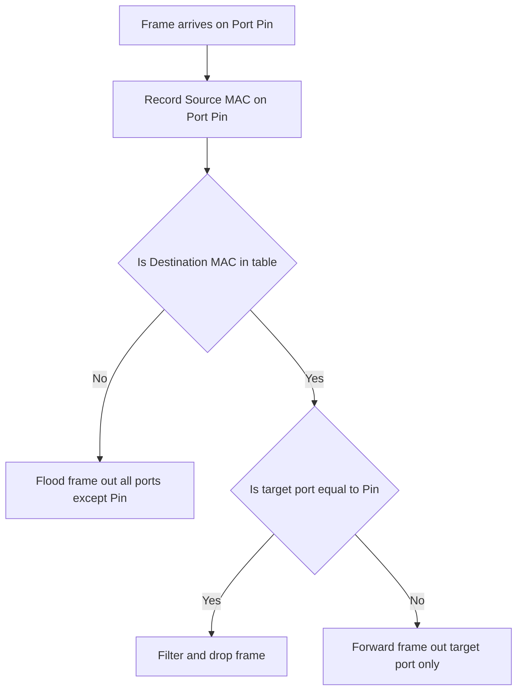

## Introduction

In a modern local area network (LAN), dozens or hundreds of devices transmit data simultaneously across shared network hardware. If every computer broadcasted every packet to every other computer on the physical cable, data transfers would collapse under constant interference, privacy would be compromised, and available bandwidth would plummet. 

Ethernet solves this problem at the Data Link Layer (OSI Layer 2). Rather than relying on network-layer logical IP addresses to deliver frames across physical wires, local hardware relies on 48-bit **Media Access Control (MAC) addresses** burned into network cards. **Learning switches** observe this traffic as it passes, dynamically mapping which device resides on which physical port. By keeping track of these mappings, switches build private, dedicated communication channels between hosts without requiring manual configuration.

This lesson explores how Ethernet frames are structured, how switches auto-discover network topology, how full-duplex links eliminate collisions, and how Virtual LANs (VLANs) logically partition large networks to preserve performance and security.

**Before you start:** You should understand OSI Layer 2 framing concepts, CRC error detection, CSMA/CD channel access rules, and basic hexadecimal notation.

## Core theory

### Ethernet frame architecture and IEEE 802.3 standard

Ethernet frames wrap network-layer packets (such as IPv4 or IPv6 datagrams) with address headers and error-checking trailers. The dominant frame format in modern networking is **Ethernet II** (also called DIX Ethernet), which aligns closely with the **IEEE 802.3** standard.

| Field | Size (Bytes) | Description |
| :--- | :--- | :--- |
| **Preamble** | 7 | Alternating 1s and 0s (`0x55` repeated) for physical clock synchronization. |
| **Start Frame Delimiter (SFD)** | 1 | The byte `10101011` (`0xD5`), indicating the start of the frame header. |
| **Destination MAC Address** | 6 | 48-bit hardware address of the intended recipient NIC. |
| **Source MAC Address** | 6 | 48-bit hardware address of the transmitting NIC. |
| **EtherType / Length** | 2 | Identifies encapsulated network protocol ($\ge 0x0600$) or payload length ($\le 1500$). |
| **Payload (Data)** | 46 to 1500 | Upper-layer packet (e.g., IP datagram). Padded with zeros if $< 46$ bytes. |
| **Frame Check Sequence (FCS)** | 4 | 32-bit Cyclic Redundancy Check (CRC-32) over MAC destination, source, type, and payload. |

The total length of an Ethernet frame on the wire involves two distinct measurements:

1. **MAC Frame Length (Header to FCS):** The standard specifies a minimum frame length of $64\text{ bytes}$ and a standard maximum frame length of $1518\text{ bytes}$ (excluding Preamble and SFD).
   $$\text{Frame}_{\text{min}} = 6 + 6 + 2 + 46 + 4 = 64\text{ bytes}$$
   $$\text{Frame}_{\text{max}} = 6 + 6 + 2 + 1500 + 4 = 1518\text{ bytes}$$

2. **Interpacket Gap (IPG):** Physical Ethernet requires a silence period of $96\text{ bit times}$ between consecutive frames to allow physical receivers to reset their timing recovery circuits. At 100 Mbps, $96\text{ bits} / 100\text{ Mbps} = 0.96\ \mu\text{s}$.

```
+-------------------+--------------------+------------------+----------------+--------------+---------+
| Preamble (7B)     | Dest MAC (6B)      | Source MAC (6B)  | EtherType (2B) | Payload      | FCS (4B)|
| SFD (1B)          |                    |                  |                | (46-1500B)   |         |
+-------------------+--------------------+------------------+----------------+--------------+---------+
|<-- Synchronization |<------------------------- Standard MAC Frame (64 - 1518 Bytes) ------------------>|
```

The minimum payload size of 46 bytes ensures that the entire frame is at least 64 bytes long. This minimum size was historically necessary for CSMA/CD collision detection: on shared coax cables, a frame had to take longer to transmit than the round-trip propagation time across the maximum allowable cable length ($512\text{ bit times} = 64\text{ bytes}$). If an upper-layer packet is smaller than 46 bytes (such as a 40-byte TCP ACK packet without IP options), the host appends **padding bytes** to reach 46 payload bytes.

### MAC addresses and frame addressing modes

A **MAC address** is a 48-bit (6-byte) globally unique binary identifier assigned to a **Network Interface Card (NIC)**. MAC addresses are written as six pairs of hexadecimal digits separated by colons or hyphens (for example, `00:1A:2B:3C:4D:5E`).

The address space is divided into two 24-bit halves:
- **Organizationally Unique Identifier (OUI):** The first 3 bytes are assigned to hardware vendors by the IEEE Registration Authority.
- **Network Interface Controller Specific:** The last 3 bytes are assigned by the manufacturer as a unique serial number.

```
 00 : 1A : 2B : 3C : 4D : 5E
|------------||------------|
  Vendor OUI    NIC Serial
```

Two control bits in the first byte determine the address classification:
1. **Unicast vs. Multicast Bit (LSB of Byte 0):**
   - If least significant bit of the first byte is `0`, the address represents a **unicast** destination (intended for one specific NIC).
   - If least significant bit of the first byte is `1`, the address represents a **multicast** destination (intended for a group of subscribed endpoints, e.g., `01:00:5E:00:00:01`).
2. **Universal vs. Local Bit (2nd LSB of Byte 0):**
   - If set to `0`, the address is a **Universally Administered Address (UAA)** assigned by the manufacturer.
   - If set to `1`, the address is a **Locally Administered Address (LAA)** overridden by a network administrator.

The **Broadcast address** consists of all 48 bits set to 1 (`FF:FF:FF:FF:FF:FF`). Every active host interface on the local network segment must accept and process frames addressed to the broadcast MAC.

### Transparent switching and the MAC learning algorithm

A Layer 2 switch is a **transparent bridge**; host systems transmit frames unaware of whether they are connected directly to the destination or separated by multiple switches. A switch maintains a dynamic lookup structure called a **MAC address table** (or **filtering database** / **CAM table**) mapping MAC addresses to physical switch ports along with an aging timestamp.

When an Ethernet frame arrives on port $P_{in}$ with Source MAC address $MAC_{S}$ and Destination MAC address $MAC_{D}$, the switch executes a deterministic processing flow:



#### Step 1: Learning
The switch inspects $MAC_{S}$ and $P_{in}$. It creates or updates an entry in its MAC address table setting $MAC_{S} \mapsto P_{in}$ and resets the **aging timer** for that entry. If $MAC_{S}$ was previously mapped to a different port, the switch updates the table immediately (handling host mobility).

#### Step 2: Forwarding and Filtering Logic
The switch inspects $MAC_{D}$:
- **Broadcast / Multicast:** If $MAC_{D}$ is `FF:FF:FF:FF:FF:FF` or a multicast MAC, the switch **floods** the frame out all active ports *except* $P_{in}$.
- **Unknown Unicast:** If $MAC_{D}$ is a unicast address not present in the MAC address table, the switch **floods** the frame out all active ports *except* $P_{in}$.
- **Known Unicast:** If $MAC_{D}$ is found in the table associated with port $P_{out}$:
  - If $P_{out} = P_{in}$, the destination resides on the same physical segment behind port $P_{in}$. The switch **filters** (drops) the frame to avoid redundant transmission.
  - If $P_{out} \neq P_{in}$, the switch **forwards** the frame exclusively out port $P_{out}$.

#### Step 3: Aging
Entries in the MAC table automatically expire if no incoming frames with source $MAC_{S}$ arrive within the **aging timer** period (typically 300 seconds). Aging ensures that stale entries for disconnected or relocated devices are purged.

### Collision domains, broadcast domains, and full-duplex operation

Understanding Layer 2 topology requires separating physical signaling constraints from logical frame boundary constraints.

```
Hub (Layer 1):     [ Host A ] --- ( Shared Collision Domain ) --- [ Host B ]
Switch (Layer 2):  [ Host A ] <--- Dedicated Full-Duplex Link ---> [ Switch Port ]
```

- **Collision Domain:** A physical network segment where two simultaneous transmissions interfere with each other. A repeater or **hub** (Layer 1) operates on electrical signals; all devices connected to a hub belong to a single shared collision domain running half-duplex CSMA/CD.
- **Broadcast Domain:** A logical network segment containing all hosts that receive a Layer 2 broadcast frame. Switches forward broadcast frames to all connected ports, so an unrouted switched network forms a single broadcast domain. Layer 3 routers are required to separate broadcast domains.

| Property | Layer 1 Hub | Layer 2 Switch |
| :--- | :--- | :--- |
| **Operating Layer** | Physical Layer | Data Link Layer |
| **Primary Logic** | Electrical signal repeat | MAC address table lookup & microsegmentation |
| **Duplex Mode** | Half-duplex (CSMA/CD active) | Full-duplex (CSMA/CD disabled) |
| **Collision Domain** | 1 shared domain across all ports | 1 isolated domain per physical port |
| **Broadcast Domain** | 1 domain | 1 domain (unless partitioned by VLANs) |

In modern **full-duplex Ethernet**, host interfaces use separate physical conductor pairs (or optical channels) for transmitting and receiving. Because collision risk drops to zero on a point-to-point full-duplex switch link, the CSMA/CD algorithm is entirely disabled, allowing simultaneous 100% bidirectional throughput.

### Virtual LANs (VLANs) and IEEE 802.1Q tagging

As switched networks scale, a single broadcast domain can become congested with broadcast traffic (such as Address Resolution Protocol requests). A **Virtual Local Area Network (VLAN)** partitions a single physical switch cluster into multiple isolated logical broadcast domains.

#### Access vs. Trunk Ports
- **Access Port:** Connects to an end-user host (PC, printer). It belongs to exactly one assigned VLAN. Frames arriving at or leaving an access port are standard, **untagged** Ethernet frames.
- **Trunk Port:** Connects switch-to-switch or switch-to-router. It multiplexes traffic for multiple VLANs over a single link by inserting an identifying VLAN header tag into each frame.

#### IEEE 802.1Q Tag Format
The IEEE 802.1Q standard defines a **4-byte VLAN tag** inserted into the Ethernet header immediately after the Source MAC address and prior to the EtherType field.

```
Standard Frame: | Dest MAC (6B) | Source MAC (6B) | EtherType (2B) | Payload ...
Tagged Frame:   | Dest MAC (6B) | Source MAC (6B) | 802.1Q Tag (4B) | EtherType (2B) | Payload ...
                                                   |
                                     +-------------+-------------+
                                     | TPID (2B)   | TCI (2B)    |
                                     +-------------+-------------+
```

The 4-byte header consists of two sub-fields:
1. **Tag Protocol Identifier (TPID):** 2 bytes fixed to hexadecimal `0x8100`. This value signals to downstream network cards that an 802.1Q header follows.
2. **Tag Control Information (TCI):** 2 bytes containing three fields:
   - **Priority Code Point (PCP):** 3 bits used for Class of Service (CoS) frame prioritization (IEEE 802.1p), supporting 8 priority queues ($0\dots7$).
   - **Drop Eligible Indicator (DEI):** 1 bit indicating whether the frame can be dropped during network congestion.
   - **VLAN Identifier (VID):** 12 bits identifying the specific VLAN ($2^{12} = 4096$ theoretical VLAN IDs). IDs `0` and `4095` are reserved; usable VLAN IDs range from `1` to `4094`.

Because inserting an 802.1Q tag adds 4 bytes to the header, the maximum legal Ethernet frame size on a trunk port increases from $1518\text{ bytes}$ to $1522\text{ bytes}$. Network interfaces must support this larger Maximum Transmission Unit (MTU) to prevent frame truncation errors.

## Worked examples

### Example 1: Switch MAC table state trace

A 4-port learning switch initially has an empty MAC address table. The following sequence of four frames arrives at the switch. Trace the state of the switch MAC table after each step, and determine the exact forwarding action taken for each frame.

1. **Frame 1:** Source `00:AA`, Destination `00:BB`, Ingress Port: `1`
2. **Frame 2:** Source `00:BB`, Destination `00:AA`, Ingress Port: `2`
3. **Frame 3:** Source `00:CC`, Destination `00:AA`, Ingress Port: `3`
4. **Frame 4:** Source `00:AA`, Destination `00:BB`, Ingress Port: `1`

#### Step-by-Step Solution

**Frame 1 (Src: `00:AA`, Dst: `00:BB`, Port: 1):**
- **Learn:** Map `00:AA` $\to$ Port `1`.
- **Lookup:** Search `00:BB` in MAC table. Not found.
- **Action:** **Flood** the frame out ports `2`, `3`, and `4`.
- **MAC Table State:** `{"00:AA": Port 1}`

**Frame 2 (Src: `00:BB`, Dst: `00:AA`, Port: 2):**
- **Learn:** Map `00:BB` $\to$ Port `2`.
- **Lookup:** Search `00:AA` in MAC table. Found on Port `1`.
- **Action:** **Forward** the frame out Port `1` only.
- **MAC Table State:** `{"00:AA": Port 1, "00:BB": Port 2}`

**Frame 3 (Src: `00:CC`, Dst: `00:AA`, Port: 3):**
- **Learn:** Map `00:CC` $\to$ Port `3`.
- **Lookup:** Search `00:AA` in MAC table. Found on Port `1`.
- **Action:** **Forward** the frame out Port `1` only.
- **MAC Table State:** `{"00:AA": Port 1, "00:BB": Port 2, "00:CC": Port 3}`

**Frame 4 (Src: `00:AA`, Dst: `00:BB`, Port: 1):**
- **Learn:** Refresh timer for `00:AA` $\to$ Port `1`.
- **Lookup:** Search `00:BB` in MAC table. Found on Port `2`.
- **Action:** **Forward** the frame out Port `2` only.
- **MAC Table State:** `{"00:AA": Port 1, "00:BB": Port 2, "00:CC": Port 3}`

We can execute this logic programmatically using Python to verify the forwarding actions:

```python
class LearningSwitch:
    def __init__(self, ports):
        self.ports = ports
        self.mac_table = {}

    def process_frame(self, src_mac, dst_mac, in_port):
        # Step 1: Learn/Update Source MAC
        self.mac_table[src_mac] = in_port

        # Step 2: Forwarding Decision
        if dst_mac in self.mac_table:
            out_port = self.mac_table[dst_mac]
            if out_port == in_port:
                return f"FILTER (drop on Port {in_port})"
            else:
                return f"FORWARD out Port {out_port}"
        else:
            other_ports = [p for p in self.ports if p != in_port]
            return f"FLOOD out Ports {other_ports}"

switch = LearningSwitch(ports=[1, 2, 3, 4])
sequence = [
    ("00:AA", "00:BB", 1),
    ("00:BB", "00:AA", 2),
    ("00:CC", "00:AA", 3),
    ("00:AA", "00:BB", 1)
]

for idx, (src, dst, port) in enumerate(sequence, 1):
    action = switch.process_frame(src, dst, port)
    print(f"Frame {idx}: Src={src} Dst={dst} Port={port} -> Action: {action}")
```

Output:

```text
Frame 1: Src=00:AA Dst=00:BB Port=1 -> Action: FLOOD out Ports [2, 3, 4]
Frame 2: Src=00:BB Dst=00:AA Port=2 -> Action: FORWARD out Port 1
Frame 3: Src=00:CC Dst=00:AA Port=3 -> Action: FORWARD out Port 1
Frame 4: Src=00:AA Dst=00:BB Port=1 -> Action: FORWARD out Port 2
```

---

### Example 2: Frame transmission delay and link efficiency calculation

A application generates a stream of 20-byte payload packets. These packets are encapsulated in standard Ethernet II frames and transmitted over a 100 Mbps Fast Ethernet link.

1. Determine the total frame size transmitted on the wire (in bytes).
2. Calculate the link efficiency $\eta$, defined as the percentage of useful payload data transmitted relative to total wire occupancy.
3. Compute the time required to transmit one frame, including the Interpacket Gap (IPG).

#### Step-by-Step Solution

**1. Total Frame Size on Wire:**
- Upper-layer payload: $20\text{ bytes}$.
- Minimum Ethernet payload requirement: $46\text{ bytes}$.
- Padding required: $46 - 20 = 26\text{ bytes}$.
- MAC Frame Header + Trailer: Destination MAC (6B) + Source MAC (6B) + EtherType (2B) + FCS (4B) = $18\text{ bytes}$.
- Physical layer overhead: Preamble (7B) + SFD (1B) = $8\text{ bytes}$.

Total Frame Bytes on Wire:
$$\text{Frame}_{\text{wire}} = 8_{\text{phy}} + 18_{\text{header}} + 20_{\text{payload}} + 26_{\text{padding}} = 72\text{ bytes}$$

Including the required Interpacket Gap ($12\text{ byte times}$):
$$\text{Total Occupancy} = 72 + 12 = 84\text{ bytes} = 672\text{ bits}$$

**2. Link Efficiency ($\eta$):**
Useful data is strictly the 20-byte payload.

$$\eta = \frac{\text{Payload Bytes}}{\text{Total Wire Occupancy Bytes}} \times 100\% = \frac{20\text{ bytes}}{84\text{ bytes}} \times 100\% \approx 23.81\%$$

*(Note: If the payload were 1500 bytes, total wire occupancy would be $8 + 18 + 1500 + 4_{\text{FCS-included}} + 12 = 1538\text{ bytes}$, yielding an efficiency of $1500 / 1538 \approx 97.53\%$).*

**3. Total Frame Transmission Time ($T_{\text{trans}}$):**
At $R = 100\text{ Mbps} = 10^8\text{ bits/sec}$:

$$T_{\text{trans}} = \frac{672\text{ bits}}{10^8\text{ bits/sec}} = 6.72 \times 10^{-6}\text{ seconds} = 6.72\ \mu\text{s}$$

## Applications

- **Enterprise Network Segmentation:** Switches use 802.1Q VLANs to isolate sensitive departments (e.g., Finance vs. Guest Wi-Fi) on shared physical switches without deploying redundant cabling.
- **Hardware Content Addressable Memory (CAM):** High-speed data center switches implement the MAC learning table in specialized hardware called Binary CAM or Ternary CAM (TCAM), performing $O(1)$ MAC address lookups at line rate (gigabits per second).
- **Port Security and MAC Filtering:** Network administrators configure switch ports to accept traffic only from statically registered MAC addresses, automatically disabling ports if an unauthorized hardware device connects.
- **Data Center VLAN Trunking and VXLAN:** VLAN tagging forms the baseline for layer 2 domain isolation in modern cloud networks, where trunks connect physical servers running hypervisors to top-of-rack (ToR) switches.

## Common mistakes

- **Confusing collision domains with broadcast domains.** Switches split collision domains on a per-port basis, but standard Layer 2 switches keep all ports in a single broadcast domain unless VLANs are configured.
- **Counting the Preamble and SFD in the 64-byte minimum frame size.** The $64\text{-byte}$ minimum frame size calculation begins at the Destination MAC address and ends at the Frame Check Sequence (FCS). Preamble (7B) and SFD (1B) precede the MAC frame and are ignored in standard Layer 2 length checks.
- **Assuming switches process Layer 3 IP headers.** Basic Layer 2 switches make forwarding decisions based strictly on MAC destination addresses. They do not inspect IP addresses or decrements Time-to-Live (TTL) values.
- **Forgetting payload padding for short packets.** Sending an IP packet smaller than 46 bytes does not yield a sub-64-byte frame. The NIC automatically appends zero-padding to reach the mandatory 64-byte minimum.
- **Misunderstanding access vs. trunk port tag handling.** Access ports strip 802.1Q tags before transmitting frames to end hosts; PCs typically drop frames containing unexpected 802.1Q tags unless explicitly configured for VLAN tagging.

## Revision notes

- **IEEE 802.3 Frame Bounds:** Minimum length is 64 bytes; maximum standard length is 1518 bytes (header + payload + FCS).
- **Minimum Payload:** Must be at least 46 bytes. If less, padding is appended.
- **Physical Overhead:** Preamble (7B), SFD (1B), and Interpacket Gap (96 bit times / 12B equivalent) are added at Layer 1.
- **MAC Address Structure:** 48 bits total; 24-bit OUI + 24-bit NIC serial. Unicast bit is LSB of Byte 0; Broadcast MAC is `FF:FF:FF:FF:FF:FF`.
- **MAC Learning Algorithm:** Learn Source MAC $\to$ Port mapping on ingress; forward, filter, or flood based on Destination MAC.
- **Aging Timer:** Purges idle MAC table entries after a timeout period (default 300 seconds).
- **Duplexing:** Switched Ethernet runs in full-duplex mode, eliminating physical collisions and disabling CSMA/CD.
- **IEEE 802.1Q Tag:** 4-byte header containing 12-bit VLAN Identifier (VID), supporting VLAN IDs 1 through 4094. Increases maximum frame size to 1522 bytes.

## Practice questions

:::question basic
A device transmits an IP datagram containing 30 bytes of data over Ethernet. How many bytes of padding will the transmitting NIC add, and what is the final size of the Ethernet frame (excluding preamble and SFD)?
:::answer
The minimum payload requirement for an Ethernet frame is 46 bytes. Because the IP datagram is 30 bytes, the NIC appends $46 - 30 = 16\text{ bytes}$ of padding. Adding the 18 bytes of header and trailer (6B Destination MAC + 6B Source MAC + 2B EtherType + 4B FCS) to the 46-byte padded payload gives a final MAC frame size of $18 + 46 = 64\text{ bytes}$.
:::

:::question basic
Given the MAC address `01:80:C2:00:00:00`, is this address a Unicast or Multicast address? Is it a Universally Administered Address (UAA) or a Locally Administered Address (LAA)?
:::answer
Convert the first byte `01` to 8-bit binary: `00000001`. The least significant bit (LSB) of the first byte is `1`, which identifies the address as a **Multicast** address. The second least significant bit is `0`, which indicates that this is a **Universally Administered Address (UAA)** assigned by the IEEE.
:::

:::question intermediate
A switch receives a unicast frame on Port 3 with Source MAC `00:11:22:33:44:55` and Destination MAC `66:77:88:99:AA:BB`. The switch MAC table currently contains an entry for `66:77:88:99:AA:BB` mapped to Port 3. What action does the switch take, and why?
:::answer
The switch will **filter (drop)** the frame. First, the switch learns/updates `00:11:22:33:44:55` on Port 3. Next, it looks up `66:77:88:99:AA:BB` and finds it mapped to Port 3. Because the destination port matches the ingress port ($P_{out} = P_{in} = 3$), transmitting the frame back out Port 3 is unnecessary and would cause duplicate reception on that segment.
:::

:::question intermediate
Why does an 802.1Q VLAN tag use 12 bits for the VLAN ID field, and what is the maximum number of usable VLANs supported by standard 802.1Q?
:::answer
A 12-bit field provides $2^{12} = 4096$ possible binary combinations (ranging from ID 0 to ID 4095). However, VLAN ID `0` (used for priority-tagged frames) and VLAN ID `4095` (reserved for implementation system use) cannot be assigned to user networks. Therefore, standard 802.1Q supports a maximum of $4096 - 2 = 4094$ usable VLANs.
:::

:::question advanced
Calculate the maximum theoretical throughput (in Mbps) for payload data on a 1 Gbps (1000 Mbps) Ethernet link carrying maximum-sized frames (1500-byte payload, untagged). Include preamble, SFD, headers, FCS, and IPG in your calculation.
:::answer
For a 1500-byte payload, frame components are: Payload = 1500 bytes, MAC Header + FCS = 18 bytes, Preamble + SFD = 8 bytes, Interpacket Gap (IPG) = 12 byte times. Total wire occupancy per frame is $1500 + 18 + 8 + 12 = 1538\text{ bytes} = 12304\text{ bits}$. Payload bits per frame are $1500 \times 8 = 12000\text{ bits}$. The ratio of useful payload to total bits transmitted is $12000 / 12304 \approx 0.9752926$. Multiplying by the 1000 Mbps line rate yields a maximum theoretical payload throughput of $\approx 975.29\text{ Mbps}$.
:::

:::question advanced
Two hosts (Host A and Host B) are connected to a Layer 1 hub, which is plugged into Port 1 of a Layer 2 switch. Host C is connected to Port 2 of the switch. Host A sends a unicast frame to Host B. Does Host C receive this frame? Explain the physical and data link operations that occur.
:::answer
No, Host C does not receive the frame. When Host A transmits the frame, the Layer 1 hub repeats the electrical signal out all its physical ports, so Host B receives it directly on the shared segment. The signal also reaches Port 1 of the Switch. The switch records Host A's MAC address on Port 1 and looks up Host B's MAC address in its table. Because Host B has previously transmitted, its MAC address is already mapped to Port 1. The switch sees that ingress port equals egress port ($P_{in} = P_{out} = 1$) and filters (drops) the frame, preventing it from forwarding out Port 2 to Host C.
:::

## Further learning

- **Next:** *IPv4 Subnetting & CIDR Calculation* explores how Layer 3 logical network addressing and variable-length subnet masks build upon Layer 2 Ethernet broadcast domains.
- **Related:** *Framing, CRC & CSMA/CD Protocol* provides mathematical derivations of collision detection slot times, binary exponential backoff algorithms, and polynomial division CRC checks.
- **Related:** *IPv6, ARP, ICMP & DHCP* covers the Address Resolution Protocol (ARP), which bridges Layer 3 IP addresses to Layer 2 Ethernet MAC addresses.
- **Related:** *Routing Concepts & Distance Vector vs Link State* details how routers forward packets between isolated Layer 2 broadcast domains.

**Textbook reference:** James F. Kurose and Keith W. Ross, *Computer Networking: A Top-Down Approach*.
