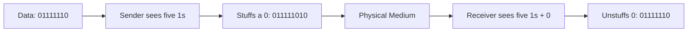

## Introduction

Imagine you are standing on one side of a dark valley, signaling to a friend on the other side using a single flashlight. You blink the light rapidly to represent 1s and 0s. Your friend sees a continuous stream of flashes, but how do they know where one sentence ends and the next begins? If a cloud momentarily obscures the light, how do they know a "1" was lost? And if a third person starts flashing their own light at the same time, how do you both stop from garbling the message?

In computer networking, these are the fundamental challenges of the **Data Link Layer** (Layer 2 of the OSI model). While the Physical Layer handles the raw transmission of bits over a wire or radio wave, the Data Link Layer turns that "bit pipe" into a structured, reliable communication channel.

This lesson covers three pillars of this layer. First, we examine **framing**, the process of encapsulating bitstreams into discrete packets. Second, we dive into **Cyclic Redundancy Checks (CRC)**, a powerful mathematical tool used to detect if bits were flipped during transit. Finally, we explore **CSMA/CD**, the classic "polite conversation" protocol that allowed early Ethernet networks to share a single wire without total chaos.

**Before you start:** You should be familiar with the *OSI vs TCP/IP Protocol Stacks* and understand basic *Binary Conversions & 2's Complement* logic, specifically the XOR operation.

## Core theory

### The Necessity of Framing

The physical layer provides a raw stream of bits. However, network protocols rarely send a single infinite stream; they send discrete blocks of data called **frames**. Framing is the process of marking the beginning and end of these blocks so the receiver can synchronize its hardware and interpret the data correctly.

There are three primary methods for framing:
1.  **Character Count:** The header specifies the total number of characters in the frame. This is rarely used today because if the count field is corrupted, the receiver loses synchronization for all subsequent frames.
2.  **Flag Bytes with Byte Stuffing:** A special "flag" byte (e.g., `0x7E`) marks the start and end. If the flag byte appears in the actual data, an "escape" byte is inserted before it.
3.  **Bit Stuffing:** Used in bit-oriented protocols like HDLC (High-Level Data Link Control). A specific bit pattern, usually `01111110` (six consecutive 1s), serves as the flag.

### Bit Stuffing and Data Transparency

To ensure the data itself does not accidentally contain the flag pattern—a property called **data transparency**—the sender uses **bit stuffing**. 

Whenever the sender's hardware encounters five consecutive `1`s in the data stream, it automatically inserts (stuffs) a `0` bit into the outgoing stream. The receiver, upon seeing five consecutive `1`s followed by a `0`, automatically removes (unstuffs) that `0`. If the receiver sees six `1`s followed by a `0`, it knows it has found a flag. If it sees seven or more `1`s, it signals an error (an "abort" condition).



### Error Detection: The Cyclic Redundancy Check (CRC)

Even with perfect framing, physical interference (noise) can flip bits. The **Cyclic Redundancy Check (CRC)** is the industry standard for detecting these errors. It treats a bit string as a polynomial with binary coefficients. For example, the bit string `110001` represents:
$$1x^5 + 1x^4 + 0x^3 + 0x^2 + 0x^1 + 1x^0 = x^5 + x^4 + 1$$

To compute a CRC, the sender and receiver agree on a **generator polynomial** $G(x)$ of degree $r$. 

**The Algorithm:**
1.  Let $M(x)$ be the frame data of $m$ bits.
2.  Append $r$ zero bits to the end of the frame. This corresponds to $x^r M(x)$.
3.  Divide the bit string $x^r M(x)$ by $G(x)$ using **modulo-2 arithmetic**.
4.  The remainder of this division is the CRC checksum (often called the Frame Check Sequence or FCS).
5.  Subtract the remainder from $x^r M(x)$ (which, in modulo-2, is the same as XORing it). The resulting string is now exactly divisible by $G(x)$.

The receiver performs the same division. If the remainder is zero, the frame is assumed to be error-free. If the remainder is non-zero, a transmission error occurred.

### Modulo-2 Arithmetic

CRC relies on modulo-2 math, which is significantly simpler than standard long division because there are no "carries" or "borrows."
*   **Addition and Subtraction** are both equivalent to the **XOR** operation.
*   $0 + 0 = 0$
*   $0 + 1 = 1$
*   $1 + 0 = 1$
*   $1 + 1 = 0$ (The carry is ignored)

In long division, we don't care how many times the divisor "goes into" the dividend. We only care if the leading bit is 1. If it is, we XOR; if it isn't, we move to the next bit.

### CSMA/CD: Managing Shared Media

When multiple devices share a single transmission medium (like the original "yellow hose" coaxial Ethernet), we need a **Medium Access Control (MAC)** protocol to prevent collisions. **CSMA/CD** (Carrier Sense Multiple Access with Collision Detection) is the classic solution.

The protocol follows these steps:
1.  **Carrier Sense:** "Listen before talking." If the line is busy, wait.
2.  **Multiple Access:** Many nodes can attempt to access the line.
3.  **Collision Detection:** "Listen while talking." If two nodes transmit simultaneously, the signals overlap and garble. The nodes detect the increased voltage (collision) and stop immediately.

### The Collision Window and Slot Time

For CSMA/CD to work, a node must still be transmitting when the "noise" from a collision travels back to it. If a frame is too short, a node might finish sending its last bit before it realizes a collision occurred at the far end of the cable.

If the maximum end-to-end propagation delay is $\tau$, the **collision window** is $2\tau$. This is the time it takes for a signal to travel to the furthest point and for the collision notification to travel back. Therefore:
$$\text{Minimum Frame Time} \ge 2 \times \text{Propagation Delay}$$

In 10 Mbps Ethernet, this "slot time" was fixed at 51.2 microseconds, leading to a minimum frame size of 64 bytes (512 bits).

### Binary Exponential Backoff

After a collision, if both nodes retried immediately, they would collide again. To avoid this, Ethernet uses **Binary Exponential Backoff**:
1.  After the $k$-th collision, the node chooses a random integer $n$ from the range $[0, 2^k - 1]$.
2.  The node waits $n \times \text{slot time}$ before attempting to retransmit.
3.  For the first collision ($k=1$), $n \in \{0, 1\}$. For the second ($k=2$), $n \in \{0, 1, 2, 3\}$.
4.  After 10 collisions, the range is frozen at $[0, 1023]$. After 16 collisions, the attempt is aborted, and an error is reported to higher layers.

## Worked examples

### Example 1: Bit Stuffing in Action

**Problem:** A Data Link Layer protocol uses bit stuffing with the flag `01111110`. Show the transmitted bitstream for the following internal data: `0110111111111100`.

**Step-by-step solution:**
1.  Scan the data from left to right.
2.  `011...` (two 1s, keep going)
3.  `011011111` (five 1s reached). Insert a `0`.
    *   Current stream: `011011111` **`0`** `...`
4.  Continue from the next bit: `11111` (another five 1s). Insert a `0`.
    *   Current stream: `011011111` **`0`** `11111` **`0`** `...`
5.  Remaining bits: `00`.
6.  Add the flags to the start and end.

**Final Answer:**
The transmitted frame is `01111110` (flag) + `011011111011111000` (stuffed data) + `01111110` (flag).

### Example 2: CRC Calculation

**Problem:** Calculate the CRC for the data bit string $M = 101010$ using the generator $G = 1011$ ($x^3 + x^1 + 1$).

**Step-by-step solution:**
1.  **Determine $r$:** The generator $G$ is $1011$, which is degree 3 (it has 4 bits). So $r = 3$.
2.  **Append $r$ zeros to $M$:** The dividend becomes $101010000$.
3.  **Perform Modulo-2 Division:**

```text
            100110  (Quotient - not used)
       ___________
1011 | 101010000
       1011
       ----
       0001100      (XOR result, brought down next bits)
          1011
          ----
          01110
           1011
           ----
           0101     (Remainder)
```

*Detailed Division Steps:*
*   $1010$ XOR $1011 = 0001$. Bring down the next bit ($1$): $0011$.
*   Leading bit is $0$, so we cannot divide. Bring down next bit ($0$): $0110$.
*   Leading bit is $0$, so we cannot divide. Bring down next bit ($0$): $1100$.
*   $1100$ XOR $1011 = 0111$. Bring down next bit ($0$): $1110$.
*   $1110$ XOR $1011 = 0101$. Bring down next bit ($0$): $1010$.
*   $1010$ XOR $1011 = 0001$.

**Final Answer:**
The remainder (CRC) is `001`. The transmitted bit string is $101010$ + $001 = 101010001$.

### Example 3: CSMA/CD Minimum Frame Size

**Problem:** A 1 Gbps network has a maximum cable length of 1 km. The speed of signal propagation is $200,000$ km/s. What is the minimum frame size in bits to ensure collision detection?

**Step-by-step solution:**
1.  **Calculate Propagation Delay ($\tau$):**
    $$\tau = \frac{\text{Distance}}{\text{Speed}} = \frac{1 \text{ km}}{200,000 \text{ km/s}} = 5 \times 10^{-6} \text{ seconds} = 5 \mu s$$
2.  **Calculate Collision Window ($2\tau$):**
    $$2\tau = 2 \times 5 \mu s = 10 \mu s$$
3.  **Calculate Minimum Bits:**
    $$\text{Bits} = \text{Bandwidth} \times \text{Time}$$
    $$\text{Bits} = (1 \times 10^9 \text{ bits/s}) \times (10 \times 10^{-6} \text{ s}) = 10,000 \text{ bits}$$

**Final Answer:**
The minimum frame size must be 10,000 bits.

## Applications

*   **Ethernet (IEEE 802.3):** Historically used CSMA/CD on shared hubs. Modern switched Ethernet is full-duplex and doesn't collide, but the 64-byte minimum frame size remains for backward compatibility.
*   **Wi-Fi (IEEE 802.11):** Uses CSMA/CA (Collision Avoidance) instead of Detection, because wireless radios cannot usually listen while they transmit.
*   **High-Speed Serial Links:** USB, SATA, and PCI Express use CRC-16 or CRC-32 to ensure data integrity across cables and PCB traces.
*   **Storage Systems:** Hard drives and SSDs store CRC values alongside data blocks to detect "bit rot" or read errors.
*   **HDLC/PPP:** These Data Link protocols use bit stuffing to allow any binary data (like an image or encrypted packet) to be sent across a serial line without triggering a "stop" command.

## Common mistakes

*   **The mistake: Treating CRC division like standard decimal division.** Why it is wrong: In CRC, we use XOR, not subtraction. There are no carries. If the leading bit of the current window is 1, you XOR with the generator. If it is 0, you simply shift to the next bit.
*   **The mistake: Forgetting to append zeros before CRC calculation.** Why it is wrong: The CRC is the remainder of $x^r M(x)$. If you divide the raw message $M(x)$ without appending $r$ zeros, you aren't leaving space for the checksum at the end of the frame.
*   **The mistake: Assuming CSMA/CD is used in modern Wi-Fi.** Why it is wrong: Wi-Fi uses CSMA/CA. In wireless, a station cannot detect a collision while transmitting because its own signal overwhelms any incoming signal.
*   **The mistake: Thinking bit stuffing happens for every '0'.** Why it is wrong: Bit stuffing only occurs after a specific sequence of '1's (usually five). It is a targeted mechanism to prevent the flag pattern from appearing in the data.
*   **The mistake: Confusing bit stuffing with byte stuffing.** Why it is wrong: Byte stuffing operates on whole characters (adding an ESC character), whereas bit stuffing operates at the individual bit level. Bit stuffing is more efficient for high-speed hardware.

## Revision notes

*   **Framing** is necessary to turn a bitstream into packets.
*   **Bit Stuffing Rule:** Insert a `0` after five consecutive `1`s in the data.
*   **CRC** uses modulo-2 polynomial division. The generator $G(x)$ of degree $r$ results in an $r$-bit checksum.
*   **Modulo-2** addition and subtraction are both XOR.
*   **CSMA/CD** stands for Carrier Sense (listen first), Multiple Access (shared medium), and Collision Detection (abort if garbled).
*   **Minimum Frame Size** is determined by $2\tau$ (round-trip propagation time) to ensure collisions are detected before transmission ends.
*   **Binary Exponential Backoff** randomizes retransmission times to prevent repeated collisions, doubling the range $[0, 2^k-1]$ after each failure.
*   **Slot Time** is the time unit used for backoff and is equal to the collision window $2\tau$.

## Practice questions

:::question basic
A sender wants to transmit the data `1111111` (seven 1s) using bit stuffing. What is the resulting bit sequence (excluding start/end flags)?
:::answer
The sequence is `11111011`. After the first five 1s, the sender inserts a `0`. The remaining two 1s are then appended.
:::

:::question basic
In modulo-2 arithmetic, what is the result of $1101 \oplus 1011$?
:::answer
The result is `0110`. 
1 XOR 1 = 0
1 XOR 0 = 1
0 XOR 1 = 1
1 XOR 1 = 0
:::

:::question intermediate
Why does Ethernet have a minimum frame size of 64 bytes? What would happen if we sent a 10-byte frame on a very long 10 Mbps coaxial cable?
:::answer
The minimum size ensures the frame's transmission time is longer than the round-trip propagation delay ($2\tau$). If a 10-byte frame were sent, the sender might finish transmitting and think the delivery was successful before the "noise" from a collision at the far end of the cable reached it. This is known as a "late collision," and the hardware would not know to retransmit the lost data.
:::

:::question intermediate
Calculate the remainder when $110101$ is divided by $101$ using modulo-2 division.
:::answer
1. $110$ XOR $101 = 011$. Bring down $1 \to 111$.
2. $111$ XOR $101 = 010$. Bring down $0 \to 100$.
3. $100$ XOR $101 = 001$. Bring down $1 \to 011$.
The remainder is `11`. (Note: Since the divisor $101$ is degree 2, the remainder must be 2 bits).
:::

:::question advanced
A node on a CSMA/CD network has just experienced its 3rd consecutive collision. What is the probability that it will wait exactly 4 slot times before its next attempt?
:::answer
For the 3rd collision ($k=3$), the backoff algorithm chooses a random integer $n$ from the range $[0, 2^3 - 1]$, which is $[0, 7]$. The possible values for $n$ are $\{0, 1, 2, 3, 4, 5, 6, 7\}$. Since there are 8 possible values, the probability of choosing $n=4$ is $1/8$ or $12.5\%$.
:::

:::question advanced
Prove that in modulo-2 arithmetic, $A + B = A - B = A \oplus B$.
:::answer
In modulo-2, addition is defined as $(a+b) \pmod 2$. 
$0+0=0, 0+1=1, 1+0=1, 1+1=0$. This matches the XOR truth table.
Subtraction is defined as the inverse of addition. Since $1+1=0$, it follows that $0-1=1$. 
$0-0=0, 1-1=0, 1-0=1, 0-1=1$. This also matches the XOR truth table.
Therefore, addition and subtraction are identical and equivalent to XOR.
:::

## Further learning

*   **Next:** *Ethernet, MAC Addressing & Switching* explores how Layer 2 addresses (MAC addresses) are used to move frames between specific devices rather than broadcasting to everyone.
*   **Related:** *Error Correction & Sliding-Window Protocols* introduces more complex methods like Hamming Codes that can fix errors, not just detect them, and protocols that manage flow control.
*   **Related:** *Binary Arithmetic, Overflow & Codes* provides the mathematical foundation for the bitwise operations used in CRC and framing.
*   **Textbook:** Andrew S. Tanenbaum and David J. Wetherall, *Computer Networks*.
