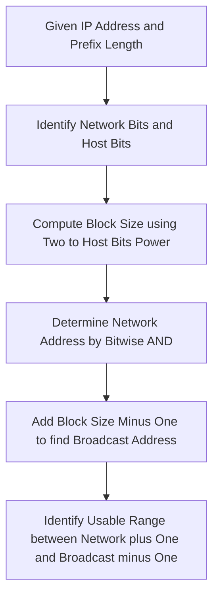

## Introduction

When the Internet Protocol version 4 (IPv4) was deployed, its 32-bit address space offered roughly 4.3 billion unique IP addresses—a quantity that seemed inexhaustible in the 1970s. However, as networked computers proliferated, the original practice of assigning massive fixed-size network blocks (Class A, B, and C) quickly caused severe address exhaustion and bloated routing tables across internet backbones.

To prevent premature address exhaustion and manage broadcast domains efficiently, network engineers developed **subnetting** and **Classless Inter-Domain Routing (CIDR)**. Subnetting allows network administrators to divide a single physical network block into smaller, isolated logical subnets. CIDR eliminates rigid historical address classes by allowing arbitrary network prefix lengths, enabling precise address allocation and route aggregation.

In this lesson, you will learn the mathematical foundations of IPv4 addressing, master bitwise masking operations, design variable-length subnet structures, and calculate supernet route aggregations.

**Before you start:** you need to be comfortable with binary-to-decimal conversions, basic bitwise logical operations (AND, OR, NOT), and the principles of packet forwarding from Ethernet and switching.

## Core theory

### IPv4 Address Structure & Dotted-Decimal Representation

An **IPv4 address** is a 32-bit unsigned binary integer used to uniquely identify a network interface on an IP network. To make these binary identifiers readable by humans, the 32 bits are divided into four 8-bit groups called **octets**. Each octet is converted into its decimal equivalent (ranging from 0 to 255) and separated by periods, creating **dotted-decimal notation**.

For example, the binary IP address:

$$\texttt{11000000.10101000.00001010.01001011}$$

maps to the dotted-decimal string `192.168.10.75`. Mathematically, an IP address expressed as octets $(O_1, O_2, O_3, O_4)$ corresponds to the 32-bit integer value:

$$I = O_1 \cdot 2^{24} + O_2 \cdot 2^{16} + O_3 \cdot 2^8 + O_4.$$

Every IPv4 address consists of two structural components:
1. **Network prefix (Network ID):** The high-order bits that identify the specific network segment to which the host belongs.
2. **Host identifier (Host ID):** The remaining low-order bits that uniquely identify a specific endpoint interface within that network segment.

### Subnet Masks & Bitwise Operations

A **subnet mask** (or **network mask**) is a 32-bit sequence consisting of $k$ contiguous `1` bits followed by $32-k$ contiguous `0` bits. The `1` bits delineate the network prefix, while the `0` bits denote the host portion of the address.



To extract network boundaries, routers perform bitwise logical operations between an IP address $I$ and a subnet mask $M$:

- **Network address:** Formed by setting all $32-k$ host bits to `0`. It identifies the network segment itself and cannot be assigned to an individual host.

$$\text{Network Address} = I \land M$$

- **Directed broadcast address:** Formed by setting all $32-k$ host bits to `1`. Packets sent to this address are delivered to all hosts on the local subnet.

$$\text{Broadcast Address} = I \lor (\sim M)$$

- **Usable host range:** The block of addresses strictly between the network address and the broadcast address:

$$\text{First Host} = (\text{Network Address}) + 1, \quad \text{Last Host} = (\text{Broadcast Address}) - 1.$$

For a subnet mask with $h = 32 - k$ host bits, the total number of IP addresses in the block is $N_{\text{total}} = 2^h$. For standard subnets ($k \le 30$), the number of **usable host addresses** is:

$$N_{\text{usable}} = 2^{32-k} - 2.$$

*(Note: RFC 3021 defines $/31$ subnets specifically for point-to-point router links, where $N_{\text{usable}} = 2^{32-31} = 2$, omitting network and broadcast address reservations.)*

### CIDR Notation & Variable Length Subnet Masking (VLSM)

**Classless Inter-Domain Routing (CIDR)** replaces historical Class A ($/8$), Class B ($/16$), and Class C ($/24$) allocations with prefix notation. In **CIDR prefix notation**, an IP address is appended with a forward slash and the integer prefix length $k$ (e.g., `10.50.0.0/19`).

| CIDR Prefix | Subnet Mask Dotted-Decimal | Total Addresses ($2^{32-k}$) | Usable Hosts ($2^{32-k}-2$) |
| :--- | :--- | :--- | :--- |
| $/24$ | `255.255.255.0` | $256$ | $254$ |
| $/25$ | `255.255.255.128` | $128$ | $126$ |
| $/26$ | `255.255.255.192` | $64$ | $62$ |
| $/27$ | `255.255.255.224` | $32$ | $30$ |
| $/28$ | `255.255.255.240` | $16$ | $14$ |
| $/29$ | `255.255.255.248` | $8$ | $6$ |
| $/30$ | `255.255.255.252` | $4$ | $2$ |

**Variable Length Subnet Masking (VLSM)** extends CIDR principles to internal network design. Rather than applying a single uniform subnet mask across an entire organization, VLSM allows network designers to sub-allocate address spaces into subnets with different prefix lengths customized to the exact size of each sub-network.

### Subnetting Calculation Steps & Block Sizes

When dividing a network block into subnets, you borrow $s$ host bits to add to the network prefix, creating $2^s$ smaller subnets. The new prefix length becomes $k' = k + s$.

The **block size** (or step size) $B$ within the changing octet determines how far apart adjacent subnet boundaries sit:

$$B = 2^{32 - k'}.$$

To subnet efficiently using host requirements:
1. Identify the required number of usable hosts $H$.
2. Find the smallest integer host bit count $h$ satisfying $2^h - 2 \ge H$.
3. Compute the required prefix length $k' = 32 - h$.
4. Sort subnet requests in descending order of host size to prevent address fragmentation.
5. Allocate contiguous blocks starting from the lowest available network boundary aligned on multiples of $B$.

### Route Aggregation & Supernetting

**Route aggregation** (also known as **supernetting**) is the inverse of subnetting. It combines multiple contiguous subnets sharing a common bit prefix into a single summary route entry in a routing table.

For $2^p$ contiguous subnets of length $k$ to aggregate into a single $/ (k - p)$ supernet, two conditions must hold:
1. The subnets must be contiguous in address space.
2. The starting network address of the lowest block must align on a boundary that is an exact multiple of the aggregated supernet block size ($2^{32 - (k - p)}$).

Routers use the **longest prefix match** rule to forward packets: when an IP destination matches multiple table entries, the router selects the entry with the highest prefix length $k$.

## Worked examples

### Example 1: Determining Network Boundaries and Host Range

An engineering workstation is assigned the IP address `172.16.45.100/22`. Calculate:
1. The subnet mask in dotted-decimal notation.
2. The network address and broadcast address.
3. The range of usable host addresses and total usable host capacity.

**Solution:**

**Step 1: Subnet mask conversion.**
A `/22` prefix length means $k = 22$ network bits and $h = 32 - 22 = 10$ host bits.
In binary, 22 ones followed by 10 zeros is:

$$\texttt{11111111.11111111.11111100.00000000}$$

Converting each octet to decimal gives `255.255.252.0`.

**Step 2: Network address calculation.**
Examine the 3rd octet where the prefix split occurs:
- IP 3rd octet: $45 = \texttt{00101101}_2$
- Mask 3rd octet: $252 = \texttt{11111100}_2$
- Bitwise AND: $\texttt{00101101}_2 \land \texttt{11111100}_2 = \texttt{00101100}_2 = 44$.

The 4th octet host bits are all `0`, so the network address is **`172.16.44.0`**.

**Step 3: Broadcast address calculation.**
The block size in the 3rd octet is $2^{10 - 8} = 2^2 = 4$.
The next network block begins at $44 + 4 = 48$ in the 3rd octet (`172.16.48.0`).
Subtracting 1 gives the broadcast address: **`172.16.47.255`**.

**Step 4: Usable host range and capacity.**
- First usable host: `172.16.44.1`
- Last usable host: `172.16.47.254`
- Usable host capacity: $2^{10} - 2 = 1024 - 2 = \mathbf{1022}$.

We can verify these results programmatically using Python:

```python
def analyze_ipv4(ip_str, prefix_len):
    octets = [int(x) for x in ip_str.split('.')]
    ip_val = (octets[0] << 24) + (octets[1] << 16) + (octets[2] << 8) + octets[3]
    mask_val = ((1 << 32) - 1) ^ ((1 << (32 - prefix_len)) - 1)
    net_val = ip_val & mask_val
    bcast_val = net_val | ((1 << (32 - prefix_len)) - 1)
    
    def to_ip(val):
        return f"{(val >> 24) & 255}.{(val >> 16) & 255}.{(val >> 8) & 255}.{val & 255}"
    
    print(f"Subnet Mask: {to_ip(mask_val)}")
    print(f"Network Address: {to_ip(net_val)}")
    print(f"Broadcast Address: {to_ip(bcast_val)}")
    print(f"Usable Host Range: {to_ip(net_val + 1)} - {to_ip(bcast_val - 1)}")
    print(f"Usable Hosts: {2**(32 - prefix_len) - 2}")

analyze_ipv4("172.16.45.100", 22)
```

Output:

```text
Subnet Mask: 255.255.252.0
Network Address: 172.16.44.0
Broadcast Address: 172.16.47.255
Usable Host Range: 172.16.44.1 - 172.16.47.254
Usable Hosts: 1022
```

---

### Example 2: Variable-Length Subnet Masking (VLSM) Allocation

You are allocated the block `192.168.1.0/24`. Design a VLSM address plan for three departments:
- Department A: 60 hosts
- Department B: 28 hosts
- Department C: 12 hosts

**Solution:**

To prevent overlap, allocate subnets in descending order of size.

**1. Department A (60 hosts):**
- Need host capacity $2^h - 2 \ge 60 \implies 2^h \ge 62 \implies h = 6$ bits ($2^6 = 64$).
- Prefix length: $32 - 6 = /26$.
- Subnet block: **`192.168.1.0/26`**.
- Address range: `192.168.1.0` to `192.168.1.63`. Usable hosts: `192.168.1.1` – `192.168.1.62`.

**2. Department B (28 hosts):**
- Need host capacity $2^h - 2 \ge 28 \implies 2^h \ge 30 \implies h = 5$ bits ($2^5 = 32$).
- Prefix length: $32 - 5 = /27$.
- Next available network address: `192.168.1.64`.
- Subnet block: **`192.168.1.64/27`**.
- Address range: `192.168.1.64` to `192.168.1.95`. Usable hosts: `192.168.1.65` – `192.168.1.94`.

**3. Department C (12 hosts):**
- Need host capacity $2^h - 2 \ge 12 \implies 2^h \ge 14 \implies h = 4$ bits ($2^4 = 16$).
- Prefix length: $32 - 4 = /28$.
- Next available network address: `192.168.1.96`.
- Subnet block: **`192.168.1.96/28`**.
- Address range: `192.168.1.96` to `192.168.1.111`. Usable hosts: `192.168.1.97` – `192.168.1.110`.

Remaining unallocated space in `/24`: `192.168.1.112` through `192.168.1.255` (144 available IP addresses for future expansion).

---

### Example 3: Route Aggregation (Supernetting)

An enterprise border router has four adjacent internal subnet routes:
- `10.8.0.0/21`
- `10.8.8.0/21`
- `10.8.16.0/21`
- `10.8.24.0/21`

Determine whether these four subnets can be aggregated into a single CIDR route, and calculate the resulting aggregated prefix.

**Solution:**

**Step 1: Determine total host span.**
Each `/21` block contains $2^{32-21} = 2^{11} = 2048$ addresses (block size of 8 in the 3rd octet).
- `10.8.0.0/21` spans `10.8.0.0` – `10.8.7.255`
- `10.8.8.0/21` spans `10.8.8.0` – `10.8.15.255`
- `10.8.16.0/21` spans `10.8.16.0` – `10.8.23.255`
- `10.8.24.0/21` spans `10.8.24.0` – `10.8.31.255`

The overall continuous span is `10.8.0.0` through `10.8.31.255`.

**Step 2: Compare binary prefix bits.**
Look at the 3rd octets in binary:
- $0 = \texttt{00000000}_2$
- $8 = \texttt{00001000}_2$
- $16 = \texttt{00010000}_2$
- $24 = \texttt{00011000}_2$

All values from 0 to 31 share the same high-order 3 bits in the 3rd octet: $\texttt{000}_2$.

**Step 3: Compute aggregate prefix length.**
The first two octets (`10.8`) contribute $8 + 8 = 16$ matching bits.
The 3rd octet contributes 3 matching bits ($\texttt{000}_2$).
Total common prefix bits $k = 16 + 3 = 19$.

The four subnets aggregate cleanly into **`10.8.0.0/19`**.

## Applications

- **Enterprise Network Segmentation:** Subnetting isolates departmental traffic into distinct broadcast domains, limiting broadcast storm propagation and enforcing security policies via Layer 3 switch boundaries.
- **Cloud Virtual Private Cloud (VPC) Architecture:** Cloud platforms like AWS, Azure, and Google Cloud require engineers to define CIDR blocks (such as `10.0.0.0/16`) and partition them using VLSM across public and private availability zones.
- **Internet Route Table Optimization:** Autonomous Systems aggregate thousands of specific customer prefixes into single CIDR blocks announced via BGP, keeping global core routing table sizes manageable.
- **Firewall Rule Definition:** Network Access Control Lists (ACLs) and stateful firewalls use CIDR prefix matching to define allowed or denied traffic destinations in concise rules.

## Common mistakes

- **Forgetting to subtract network and broadcast addresses when computing host capacity.** Why it is wrong: $2^{32-k}$ gives the total number of IP addresses in a block, but the lowest address (all host bits 0) is reserved for the network ID and the highest address (all host bits 1) is reserved for directed broadcast. To avoid it, always use $2^{32-k} - 2$ when calculating usable host slots for standard subnets ($k \le 30$).
- **Allocating VLSM subnets without sorting host requirements in descending order.** Why it is wrong: Assigning smaller subnets first leaves fragmented gaps that cannot accommodate larger contiguous blocks required for bigger subnets later. To avoid it, always sort subnet requirements from largest to smallest before assigning network blocks.
- **Misaligning subnet or supernet boundaries on non-power-of-two boundaries.** Why it is wrong: Subnet blocks must start at an IP address where all host bits are zero, meaning the decimal value in the interesting octet must be an integer multiple of the block size ($2^{32-k}$). To avoid it, ensure the starting network address is divisible by the block size.
- **Confusing prefix length with host bit length.** Why it is wrong: Using prefix length $k$ directly as the exponent in $2^k$ calculates total subnets from a root block rather than host capacity. To avoid it, remember that $k$ is the prefix bit count and $32 - k$ is the host bit count; host capacity is driven by $2^{32-k}$.
- **Overlapping subnets during variable-length allocation.** Why it is wrong: Assigning a new subnet inside the IP range of an already allocated block creates routing conflicts and duplicate IP address assignments. To avoid it, track the broadcast address of the previous subnet and start the next subnet at the next sequential IP address.

## Revision notes

- IPv4 addresses are 32-bit binary integers represented as four 8-bit octets in dotted-decimal format.
- A subnet mask consists of $k$ contiguous `1` bits followed by $32-k$ `0` bits, where $k$ is the CIDR prefix length.
- $\text{Network Address} = \text{IP} \land \text{Mask}$; $\text{Broadcast Address} = \text{Network Address} \lor (\sim \text{Mask})$.
- Block size equals $2^{32-k}$. Total addresses per block equal $2^{32-k}$; usable hosts equal $2^{32-k} - 2$ (for $k \le 30$).
- VLSM allocates subnets with variable prefix lengths to match host demands without wasting address space.
- Always allocate VLSM subnets in descending order of size to prevent address fragmentation.
- Route aggregation (supernetting) merges contiguous subnets sharing common high-order prefix bits into a single summarized CIDR route.
- RFC 3021 defines `/31` prefixes for point-to-point links, providing 2 usable host addresses without reserving network or broadcast IDs.

## Practice questions

:::question basic
Convert the subnet mask `255.255.240.0` to CIDR prefix notation and calculate the total number of IP addresses contained in this block.
:::answer
The subnet mask `255.255.240.0` in binary is `11111111.11111111.11110000.00000000`, which contains 20 contiguous ones. Therefore, the CIDR prefix notation is `/20`. The total number of IP addresses in a `/20` block is $2^{32-20} = 2^{12} = 4096$.
:::

:::question basic
Given the IP address `192.168.50.130/27`, identify its network address, broadcast address, and first usable host address.
:::answer
A `/27` prefix leaves $32 - 27 = 5$ host bits, giving a block size of $2^5 = 32$. In the fourth octet, multiples of 32 are 0, 32, 64, 96, 128, and 160; since 130 lies between 128 and 159, the network address is `192.168.50.128`. The broadcast address is `192.168.50.159` (one less than 160), and the first usable host address is `192.168.50.129`.
:::

:::question intermediate
A network administrator needs to carve a `/24` network (`10.10.1.0/24`) into subnets to support four distinct departments requiring 50, 25, 20, and 10 hosts respectively. Using VLSM, determine the prefix length and network range assigned to each department.
:::answer
Sorting requirements in descending order: 50 hosts needs host bits $h=6$ ($2^6 = 64$), giving prefix `/26` (`10.10.1.0/26`, range `10.10.1.0` – `10.10.1.63`). Next, 25 hosts needs $h=5$ ($2^5 = 32$), giving prefix `/27` (`10.10.1.64/27`, range `10.10.1.64` – `10.10.1.95`). Next, 20 hosts also needs $h=5$ ($2^5 = 32$), giving prefix `/27` (`10.10.1.96/27`, range `10.10.1.96` – `10.10.1.127`). Finally, 10 hosts needs $h=4$ ($2^4 = 16$), giving prefix `/28` (`10.10.1.128/28`, range `10.10.1.128` – `10.10.1.143`).
:::

:::question intermediate
Determine whether the four subnets `172.16.16.0/22`, `172.16.20.0/22`, `172.16.24.0/22`, and `172.16.28.0/22` can be aggregated into a single supernet route. If so, state the aggregate CIDR prefix.
:::answer
Each `/22` subnet covers a block size of 4 in the third octet: `16–19`, `20–23`, `24–27`, and `28–31`. Combined, these contiguous subnets span `172.16.16.0` through `172.16.31.255`, covering 16 blocks in the third octet ($16 \times 256 = 4096 = 2^{12}$ total addresses). The 3rd octet values in binary are `00010000`, `00010100`, `00011000`, and `00011100`, which all share the high-order bits `0001`. Combining these 4 bits with the 16 bits of `172.16` yields 20 common prefix bits, so the subnets aggregate cleanly into `172.16.16.0/20`.
:::

:::question advanced
Why does standard point-to-point router link configuration using `/30` subnets waste address space compared to RFC 3021 `/31` subnets, and how does host routing behavior differ between them?
:::answer
A standard `/30` subnet allocates $2^2 = 4$ total IP addresses, but reserves 2 addresses for Network ID and Directed Broadcast ID, leaving only 2 usable host IPs (a $50\%$ address space waste). RFC 3021 allows `/31` subnets on point-to-point links with 2 total IP addresses ($2^1 = 2$), treating the lower IP as host 0 and the higher IP as host 1 without reserving separate network or broadcast addresses. On a `/31` link, directed broadcasts are disabled or interpreted as unicast delivery to the single remote peer, eliminating address waste without causing routing ambiguity.
:::

:::question advanced
A router receives a packet with destination IP `192.168.14.75`. The router's routing table contains four matching entries: `192.168.0.0/16`, `192.168.12.0/22`, `192.168.14.0/24`, and `192.168.14.64/28`. Which route will the router select, and what fundamental routing principle dictates this choice?
:::answer
The router will select `192.168.14.64/28`. This decision is governed by the **longest prefix match** rule, which dictates that when an IP destination address matches multiple routing table entries, the router must forward the packet using the route entry with the longest prefix length (most specific mask). `192.168.14.64/28` matches bits 0–27 of the destination IP and has a 28-bit prefix length, which is longer than `/24`, `/22`, or `/16`.
:::

## Further learning

- **Next:** *IPv6, ARP, ICMP & DHCP* explores the 128-bit IPv6 address architecture and neighbor discovery protocols that eliminate the need for NAT and legacy IPv4 subnet constraints.
- **Related:** *Routing Concepts & Distance Vector vs Link State* demonstrates how routers maintain CIDR network prefixes inside forwarding tables and calculate shortest paths across dynamic network topologies.
- **Related:** *BGP & Inter-Domain Autonomous Routing* explains how internet backbone routers aggregate CIDR prefixes across Autonomous Systems to keep global core routing tables scalable.

Textbook reference:
Kurose and Ross, *Computer Networking: A Top-Down Approach*.
