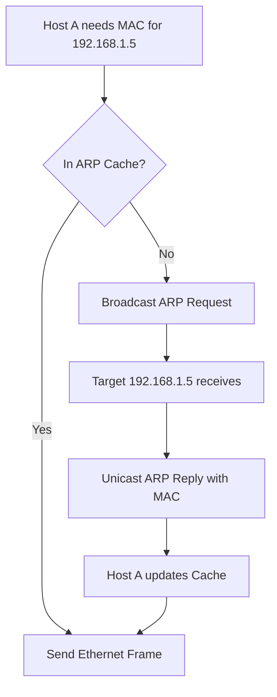

## Introduction

In the early days of the Internet, the 4.3 billion addresses provided by IPv4 seemed inexhaustible. However, the explosion of mobile devices, IoT sensors, and global connectivity led to the official exhaustion of the IPv4 free pool. While techniques like Network Address Translation (NAT) bought time, the long-term solution is **IPv6**, which offers a virtually limitless address space.

But an IP address alone is not enough for a network to function. A computer needs to know how to map that logical IP address to a physical hardware address to send data over a wire; it needs a way to automatically obtain an address without manual configuration; and it needs a method to report errors when packets go astray. This lesson covers the "glue" protocols that make the Internet Protocol (IP) suite practical: **ARP** for address resolution, **DHCP** for configuration, and **ICMP** for diagnostics, alongside the architecture of **IPv6**.

**Before you start:** you should be familiar with the concepts in *Ethernet, MAC Addressing & Switching* and understand the basics of *IPv4 Subnetting & CIDR Calculation*.

## Core theory

### IPv6 Addressing and Notation

An **IPv6 address** is 128 bits long, providing $2^{128}$ (approximately $3.4 \times 10^{38}$) unique addresses. This is enough to assign trillions of addresses to every human being on Earth. Unlike the dotted-decimal notation of IPv4, IPv6 uses **hexadecimal** notation. The 128 bits are divided into eight 16-bit blocks (hextets), separated by colons.

Example: `2001:0db8:85a3:0000:0000:8a2e:0370:7334`

To make these addresses manageable, two compression rules are applied:
1.  **Leading Zero Compression:** Within each 16-bit block, leading zeros can be omitted. `0db8` becomes `db8`, and `0000` becomes `0`.
2.  **Zero Compression (Double Colon):** One contiguous sequence of blocks containing only zeros can be replaced with a double colon `::`. This can only be done **once** per address to avoid ambiguity.

Applying these to the example:
- Step 1: `2001:db8:85a3:0:0:8a2e:370:7334`
- Step 2: `2001:db8:85a3::8a2e:370:7334`

### The IPv6 Header

The IPv6 header was designed to be streamlined for faster processing by routers. Unlike the variable-length IPv4 header, the IPv6 header has a **fixed length of 40 bytes**.

| Field | Size (Bits) | Description |
| :--- | :--- | :--- |
| **Version** | 4 | Set to 6 for IPv6. |
| **Traffic Class** | 8 | Used for Quality of Service (QoS) management. |
| **Flow Label** | 20 | Identifies a sequence of packets requiring special handling (e.g., real-time video). |
| **Payload Length** | 16 | Size of the data following the fixed header (up to 65,535 bytes). |
| **Next Header** | 8 | Identifies the type of header immediately following (e.g., TCP, UDP, or an Extension Header). |
| **Hop Limit** | 8 | Replaces the IPv4 TTL; decremented by each router. Packet is dropped if it reaches 0. |
| **Source Address** | 128 | The IPv6 address of the originator. |
| **Destination Address** | 128 | The IPv6 address of the intended recipient. |

IPv6 removes the header checksum, relying on the link layer (Ethernet) and transport layer (TCP/UDP) to handle error detection, which reduces router overhead.

### ARP: Address Resolution Protocol

While IP handles logical routing, data delivery on a local segment requires a **MAC address**. The **Address Resolution Protocol (ARP)** bridges the gap between Layer 3 (Network) and Layer 2 (Data Link) in IPv4 networks.

When Host A wants to send a packet to Host B on the same local network:
1.  **ARP Cache Check:** Host A checks its internal table (the ARP cache) for Host B's IP-to-MAC mapping.
2.  **ARP Request:** If not found, Host A broadcasts an **ARP Request** frame to the entire local segment (`FF:FF:FF:FF:FF:FF`). The message asks: "Who has IP 192.168.1.5? Tell 192.168.1.2."
3.  **ARP Reply:** Host B recognizes its IP, updates its own cache with Host A's MAC, and sends a unicast **ARP Reply** directly to Host A containing its MAC address.
4.  **Update:** Host A stores the mapping in its cache and proceeds to encapsulate the IP packet in an Ethernet frame.



In IPv6, ARP is replaced by the **Neighbor Discovery Protocol (NDP)**, which uses ICMPv6 multicast rather than broadcasts.

### ICMP: Internet Control Message Protocol

**ICMP** is used by network devices to send error messages and operational information. It does not transport user data but is vital for network health.

Common ICMP messages include:
-   **Echo Request/Reply:** Used by the `ping` utility to test connectivity and measure round-trip time (RTT).
-   **Destination Unreachable:** Sent by a router or host when a packet cannot be delivered (e.g., no route to host, or port closed).
-   **Time Exceeded:** Sent by a router when a packet's TTL (IPv4) or Hop Limit (IPv6) reaches zero. This is the mechanism behind `traceroute`.
-   **Redirect:** Used by a router to inform a host that there is a better path for a specific destination.

**ICMPv6** is a more robust version for IPv6. It incorporates the functions of ARP (via Neighbor Solicitation) and IGMP (Multicast Group Management), making it a cornerstone of the IPv6 architecture.

### DHCP: Dynamic Host Configuration Protocol

Manually assigning IP addresses to thousands of devices is impossible. **DHCP** automates the assignment of IP addresses, subnet masks, default gateways, and DNS server addresses.

The DHCPv4 process follows the **DORA** sequence:
1.  **Discover:** The client broadcasts a message to find available DHCP servers.
2.  **Offer:** Servers respond with a unicast or broadcast offering an IP address and configuration.
3.  **Request:** The client broadcasts a request to "lease" the specific address from the chosen server.
4.  **Acknowledge (ACK):** The server confirms the lease and provides final configuration parameters.

DHCP uses a **lease** system. A client must renew its lease (usually at 50% of the lease duration). If the client leaves the network, the address eventually expires and returns to the pool for reuse.

## Worked examples

### Example 1: IPv6 Address Manipulation

A network administrator sees the following expanded IPv6 address in a log file:
`fe80:0000:0000:0000:0202:b3ff:fe1e:8329`

**Task:** Compress this address to its shortest valid form.

**Step 1: Remove leading zeros in each hextet.**
- `fe80` stays `fe80`
- `0000` becomes `0`
- `0202` becomes `202`
- `b3ff` stays `b3ff`
- Result: `fe80:0:0:0:202:b3ff:fe1e:8329`

**Step 2: Apply the double colon rule to the longest string of zeros.**
- There are three consecutive `0` blocks.
- Result: `fe80::202:b3ff:fe1e:8329`

**Final Answer:** `fe80::202:b3ff:fe1e:8329`

---

### Example 2: Tracing an ARP Operation

Consider a small network:
- Host A: IP `10.0.0.1`, MAC `AA:AA:AA:AA:AA:AA`
- Host B: IP `10.0.0.2`, MAC `BB:BB:BB:BB:BB:BB`
- The ARP caches of both hosts are currently empty.

**Task:** Describe the frames on the wire when Host A pings Host B.

1.  **ARP Request:** Host A encapsulates an ARP Request in an Ethernet frame.
    - Source MAC: `AA:AA:AA:AA:AA:AA`
    - Destination MAC: `FF:FF:FF:FF:FF:FF` (Broadcast)
    - Content: "Who has 10.0.0.2?"
2.  **ARP Reply:** Host B receives the broadcast and responds.
    - Source MAC: `BB:BB:BB:BB:BB:BB`
    - Destination MAC: `AA:AA:AA:AA:AA:AA` (Unicast)
    - Content: "10.0.0.2 is at BB:BB:BB:BB:BB:BB"
3.  **ICMP Echo Request:** Host A now has the MAC and sends the ping.
    - Source MAC: `AA:AA:AA:AA:AA:AA`
    - Destination MAC: `BB:BB:BB:BB:BB:BB`
    - Source IP: `10.0.0.1`, Destination IP: `10.0.0.2`

---

### Example 3: IPv6 Address Expansion with Python

In some automation tasks, you need to expand a compressed IPv6 address to its full 32-character hexadecimal form for database consistency.

```python
import ipaddress

def expand_ipv6(compressed_addr):
    # Create an IPv6Address object
    addr = ipaddress.IPv6Address(compressed_addr)
    # The .exploded property returns the full 8-hextet string
    return addr.exploded

address = "2001:db8::1"
print(f"Compressed: {address}")
print(f"Expanded:   {expand_ipv6(address)}")
```

Output:
```text
Compressed: 2001:db8::1
Expanded:   2001:0db8:0000:0000:0000:0000:0000:0001
```

## Applications

-   **Enterprise Network Management:** DHCP allows IT departments to manage IP pools centrally. If a DNS server changes, the admin updates the DHCP scope once, and every client receives the update upon lease renewal.
-   **Internet of Things (IoT):** IPv6 is essential for IoT. With $2^{128}$ addresses, every smart sensor in a factory can have a globally unique, routable IP address without the complexities of NAT.
-   **Network Troubleshooting:** Engineers use ICMP-based tools like `ping` to check if a server is up and `traceroute` to identify which specific router in a path is dropping packets or causing latency.
-   **Transition Technologies:** Since the world cannot switch to IPv6 overnight, "Dual Stack" configurations allow devices to run both IPv4 and IPv6 simultaneously, using ARP for the former and NDP for the latter.
-   **Local Link Communication:** IPv6 uses **Link-Local** addresses (`fe80::/10`) which are automatically generated. This allows two devices connected by a single cable to communicate immediately without a DHCP server or manual configuration.

## Common mistakes

-   **Using the double colon twice.** An address like `2001::abcd::1` is invalid because it is mathematically impossible to determine how many zero blocks belong in each gap.
-   **Confusing ARP with DHCP.** ARP finds the hardware address for a known IP; DHCP provides an IP address to a host that doesn't have one. They operate at different stages of network initialization.
-   **Assuming ICMP is a transport protocol.** ICMP is a Layer 3 protocol used for control and signaling. It does not use port numbers (like TCP/UDP) and is not used for transferring application data.
-   **Believing IPv6 has broadcasts.** IPv6 completely eliminated broadcast addresses to improve network efficiency. It uses **multicast** (sending to a specific group) and **anycast** (sending to the nearest of a group) instead.
-   **Forgetting that ARP is local.** ARP requests are broadcast frames. Routers do not forward broadcasts, so ARP only works within a single local area network (LAN) or VLAN. To reach a host on a different network, you need the MAC address of your **default gateway**, not the destination host.

## Revision notes

-   **IPv6 Address Length:** 128 bits, written as 8 hextets in hexadecimal.
-   **IPv6 Compression:** Omit leading zeros; replace one sequence of zeros with `::`.
-   **IPv6 Header:** Fixed 40 bytes; no checksum; includes Flow Label and Hop Limit.
-   **ARP (IPv4):** Resolves IP addresses to MAC addresses using local broadcasts.
-   **NDP (IPv6):** Replaces ARP; uses ICMPv6 and multicast.
-   **ICMP:** Layer 3 protocol for error reporting (`Destination Unreachable`) and diagnostics (`Echo Request`).
-   **DHCP DORA:** Discover, Offer, Request, Acknowledge.
-   **DHCP Lease:** Addresses are "rented" for a time; clients must renew or the address returns to the pool.
-   **Traceroute:** Uses ICMP `Time Exceeded` messages by incrementing the TTL/Hop Limit starting from 1.

## Practice questions

:::question basic
What is the bit-length of an IPv6 address, and how many hexadecimal characters are required to represent it in its fully expanded form (excluding colons)?
:::answer
An IPv6 address is 128 bits long. Since each hexadecimal character represents 4 bits ($2^4 = 16$), the fully expanded address requires $128 / 4 = 32$ hexadecimal characters.
:::

:::question basic
At which layer of the OSI model does ARP operate, and why is it considered a "bridge" between layers?
:::answer
ARP operates at the Data Link Layer (Layer 2) but serves the Network Layer (Layer 3). It is considered a bridge because it takes a Layer 3 logical address (IP) and resolves it to a Layer 2 physical address (MAC), which is necessary for framing and transmission on a local medium.
:::

:::question intermediate
A host sends a DHCP Request message during the DORA process. Is this message sent via unicast or broadcast, and why?
:::answer
The DHCP Request is typically sent via broadcast. This informs the server whose offer was accepted that the client is taking the address, and it simultaneously informs all other DHCP servers that their offers were declined, allowing them to release those addresses back into their respective pools.
:::

:::question intermediate
Explain how the `traceroute` utility uses ICMP to map the path to a destination.
:::answer
Traceroute sends a sequence of packets (usually UDP or ICMP Echo) starting with a TTL (or Hop Limit) of 1. The first router decrements it to 0, drops the packet, and sends back an ICMP `Time Exceeded` message, revealing its IP. Traceroute then sends packets with TTL 2, 3, and so on, until the destination is reached, recording the source of each `Time Exceeded` message to build the path map.
:::

:::question advanced
In IPv6, how does a host resolve a neighbor's MAC address if there are no broadcasts?
:::answer
IPv6 uses the Neighbor Discovery Protocol (NDP). The host sends an ICMPv6 **Neighbor Solicitation** message to a **Solicited-Node Multicast** address, which is derived from the target's IP. Only the target host (and any others with very similar IPs) will listen to this specific multicast group, significantly reducing the interruption to other hosts compared to an IPv4 ARP broadcast.
:::

:::question advanced
What is a "Gratuitous ARP," and what are two common scenarios where it is used?
:::answer
A Gratuitous ARP is an ARP response (or request) that is sent without being prompted by an ARP request. It is used for: 1) **IP Conflict Detection**, where a host broadcasts its own IP to see if anyone else responds; and 2) **Updating ARP Caches**, such as when a backup router takes over a Virtual IP (VIP) in a high-availability cluster and needs to tell the switch and hosts to send traffic to its MAC address instead.
:::

## Further learning

-   **Next:** *TCP 3-Way Handshake & Flow Control* to understand how reliable connections are built on top of the IP layer we just configured.
-   **Related:** *DNS & Modern HTTP Protocols* explores how human-readable names (like `google.com`) are translated into the IPv6 addresses discussed in this lesson.
-   **Related:** *BGP & Inter-Domain Autonomous Routing* covers how IPv6 prefixes are advertised across the global Internet between different organizations.
-   **Textbook:** Kurose and Ross, *Computer Networking: A Top-Down Approach*.
