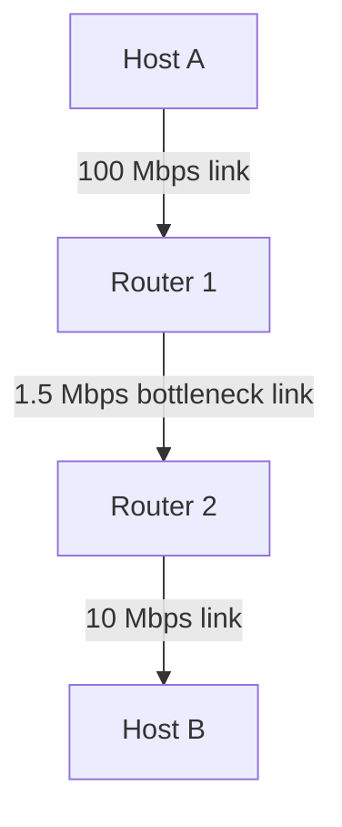

## Introduction

Imagine streaming a high-definition video across continents. Although light signals travel through optical fibers at nearly two-hundred thousand kilometers per second, video streams can still buffer, frame rate can drop, and interactive calls can suffer from lag. Why does a network with gigabit link capacities sometimes deliver sluggish performance?

The answer lies in how computing systems are connected, how data is formatted and transmitted, and how physical limitations accumulate across network paths. Every network architecture makes trade-offs between hardware complexity, fault tolerance, resource sharing, and raw speed. Understanding these fundamental design choices allows engineers to predict system performance, optimize resource allocation, and troubleshoot transmission bottlenecks.

This lesson covers the fundamental layout patterns of computer networks (**topologies**), the core strategies used to move data between endpoints (**circuit and packet switching**), the distinct mathematical components that constitute **end-to-end delay**, and the performance metrics of **throughput** and the **bandwidth-delay product**.

**Before you start:** you need basic arithmetic skills, unit conversion fluency (converting between bits, bytes, Megabits, and seconds), and an understanding of rates and distances.

## Core theory

### Physical and logical network topologies

A **network topology** defines the arrangement of nodes and interconnecting links in a computer network. Topologies are categorized physically (the literal spatial cabling layout) and logically (how data signals flow between endpoints).



The standard physical topologies each offer distinct structural trade-offs:

1. **Bus topology**: All network nodes connect to a single central cable (the bus). Data transmitted by any node propagates across the shared medium and is visible to all endpoints. While inexpensive to deploy, a break in the main cable disables the entire network, and simultaneous transmissions cause collision domain interference.
2. **Star topology**: Each endpoint connects directly to a central device, such as a switch or hub. If an individual link fails, only that endpoint is disconnected. The central node represents a single point of failure, but modern local area networks (LANs) overwhelmingly favor star topologies due to ease of management and isolation of faults.
3. **Ring topology**: Nodes connect sequentially in a closed loop. Data packets travel in one direction from node to node, often using a token-passing mechanism to manage access. A failure in a basic ring breaks the loop, though dual-ring designs provide redundant counter-rotating paths.
4. **Mesh topology**: Devices maintain redundant connections to each other. In a **full mesh**, every node connects directly to every other node. For a network with $N$ nodes, the total number of bidirectional physical links $L$ is:

$$L = \frac{N(N - 1)}{2}$$

In a **partial mesh**, only critical nodes share multiple direct links. Mesh topologies deliver high fault tolerance and redundant routing paths, but the hardware cost and cabling requirements scale quadratically ($O(N^2)$) for full mesh layouts.

| Topology | Hardware Cost | Fault Tolerance | Scalability | Typical Application |
| :--- | :--- | :--- | :--- | :--- |
| **Bus** | Very Low | Low (single cable failure drops network) | Poor | Legacy Ethernet (10BASE2) |
| **Star** | Moderate | High for edges (central switch critical) | Excellent | Modern Ethernet LANs, Home Wi-Fi |
| **Ring** | Low to Moderate | Low (unless dual-ring configured) | Moderate | FDDI, Legacy Token Ring |
| **Full Mesh** | Extremely High | Exceptional (multiple redundant paths) | Very Poor | Core router backbones |
| **Partial Mesh**| High | High | Good | Datacenter backbones, WANs |

### Switching paradigms: circuit switching versus packet switching

To move data from a sender to a receiver across a network of interconnected nodes, communications networks rely on one of two fundamental switching paradigms: **circuit switching** or **packet switching**.

#### Circuit switching

In **circuit switching**, a dedicated physical or virtual path (a circuit) is established between the sender and receiver before communication begins. This path remains exclusively reserved for the duration of the communication session, regardless of whether data is actively being transmitted.

Traditional telephone networks use circuit switching. Link capacity is partitioned into fixed channels using either **frequency-division multiplexing (FDM)**, where the frequency spectrum is divided into narrow frequency bands, or **time-division multiplexing (TDM)**, where time is divided into recurring frame slots.

* **Advantages**: Guaranteed transmission rate and zero queuing delay during active sessions.
* **Disadvantages**: Inefficient utilization. During silent periods (such as pauses in a conversation or waiting for a user to click a link), reserved resources sit idle and cannot be reused by other users. Connection setup creates an unavoidable initial latency penalty.

#### Packet switching

In **packet switching**, data streams are broken into smaller chunks called **packets**. Each packet carries header metadata containing source and destination addresses. Packets are transmitted independently across shared network links using a mechanism called **store-and-forward transmission**. A intermediate switch or router must receive an entire packet before it can begin transmitting the first bit of that packet onto the outgoing link.

Packet switching relies on **statistical multiplexing**: link capacity is allocated dynamically on demand rather than statically reserved.

* **Advantages**: Exceptional resource efficiency. Multiple users share link bandwidth dynamically. If a user is idle, other users utilize the full link capacity.
* **Disadvantages**: Variable performance. Because resources are shared rather than reserved, packets experience fluctuating queuing delays and potential packet loss when intermediate router buffers overflow during traffic surges.

### Components of end-to-end network delay

When a packet traverses a path from source to destination, it experiences an end-to-end delay composed of four fundamental nodal delay components:

$$d_{\text{nodal}} = d_{\text{proc}} + d_{\text{queue}} + d_{\text{trans}} + d_{\text{prop}}$$

#### 1. Processing delay ($d_{\text{proc}}$)

The **processing delay** is the time required by a router or node to examine the packet header, determine the outgoing destination interface using routing tables, and check for bit-level bit errors. In modern hardware, processing delay is implemented in specialized Application-Specific Integrated Circuits (ASICs) and typically ranges from microseconds to a few milliseconds.

#### 2. Queuing delay ($d_{\text{queue}}$)

The **queuing delay** is the time a packet spends waiting in a router's memory buffer (queue) until the outgoing link becomes available. Queuing delay depends directly on network congestion.

If packets arrive at a queue at an average rate of $a$ packets/second, each packet consists of $L$ bits, and the link transmission rate is $R$ bits/second, the ratio $\frac{L \cdot a}{R}$ is defined as the **traffic intensity**. If traffic intensity exceeds 1, arrivals outpace link capacity, the queue grows toward infinity, and packet drop occurs.

#### 3. Transmission delay ($d_{\text{trans}}$)

The **transmission delay** (also called store-and-forward delay) is the amount of time required to push all of the packet's bits onto the physical transmission link. It depends solely on packet length and link bandwidth:

$$d_{\text{trans}} = \frac{L}{R}$$

where $L$ is the packet length in bits and $R$ is the link transmission rate in bits per second (bps).

#### 4. Propagation delay ($d_{\text{prop}}$)

The **propagation delay** is the time required for a single bit to travel physically from the beginning of the link to the destination end of the link. It depends solely on the physical distance and the speed of light in the medium:

$$d_{\text{prop}} = \frac{d}{s}$$

where $d$ is the distance in meters and $s$ is the propagation speed of the physical medium (typically $2 \times 10^8 \text{ m/s}$ in copper or glass fiber, and $3 \times 10^8 \text{ m/s}$ in free space).

**Crucial distinction**: Transmission delay ($L/R$) is a function of packet size and link speed; it is independent of physical distance. Propagation delay ($d/s$) is a function of distance and signal speed; it is independent of packet size and bandwidth.

For an $N$-hop network path consisting of $N$ identical links operating under store-and-forward routing, the minimum time to transmit a single packet (assuming zero processing and queuing delay) is:

$$d_{\text{end-to-end}} = N \cdot (d_{\text{trans}} + d_{\text{prop}})$$

If a source transmits $P$ back-to-back packets across $N$ identical hops, the total time required for all $P$ packets to reach the destination fully is:

$$d_{\text{total}} = (N + P - 1) \cdot d_{\text{trans}} + N \cdot d_{\text{prop}}$$

### Throughput, bottleneck links, and bandwidth-delay product

#### Throughput and bottleneck links

**Throughput** measures the effective rate (in bits per second) at which data is successfully transferred from a sender to a receiver over a network path. It can be measured as **instantaneous throughput** (at a specific millisecond) or **average throughput** over a longer duration.

Consider a multi-hop path where a packet passes through consecutive links with capacities $R_1, R_2, R_3, \dots, R_m$. The upper bound on the end-to-end throughput for a single flow is dictated by the slowest link along the route, called the **bottleneck link**:

$$\text{Throughput} = \min(R_1, R_2, R_3, \dots, R_m)$$

#### Bandwidth-delay product (BDP)

 setup, sending a continuous stream of data requires keeping the network pipe full. The capacity of this physical pipe is defined by the **bandwidth-delay product (BDP)**:

$$\text{BDP} = R \times d_{\text{prop}}$$

where $R$ is the link bandwidth (bps) and $d_{\text{prop}}$ is the one-way propagation delay (seconds).

The BDP represents the maximum volume of bits that can be "in flight"—transmitted into the cable but not yet received by the destination—at any single instant. Networks with high bandwidth and long propagation delay (such as satellite links or transoceanic fiber connections) are called **long fat networks (LFNs)**. Transport protocols operating over LFNs must maintain large buffer windows equal to or exceeding the BDP to achieve full link utilization.

## Worked examples

### Example 1: Calculating network delays and store-and-forward timing

A host sends a large file partitioned into packets over a network path with $N = 3$ identical hops (2 intermediate routers). Each link has a bandwidth of $R = 100\text{ Mbps}$ ($100 \times 10^6\text{ bits/s}$), a physical distance $d = 2\,000\text{ km}$ ($2 \times 10^6\text{ m}$), and a signal propagation speed $s = 2 \times 10^8\text{ m/s}$. The packet size $L = 10\text{ MB}$ ($10 \times 10^6\text{ bytes}$). Processing delay per router is $2.0\text{ ms}$, and queuing delay is zero.

Calculate the single-link transmission delay, single-link propagation delay, and total end-to-end delay for one packet.

```python
def calculate_end_to_end_delay(packet_bytes, rate_bps, dist_km, speed_m_s, hops, proc_ms):
    # Convert packet size from Bytes to bits
    L = packet_bytes * 8
    # Single-link transmission delay (seconds)
    d_trans_s = L / rate_bps
    # Single-link propagation delay (seconds)
    d_prop_s = (dist_km * 1000) / speed_m_s
    
    # Store-and-forward transmission across hops
    total_trans_ms = hops * d_trans_s * 1000
    total_prop_ms = hops * d_prop_s * 1000
    # Intermediate routers perform processing: (hops - 1) routers
    total_proc_ms = (hops - 1) * proc_ms
    
    total_delay_ms = total_trans_ms + total_prop_ms + total_proc_ms
    return d_trans_s * 1000, d_prop_s * 1000, total_delay_ms

d_trans, d_prop, total = calculate_end_to_end_delay(
    packet_bytes=10_000_000,
    rate_bps=100_000_000,
    dist_km=2000,
    speed_m_s=2e8,
    hops=3,
    proc_ms=2.0
)

print(f"Transmission delay per link: {d_trans:.1f} ms")
print(f"Propagation delay per link: {d_prop:.1f} ms")
print(f"Total end-to-end delay: {total:.1f} ms")
```

Output:

```text
Transmission delay per link: 800.0 ms
Propagation delay per link: 10.0 ms
Total end-to-end delay: 2434.0 ms
```

**Step-by-step breakdown**:
1. Convert packet size: $10 \times 10^6\text{ bytes} \times 8\text{ bits/byte} = 80 \times 10^6\text{ bits}$.
2. Compute single-link $d_{\text{trans}} = \frac{80 \times 10^6\text{ bits}}{100 \times 10^6\text{ bps}} = 0.8\text{ s} = 800.0\text{ ms}$.
3. Compute single-link $d_{\text{prop}} = \frac{2 \times 10^6\text{ m}}{2 \times 10^8\text{ m/s}} = 0.01\text{ s} = 10.0\text{ ms}$.
4. Sum all hop delays:
   - Total transmission delay across 3 store-and-forward links: $3 \times 800.0\text{ ms} = 2400.0\text{ ms}$.
   - Total propagation delay across 3 links: $3 \times 10.0\text{ ms} = 30.0\text{ ms}$.
   - Total processing delay at 2 intermediate routers: $2 \times 2.0\text{ ms} = 4.0\text{ ms}$.
   - Total delay $= 2400.0 + 30.0 + 4.0 = 2434.0\text{ ms} = 2.434\text{ seconds}$.

### Example 2: Bandwidth-delay product and dynamic pipe capacity

A transcontinental fiber optic connection has a bandwidth $R = 10\text{ Gbps}$ ($10^{10}\text{ bits/s}$) and spans a physical length $d = 5\,000\text{ km}$ ($5 \times 10^6\text{ m}$). The propagation velocity $s = 2 \times 10^8\text{ m/s}$.

Compute $d_{\text{prop}}$, the bandwidth-delay product (BDP) in Megabytes, and the maximum number of 1500-byte packets currently in flight when the transmission pipe is completely full.

```python
R_bps = 10_000_000_000  # 10 Gbps
dist_m = 5_000_000      # 5000 km
speed_m_s = 2e8         # Propagation speed
packet_bytes = 1500

d_prop = dist_m / speed_m_s
bdp_bits = R_bps * d_prop
bdp_bytes = bdp_bits / 8
bdp_mb = bdp_bytes / 1e6
packets_in_flight = bdp_bits / (packet_bytes * 8)

print(f"Propagation delay: {d_prop * 1000:.1f} ms")
print(f"BDP in bits: {bdp_bits:.0f}")
print(f"BDP in Megabytes: {bdp_mb:.2f} MB")
print(f"Packets in flight: {packets_in_flight:.2f}")
```

Output:

```text
Propagation delay: 25.0 ms
BDP in bits: 250000000
BDP in Megabytes: 31.25 MB
Packets in flight: 20833.33
```

**Step-by-step breakdown**:
1. Single-way propagation delay $d_{\text{prop}} = \frac{5 \times 10^6}{2 \times 10^8} = 0.025\text{ s} = 25.0\text{ ms}$.
2. $\text{BDP} = R \times d_{\text{prop}} = 10^{10}\text{ bps} \times 0.025\text{ s} = 250\,000\,000\text{ bits}$.
3. Convert bits to Megabytes: $\frac{250\,000\,000\text{ bits}}{8\text{ bits/byte}} = 31\,250\,000\text{ bytes} = 31.25\text{ MB}$.
4. Each 1500-byte packet contains $1500 \times 8 = 12\,000\text{ bits}$.
5. Number of packets in flight $= \frac{250\,000\,000}{12\,000} \approx 20\,833.33\text{ packets}$.

### Example 3: Throughput analysis and bottleneck identification

A server sends a file to a remote client traversing three sequential links:
- Link 1: Host to Router 1 ($R_1 = 100\text{ Mbps}$)
- Link 2: Router 1 to Router 2 ($R_2 = 1.5\text{ Mbps}$)
- Link 3: Router 2 to Client ($R_3 = 10\text{ Mbps}$)

Assuming no competing network traffic, determine the end-to-end throughput and calculate the exact time taken to transmit a $15\text{ MB}$ ($15 \times 10^6\text{ bytes}$) file ignoring propagation delays.

**Solution**:
1. Identify the bottleneck link:

$$\text{Throughput} = \min(R_1, R_2, R_3) = \min(100, 1.5, 10) = 1.5\text{ Mbps}$$

2. Convert file size to bits:

$$L_{\text{total}} = 15 \times 10^6\text{ bytes} \times 8\text{ bits/byte} = 120 \times 10^6\text{ bits}$$

3. Calculate transfer time across the bottleneck:

$$t_{\text{transfer}} = \frac{120 \times 10^6\text{ bits}}{1.5 \times 10^6\text{ bits/s}} = 80.0\text{ seconds}$$

The maximum throughput is **1.5 Mbps**, and the transfer takes **80.0 seconds**.

## Applications

- **Internet Service Provider (ISP) network design**: ISPs combine star topologies at the local access level (FTTH/DSL) with partial mesh core backbones to balance wiring cost against fault-tolerant wide-area routing.
- **Datacenter network architecture**: Datacenters utilize specialized leaf-spine (Clos) topologies to ensure predictable, low-latency east-west traffic between thousands of servers.
- **Transport protocol tuning**: Operating systems use the Bandwidth-Delay Product to set TCP buffer sizes (`so_rcvbuf`, `so_sndbuf`). If buffer sizes are smaller than the BDP, TCP cannot saturate high-bandwidth long-distance connections.
- **Video streaming & CDN deployment**: Video streaming services place edge servers close to users to reduce propagation delay ($d_{\text{prop}}$), minimizing initial playback buffering and maximizing available throughput.

## Common mistakes

- **Confusing transmission delay with propagation delay.** Thinking transmission delay depends on physical distance or propagation delay depends on bandwidth. Transmission delay ($L/R$) depends exclusively on packet length and bandwidth. Propagation delay ($d/s$) depends exclusively on physical distance and medium speed.
- **Assuming packet switching guarantees dedicated bandwidth.** Mistaking packet switching for circuit switching. Packet switching uses dynamic statistical multiplexing; available link capacity varies based on active competing flows.
- **Miscalculating full mesh connection counts.** Using $N(N-1)$ instead of $\frac{N(N-1)}{2}$. A link between Node A and Node B connects both endpoints bidirectionally; dividing by 2 prevents double counting individual links.
- **Ignoring store-and-forward overhead when summing multihop delays.** Calculating total transmission delay for a single packet as $d_{\text{trans}}$ instead of $N \cdot d_{\text{trans}}$ over $N$ hops. A router must fully receive all bits of a packet before forwarding it to the next hop.
- **Expressing Bandwidth-Delay Product in wrong units.** Mixing bits and bytes or megabits and megabytes. Multiplying bandwidth in bits/second by delay in seconds yields bits; always divide by 8 to convert the result into bytes.

## Revision notes

- Topologies describe physical and logical link arrangements: Star (central switch), Mesh (high redundancy), Bus (shared media), Ring (token loops).
- Full mesh topologies require $\frac{N(N-1)}{2}$ links for $N$ nodes.
- Circuit switching establishes dedicated, reserved paths (zero queuing, wasted idle capacity); packet switching shares links via statistical multiplexing (efficient, variable queuing delay).
- Total nodal delay equation: $d_{\text{nodal}} = d_{\text{proc}} + d_{\text{queue}} + d_{\text{trans}} + d_{\text{prop}}$.
- Transmission delay equation: $d_{\text{trans}} = \frac{L}{R}$ (Packet size / Link bandwidth).
- Propagation delay equation: $d_{\text{prop}} = \frac{d}{s}$ (Distance / Signal propagation speed).
- Path throughput is bounded by the bottleneck link: $\min(R_1, R_2, \dots, R_m)$.
- Bandwidth-Delay Product: $\text{BDP} = R \times d_{\text{prop}}$, representing the volume of bits in flight required to fill the network pipe.

## Practice questions

:::question basic
Calculate the transmission delay ($d_{\text{trans}}$) for a 1,500-byte packet transmitted over a 1 Gbps Ethernet link.
:::answer
First, convert the packet size into bits: $1500\text{ bytes} \times 8 = 12\,000\text{ bits}$. 

Next, divide by the link transmission rate ($1\text{ Gbps} = 10^9\text{ bits/second}$):

$$d_{\text{trans}} = \frac{12\,000\text{ bits}}{10^9\text{ bits/second}} = 1.2 \times 10^{-5}\text{ seconds} = 12\text{ microseconds (0.012 ms)}$$
:::

:::question basic
How many bidirectional physical links are required to fully connect a network of 10 routers using a full mesh topology?
:::answer
A full mesh topology connecting $N$ nodes requires $\frac{N(N-1)}{2}$ bidirectional links. 

Substituting $N = 10$:

$$L = \frac{10 \times (10 - 1)}{2} = \frac{90}{2} = 45\text{ links}$$
:::

:::question intermediate
Host A transmits data to Host B across three sequential links with bandwidths of 100 Mbps, 1 Gbps, and 10 Mbps respectively. Assuming no competing traffic, what is the maximum achievable end-to-end throughput, and which link is the bottleneck?
:::answer
The maximum throughput across a multi-hop path is constrained by the bottleneck link, which is the link with the smallest capacity along the path. 

Comparing $R_1 = 100\text{ Mbps}$, $R_2 = 1000\text{ Mbps}$, and $R_3 = 10\text{ Mbps}$, the bottleneck link is Link 3. The maximum theoretical throughput is therefore **10 Mbps**.
:::

:::question intermediate
A fiber-optic link spans $1\,000\text{ km}$ ($10^6\text{ m}$) with a signal propagation speed $s = 2 \times 10^8\text{ m/s}$ and bandwidth $R = 100\text{ Mbps}$. Calculate the propagation delay ($d_{\text{prop}}$) and the Bandwidth-Delay Product (BDP) in kilobytes (KB).
:::answer
First, calculate propagation delay:

$$d_{\text{prop}} = \frac{d}{s} = \frac{1\,000\,000\text{ m}}{2 \times 10^8\text{ m/s}} = 0.005\text{ seconds} = 5\text{ ms}$$

Next, compute BDP in bits:

$$\text{BDP} = R \times d_{\text{prop}} = (100 \times 10^6\text{ bps}) \times 0.005\text{ s} = 500\,000\text{ bits}$$

Finally, convert bits to kilobytes (KB):

$$\text{BDP in bytes} = \frac{500\,000}{8} = 62\,500\text{ bytes} = 62.5\text{ KB}$$
:::

:::question advanced
A host sends $P = 100$ back-to-back packets, each of size $L = 1000\text{ bytes}$ ($8000\text{ bits}$), across a path of $N = 4$ identical store-and-forward hops. Each link has bandwidth $R = 10\text{ Mbps}$ ($10^7\text{ bps}$) and propagation delay $d_{\text{prop}} = 1\text{ ms}$. Neglecting processing and queuing delays, calculate the total time required for all packets to reach the destination completely.
:::answer
Calculate the single-link transmission delay:

$$d_{\text{trans}} = \frac{8000\text{ bits}}{10^7\text{ bps}} = 0.0008\text{ seconds} = 0.8\text{ ms}$$

For $P$ back-to-back packets traversing $N$ store-and-forward hops, the first packet takes $N \cdot d_{\text{trans}} + N \cdot d_{\text{prop}}$ to arrive at the destination. Each subsequent packet arrives $d_{\text{trans}}$ time units after the preceding packet because the last link streams them sequentially. 

The total end-to-end time equation is:

$$t_{\text{total}} = (N + P - 1) \cdot d_{\text{trans}} + N \cdot d_{\text{prop}}$$

Substituting the given values:

$$t_{\text{total}} = (4 + 100 - 1) \times 0.8\text{ ms} + 4 \times 1.0\text{ ms} = (103 \times 0.8) + 4.0 = 82.4 + 4.0 = 86.4\text{ ms}$$
:::

:::question advanced
Explain why packet switching enables statistical multiplexing and why this design allows a network link to support significantly more active users than circuit switching when user traffic is bursty.
:::answer
Circuit switching divides link capacity into fixed, static channels (using FDM or TDM) and reserves dedicated bandwidth for each user session regardless of activity. When bursty users are idle between data transmissions, their reserved channel capacity is wasted. 

Packet switching does not allocate dedicated channels; instead, packets from active users share link bandwidth dynamically on demand (statistical multiplexing). Because it is statistically improbable that all bursty users will transmit at peak capacity simultaneously, packet switching can oversubscribe link capacity, allowing many more total users to share the link while achieving high link utilization.
:::

## Further learning

- **Next:** *OSI vs TCP/IP Protocol Stacks* explains how communication functions are organized into layered abstractions.
- **Related:** *Channel Capacity & Transmission Media* dives deeper into signal propagation, Shannon-Nyquist physical limits, and media characteristics.
- **Related:** *Framing, CRC & CSMA/CD Protocol* covers link-layer frame construction, error detection, and shared channel access control in LAN environments.
- James F. Kurose and Keith W. Ross, *Computer Networking: A Top-Down Approach*.
