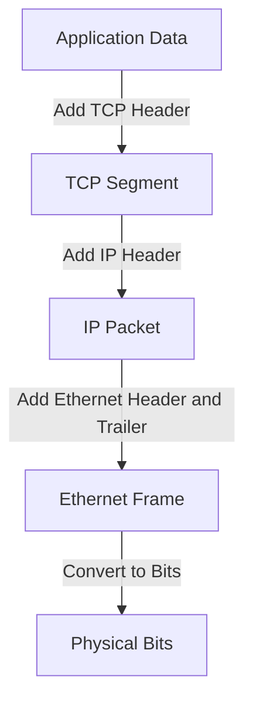

## Introduction

When you open a web browser and load a video, your computer executes millions of operations to request data from a remote server thousands of miles away. The sending host, intermediate routers, and receiving device may use completely different operating systems, CPU architectures, and physical transmission media (such as fiber-optic cables, copper wires, or radio waves). 

To ensure seamless communication across such heterogeneous systems, network architectures rely on **protocol layering**. Instead of writing a single monolithic software system to handle every hardware and software detail, networking capabilities are broken into modular, hierarchical layers. Each layer performs a specific set of functions and relies on the layer directly beneath it to provide lower-level services.

In this lesson, you will explore the two foundational reference models of computer networking: the **OSI 7-layer reference model** and the **TCP/IP 4-layer model**. You will study how data is wrapped in control information (**encapsulation**) as it travels down the stack, how receiving hosts route incoming traffic to the correct application (**demultiplexing**), and how header bytes reduce net transmission efficiency.

**Before you start:** you need a basic understanding of network hardware, node-to-node links, and fundamental performance metrics covered in *Network Fundamentals, Topologies & Performance*.

## Core theory

### The principle of protocol layering

A **protocol** is a set of formal rules governing how two or more communicating entities exchange messages. In **protocol layering**, these rules are organized into a vertical stack. Higher layers focus on application logic and end-to-end user services, while lower layers manage physical data transfer across physical links.

Layering offers three key advantages:
1. **Modularity and abstraction**: Changing the implementation of one layer does not require changes to other layers, provided the **interface** between them remains constant. For example, switching from Wi-Fi to Ethernet requires no changes to your web browser or HTTP.
2. **Interoperability**: Standardized layer definitions allow hardware and software from different vendors to work together seamlessly.
3. **Manageability**: Dividing a complex system into smaller, well-defined components makes network protocols easier to analyze, design, and debug.

Each layer $N$ provides services to layer $N+1$ through a **Service Access Point (SAP)**. When layer $N+1$ passes data down, it treats layer $N$ as a service provider. Vertically adjacent layers interact locally via software interfaces, whereas peer layers across different hosts communicate logically using a **layer protocol**.

### The OSI 7-layer reference model

Developed in the late 1970s by the International Organization for Standardization (ISO), the **Open Systems Interconnection (OSI) model** is an abstract 7-layer conceptual framework.

| Layer Number | OSI Layer | Primary Function | Example Protocols & Standards |
| :--- | :--- | :--- | :--- |
| **7** | **Application** | User-facing network services and interface | HTTP, SMTP, DNS, FTP |
| **6** | **Presentation** | Data formatting, syntax translation, compression, encryption | ASCII, JPEG, TLS/SSL (conceptually) |
| **5** | **Session** | Dialogue control, session establishment, teardown, checkpointing | NetBIOS, RPC |
| **4** | **Transport** | End-to-end process-to-process delivery, segmentation, flow/error control | TCP, UDP |
| **3** | **Network** | Logical addressing (IP), packet routing, internetwork forwarding | IPv4, IPv6, ICMP, OSPF |
| **2** | **Data Link** | Hop-to-hop framing, physical addressing (MAC), link error control | Ethernet (802.3), Wi-Fi (802.11) |
| **1** | **Physical** | Bit transmission over physical medium, voltage levels, signal timing | NRZ, Cat6, Fiber optics |

The top three layers (Application, Presentation, Session) are often grouped together as **upper layers** or software layers. The bottom four layers (Transport, Network, Data Link, Physical) handle end-to-end and node-to-node transport of data across physical hardware.

### The TCP/IP 4-layer model

While OSI was designed as a formal reference standard, the **TCP/IP model** (defined in RFC 1122) emerged from ARPANET development and became the practical architecture of the modern Internet. TCP/IP compresses the networking functions into four pragmatic layers:

1. **Application Layer**: Encompasses OSI Layers 5, 6, and 7. Network applications format their own data, manage sessions, and handle encoding directly (for example, web browsers handle HTTP parsing and TLS encryption).
2. **Transport Layer**: Identical in scope to OSI Layer 4. Provides process-to-process communication using port numbers. Main protocols are **Transmission Control Protocol (TCP)** (reliable, connection-oriented) and **User Datagram Protocol (UDP)** (unreliable, connectionless).
3. **Internet Layer**: Equivalent to OSI Layer 3. Handles host-to-host logical addressing and packet routing across networks using the **Internet Protocol (IP)**.
4. **Link Layer** (or Network Interface Layer): Combines OSI Layers 1 and 2. Defines how data is framed, physically addressed using Media Access Control (**MAC**) addresses, and transmitted as signals over a specific physical link.

```
OSI 7-Layer Model              TCP/IP 4-Layer Model
+------------------+           +------------------+
| 7. Application   | \         |                  |
+------------------+  \        |                  |
| 6. Presentation  | --+-----> | 4. Application   |
+------------------+  /        |                  |
| 5. Session       | /         |                  |
+------------------+           +------------------+
| 4. Transport     | --------> | 3. Transport     |
+------------------+           +------------------+
| 3. Network       | --------> | 2. Internet      |
+------------------+           +------------------+
| 2. Data Link     | \         | 1. Link          |
+------------------+  +------> |  (Network        |
| 1. Physical      | /         |   Interface)     |
+------------------+           +------------------+
```

### Data encapsulation and Protocol Data Units (PDUs)

As data moves down the protocol stack on the sending host, each layer wraps the incoming data from the layer above with its own control information. This process is called **encapsulation**. The reverse process on the receiving host is called **decapsulation**.

At each layer, the combined data unit is known as a **Protocol Data Unit (PDU)**:
- **Application Layer**: Message or Data
- **Transport Layer**: **Segment** (for TCP) or **Datagram** (for UDP)
- **Internet Layer**: **Packet** (or IP Datagram)
- **Link Layer**: **Frame**
- **Physical Layer**: Bits

A layer prepends a **header** (and in the case of the Data Link layer, appends a **trailer**) to the upper-layer PDU. The upper-layer PDU acts as the **payload** for the lower layer.



When a router receives a frame, it strips the Link layer header/trailer, inspects the Internet layer header (IP address) to make a routing decision, encapsulates the IP packet into a new Link layer frame for the next hop, and sends it out. Intermediate switches operate at the Link layer (Layer 2), inspecting only frame headers. Intermediate routers operate at the Internet layer (Layer 3).

### Header demultiplexing and field identification

When a destination host receives raw signals, its Physical layer converts the signals into bits and passes the frame up to the Link layer. To deliver payload data to the correct protocol or application, each layer inspects specific multiplexing identifiers inside incoming headers. This process is **demultiplexing**.

```
+-----------------------------------------------------------------------+
| Ethernet Header | IP Header | TCP Header | Application Payload | FCS  |
+-----------------------------------------------------------------------+
        |              |            |
        |              |            +--> Destination Port (e.g., 80 for HTTP)
        |              +---------------> Protocol Field (e.g., 6 for TCP)
        +------------------------------> EtherType Field (e.g., 0x0800 for IPv4)
```

1. **EtherType (Link Layer Header)**: Indicates which Internet-layer protocol is carried inside the frame. Common values include `0x0800` for IPv4, `0x86DD` for IPv6, and `0x0806` for ARP.
2. **Protocol Field (Internet Layer Header)**: Indicates which Transport-layer protocol is carried inside the IP packet. Standard values include `6` for TCP, `17` for UDP, and `1` for ICMP.
3. **Port Number (Transport Layer Header)**: Identifies the target process or socket on the destination host. For example, TCP destination port `80` routes data to a Web server (HTTP), while port `53` (UDP/TCP) routes data to a DNS server.

### Protocol efficiency and header overhead

Every layer adds header metadata to guarantee correct routing, error detection, and delivery control. However, these extra bytes consume channel bandwidth.

Let $L_{\text{data}}$ be the application data payload size in bytes. Let $H_{\text{trans}}$, $H_{\text{net}}$, and $H_{\text{link}}$ be the header lengths added at the Transport, Internet, and Link layers, respectively, and $T_{\text{link}}$ be the Link layer trailer length.

The total size of the transmitted frame $L_{\text{total}}$ is:

$$L_{\text{total}} = L_{\text{data}} + H_{\text{trans}} + H_{\text{net}} + H_{\text{link}} + T_{\text{link}}$$

The total header overhead $\sum H$ is:

$$\sum H = H_{\text{trans}} + H_{\text{net}} + H_{\text{link}} + T_{\text{link}}$$

The protocol transmission **efficiency** $\eta$ is defined as the ratio of useful application data payload to total frame size:

$$\eta = \frac{L_{\text{data}}}{L_{\text{total}}} \times 100\% = \frac{L_{\text{data}}}{L_{\text{data}} + \sum H} \times 100\%$$

The **overhead ratio** is:

$$\text{Overhead Ratio} = \frac{\sum H}{L_{\text{total}}} \times 100\% = 100\% - \eta$$

When payload sizes are small (such as voice samples or interactive keystrokes), fixed header costs dominate, resulting in low transmission efficiency. When payload sizes are large (near the Maximum Transmission Unit, or MTU), efficiency approaches $100\%$.

## Worked examples

### Example 1: Calculating encapsulation efficiency across payload sizes

A network host transmits two types of traffic over an Ethernet network using standard IPv4:
1. **VoIP packet**: Payload $L_{\text{data}} = 40\text{ bytes}$, using UDP at the Transport layer.
2. **Web response packet**: Payload $L_{\text{data}} = 1460\text{ bytes}$, using TCP at the Transport layer.

Standard header and trailer sizes are:
- UDP header: $H_{\text{trans}} = 8\text{ bytes}$
- TCP header (without options): $H_{\text{trans}} = 20\text{ bytes}$
- IPv4 header (without options): $H_{\text{net}} = 20\text{ bytes}$
- Ethernet Link header: $H_{\text{link}} = 14\text{ bytes}$
- Ethernet Frame Check Sequence (FCS) trailer: $T_{\text{link}} = 4\text{ bytes}$

Calculate total frame size, header overhead, transmission efficiency, and overhead ratio for both packets.

```python
def calculate_efficiency(payload_bytes, transport_hdr, ip_hdr, link_hdr):
    total_hdr = transport_hdr + ip_hdr + link_hdr
    total_bytes = payload_bytes + total_hdr
    efficiency = (payload_bytes / total_bytes) * 100
    overhead = (total_hdr / total_bytes) * 100
    return total_bytes, total_hdr, efficiency, overhead

voip_payload = 40
web_payload = 1460

v_tot, v_hdr, v_eff, v_over = calculate_efficiency(voip_payload, 8, 20, 18)
w_tot, w_hdr, w_eff, w_over = calculate_efficiency(web_payload, 20, 20, 18)

print(f"VoIP Total: {v_tot} B, Overhead: {v_hdr} B, Efficiency: {v_eff:.2f}%")
print(f"Web Total: {w_tot} B, Overhead: {w_hdr} B, Efficiency: {w_eff:.2f}%")
```

Output:

```text
VoIP Total: 86 B, Overhead: 46 B, Efficiency: 46.51%
Web Total: 1518 B, Overhead: 58 B, Efficiency: 96.18%
```

**Step-by-step resolution:**

1. **VoIP Packet**:
   - Total Link Layer Header + Trailer: $14 + 4 = 18\text{ bytes}$.
   - Total Header Overhead: $\sum H = 8\text{ (UDP)} + 20\text{ (IP)} + 18\text{ (Ethernet)} = 46\text{ bytes}$.
   - Total Frame Size: $L_{\text{total}} = 40 + 46 = 86\text{ bytes}$.
   - Efficiency: $\eta = \frac{40}{86} \times 100\% \approx 46.51\%$.
   - Overhead Ratio: $\frac{46}{86} \times 100\% \approx 53.49\%$.

2. **Web Response Packet**:
   - Total Header Overhead: $\sum H = 20\text{ (TCP)} + 20\text{ (IP)} + 18\text{ (Ethernet)} = 58\text{ bytes}$.
   - Total Frame Size: $L_{\text{total}} = 1460 + 58 = 1518\text{ bytes}$.
   - Efficiency: $\eta = \frac{1460}{1518} \times 100\% \approx 96.18\%$.
   - Overhead Ratio: $\frac{58}{1518} \times 100\% \approx 3.82\%$.

**Conclusion:** Small payloads suffer significant efficiency penalties because fixed header bytes exceed the payload data size. Large payloads maximize protocol efficiency.

### Example 2: Tracing header demultiplexing from raw hex data

A network interface card receives a frame. The host stack inspects the header fields sequentially to determine how to route the payload:

- Header 1 (Ethernet): EtherType field contains hexadecimal `0x0800`.
- Header 2 (IP): Protocol field contains decimal `6`.
- Header 3 (Transport): Destination Port field contains decimal `80`.

Trace the path of the payload step by step up the receiving stack.

**Step-by-step resolution:**

1. **Link Layer Processing**: The network interface reads the Ethernet header. It checks the EtherType value `0x0800`. Looking up standard EtherType values, `0x0800` corresponds to **IPv4**. The Link layer strips the 14-byte Ethernet header and 4-byte trailer and passes the remaining payload (the IP packet) to the **IPv4 module** at the Internet layer.
2. **Internet Layer Processing**: The IPv4 module inspects the IP header. It validates the IP checksum and checks the Destination IP Address. Finding that the packet is addressed to this host, it reads the 8-bit Protocol field. Decimal value `6` corresponds to **TCP**. The IPv4 module strips the IP header and passes the remaining payload (the TCP segment) to the **TCP module** at the Transport layer.
3. **Transport Layer Processing**: The TCP module inspects the TCP header. It processes sequence numbers and flags, then inspects the 16-bit Destination Port field, which reads `80`. In standard port assignments, port `80` is reserved for **HTTP**. The TCP module locates the socket bound to TCP port 80 (typically an Apache, NGINX, or web application process) and places the demultiplexed application payload into that application's receive buffer.

### Example 3: OSI vs TCP/IP mapping for secure web browsing

Identify which OSI layer and which TCP/IP layer handle each of the following components during a secure web session (`https://example.com`):

1. An HTTP GET request string (`GET / index.html`)
2. A TLS encryption session key exchange
3. Opening a reliable byte stream connection using TCP port 443
4. Forwarding packets across intermediate internet routers using IP addresses
5. Transmitting binary electrical pulses across an Ethernet cable

**Step-by-step resolution:**

| Component | OSI Layer Mapping | TCP/IP Layer Mapping | Explanation |
| :--- | :--- | :--- | :--- |
| **HTTP GET Request** | Layer 7 (Application) | Application Layer | Direct interface for application interaction and content requests. |
| **TLS Encryption** | Layer 6 (Presentation) | Application Layer | OSI assigns formatting and encryption to Presentation. In TCP/IP, TLS runs in user space within the Application layer. |
| **TCP Port 443** | Layer 4 (Transport) | Transport Layer | Handles end-to-end process management, port binding, and flow control. |
| **IP Routing** | Layer 3 (Network) | Internet Layer | Provides logical network addressing and inter-network path selection. |
| **Electrical Pulses** | Layer 1 (Physical) | Link Layer | Converts bit streams into physical physical signals on media. |

## Applications

- **Protocol Analysis and Debugging**: Network engineers use packet analyzers like Wireshark to capture frames and dissect them layer by layer. Filtering by layer identifiers (such as `ip.proto == 6` or `tcp.port == 443`) relies directly on header demultiplexing concepts.
- **Operating System Kernel Architecture**: Modern OS kernels (Linux, Windows, macOS) implement the Transport (TCP/UDP), Internet (IP), and Link (Ethernet/Wi-Fi) layers inside kernel space for maximum performance, exposing a Sockets API (like BSD sockets) to user-space applications operating at the Application layer.
- **Firewall and Security Rule Design**: Stateless packet filtering firewalls operate at Layers 3 and 4 (inspecting IP addresses, protocol numbers, and port numbers). Stateful inspection and Application Firewalls (WAFs) operate up to Layer 7 to inspect HTTP payloads and detect malicious SQL injections or cross-site scripting attempts.
- **Network Hardware Division**: Layer 2 Ethernet switches forward traffic based strictly on MAC addresses, ignoring IP headers. Layer 3 routers parse IP headers to make forwarding decisions across subnet boundaries.

## Common mistakes

- **Assuming the OSI model is literally implemented in modern software stacks.** Why it is wrong and how to avoid it: OSI is a conceptual reference model, not a software specification. Modern systems implement the 4-layer TCP/IP stack; layers like Presentation and Session do not exist as independent OS modules.
- **Confusing the TCP/IP 4-layer model with the 5-layer hybrid model.** Why it is wrong and how to avoid it: RFC 1122 defines TCP/IP with 4 layers (combining Link and Physical into a single Link layer). Many modern textbooks use a 5-layer teaching model (Physical, Data Link, Network, Transport, Application) to combine OSI's detailed lower layers with TCP/IP's application structure. Always specify which model you are using.
- **Believing routers strip and inspect transport or application headers.** Why it is wrong and how to avoid it: Standard Layer 3 routers inspect only up to the IP header to make forwarding decisions. They do not decrypt or modify TCP segment headers or application payloads unless performing specialized functions like NAT or deep packet inspection.
- **Treating MAC addresses and IP addresses as interchangeable.** Why it is wrong and how to avoid it: MAC addresses (Layer 2 / Link layer) identify specific physical network interfaces on a single local network segment. IP addresses (Layer 3 / Internet layer) provide global logical addressing across multiple interconnected networks.
- **Ignoring header overhead when designing network protocols.** Why it is wrong and how to avoid it: Sending small data payloads frequently (such as 1-byte telnet keypresses or 20-byte sensor updates) results in extreme overhead where headers make up over $80\%$ of transmitted bytes. Batching small payloads into larger buffers restores transmission efficiency.

## Revision notes

- **Protocol Layering**: Modular design pattern where each layer provides a specific service to the layer above it via standard interfaces.
- **OSI 7-Layer Model**: Physical, Data Link, Network, Transport, Session, Presentation, Application (mnemonic: *Please Do Not Touch Steve's Pet Alligator*).
- **TCP/IP 4-Layer Model**: Link, Internet, Transport, Application (defined in RFC 1122).
- **Protocol Data Units (PDUs)**: Data/Message (Application) $\to$ Segment/Datagram (Transport) $\to$ Packet (Internet) $\to$ Frame (Link) $\to$ Bits (Physical).
- **Demultiplexing Fields**: 
  - Link Layer $\to$ EtherType (`0x0800` IPv4, `0x86DD` IPv6)
  - Internet Layer $\to$ Protocol field (`6` TCP, `17` UDP)
  - Transport Layer $\to$ Port numbers (`80` HTTP, `443` HTTPS, `53` DNS)
- **Transmission Efficiency Formula**: $\eta = \frac{L_{\text{data}}}{L_{\text{total}}} \times 100\% = \frac{L_{\text{data}}}{L_{\text{data}} + \sum H} \times 100\%$.
- **Header Overhead**: Fixed protocol bytes ($H_{\text{trans}} + H_{\text{net}} + H_{\text{link}} + T_{\text{link}}$) lower efficiency drastically when payload size $L_{\text{data}}$ is small.

## Practice questions

:::question basic
Which layer of the TCP/IP model is responsible for routing packets across multiple interconnected networks using logical addresses?
:::answer
The Internet layer (equivalent to Layer 3, the Network layer, in the OSI model) is responsible for logical addressing and packet routing across intermediate networks. It uses IP addresses embedded in packet headers to determine the best path toward the destination.
:::

:::question basic
Define encapsulation in the context of computer networking and name the PDU produced at the Transport layer for TCP.
:::answer
Encapsulation is the process where a lower protocol layer wraps payload data received from an upper layer with its own control header (and optional trailer). The Protocol Data Unit (PDU) produced at the Transport layer when using TCP is called a segment.
:::

:::question intermediate
A host receives an Ethernet frame containing an IPv4 packet, which in turn carries a UDP datagram with a DNS query. List the three demultiplexing fields used by the host stack in order from lowest layer to highest layer, and specify where each field is located.
:::answer
1. The EtherType field in the Ethernet (Link layer) header identifies the payload as an IPv4 packet (value `0x0800`).
2. The Protocol field in the IPv4 (Internet layer) header identifies the payload as a UDP datagram (value `17`).
3. The Destination Port field in the UDP (Transport layer) header identifies the target application process as DNS (port `53`).
:::

:::question intermediate
Suppose an application transmits a payload of 100 bytes. The application uses TCP (20-byte header), IPv4 (20-byte header), and Ethernet (14-byte header plus 4-byte FCS trailer). Calculate the total frame size and the protocol transmission efficiency.
:::answer
The total header and trailer overhead is $\sum H = 20 + 20 + 14 + 4 = 58\text{ bytes}$. The total frame size is $L_{\text{total}} = 100 + 58 = 158\text{ bytes}$. The transmission efficiency is $\eta = \frac{100}{158} \times 100\% \approx 63.29\%$.
:::

:::question advanced
Explain why the Session and Presentation layers of the OSI model were omitted as standalone layers in the TCP/IP architecture, and describe how their functions are handled in modern internet applications.
:::answer
The designers of the TCP/IP architecture found that Presentation functions (such as data encoding, compression, and encryption) and Session functions (such as dialogue management and checkpointing) rarely needed to be implemented as generic, independent operating system services. Instead, these services are application-specific and are implemented directly inside user-space application libraries (such as OpenSSL for TLS encryption or JSON/protobuf libraries for data formatting) within the TCP/IP Application layer.
:::

:::question advanced
A sensor network node sends a 10-byte telemetry reading every second using UDP/IPv4 over Ethernet. A second node aggregates 50 readings into a single 500-byte payload before sending it once every 50 seconds. Compare the header overhead ratio of both approaches (assume 8-byte UDP header, 20-byte IP header, and 18-byte Ethernet header/trailer). Why might a real-time monitoring application still prefer the first approach?
:::answer
For Node 1 (10-byte payload), total frame size is $10 + 46 = 56\text{ bytes}$, giving an overhead ratio of $\frac{46}{56} \times 100\% \approx 82.14\%$. For Node 2 (500-byte payload), total frame size is $500 + 46 = 546\text{ bytes}$, giving an overhead ratio of $\frac{46}{546} \times 100\% \approx 8.42\%$. Node 2 is dramatically more bandwidth-efficient. However, a real-time monitoring application might still prefer Node 1 because aggregating data for 50 seconds introduces up to 50 seconds of telemetry latency, which is unacceptable for time-critical alerts or emergency control loops.
:::

## Further learning

- **Next:** *Framing, CRC & CSMA/CD Protocol* explores how the Link layer constructs physical frames, detects transmission errors, and manages shared channel access.
- **Next:** *Ethernet, MAC Addressing & Switching* examines how Layer 2 devices switch frames across local networks using hardware MAC addresses.
- **Related:** *IPv4 Subnetting & CIDR Calculation* dives into Layer 3 Internet addressing, subnet masking, and routing prefix calculations.
- Recommended textbook: Kurose and Ross, *Computer Networking: A Top-Down Approach*.
