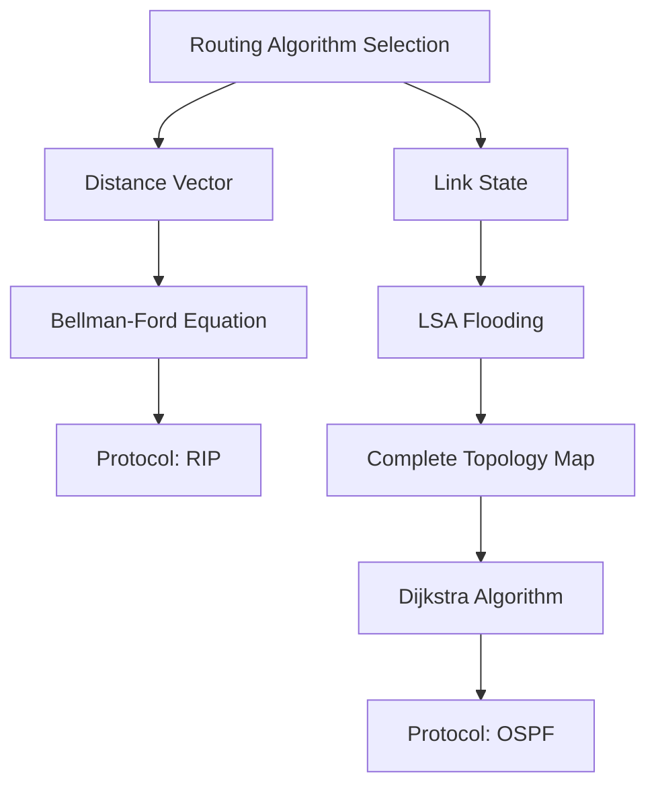

## Introduction

Imagine you are standing at a busy intersection in a city you have never visited. You have a destination in mind, but you do not have a map of the entire city. You rely on the street signs at that specific corner to tell you which way to turn to reach your goal. In the world of computer networking, every router is at such an intersection. Millions of packets arrive every second, and the router must decide, almost instantaneously, which outgoing link will get each packet closer to its final destination.

This decision-making process is the heart of the **Network Layer**. It involves two distinct but related tasks: **forwarding**, the local action of moving a packet from an input interface to the correct output interface, and **routing**, the network-wide process of determining the end-to-end paths that packets should follow. Without efficient routing algorithms, the internet would collapse into a congested mess of loops and dead ends.

In this lesson, we will examine the two primary philosophies of routing: **Distance Vector (DV)** and **Link State (LS)**. We will dive into the mathematical foundations of each—the Bellman-Ford algorithm and Dijkstra’s algorithm—and see how they are implemented in real-world protocols like RIP and OSPF. We will also discuss the inherent challenges of distributed pathfinding, such as slow convergence and routing loops.

**Before you start:** you should be familiar with the basic functions of the *OSI vs TCP/IP Protocol Stacks* and understand the concept of a packet as defined in *Network Fundamentals, Topologies & Performance*.

## Core theory

### Routing vs. Forwarding

To understand routing, we must first distinguish it from forwarding. While often used interchangeably in casual conversation, they represent different planes of operation:

1.  **Forwarding (Data Plane):** This is the hardware-accelerated process of taking a packet from an input port, looking up its destination address in a **forwarding table** (sometimes called a routing table), and sending it out the appropriate output port. This happens on a microsecond timescale.
2.  **Routing (Control Plane):** This is the "brain" of the network. Routing algorithms run in software to determine the best paths from sources to destinations. The output of the routing algorithm is used to populate the forwarding tables. This happens on a timescale of seconds or when the network topology changes.

We represent a network as a **graph** $G = (N, E)$, where $N$ is a set of nodes (routers) and $E$ is a set of edges (physical links). Each edge $(u, v)$ has an associated **cost** $c(u, v)$, which could represent physical distance, link speed, monetary cost, or current congestion levels. The goal of a routing algorithm is to find the path with the minimum total cost between any two nodes.

### Distance Vector (DV) Routing

**Distance Vector** routing is a decentralized, iterative algorithm. In a DV-based network, each router maintains a vector (a list) of the minimum distances to all known destinations. Routers do not know the entire network topology; they only know their immediate neighbors and the information those neighbors share.

The mathematical foundation of DV is the **Bellman-Ford equation**. Let $d_x(y)$ be the cost of the least-cost path from node $x$ to node $y$. The equation states:

$$d_x(y) = \min_v \{c(x, v) + d_v(y)\}$$

Where the minimum is taken over all neighbors $v$ of $x$. In words: the best way to get to $y$ from $x$ is to look at all neighbors $v$, add the cost to reach $v$ to $v$'s own reported distance to $y$, and pick the smallest result.

**Key Characteristics of DV:**
*   **Distributed:** Each node receives information from neighbors, performs a calculation, and distributes results back to neighbors.
*   **Iterative:** The process continues until no more information is exchanged (convergence).
*   **Self-terminating:** If no topology changes occur, the algorithm eventually stops.

The most common implementation of DV is the **Routing Information Protocol (RIP)**, which uses "hop count" as its cost metric (maximum 15 hops).

### Link State (LS) Routing

In **Link State** routing, every router possesses a complete map of the network topology. This is achieved through a process called **flooding**. Each router creates a **Link State Advertisement (LSA)** containing the identity of its neighbors and the cost of the links to them. This LSA is broadcast to *every* other router in the network.

Once a router has received LSAs from all other routers, it builds a **Link State Database (LSDB)**, which is essentially the complete graph $G$. It then runs **Dijkstra’s algorithm** locally to calculate the shortest path tree from itself to all other nodes.

**Dijkstra’s Algorithm Steps:**
1.  **Initialization:** Mark the source node as the current node and set its distance to 0. Set all other nodes' distances to infinity.
2.  **Neighbor Update:** For the current node, consider all its unvisited neighbors and calculate their tentative distances through the current node.
3.  **Selection:** Once all neighbors of the current node are considered, mark the current node as visited. A visited node will never be checked again.
4.  **Iteration:** Select the unvisited node with the smallest tentative distance and set it as the new "current node." Repeat from step 2 until all nodes are visited.

The most widely used LS protocol is **Open Shortest Path First (OSPF)**.

### Convergence and the Count-to-Infinity Problem

**Convergence** is the state where all routers have consistent and correct routing information. LS protocols generally converge faster than DV protocols because they flood information immediately.

DV protocols suffer from the **count-to-infinity** problem. Consider three nodes in a line: $A - B - C$, with all link costs = 1. If the link between $B$ and $C$ fails, $B$ knows $C$ is unreachable. However, $A$ had previously told $B$ that it could reach $C$ in 2 hops (via $B$). $B$ might mistakenly think, "I can't reach $C$ directly, but $A$ says it can reach $C$ in 2 hops, so I can reach $C$ via $A$ in 3 hops!" $B$ tells $A$ its new distance is 3; $A$ then updates its distance to 4, and they continue incrementing until they reach a predefined "infinity" value.

**Solutions to Count-to-Infinity:**
*   **Split Horizon:** A router does not advertise a route back to the neighbor from which it learned that route.
*   **Poison Reverse:** If $B$ routes through $A$ to reach $C$, $B$ advertises to $A$ that its distance to $C$ is infinity. This explicitly tells $A$ not to try to reach $C$ through $B$.

### Comparing DV and LS Protocols

The choice between DV and LS involves trade-offs in complexity, overhead, and speed.

| Feature | Distance Vector (RIP) | Link State (OSPF) |
| :--- | :--- | :--- |
| **Knowledge** | Only knows neighbors' "views" | Knows entire network map |
| **Algorithm** | Bellman-Ford | Dijkstra |
| **Convergence** | Slow; may have loops | Fast; loop-free once converged |
| **Overhead** | Low (periodic updates) | High (flooding LSAs) |
| **Scalability** | Limited (e.g., 15 hops) | High (hierarchical areas) |
| **Robustness** | Errors propagate network-wide | Errors are localized |



## Worked examples

### Example 1: Bellman-Ford Update

Consider a small network with three routers: $X$, $Y$, and $Z$.
*   Cost $c(X, Y) = 2$
*   Cost $c(X, Z) = 7$
*   Cost $c(Y, Z) = 1$

Initially, $X$ has the following distance vector: $D_X = [X:0, Y:2, Z:7]$.
$Y$ has: $D_Y = [X:2, Y:0, Z:1]$.
$Z$ has: $D_Z = [X:7, Y:1, Z:0]$.

**Step:** Node $X$ receives an update from neighbor $Y$. $X$ wants to recalculate its distance to $Z$ using the Bellman-Ford equation: $D_X(Z) = \min \{ c(X, Y) + D_Y(Z), c(X, Z) + D_Z(Z) \}$.

1.  Path via $Y$: $c(X, Y) + D_Y(Z) = 2 + 1 = 3$.
2.  Path via $Z$: $c(X, Z) + D_Z(Z) = 7 + 0 = 7$.
3.  Minimum: $\min(3, 7) = 3$.

**Result:** $X$ updates its distance vector to $D_X = [X:0, Y:2, Z:3]$. It now knows that the shortest path to $Z$ is through $Y$, not the direct link.

### Example 2: Dijkstra's Algorithm Trace

We will find the shortest paths from source node **A** to all other nodes in the following graph:
*   Links: (A,B,2), (A,C,5), (B,C,2), (B,D,4), (C,D,1)

**Initialization:**
*   Visited Set $S = \{A\}$
*   Distances: $D(B)=2, D(C)=5, D(D)=\infty$

**Iteration 1:**
1.  Unvisited nodes are $B, C, D$. Smallest $D$ is $B$ (value 2).
2.  Add $B$ to $S$. $S = \{A, B\}$.
3.  Update neighbors of $B$ ($C$ and $D$):
    *   New $D(C) = \min(5, D(B) + c(B,C)) = \min(5, 2 + 2) = 4$.
    *   New $D(D) = \min(\infty, D(B) + c(B,D)) = \min(\infty, 2 + 4) = 6$.

**Iteration 2:**
1.  Unvisited nodes are $C, D$. Smallest $D$ is $C$ (value 4).
2.  Add $C$ to $S$. $S = \{A, B, C\}$.
3.  Update neighbors of $C$ ($D$):
    *   New $D(D) = \min(6, D(C) + c(C,D)) = \min(6, 4 + 1) = 5$.

**Iteration 3:**
1.  Only $D$ remains. Add $D$ to $S$. $S = \{A, B, C, D\}$.
2.  Final distances from A: **B=2, C=4, D=5**.

### Example 3: Python Implementation of Dijkstra

This script calculates the shortest path from a source node to all others using a priority-queue-like approach (using a simple list for clarity).

```python
def dijkstra(graph, start_node):
    # graph is a dict of dicts: {node: {neighbor: cost}}
    distances = {node: float('inf') for node in graph}
    distances[start_node] = 0
    unvisited = list(graph.keys())

    while unvisited:
        # Find unvisited node with smallest distance
        current_node = min(unvisited, key=lambda node: distances[node])
        unvisited.remove(current_node)

        if distances[current_node] == float('inf'):
            break

        for neighbor, weight in graph[current_node].items():
            path_cost = distances[current_node] + weight
            if path_cost < distances[neighbor]:
                distances[neighbor] = path_cost
                
    return distances

# Define the graph from Example 2
network = {
    'A': {'B': 2, 'C': 5},
    'B': {'A': 2, 'C': 2, 'D': 4},
    'C': {'A': 5, 'B': 2, 'D': 1},
    'D': {'B': 4, 'C': 1}
}

results = dijkstra(network, 'A')
for node in sorted(results):
    print(f"Distance from A to {node}: {results[node]}")
```

Output:
```text
Distance from A to A: 0
Distance from A to B: 2
Distance from A to C: 4
Distance from A to D: 5
```

## Applications

*   **Intra-domain Routing (IGP):** OSPF and IS-IS (Intermediate System to Intermediate System) are the standard Link State protocols used within large corporate or ISP networks to manage internal traffic.
*   **Small Networks:** RIP is still used in very small, simple networks where the overhead of OSPF is unnecessary and the 15-hop limit is not a constraint.
*   **Software Defined Networking (SDN):** In SDN, a centralized controller often runs a version of Dijkstra’s algorithm to compute paths for the entire network and then pushes those paths down to switches via OpenFlow.
*   **Traffic Engineering:** Link State protocols allow for sophisticated traffic engineering. Because every router has the full map, they can calculate paths that avoid congested links or meet specific Quality of Service (QoS) requirements.
*   **Data Center Fabrics:** Modern data centers use specialized versions of Link State routing to manage the massive number of redundant paths between servers, ensuring high availability and throughput.

## Common mistakes

*   **The mistake.** Thinking Distance Vector protocols have a complete map of the network. **Why it is wrong and how to avoid it.** DV routers only know what their neighbors tell them ("neighbor-to-neighbor" gossip). Only Link State protocols build a full topological map.
*   **The mistake.** Assuming Dijkstra's algorithm works correctly with negative edge weights. **Why it is wrong and how to avoid it.** Dijkstra assumes that adding an edge always increases (or keeps constant) the path cost. If negative weights exist, a previously "visited" node might find a shorter path later. For negative weights, use the Bellman-Ford algorithm.
*   **The mistake.** Confusing the routing table with the link-state database. **Why it is wrong and how to avoid it.** The LSDB is the raw map of all links. The routing (forwarding) table is the *result* of running Dijkstra on that map, containing only the "next hop" for each destination.
*   **The mistake.** Believing "Poison Reverse" solves all routing loops. **Why it is wrong and how to avoid it.** Poison reverse solves loops involving two nodes, but more complex loops involving three or more nodes can still occur during the convergence period of DV protocols.
*   **The mistake.** Ignoring the overhead of Link State flooding. **Why it is wrong and how to avoid it.** In very large networks, flooding LSAs can consume significant bandwidth and CPU. This is why OSPF uses "Areas" to localize flooding and keep the LSDB size manageable.

## Revision notes

*   **Forwarding** is local (input to output); **Routing** is global (path determination).
*   **Bellman-Ford Equation:** $d_x(y) = \min_v \{c(x,v) + d_v(y)\}$.
*   **Distance Vector (RIP):** Decentralized, uses Bellman-Ford, suffers from count-to-infinity, limited by hop count.
*   **Link State (OSPF):** Global knowledge via flooding, uses Dijkstra, fast convergence, higher CPU/memory requirements.
*   **Dijkstra Complexity:** With a simple implementation, $O(N^2)$; with a binary heap, $O(E \log N)$.
*   **Split Horizon/Poison Reverse:** Techniques to mitigate loops in Distance Vector protocols by controlling how routes are advertised back to neighbors.
*   **Metric:** The "cost" of a link. RIP uses hops; OSPF typically uses $10^8 / \text{bandwidth}$.
*   **Convergence:** The time it takes for all routers to agree on the network topology after a change.

## Practice questions

:::question basic
A router using Distance Vector routing receives two updates for destination $Z$. Neighbor $A$ advertises a distance of 5 to $Z$ and the link cost to $A$ is 2. Neighbor $B$ advertises a distance of 3 to $Z$ and the link cost to $B$ is 5. Which neighbor will the router choose as the next hop for $Z$?
:::answer
The router will choose neighbor $A$. Using Bellman-Ford, the cost via $A$ is $5 + 2 = 7$, and the cost via $B$ is $3 + 5 = 8$. Since 7 is less than 8, $A$ is the preferred next hop.
:::

:::question basic
In OSPF, what is the purpose of "flooding" Link State Advertisements (LSAs)?
:::answer
Flooding ensures that every router in the network (or area) receives the exact same information about every link and its status. This allows each router to build an identical, complete map of the topology, which is necessary for Dijkstra's algorithm to calculate consistent, loop-free paths.
:::

:::question intermediate
Explain why the "Count-to-Infinity" problem occurs in Distance Vector routing but not in Link State routing.
:::answer
In Distance Vector, routers only have aggregate information from neighbors and don't know the actual path taken; thus, they can accidentally form a loop by routing through a neighbor that is actually routing through them. In Link State, every router has the full topology map, so when a link fails, every router sees the failure in the map and calculates a new path that physically cannot include the failed link or a loop.
:::

:::question intermediate
A network has 10 routers. If one link cost changes, how many routers will eventually run Dijkstra's algorithm in an OSPF network? How many will update their vectors in a RIP network?
:::answer
In OSPF, all 10 routers will run Dijkstra because the LSA describing the change is flooded to the entire network. In RIP, only the routers whose shortest paths are affected by that specific link change will update their vectors and propagate those changes, though in the worst case, this could also be all 10.
:::

:::question advanced
Suppose a network uses Dijkstra's algorithm. If all link costs are doubled, do the shortest paths change? If all link costs are increased by a constant $k$, do the shortest paths change?
:::answer
If costs are doubled, the shortest paths do not change because the relative order of path costs remains the same (if $Path_1 < Path_2$, then $2 \cdot Path_1 < 2 \cdot Path_2$). However, if a constant $k$ is added to every link, the shortest paths *can* change because paths with more hops are penalized more heavily than paths with fewer hops, potentially making a previously longer (but lower-cost) path more expensive than a shorter-hop path.
:::

:::question advanced
Why does OSPF use a hierarchy (Areas) for large networks? Describe the impact on the Link State Database (LSDB).
:::answer
OSPF uses Areas to limit the scope of LSA flooding and reduce the computational burden on routers. By dividing the network, a router only needs to maintain a detailed LSDB for its own area and a summarized view of other areas, which significantly reduces the memory required for the LSDB and the time required to run Dijkstra's algorithm.
:::

## Further learning

*   **Next:** *IPv4 Subnetting & CIDR Calculation* explains how IP addresses are structured to allow the routing tables we discussed to stay small through route summarization.
*   **Related:** *BGP & Inter-Domain Autonomous Routing* covers how routing works between different organizations (the "Path Vector" protocol), which is the glue that holds the global Internet together.
*   **Related:** *OSI vs TCP/IP Protocol Stacks* provides the context for where the Network Layer sits in the overall communication process.
*   **Textbook:** Kurose and Ross, *Computer Networking: A Top-Down Approach*.
