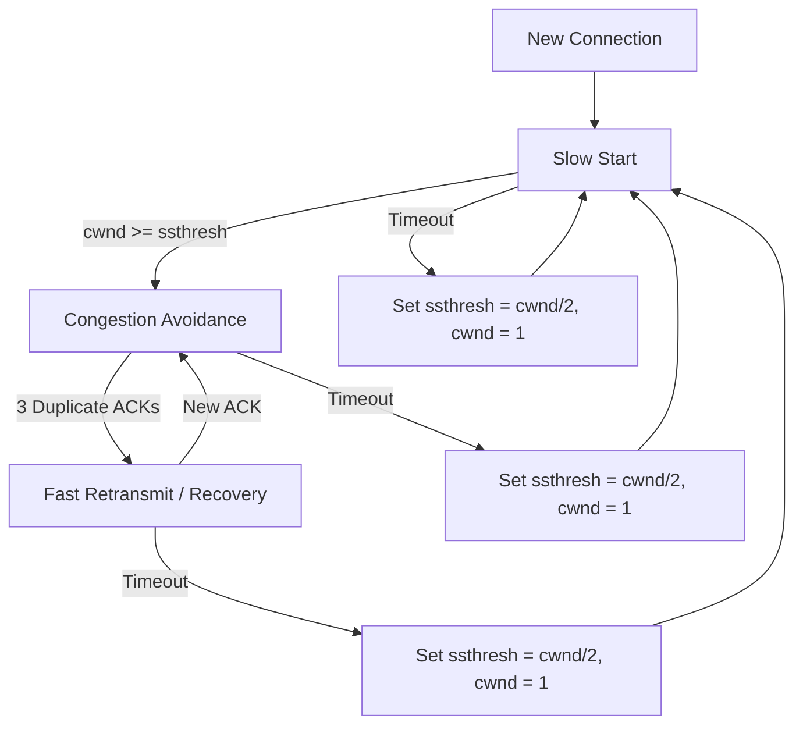

## Introduction

Imagine you are trying to send a massive file across a busy city using a fleet of delivery bikes. If you send all the bikes at once, they might get stuck in a massive traffic jam, causing every delivery to be late. If you send only one bike at a time, the city streets are empty, but your file transfer will take forever. This is the fundamental challenge of **Congestion Control**.

In computer networking, the "city streets" are the links and routers that make up the Internet. Unlike Flow Control, which prevents a fast sender from overwhelming a slow receiver, Congestion Control prevents the sender from overwhelming the network itself. While the Transmission Control Protocol (TCP) uses sophisticated algorithms to probe the network's capacity and back off when it detects "traffic jams," the User Datagram Protocol (UDP) takes a different approach: it simply sends data as fast as the application requests, prioritizing speed and low latency over reliability and politeness.

This lesson explores how TCP manages this delicate balance through its congestion window and the AIMD algorithm, and why certain applications choose to bypass these features entirely by using UDP.

**Before you start:** you should be familiar with the *TCP 3-Way Handshake & Flow Control*, specifically the concept of sequence numbers and the receiver's window ($rwnd$), as well as basic *IPv4 Subnetting & CIDR Calculation*.

## Core theory

### The Congestion Problem and the Window

When multiple sources send data into a network at a combined rate higher than the capacity of a bottleneck link, **Congestion** occurs. Routers have buffers (memory) to store incoming packets during temporary bursts, but if the arrival rate remains higher than the departure rate, these buffers overflow, and packets are dropped.

TCP detects this congestion indirectly. Since TCP expects an acknowledgment (ACK) for every segment sent, a missing ACK or a timeout is treated as a signal that a packet was dropped due to congestion. To manage this, TCP maintains a **Congestion Window ($cwnd$)**. This window represents the sender's estimate of the network's current capacity.

The $cwnd$ is a sender-side limit on the amount of data that can be "in flight" (sent but not yet acknowledged). This is distinct from the **Receiver Window ($rwnd$)**, which is the limit advertised by the receiver to prevent its own buffers from overflowing. The actual amount of data a sender can transmit is the minimum of these two values:

$$\text{Effective Window} = \min(cwnd, rwnd)$$

TCP is often described as **self-clocking**. This means it uses ACKs as a "clock" to trigger the injection of new packets into the network. This principle, known as the **Conservation of Packets**, ensures that for every packet that leaves the network (is delivered), a new one can be sent.

### TCP Slow Start

When a TCP connection begins, the sender has no idea what the network capacity is. It could be a 10 Gbps fiber link or a 56 kbps satellite link. To avoid causing immediate congestion, TCP enters the **Slow Start** phase.

1.  Initialize $cwnd$ to a small value, typically 1 **Maximum Segment Size (MSS)**.
2.  For every ACK received, increase $cwnd$ by 1 MSS.

This results in **exponential growth**. If the sender transmits 1 segment and receives 1 ACK, $cwnd$ becomes 2. The sender then transmits 2 segments; when both are acknowledged, $cwnd$ becomes 4. The window continues to double every Round Trip Time (RTT). Despite the name, Slow Start is the fastest way TCP increases its transmission rate.

The growth is governed by:
$$cwnd_{t+1} = cwnd_t + 1 \text{ (per ACK received)}$$

### Congestion Avoidance and AIMD

Exponential growth is too aggressive for a steady-state connection. To transition to a more stable growth pattern, TCP uses a variable called the **Slow Start Threshold ($ssthresh$)**. When $cwnd \ge ssthresh$, TCP enters **Congestion Avoidance**.

In this phase, TCP uses the **Additive Increase Multiplicative Decrease (AIMD)** algorithm:
-   **Additive Increase:** For every RTT where no loss occurs, increase $cwnd$ by 1 MSS. This is done by increasing $cwnd$ by $1/cwnd$ for every ACK received.
-   **Multiplicative Decrease:** When a loss is detected via a timeout, $ssthresh$ is set to half of the current $cwnd$, and $cwnd$ is reset to 1 MSS.

This creates the famous "sawtooth" pattern of TCP throughput. The goal is to probe for extra bandwidth slowly but back off aggressively to allow the network to recover. AIMD is mathematically proven to lead to **fairness**, where multiple TCP flows sharing a bottleneck link eventually converge to an equal share of the bandwidth.

### Fast Retransmit and Fast Recovery

Waiting for a full retransmission timeout (RTO) is inefficient. If a single segment is lost but subsequent segments arrive, the receiver will send **Duplicate ACKs** for the last successfully received in-order segment.

-   **Fast Retransmit:** If the sender receives **three duplicate ACKs** (four ACKs for the same sequence number in total), it assumes the segment was lost and retransmits it immediately without waiting for a timeout.
-   **Fast Recovery:** Instead of dropping $cwnd$ to 1 MSS (as it would for a timeout), the sender sets $ssthresh = cwnd / 2$, then sets $cwnd = ssthresh + 3$ (to account for the segments that triggered the duplicate ACKs). It then continues with Additive Increase.

This distinction is crucial: a timeout suggests severe congestion (no packets getting through), while triple duplicate ACKs suggest mild congestion (some packets are still arriving).

### UDP: The Datagram Alternative

The User Datagram Protocol (UDP) is a **connectionless**, "best-effort" transport protocol. Unlike TCP, it does not perform a handshake, does not track sequence numbers, and has no built-in congestion control.

| Feature | TCP | UDP |
| :--- | :--- | :--- |
| Reliability | Guaranteed delivery via retransmission | No guarantee; packets can be lost |
| Ordering | Segments delivered in order | Datagrams may arrive out of order |
| Latency | Higher (handshake + retransmissions) | Lower (no handshake, no delays) |
| Overhead | 20-60 byte header | 8 byte header |
| Congestion Control | Yes (AIMD) | No (Application must manage) |

UDP is preferred when **Low Latency** is more important than perfect reliability. If a packet of voice data in a VoIP call is lost, retransmitting it 200ms later is useless because the conversation has moved on. The application would rather just skip the lost millisecond of audio.

### State Transition Logic

The following diagram illustrates how a TCP sender moves between the primary congestion control states.



## Worked examples

### Example 1: Tracing the Congestion Window

A TCP connection starts with $cwnd = 1$ MSS and $ssthresh = 8$ MSS. Assume no packets are lost until $cwnd$ reaches 12 MSS. Calculate the value of $cwnd$ for the first 10 transmission rounds (RTTs).

**Step 1: Slow Start Phase.**
-   Round 1: $cwnd = 1$. Send 1, get 1 ACK. $cwnd$ becomes 2.
-   Round 2: $cwnd = 2$. Send 2, get 2 ACKs. $cwnd$ becomes 4.
-   Round 3: $cwnd = 4$. Send 4, get 4 ACKs. $cwnd$ becomes 8.
-   Round 4: $cwnd = 8$. Since $cwnd = ssthresh$, the sender enters Congestion Avoidance.

**Step 2: Congestion Avoidance.**
-   Round 5: $cwnd = 8 + 1 = 9$. (Additive increase).
-   Round 6: $cwnd = 10$.
-   Round 7: $cwnd = 11$.
-   Round 8: $cwnd = 12$.

**Step 3: Handling Loss.**
Assume a timeout occurs at the end of Round 8.
-   $ssthresh$ becomes $12 / 2 = 6$.
-   $cwnd$ resets to 1.
-   Round 9: $cwnd = 1$. (Slow start begins again).
-   Round 10: $cwnd = 2$. (Since $2 < 6$).

**Final Answer:** The $cwnd$ values at the start of each round are 1, 2, 4, 8, 9, 10, 11, 12, 1, 2.

### Example 2: Latency for Small Requests (TCP vs UDP)

Consider a DNS query (small request, small response). The Round Trip Time (RTT) between client and server is 50ms. Compare the time elapsed until the client receives the data.

**UDP Scenario:**
1.  Client sends UDP Datagram (0ms).
2.  Server receives and sends response (50ms).
3.  Client receives response (100ms).
**Total Time: 100ms.**

**TCP Scenario:**
1.  Client sends SYN (0ms).
2.  Server sends SYN-ACK (50ms).
3.  Client sends ACK + Data Request (100ms).
4.  Server receives request and sends Data Response (150ms).
5.  Client receives response (200ms).
**Total Time: 200ms.**

**Analysis:** TCP takes double the time of UDP because of the mandatory 3-way handshake. For short-lived connections, the handshake overhead is the dominant factor in perceived latency.

### Example 3: Python Simulation of AIMD

This script simulates the growth of $cwnd$ over time, showing the additive increase and the multiplicative decrease when a simulated loss occurs.

```python
def simulate_tcp(rounds, loss_at):
    cwnd = 1.0
    ssthresh = 16.0
    history = []
    
    for r in range(1, rounds + 1):
        history.append(round(cwnd, 2))
        
        if r == loss_at:
            # Multiplicative Decrease (Timeout)
            ssthresh = max(2.0, cwnd / 2)
            cwnd = 1.0
            continue
            
        if cwnd < ssthresh:
            # Slow Start: Exponential growth
            cwnd *= 2
        else:
            # Congestion Avoidance: Additive increase
            cwnd += 1.0
            
    return history

# Simulate 15 rounds with a timeout at round 10
print(simulate_tcp(15, 10))
```

Output:

```text
[1.0, 2.0, 4.0, 8.0, 16.0, 17.0, 18.0, 19.0, 20.0, 21.0, 1.0, 2.0, 4.0, 8.0, 16.0]
```

**Explanation of Output:**
-   **Rounds 1-4:** $cwnd$ doubles (1, 2, 4, 8) because it is below $ssthresh$ (16).
-   **Rounds 5-9:** $cwnd$ increases linearly (16, 17, 18, 19, 20, 21) because it is $\ge ssthresh$.
-   **Round 10:** A timeout occurs. $ssthresh$ is set to $21 / 2 = 10.5$. $cwnd$ resets to 1.0.
-   **Rounds 11-14:** $cwnd$ doubles (1, 2, 4, 8) because it is below the new $ssthresh$ (10.5).
-   **Round 15:** $cwnd$ was 8.0 at the end of Round 14. Since $8.0 < 10.5$, it doubles to 16.0.

## Applications

-   **Web Browsing (HTTP/1.1 and HTTP/2):** These rely on TCP to ensure that every part of a webpage (HTML, CSS, Images) arrives correctly. A single missing bit in a JavaScript file could crash the page, making TCP's reliability essential.
-   **Real-Time Media (VoIP and Video Conferencing):** Applications like Zoom or WhatsApp Calls use UDP (often via the RTP protocol). They prioritize low latency so that the "lag" between speakers is minimized, accepting that occasional packet loss will only cause minor audio artifacts.
-   **Online Gaming:** Fast-paced games use UDP to send player coordinates. If a coordinate update is lost, the next one arriving 16ms later will correct the position. Waiting for a TCP retransmission would cause the player to "teleport" or freeze, a phenomenon known as **Head-of-Line Blocking**.
-   **Modern Web Protocols (HTTP/3):** Interestingly, HTTP/3 uses the QUIC protocol, which is built on top of **UDP**. QUIC implements its own congestion control and reliability mechanisms in user space, allowing it to avoid the latency of the TCP handshake and the Head-of-Line blocking issues of standard TCP.
-   **File Transfer (FTP/SFTP):** These use TCP because a single flipped bit or missing segment would corrupt the entire file. The throughput "sawtooth" is an acceptable trade-off for data integrity.

## Common mistakes

-   **The mistake.** Thinking $cwnd$ and $rwnd$ are the same thing. **Why it is wrong and how to avoid it.** $rwnd$ is about the receiver's memory; $cwnd$ is about the network's capacity. Remember that the sender must respect the *smaller* of the two.
-   **The mistake.** Assuming UDP is "faster" because it has a higher bit rate. **Why it is wrong and how to avoid it.** UDP is "faster" in terms of *latency* (no handshake) and *jitter*, but it doesn't increase the physical bandwidth of the wire. It simply lacks the "brakes" that TCP applies.
-   **The mistake.** Believing Slow Start is actually slow. **Why it is wrong and how to avoid it.** Slow Start is an exponential growth phase. It is only "slow" compared to sending the entire window at once. It is the fastest growth phase in the TCP lifecycle.
-   **The mistake.** Confusing the trigger for Fast Retransmit. **Why it is wrong and how to avoid it.** It is triggered by **three duplicate ACKs** (which is the 4th ACK for that sequence number), not just one. A single duplicate ACK could just be a packet arriving out of order.
-   **The mistake.** Thinking UDP provides no error checking at all. **Why it is wrong and how to avoid it.** UDP has an optional checksum in its header to detect corruption. However, if it detects corruption, it simply drops the packet; it never asks for a retransmission.

## Revision notes

-   **Congestion Window ($cwnd$):** The sender-side limit on in-flight data to prevent network congestion.
-   **Slow Start:** $cwnd$ starts at 1 MSS and doubles every RTT ($cwnd = cwnd + 1$ per ACK).
-   **Congestion Avoidance:** Triggered when $cwnd \ge ssthresh$. $cwnd$ increases by 1 MSS per RTT (Additive Increase).
-   **Multiplicative Decrease:** On timeout, $ssthresh = cwnd / 2$ and $cwnd = 1$.
-   **Fast Retransmit:** Triggered by 3 duplicate ACKs; allows retransmission before a timeout.
-   **Fast Recovery:** After Fast Retransmit, $cwnd$ is reduced to $ssthresh$ rather than 1.
-   **UDP Header:** Only 8 bytes (Source Port, Destination Port, Length, Checksum).
-   **UDP Use Case:** Best for loss-tolerant, delay-sensitive applications (DNS, VoIP, Gaming).
-   **Fairness:** AIMD ensures that multiple flows eventually share a bottleneck link equally.

## Practice questions

:::question basic
A TCP sender is in the Slow Start phase with a $cwnd$ of 4 MSS. It sends 4 segments and receives ACKs for all of them. What will be the $cwnd$ for the next transmission round?
:::answer
The $cwnd$ will be 8 MSS. In Slow Start, the window doubles every RTT (or increases by 1 for every ACK received), so 4 + 4 = 8.
:::

:::question basic
Which field in the UDP header is optional in IPv4 but mandatory in IPv6?
:::answer
The Checksum field. In IPv4, a sender can set the checksum to zero to skip the calculation, but IPv6 requires it to ensure header integrity since IPv6 routers no longer perform header checksums themselves.
:::

:::question intermediate
A TCP connection is in Congestion Avoidance with $cwnd = 20$ MSS. A packet loss is detected via a **timeout**. What are the new values for $ssthresh$ and $cwnd$?
:::answer
$ssthresh = 10$ and $cwnd = 1$. In the event of a timeout, TCP assumes severe congestion, halving the threshold ($20/2 = 10$) and resetting the window to the minimum of 1 MSS to restart Slow Start.
:::

:::question intermediate
Why does UDP not have a "handshake" like TCP's SYN/ACK?
:::answer
UDP is connectionless and does not maintain state. Since it does not guarantee reliability, ordering, or flow control, there are no parameters (like sequence numbers or window sizes) that need to be synchronized between the two hosts before data transfer begins.
:::

:::question advanced
Explain why the "Additive Increase" part of AIMD is necessary for fairness when multiple TCP flows share a bottleneck link.
:::answer
If two flows share a link, Multiplicative Decrease forces both to drop their rates proportionally when congestion occurs. However, Additive Increase allows them to "probe" the remaining capacity at the same constant rate (1 MSS per RTT). Over time, this causes the flows to converge toward an equal share of the bandwidth, regardless of their starting speeds.
:::

:::question advanced
A sender uses a version of TCP that implements Fast Recovery. If $cwnd$ is 40 MSS and 3 duplicate ACKs are received, what is the $cwnd$ value immediately after entering Fast Recovery?
:::answer
The $cwnd$ becomes 23 MSS. First, $ssthresh$ is set to half of $cwnd$ ($40 / 2 = 20$). Then, $cwnd$ is set to $ssthresh + 3$ to account for the three segments that have left the network (triggering the duplicate ACKs), resulting in 23.
:::

## Further learning

-   **Next:** *DNS & Modern HTTP Protocols* explores how the transport choices made here (UDP for DNS, TCP for HTTP) affect the performance of the modern web.
-   **Related:** *OSI vs TCP/IP Protocol Stacks* provides the architectural context for where the Transport layer sits relative to the Network and Application layers.
-   **Related:** *Channel Capacity & Transmission Media* explains the physical limits (like Shannon's Law) that create the bottlenecks TCP tries to manage.
-   **Related:** *TCP 3-Way Handshake & Flow Control* covers the initial connection setup and the receiver-side window management.
-   **Textbook:** James Kurose and Keith Ross, *Computer Networking: A Top-Down Approach*.
