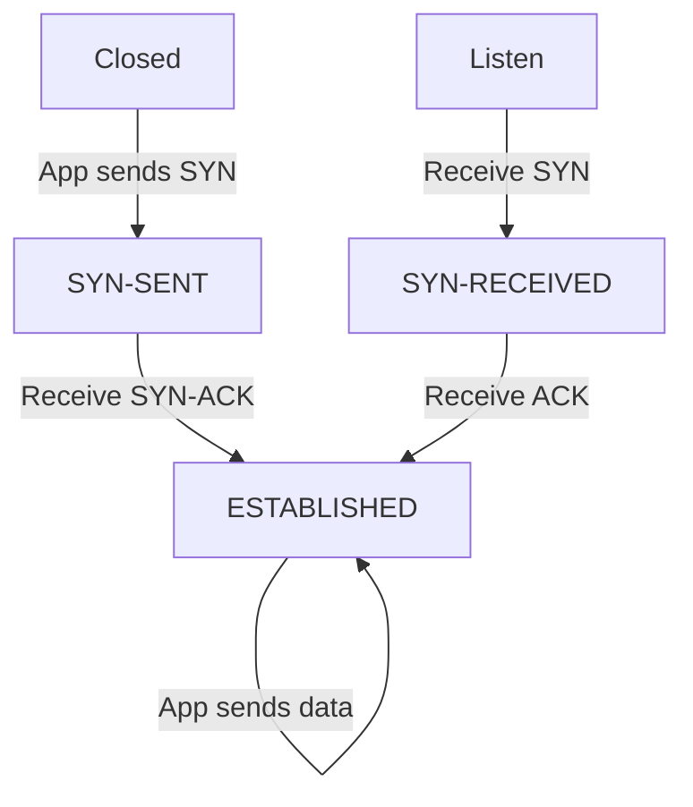

## Introduction

In the previous modules, we explored how the Internet Protocol (IP) handles the routing of packets across a vast web of interconnected networks. However, IP is a "best-effort" delivery system. It makes no guarantees that a packet will arrive, that it will arrive only once, or that it will arrive in the correct order. For applications like web browsing (HTTP) or file transfers (FTP), receiving a scrambled or incomplete set of data is unacceptable.

This is where the **Transmission Control Protocol (TCP)** steps in. Operating at the Transport Layer, TCP transforms the unreliable underlying network into a reliable "pipe" for data. Before a single byte of application data is sent, TCP must establish a formal connection between the sender and the receiver. Once the data starts flowing, TCP must ensure the sender does not overwhelm the receiver's memory—a process known as **flow control**.

In this lesson, we will dissect the **3-way handshake** that initializes a connection and the **sliding window** mechanism that keeps data rates manageable. We will see how TCP uses sequence numbers not just for ordering, but as a fundamental tool for reliability and resource management.

**Before you start:** You should be familiar with *OSI vs TCP/IP Protocol Stacks*, specifically the difference between Layer 3 (Network) and Layer 4 (Transport), and have a basic understanding of *IPv4 Subnetting & CIDR Calculation*.

## Core theory

### The TCP Segment Structure and Flags

To understand the handshake and flow control, we must first look at the TCP header. Unlike the simple header of UDP, the TCP header contains several fields dedicated to state management.

The most critical fields for this lesson are:
*   **Sequence Number (32 bits):** In the initial handshake, this is a random starting value. During data transfer, it represents the byte-stream number of the first data byte in the segment.
*   **Acknowledgment Number (32 bits):** If the ACK flag is set, this contains the next byte sequence number the sender of the segment is expecting to receive.
*   **Window Size (16 bits):** This field is used for flow control. It tells the other party how many bytes the sender is willing to accept, starting from the byte indicated in the acknowledgment field.
*   **Flags (9 bits):** Control bits that define the segment type. The most important for us are **SYN** (Synchronize), **ACK** (Acknowledge), **FIN** (Finish), and **RST** (Reset).

### The 3-Way Handshake

TCP is a **connection-oriented** protocol. It requires a formal setup phase to synchronize sequence numbers and exchange initial capabilities (like maximum segment size). This is achieved through the **3-way handshake**.

1.  **SYN:** The client chooses an **Initial Sequence Number (ISN)**, let's call it $x$. It sends a segment with the `SYN` flag set and `Sequence Number = x`. The client enters the `SYN-SENT` state.
2.  **SYN-ACK:** The server receives the SYN. It chooses its own ISN, $y$. It sends a segment with both `SYN` and `ACK` flags set. It sets `Sequence Number = y` and `Acknowledgment Number = x + 1`. The server enters the `SYN-RECEIVED` state.
3.  **ACK:** The client receives the SYN-ACK. It sends a segment with the `ACK` flag set. It sets `Sequence Number = x + 1` and `Acknowledgment Number = y + 1`. Both parties now enter the `ESTABLISHED` state.

Note that the `SYN` flag consumes exactly one sequence number, even though it carries no application data. This ensures that the acknowledgment of the SYN is unambiguous.

### Sequence and Acknowledgment Numbers

TCP views data as an unstructured, ordered stream of bytes. Every byte sent is assigned a sequence number. If a sender transmits a segment containing 1000 bytes of data with a starting `Sequence Number = 500`, the bytes in that segment are numbered 500 through 1499.

The **Acknowledgment Number** is "cumulative." When a receiver sends an `ACK` with the value 1500, it is saying: "I have successfully received everything up to byte 1499, and I am ready for byte 1500." If segments arrive out of order (e.g., 500-999 arrives, then 1500-1999 arrives, but 1000-1499 is missing), the receiver will continue to ACK 1000 until the "hole" in the sequence is filled.

### Flow Control: The Sliding Window

**Flow control** is the mechanism that prevents a fast sender from overrunning a slow receiver's buffer. If the receiver's application is slow to read data from the TCP buffer, the buffer will fill up. If the sender keeps sending, the receiver will be forced to drop packets.

TCP implements flow control using a **sliding window**. The receiver "advertises" a **Receive Window (rwnd)** in every ACK segment. This value represents the amount of free space currently available in its receive buffer.

The sender maintains a variable called the **Send Window**, which is the maximum amount of data it can have "in flight" (sent but not yet acknowledged). The sender must ensure that:

$$LastByteSent - LastByteAcked \le rwnd$$

As the receiver's application reads data, the buffer empties, and the receiver sends a new ACK with a larger `rwnd`, effectively "sliding" the window forward and allowing the sender to transmit more.

### Window Management and Zero Window Probing

If the receiver's buffer becomes completely full, it will send an ACK with `rwnd = 0`. This is known as a **Zero Window**. At this point, the sender must stop transmitting data.

However, a potential deadlock arises: if the receiver later clears its buffer and wants to tell the sender to resume, but the update segment (the ACK with a non-zero window) is lost in the network, the sender will wait forever. To prevent this, TCP uses a **Persist Timer**. When the window is zero, the sender periodically sends a **Window Probe**—a tiny segment (usually 1 byte) to trigger an ACK from the receiver. This ACK will contain the current `rwnd`, allowing the connection to recover if space has become available.

### Silly Window Syndrome

A common efficiency problem in flow control is the **Silly Window Syndrome**. This occurs when the receiver advertises very small increments of window space (e.g., 1 byte at a time) as soon as the application reads a tiny bit of data. The sender then sends tiny segments to fill that space. This is highly inefficient because the TCP/IP header overhead (typically 40 bytes) is much larger than the payload.

To avoid this:
1.  **Receiver-side:** Do not advertise a larger window until the buffer space has increased by a significant amount (usually the Maximum Segment Size or half the total buffer capacity).
2.  **Sender-side:** Use **Nagle's Algorithm**, which instructs the sender to buffer small amounts of outgoing data and wait to send a full-sized segment unless an ACK for all previously sent data has been received.

## Worked examples

### Example 1: Handshake Sequence Trace

A client (Host A) initiates a TCP connection to a server (Host B). Host A chooses an ISN of 5000. Host B chooses an ISN of 8000. Trace the sequence and acknowledgment numbers for the 3-way handshake.

**Step 1: SYN from A to B**
*   Flags: `SYN`
*   Seq: 5000
*   Ack: 0 (or not applicable)
*   *Note: A is now in SYN-SENT state.*

**Step 2: SYN-ACK from B to A**
*   Flags: `SYN`, `ACK`
*   Seq: 8000
*   Ack: 5001 (A's Seq + 1)
*   *Note: B is now in SYN-RECEIVED state.*

**Step 3: ACK from A to B**
*   Flags: `ACK`
*   Seq: 5001
*   Ack: 8001 (B's Seq + 1)
*   *Note: Connection is now ESTABLISHED.*

**Final Answer:** The final segment has `Seq=5001` and `Ack=8001`.

### Example 2: Calculating the Usable Window

Consider a TCP connection where the receiver has a total buffer size of 10,000 bytes.
*   The last byte acknowledged by the receiver is 4000.
*   The last byte received and placed in the buffer is 6000.
*   The receiver's application has not yet read any data since byte 4000.
*   The sender has already sent up to byte 7000 (meaning bytes 6001-7000 are in flight).

Calculate the **Advertised Window (rwnd)** and the **Usable Window** for the sender.

**Step 1: Calculate the space occupied in the buffer.**
The buffer contains bytes that have been received but not yet read by the application.
Bytes in buffer: $6000 - 4000 = 2000$ bytes.

**Step 2: Calculate the Advertised Window (rwnd).**
The window is the total buffer size minus the occupied space.
$$rwnd = 10,000 - 2,000 = 8,000 \text{ bytes}$$

**Step 3: Calculate the data currently in flight.**
The sender has sent up to 7000, but only up to 4000 has been acknowledged.
In-flight: $7000 - 4000 = 3000$ bytes.

**Step 4: Calculate the Usable Window.**
The usable window is the amount of data the sender is allowed to send immediately.
$$UsableWindow = rwnd - (\text{In-flight}) = 8,000 - 3,000 = 5,000 \text{ bytes}$$

**Final Answer:** The receiver advertises a window of 8,000 bytes. The sender has a usable window of 5,000 bytes.

### Example 3: Handling Out-of-Order Segments

A sender transmits four segments, each containing 100 bytes of data.
*   Segment 1: Seq 1000
*   Segment 2: Seq 1100
*   Segment 3: Seq 1200
*   Segment 4: Seq 1300

Segment 2 is lost in the network. Segments 1, 3, and 4 arrive successfully. What are the acknowledgment numbers sent by the receiver for each arriving segment?

1.  **Segment 1 arrives:** Receiver sends `ACK 1100`.
2.  **Segment 3 arrives:** This is out of order. Receiver cannot ACK 1300 because it hasn't seen 1100-1199. It sends a duplicate `ACK 1100`.
3.  **Segment 4 arrives:** Still missing the "hole" at 1100. Receiver sends another duplicate `ACK 1100`.

**Final Answer:** The receiver sends `ACK 1100` three times. This "triple duplicate ACK" is a signal to the sender that Segment 2 was likely lost.

## Applications

*   **Web Browsing (HTTP/HTTPS):** Every time you load a webpage, your browser performs a 3-way handshake with the server. Modern protocols like HTTP/2 and HTTP/3 attempt to minimize the latency penalty of these handshakes.
*   **Database Connections:** Applications connecting to a SQL database (like PostgreSQL or MySQL) use TCP to ensure that queries and results are not corrupted or lost during transmission.
*   **File Transfer Protocols (SFTP/SCP):** Reliability is paramount when moving binaries. TCP's flow control ensures that a fast server doesn't crash a client with limited memory during a large download.
*   **Email (SMTP/IMAP):** Ensuring that email headers and bodies arrive intact depends on the byte-stream reliability provided by TCP.
*   **SSH (Secure Shell):** Remote terminal sessions require strict ordering of characters. TCP handles the reassembly of keystrokes that might arrive out of order due to network jitter.

## Common mistakes

*   **The mistake: Thinking the ACK number is the sequence number of the last byte received.** Why it is wrong: The ACK number is actually the sequence number of the *next* byte expected. If you receive byte 100, you ACK 101.
*   **The mistake: Confusing Flow Control with Congestion Control.** Why it is wrong: Flow control is about the *receiver's* capacity (buffer space). Congestion control is about the *network's* capacity (preventing router queues from overflowing). They use different variables (`rwnd` vs `cwnd`).
*   **The mistake: Forgetting that SYN and FIN flags increment the sequence number.** Why it is wrong: Even though they carry no data, these control flags are treated as a single "phantom" byte in the sequence space to allow for reliable acknowledgment.
*   **The mistake: Assuming the window size is fixed.** Why it is wrong: The window size is dynamic. It is updated in every single ACK segment sent by the receiver based on how much data the application has consumed.
*   **The mistake: Believing TCP sends "packets".** Why it is wrong: TCP is a byte-stream protocol. While it packages bytes into "segments" for the IP layer, the application sees a continuous stream of bytes, not discrete message boundaries.

## Revision notes

*   **3-Way Handshake:** SYN $\to$ SYN-ACK $\to$ ACK.
*   **ISN:** Initial Sequence Numbers are randomized to prevent sequence prediction attacks.
*   **Cumulative ACK:** An ACK for byte $N$ implies all bytes $1$ to $N-1$ have been received.
*   **Flow Control Formula:** $LastByteSent - LastByteAcked \le AdvertisedWindow$.
*   **Receive Window (rwnd):** Communicated in the TCP header to tell the sender how much buffer space is left.
*   **Zero Window:** A state where the sender must stop sending data; resolved by window probing.
*   **Nagle's Algorithm:** Buffers small amounts of data to send larger, more efficient segments.
*   **Flags to Remember:** SYN (start), ACK (acknowledge), FIN (graceful close), RST (abort), PSH (push data to app), URG (urgent).

## Practice questions

:::question basic
During the 3-way handshake, if the Client sends a SYN with `Seq = 1234`, what will be the `Acknowledgment Number` in the Server's SYN-ACK response?
:::answer
The Acknowledgment Number will be `1235`. In TCP, the SYN flag is treated as if it consumes one byte of the sequence space, so the receiver increments the sequence number by 1 to acknowledge it.
:::

:::question basic
What is the primary purpose of the "Window Size" field in the TCP header?
:::answer
The primary purpose is **flow control**. It allows the receiver to inform the sender of how much data it can currently accept in its buffer, preventing the sender from overwhelming the receiver's resources.
:::

:::question intermediate
A sender has received an `ACK` with `Ack Number = 5001` and `Window Size = 2000`. The sender then transmits two segments: the first with 500 bytes of data and the second with 800 bytes of data. What is the sender's remaining **usable window**?
:::answer
The sender's total allowed window is 2000 bytes starting from 5001. The sender has used $500 + 800 = 1300$ bytes of that window. Therefore, the remaining usable window is $2000 - 1300 = 700$ bytes.
:::

:::question intermediate
Explain why TCP uses a random Initial Sequence Number (ISN) instead of always starting at 0.
:::answer
Random ISNs are used primarily for **security** and to prevent **cross-connection interference**. If ISNs were predictable (like starting at 0), an attacker could easily forge segments to inject data into a connection. Additionally, if a connection closes and a new one opens immediately on the same ports, random ISNs help ensure that delayed segments from the old connection aren't mistakenly accepted as part of the new one.
:::

:::question advanced
A receiver is suffering from Silly Window Syndrome. Its total buffer is 4000 bytes. Currently, the buffer is full. The application reads 1 byte of data. Should the TCP stack send a window update advertising `rwnd = 1`? Why or why not?
:::answer
No, the TCP stack should not send an update for 1 byte. This would trigger the sender to send a 1-byte segment, which has a very high overhead (40 bytes of header for 1 byte of data). According to Clark's solution to Silly Window Syndrome, the receiver should wait until it can advertise a window of either one Maximum Segment Size (MSS) or half of its total buffer (2000 bytes in this case) before sending an update.
:::

:::question advanced
In a high-latency satellite link with a Round Trip Time (RTT) of 500ms and a bandwidth of 1 Gbps, the standard 16-bit TCP Window Size field can become a bottleneck. Calculate the maximum theoretical throughput using only a 64 KB window and explain how TCP overcomes this.
:::answer
Maximum throughput is $WindowSize / RTT$. Here, $64 \text{ KB} = 65,536 \text{ bytes}$. Throughput $= 65,536 \text{ bytes} / 0.5 \text{ s} = 131,072 \text{ bytes/s} \approx 1.05 \text{ Mbps}$. This is far below the 1 Gbps capacity. TCP overcomes this using the **Window Scale** option (defined in RFC 1323), which allows the 16-bit window value to be shifted left by up to 14 bits, effectively allowing windows up to 1 GB.
:::

## Further learning

*   **Next:** *TCP Congestion Control vs UDP Low Latency* explores how TCP handles network-wide bottlenecks using algorithms like Tahoe, Reno, and CUBIC.
*   **Related:** *OSI vs TCP/IP Protocol Stacks* provides the architectural context for why these reliability features are placed in the Transport Layer rather than the Network Layer.
*   **Related:** *Error Correction & Sliding-Window Protocols* goes deeper into the mathematical proofs of why sliding windows are more efficient than simple "Stop-and-Wait" protocols.
*   **Textbook:** James Kurose and Keith Ross, *Computer Networking: A Top-Down Approach*.
