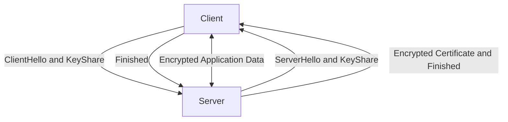

## Introduction

Imagine you are logging into your bank's website. Your browser must solve two immediate problems: it needs to ensure that the server actually belongs to your bank (authentication) and it needs to ensure that no one on the local Wi-Fi or at the ISP can read your password (confidentiality). This is achieved through the Transport Layer Security (TLS) protocol. Simultaneously, the bank's network must defend itself against malicious traffic, using firewalls to decide which packets are allowed to reach their internal servers.

This lesson covers the mechanisms that secure the "pipes" of the internet. We will explore how the TLS handshake uses asymmetric cryptography to securely exchange symmetric keys, how digital certificates prevent impersonation, and how different firewall architectures filter traffic at various layers of the protocol stack. Understanding these concepts is essential for building resilient, secure systems in an era of constant network-based threats.

**Before you start:** you should be familiar with the *TCP 3-Way Handshake & Flow Control*, *OSI vs TCP/IP Protocol Stacks*, and *DNS & Modern HTTP Protocols*.

## Core theory

### Cryptographic Foundations

To understand TLS, we must distinguish between two types of encryption. **Symmetric Encryption** uses the same secret key for both encryption and decryption. It is computationally efficient and fast, making it ideal for bulk data transfer. Examples include the Advanced Encryption Standard (AES). However, it suffers from the "key exchange problem": how do two parties agree on a secret key without an eavesdropper seeing it?

**Asymmetric Encryption** (or Public Key Cryptography) solves this. Each party has a **Public Key**, which is shared openly, and a **Private Key**, which is kept secret. Data encrypted with the public key can only be decrypted by the corresponding private key. While powerful, asymmetric algorithms like RSA or Elliptic Curve Cryptography (ECC) are much slower than symmetric ones.

TLS combines both: it uses asymmetric encryption to securely negotiate a temporary **Session Key**, which is then used with symmetric encryption for the remainder of the connection.

### The TLS 1.3 Handshake

TLS 1.3 is the modern standard, designed to reduce latency and improve security over its predecessor, TLS 1.2. While TLS 1.2 required two round-trips (2-RTT) to establish a secure connection, TLS 1.3 achieves this in one round-trip (1-RTT).

The process relies on a **Diffie-Hellman Ephemeral (DHE)** exchange. Instead of the server simply sending a public key, both parties contribute parameters to derive a shared secret that is never transmitted over the wire. This provides **Forward Secrecy**: if the server's long-term private key is stolen in the future, past sessions cannot be decrypted.

1.  **ClientHello**: The client sends supported cipher suites and a "key share" (its half of the Diffie-Hellman exchange).
2.  **ServerHello**: The server chooses the cipher, sends its own "key share," and immediately switches to encrypted communication for the rest of the handshake.
3.  **Authentication**: The server sends its digital certificate and a digital signature to prove its identity.
4.  **Finished**: Both parties verify that the handshake has not been tampered with.

### Digital Certificates and the Chain of Trust

How does the client know the server's public key is legitimate? This is the role of the **Certificate Authority (CA)**. A CA is a trusted third party that issues a **Digital Certificate**, which binds a public key to an identity (e.g., `google.com`).

A certificate contains the owner's public key and is signed by the CA's private key. Your browser comes pre-installed with a list of **Root Certificates** from trusted CAs. When you visit a site, the browser verifies the signature using the CA's public key. If the CA that signed the site's certificate is not a root CA, the browser follows a **Chain of Trust** (Intermediate CAs) until it reaches a trusted root.

### Firewall Architectures: Packet Filtering

A **Firewall** is a network security system that monitors and controls incoming and outgoing traffic based on predetermined security rules. The simplest form is a **Stateless Packet Filter**. It examines each packet in isolation, looking at the "5-tuple":
1. Source IP Address
2. Destination IP Address
3. Source Port
4. Destination Port
5. Protocol (TCP/UDP/ICMP)

Stateless filters are fast but limited. They cannot tell if a packet is part of an existing, legitimate connection or a random probe.

### Stateful Inspection and Application Gateways

A **Stateful Inspection Firewall** maintains a **State Table** that tracks the condition of active connections. For example, if an internal host sends a TCP SYN packet to an external web server, the firewall records this. When the SYN-ACK returns, the firewall recognizes it as part of an established flow and allows it through automatically.

| Source IP | Dest IP | Port | State |
| :--- | :--- | :--- | :--- |
| 192.168.1.5 | 93.184.216.34 | 443 | ESTABLISHED |
| 192.168.1.10 | 8.8.8.8 | 53 | UDP_SENT |

**Application Layer Firewalls** (or Proxy Firewalls) go deeper. They reconstruct the data stream to inspect the actual content (e.g., HTTP headers or SQL queries). This allows them to block specific commands, such as an "HTTP POST" to a sensitive URL, even if the port (80 or 443) is generally allowed.

### DDoS Mitigation

A **Distributed Denial of Service (DDoS)** attack attempts to overwhelm a target with a flood of traffic. Mitigation involves several layers:
-   **Rate Limiting**: Dropping traffic from a single source if it exceeds a threshold.
-   **Anycast Routing**: Distributing the attack load across multiple geographically dispersed data centers.
-   **Scrubbing Centers**: Redirecting traffic to specialized hardware that filters out "dirty" traffic (malformed packets or botnet signatures) while passing "clean" traffic to the destination.

## Worked examples

### Example 1: TLS 1.3 Latency Calculation

A client in London connects to a server in New York. The one-way propagation delay is $35\text{ ms}$. We assume the TCP 3-way handshake must occur before the TLS handshake (though TFO—TCP Fast Open—can optimize this, we will use the standard sequence).

1.  **TCP Handshake**:
    -   Client sends SYN $\to$ Server ($35\text{ ms}$)
    -   Server sends SYN-ACK $\to$ Client ($35\text{ ms}$)
    -   Total for TCP: $70\text{ ms}$ (1 RTT)

2.  **TLS 1.3 Handshake**:
    -   Client sends ClientHello + KeyShare (piggybacked on the final TCP ACK or sent immediately after).
    -   Server sends ServerHello + KeyShare + Certificate ($35\text{ ms}$)
    -   Client processes and sends Finished ($35\text{ ms}$)
    -   Total for TLS: $70\text{ ms}$ (1 RTT)

**Total time to first byte of application data:** $140\text{ ms}$.
In TLS 1.2, the TLS portion would have taken 2 RTTs ($140\text{ ms}$), making the total $210\text{ ms}$. TLS 1.3 saves exactly one RTT ($70\text{ ms}$ in this case).

### Example 2: Designing a Firewall Rule Set

A company wants to allow internal employees ($10.0.0.0/24$) to browse the web (HTTP/HTTPS) and use DNS, but block all other incoming and outgoing traffic. The firewall uses a "Default Deny" policy.

| Rule ID | Action | Protocol | Source | Dest | Dest Port | Description |
| :--- | :--- | :--- | :--- | :--- | :--- | :--- |
| 1 | ALLOW | TCP | $10.0.0.0/24$ | ANY | 80, 443 | Web Traffic |
| 2 | ALLOW | UDP | $10.0.0.0/24$ | ANY | 53 | DNS Queries |
| 3 | ALLOW | TCP | ANY | $10.0.0.0/24$ | ANY | Established traffic (Stateful) |
| 4 | DENY | ANY | ANY | ANY | ANY | Default Deny |

**Analysis:**
-   Rule 1 and 2 handle the outbound requests.
-   Rule 3 is critical in a stateful firewall; it allows the *return* traffic for connections initiated by the employees. Without stateful inspection, we would have to explicitly allow all incoming traffic from ports 80/443, which is a major security hole.
-   Rule 4 ensures that any traffic not explicitly permitted is dropped.

### Example 3: Verifying a Certificate Chain

Consider a certificate for `example.com`. The verification process follows these steps:
1.  The browser receives the `example.com` certificate. It checks the **Digital Signature** using the public key of the issuer, "DigiCert Intermediate CA".
2.  The browser does not yet trust "DigiCert Intermediate CA". It looks at the intermediate certificate and sees it was signed by "DigiCert Global Root G2".
3.  The browser checks its internal **Trust Store**. It finds "DigiCert Global Root G2" in its list of trusted roots.
4.  Because the root is trusted, and every link in the chain is cryptographically valid (signatures match), the `example.com` certificate is accepted.

## Applications

-   **HTTPS (Hypertext Transfer Protocol Secure)**: The foundation of secure web browsing, using TLS to wrap standard HTTP traffic.
-   **Virtual Private Networks (VPNs)**: Many modern VPNs (like OpenVPN or AnyConnect) use TLS to create a secure tunnel for all network traffic, not just web data.
-   **Intrusion Prevention Systems (IPS)**: Advanced firewalls that don't just block ports but look for known attack patterns (signatures) within the packet payloads.
-   **Secure Email**: Protocols like IMAPS and SMTPS use TLS to encrypt the communication between email clients and servers.
-   **Zero Trust Architecture**: A security model where firewalls are placed not just at the perimeter, but between every microservice in a data center, requiring constant re-authentication.

## Common mistakes

-   **Confusing Encryption with Authentication.** Encryption hides data, but authentication proves who you are talking to. Without the CA system (authentication), an attacker could use encryption to create a perfectly "secure" private tunnel to their own malicious server (a Man-in-the-Middle attack).
-   **Assuming Firewalls Stop All Malware.** A firewall might allow traffic on port 443 (HTTPS). If a user downloads a malicious `.exe` file over that encrypted connection, the firewall (unless it performs Deep Packet Inspection) will see it as legitimate encrypted traffic.
-   **Mixing up TLS and SSL.** Secure Sockets Layer (SSL) is the predecessor to TLS. SSL 3.0 is deprecated and insecure. While people often say "SSL certificate," they are almost always using the TLS protocol.
-   **Neglecting the "Default Deny" Principle.** A "Default Allow" firewall policy (where you only block known bad things) is dangerous because it is impossible to list every possible threat. Always start by blocking everything and only opening what is necessary.
-   **Ignoring Certificate Expiration.** Certificates have a validity period. If a server administrator forgets to renew a certificate, browsers will block the site, even if the cryptographic keys are still perfectly valid.

## Revision notes

-   **Symmetric Encryption**: Fast, one key for both sides (e.g., AES).
-   **Asymmetric Encryption**: Slower, public/private key pair (e.g., RSA, ECC).
-   **TLS 1.3 Handshake**: 1-RTT. Uses Diffie-Hellman for key exchange and provides Forward Secrecy.
-   **Certificate Authority (CA)**: A trusted entity that signs public keys to verify identity.
-   **Stateless Firewall**: Filters based on individual packets (IPs, ports, protocol).
-   **Stateful Firewall**: Tracks the state of connections; allows return traffic for established flows.
-   **Next-Generation Firewall (NGFW)**: Combines traditional filtering with Application Layer inspection and IPS.
-   **5-Tuple**: Source IP, Destination IP, Source Port, Destination Port, Protocol.

## Practice questions

:::question basic
Why does TLS use asymmetric encryption only at the start of a session rather than for all data transmission?
:::answer
Asymmetric encryption is computationally expensive and significantly slower than symmetric encryption. By using it only for the handshake, TLS can securely exchange a symmetric session key, which is then used for high-speed data transfer.
:::

:::question basic
What is the primary difference between a "Drop" and a "Reject" action in a firewall rule?
:::answer
A "Drop" action silently discards the packet, providing no feedback to the sender, which is often preferred to hide the firewall's existence. A "Reject" action discards the packet but sends an ICMP "Destination Unreachable" message back to the sender, informing them the connection was blocked.
:::

:::question intermediate
Explain how "Forward Secrecy" protects communication and which part of the TLS handshake enables it.
:::answer
Forward Secrecy ensures that if a server's long-term private key is compromised in the future, past recorded sessions cannot be decrypted. It is enabled by using Ephemeral Diffie-Hellman (DHE) key exchange, where unique, temporary session keys are generated for every connection and discarded immediately after.
:::

:::question intermediate
A stateful firewall sees an incoming TCP packet with the ACK flag set, but there is no corresponding entry in its state table. What should the firewall do and why?
:::answer
The firewall should drop the packet. Since there is no entry in the state table, this packet is not part of a connection initiated from the inside; it is likely a "scanned" packet or an attempt to bypass the firewall by mimicking an established connection.
:::

:::question advanced
In a Man-in-the-Middle (MitM) attack, an attacker intercepts the TLS handshake and presents their own certificate to the client. Why does the browser usually detect this?
:::answer
The browser checks the digital signature on the attacker's certificate. Since the attacker cannot produce a signature from a trusted Root CA (as they don't have the CA's private key), the browser will find that the chain of trust is broken and issue a security warning.
:::

:::question advanced
How does an Application Layer Firewall (Proxy) handle an encrypted HTTPS connection if it needs to inspect the content for viruses?
:::answer
The firewall must perform "SSL/TLS Inspection" (or "Break and Inspect"). It terminates the TLS connection from the client, decrypts and inspects the data, and then establishes a new TLS connection to the destination server. This requires the client to trust a root certificate issued by the firewall itself.
:::

## Further learning

-   **Related:** *Access Control & OS Security Fundamentals* in Operating Systems explains how systems decide who may do what, complementing the network-level defences in this lesson.
-   **Related:** *TCP 3-Way Handshake & Flow Control* is essential for understanding how the underlying transport layer functions before TLS even begins.
-   **Related:** *BGP & Inter-Domain Autonomous Routing* explains how traffic moves between networks, which is the level where DDoS mitigation and Anycast routing operate.
-   **Textbook:** James Kurose and Keith Ross, *Computer Networking: A Top-Down Approach*.
