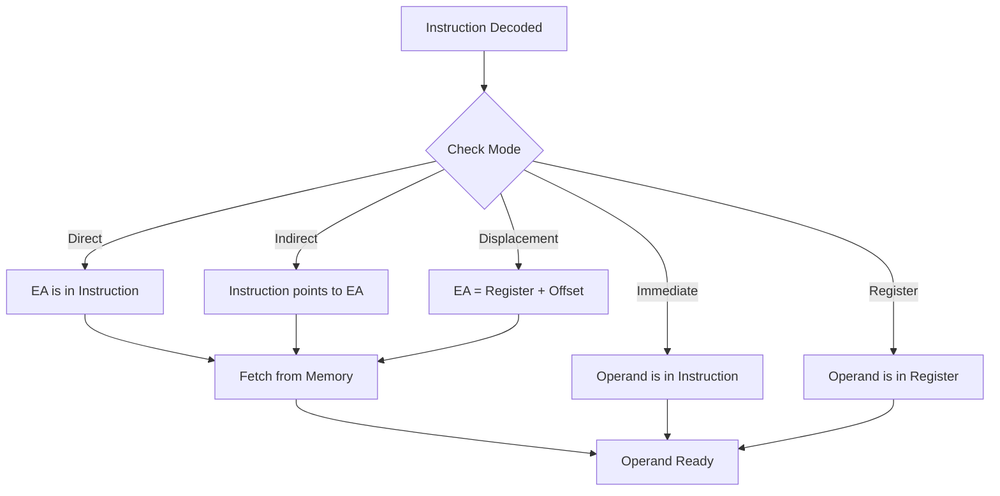

## Introduction

Imagine you are a librarian. If a patron asks for a book, there are several ways you might find it. You might already be holding the book (**Immediate**), it might be on your desk right in front of you (**Register**), you might have the exact shelf number (**Direct**), or you might have a slip of paper that tells you where to find the shelf number (**Indirect**). 

In computer architecture, **Addressing Modes** are the different ways a Central Processing Unit (CPU) can specify the location of an operand. An operand is the data that an instruction acts upon. Because memory is large and registers are few, the way we "address" this data significantly impacts the speed of the CPU, the size of the machine code, and the flexibility of the software.

This lesson covers the fundamental addressing modes found in both RISC (Reduced Instruction Set Computer) and CISC (Complex Instruction Set Computer) architectures. We will explore how the CPU calculates the **Effective Address (EA)**—the actual physical address in main memory used to fetch data—and why certain modes are preferred for specific tasks like looping through arrays or calling functions.

**Before you start:** you need to be familiar with the *Von Neumann Architecture & Performance Metrics*, the basic instruction cycle (Fetch-Decode-Execute), and the conceptual difference between *RISC vs CISC & Instruction Formats*.

## Core theory

### The Concept of Effective Address (EA)

Every machine instruction consists of an **Opcode** (what to do) and one or more **Operands** (what to do it to). While some operands are stored directly inside the instruction or in registers, many reside in Main Memory.

The **Effective Address (EA)** is the final memory address generated by the CPU control unit to access an operand. Depending on the addressing mode, the EA might be explicitly stated in the instruction, or it might be the result of a mathematical calculation involving registers and constants.

### Immediate and Register Addressing

These are the fastest modes because they do not require a trip to the Main Memory (RAM) to fetch the operand.

1.  **Immediate Addressing**: The operand is a constant value contained within the instruction itself.
    *   **Example**: `ADD R1, #5` (Add the literal value 5 to the contents of Register 1).
    *   **Pros**: No memory reference is needed to fetch data; it is very fast.
    *   **Cons**: The size of the operand is limited by the width of the instruction's address field.
2.  **Register Addressing**: The operand is stored in a CPU register, and the instruction specifies which register to use.
    *   **Example**: `ADD R1, R2` (Add the contents of R2 to R1).
    *   **Pros**: Registers are much faster than memory. Instructions are short because only a few bits are needed to identify a register (e.g., 5 bits for 32 registers).
    *   **Cons**: There are a limited number of registers available.

### Direct and Indirect Addressing

When data is too large for registers or must persist across different parts of a program, we use memory-based modes.

1.  **Direct (Absolute) Addressing**: The instruction contains the actual Effective Address of the operand in memory.
    *   **Calculation**: $$EA = A$$ (where $A$ is the address field in the instruction).
    *   **Pros**: Simple to understand; only one memory reference is required to get the data.
    *   **Cons**: The address space is limited by the size of the instruction's address field. If an instruction is 32 bits and the opcode takes 8 bits, only 24 bits remain for the address, limiting the range.
2.  **Indirect Addressing**: The instruction contains a memory address that holds the *actual* address of the operand. This is essentially a pointer.
    *   **Calculation**: $$EA = [A]$$ (The contents of memory at address $A$).
    *   **Pros**: Allows for a very large address space and makes implementing pointers and parameter passing easier.
    *   **Cons**: Very slow, as it requires two memory accesses: one to get the EA and another to get the actual data.

### Displacement Addressing

Displacement addressing combines the flexibility of registers with the capacity of memory. The Effective Address is calculated by adding a constant (displacement) to the contents of a register.

$$EA = A + (R)$$

There are three common variations of this mode:

| Variation | Register Used | Typical Use Case |
| :--- | :--- | :--- |
| **Relative Addressing** | Program Counter (PC) | Branching and jumping to nearby code. |
| **Base-Register Addressing** | A dedicated Base Register | Relocating programs in memory (Segmentation). |
| **Indexed Addressing** | An Index Register | Accessing elements in an array or table. |

**Relative Addressing** is particularly important for **Position-Independent Code (PIC)**. Because the jump target is calculated relative to the current instruction's location ($EA = PC + \text{offset}$), the entire block of code can be moved to a different part of memory without breaking the internal jumps.

### Addressing Mode Logic Flow

The following diagram illustrates how the CPU determines where to find the operand based on the mode specified in the instruction.



### ISA Philosophy: RISC vs. CISC

The variety of addressing modes available is a key differentiator between architectural philosophies:

*   **CISC (e.g., x86)**: Features many complex addressing modes, including "Autoincrement" or "Scaled Indexed" (e.g., $EA = \text{Base} + \text{Index} \times \text{Scale} + \text{Displacement}$). This allows a single instruction to perform complex tasks like traversing a linked list.
*   **RISC (e.g., ARM, MIPS, RISC-V)**: Follows a **Load/Store Architecture**. Only specific `LOAD` and `STORE` instructions can access memory (usually using simple displacement addressing). All arithmetic instructions must use Register or Immediate modes. This simplifies the hardware and enables more efficient pipelining.

## Worked examples

### Example 1: Calculating Effective Address

Consider a computer where memory is byte-addressable and registers are 32 bits wide. 
Current state:
*   **PC**: `0x1000`
*   **R1**: `0x2000`
*   **R2**: `0x0004`
*   **Memory at 0x2000**: `0x3000`
*   **Memory at 0x2004**: `0x55AA`
*   **Memory at 0x3000**: `0x99FF`

Calculate the **Effective Address (EA)** and the **Operand Value** for the following instructions:

1.  `LOAD R3, 2000` (Direct Addressing)
2.  `LOAD R3, (R1)` (Register Indirect Addressing)
3.  `LOAD R3, 4(R1)` (Indexed/Displacement Addressing)

**Solution:**

1.  **Direct Addressing**: The EA is the value provided in the instruction.
    *   $EA = 0x2000$
    *   Operand Value = Contents of Memory at `0x2000` = **0x3000**
2.  **Register Indirect**: The EA is the contents of the specified register.
    *   $EA = (R1) = 0x2000$
    *   Operand Value = Contents of Memory at `0x2000` = **0x3000**
3.  **Indexed/Displacement**: The EA is the sum of the register contents and the constant offset.
    *   $EA = (R1) + 4 = 0x2000 + 4 = 0x2004$
    *   Operand Value = Contents of Memory at `0x2004` = **0x55AA**

### Example 2: Array Access in C

This C program demonstrates how a compiler uses indexed addressing to access array elements.

```c
#include <stdio.h>

int main(void) {
    int numbers[5] = {10, 20, 30, 40, 50};
    // We want to access numbers[3]
    int i = 3;
    int value = numbers[i];
    
    printf("Value at index %d is %d\n", i, value);
    return 0;
}
```

Output:
```text
Value at index 3 is 40
```

**How the CPU sees this:**
1.  The base address of the array `numbers` is stored in a register (let's say `R_base`).
2.  The index `i` is stored in another register (`R_index`).
3.  Since an `int` is typically 4 bytes, the CPU calculates the address as:
    $$EA = R_{base} + (R_{index} \times 4)$$
4.  This is a form of **Scaled Indexed Addressing**. The CPU fetches the data at that EA and stores it in the register assigned to the variable `value`.

## Applications

*   **Compiler Design**: Compilers choose addressing modes to minimize code size and maximize execution speed. For example, they use **Immediate** mode for small constants and **Indexed** mode for array accesses.
*   **Position-Independent Code (PIC)**: Operating systems use **PC-Relative** addressing to load shared libraries (like `.dll` or `.so` files) into any available memory location without needing to rewrite the addresses in the code.
*   **Stack Operations**: The **Register Indirect with Post-increment/Pre-decrement** modes (common in CISC) are used to implement stack pointers, allowing for efficient `PUSH` and `POP` operations during function calls.
*   **Pointer Manipulation**: **Indirect Addressing** is the hardware-level implementation of pointers in languages like C and C++. When you dereference a pointer, the CPU is performing an indirect memory access.
*   **Object-Oriented Programming**: Accessing an object's field (e.g., `myObject.height`) is typically implemented using **Displacement Addressing**, where the base register points to the start of the object and the offset represents the specific field's location.

## Common mistakes

*   **The mistake: Confusing the Effective Address with the Operand.** Why it is wrong: The EA is the *location* (the "where"), while the operand is the *data* (the "what"). In Direct Addressing, the instruction contains the EA; in Immediate Addressing, the instruction contains the actual data.
*   **The mistake: Forgetting the PC increments.** Why it is wrong: In **PC-Relative** addressing, the offset is often added to the address of the *next* instruction, not the current one, because the PC is incremented during the fetch stage. Failing to account for this results in an "off-by-one" error in jump targets.
*   **The mistake: Assuming all modes are available for all instructions.** Why it is wrong: In RISC architectures, only `Load` and `Store` instructions can use memory addressing modes. Arithmetic instructions like `ADD` or `AND` are strictly limited to Register and Immediate modes.
*   **The mistake: Overestimating the speed of Indirect Addressing.** Why it is wrong: Students often forget that Indirect Addressing requires *two* separate memory read cycles (one for the pointer, one for the data). This makes it significantly slower than Direct or Register addressing.
*   **The mistake: Ignoring data alignment.** Why it is wrong: When using **Indexed Addressing** to access an array of 64-bit integers, the index must be multiplied by 8. If the hardware doesn't support "scaled" indexing, the programmer or compiler must manually shift the index bits.

## Revision notes

*   **Immediate**: Data is in the instruction. No memory access.
*   **Register**: Data is in a register. Fastest access.
*   **Direct**: Instruction contains the memory address ($EA = A$).
*   **Indirect**: Instruction contains the address of the address ($EA = [A]$).
*   **Displacement**: $EA = A + (R)$. Includes Relative, Base, and Indexed modes.
*   **PC-Relative**: $EA = PC + \text{Offset}$. Used for jumps and position-independent code.
*   **Effective Address (EA)**: The final calculated physical address in memory.
*   **Memory References**: Immediate/Register (0), Direct (1), Indirect (2), Displacement (1).
*   **RISC vs CISC**: RISC uses few, simple modes (Load/Store only); CISC uses many, complex modes.

## Practice questions

:::question basic
Which addressing mode is being used in the assembly instruction `MOVE R1, #42`, and how many memory references are required to fetch the operand?
:::answer
This is **Immediate Addressing**. Zero memory references are required to fetch the operand because the value `42` is encoded directly within the instruction itself, which is already in the CPU after the fetch stage.
:::

:::question basic
Define "Effective Address" in your own words.
:::answer
The Effective Address (EA) is the final, actual memory address that the CPU uses to access data in RAM. It is the result of the addressing mode's calculation logic, such as adding an offset to a register or looking up a pointer in memory.
:::

:::question intermediate
A CPU uses **Indexed Addressing** ($EA = A + R$). If the instruction is `LOAD R2, 100(R1)`, and Register `R1` contains the value `0x1050`, what is the Effective Address? If memory at `0x1050` is `0x00FF` and memory at `0x10B4` is `0xABCD`, what value is loaded into `R2`?
:::answer
The offset $A$ is `100` (which is `0x64` in hex). The EA is $0x1050 + 0x64 = 0x10B4$. The value loaded into `R2` is the contents of memory at that EA, which is **0xABCD**.
:::

:::question intermediate
Compare **Direct** and **Indirect** addressing in terms of instruction size and execution speed.
:::answer
Direct addressing is faster because it requires only one memory access to fetch the operand, whereas Indirect requires two. However, Direct addressing is limited by the instruction size (the address field must fit in the instruction), while Indirect addressing allows the program to access any location in the full memory range by using a pointer stored in a full-width memory word.
:::

:::question advanced
In a **PC-Relative** branch instruction, the offset is `+12`. If the current instruction is at address `0x0400` and the instruction size is 4 bytes, what is the target Effective Address? Assume the PC is incremented immediately after fetching the current instruction.
:::answer
After fetching the instruction at `0x0400`, the PC is incremented to `0x0404`. The target EA is calculated relative to this new PC value: $0x0404 + 12 = 0x0410$. Therefore, the branch will jump to address **0x0410**.
:::

:::question advanced
Why do RISC architectures generally avoid complex addressing modes like **Memory Indirect**?
:::answer
RISC architectures aim for high performance through instruction pipelining, where multiple instructions are processed in overlapping stages. Complex modes like Memory Indirect require multiple memory accesses and variable execution times, which create "stalls" or "hazards" in the pipeline. By restricting memory access to simple Load/Store instructions with predictable timing, RISC processors can maintain a higher clock speed and more efficient throughput.
:::

## Further learning

*   **Next:** *Instruction Cycle & Assembly Language* explores how the CPU sequences these addressing calculations during the decode and execute phases.
*   **Next:** *Datapath & Register Organization* provides a deeper look at the hardware (ALUs and buses) that physically performs the Effective Address additions.
*   **Related:** *Pipelining Fundamentals & Speedup* explains why simple addressing modes are essential for modern high-speed processor designs.
*   **Textbook:** Hennessy and Patterson, *Computer Architecture: A Quantitative Approach*.
