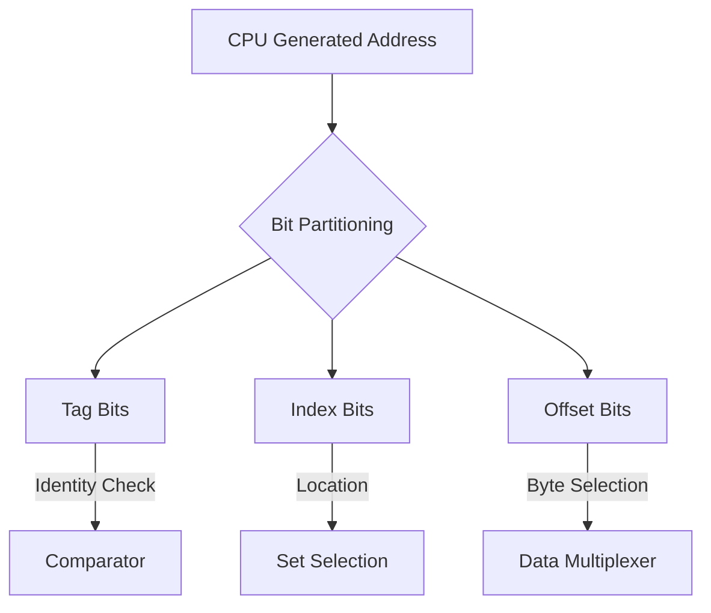

## Introduction

In modern computing, the "Memory Wall" describes the staggering performance gap between fast CPUs and relatively slow DRAM. While a processor might execute instructions in less than a nanosecond, fetching data from main memory can take hundreds of cycles. Caches bridge this gap by exploiting **locality of reference**. However, because a cache is much smaller than main memory, we need a rigorous mathematical system to determine exactly where a piece of data resides.

Imagine a massive library (Main Memory) and a small desk (Cache). If you can only fit ten books on your desk, how do you decide which book goes where? If every book has a specific assigned spot on the desk, you can find it instantly, but you might have to swap books frequently. If any book can go anywhere, you maximize space but spend forever searching the desk. This lesson explores the engineering middle ground: how we partition memory addresses into **tags**, **indices**, and **offsets** to balance speed and efficiency.

We will move from the simplest mapping (Direct-Mapped) to the most flexible (Fully Associative), and finally to the industry standard (N-Way Set-Associative). We will also look at how the **Least Recently Used (LRU)** algorithm decides which data to evict when the cache is full.

**Before you start:** You should be comfortable with binary-to-hexadecimal conversions and understand the basics of the instruction cycle and memory addressing modes.

## Core theory

### The Anatomy of a Cache Address

When the CPU requests a memory address, the cache controller does not treat that address as a single number. Instead, it interprets the bits as three distinct functional fields. The total number of bits in the address (typically 32 or 64) is partitioned based on the cache's geometry.

1.  **Offset (Block Offset):** These bits determine which specific byte within a **cache block** (or line) is being accessed. If a block is $2^k$ bytes, the offset requires $k$ bits.
2.  **Index:** These bits determine which **set** in the cache the data could be located in. If the cache has $2^s$ sets, the index requires $s$ bits.
3.  **Tag:** These are the remaining high-order bits. They are stored in the cache alongside the data to uniquely identify which specific memory block is currently occupying that cache slot.

### Direct-Mapped Caches (1-Way)

In a **direct-mapped cache**, every block of main memory maps to exactly one specific line in the cache. The mapping is usually calculated as:
$$\text{Cache Line} = (\text{Block Address}) \pmod{\text{Number of Lines in Cache}}$$

While this is hardware-efficient because it only requires one comparator, it suffers from **conflict misses**. If a program frequently alternates between two memory addresses that map to the same cache line, the cache will "thrash," constantly evicting one to make room for the other, even if the rest of the cache is empty.

To calculate the bits for a direct-mapped cache:
- **Offset bits** $= \log_2(\text{Block Size in bytes})$
- **Index bits** $= \log_2(\text{Number of Lines in cache})$
- **Tag bits** $= \text{Address Width} - (\text{Index} + \text{Offset})$

### Fully Associative Caches

At the opposite extreme, a **fully associative cache** allows any block of memory to be stored in any available cache line. There is no index field because there are no specific sets; the entire cache is treated as one single set.

- **Pros:** Zero conflict misses. A block is only evicted if the cache is completely full.
- **Cons:** To find a block, the controller must compare the requested tag against *every* tag in the cache simultaneously. This requires massive amounts of power and expensive hardware comparators for every single line.

In this configuration:
- **Offset bits** $= \log_2(\text{Block Size})$
- **Index bits** $= 0$
- **Tag bits** $= \text{Address Width} - \text{Offset}$

### N-Way Set-Associative Caches

Most modern processors use **N-way set-associative mapping**, a hybrid approach. The cache is divided into $S$ sets, and each set contains $N$ lines (or "ways"). A memory block maps to a specific set based on its index bits, but it can reside in *any* of the $N$ ways within that set.

Common configurations include 2-way, 4-way, and 8-way. As $N$ increases, conflict misses decrease, but the hardware complexity (the number of simultaneous comparisons) increases.

The fundamental formulas for an N-way cache are:
1.  $\text{Total Blocks} = \frac{\text{Cache Size}}{\text{Block Size}}$
2.  $\text{Number of Sets } (S) = \frac{\text{Total Blocks}}{N}$
3.  $\text{Index bits} = \log_2(S)$
4.  $\text{Offset bits} = \log_2(\text{Block Size})$

### Replacement Policies: LRU

When a cache set is full and a new block must be brought in, the controller must choose which existing block to evict. For set-associative and fully associative caches, the **Least Recently Used (LRU)** policy is the gold standard.

LRU operates on the principle of **temporal locality**: if you haven't used a piece of data in a long time, you are unlikely to use it in the near future. 
- Each set maintains "recency" bits.
- Whenever a block is accessed (hit or miss), it is marked as the "Most Recently Used" (MRU).
- When eviction is necessary, the block that has gone the longest without an access is removed.

While perfect LRU is expensive to implement for high associativity (e.g., 16-way), hardware often uses "Pseudo-LRU" using a tree-based bit scheme to approximate the same behavior with less logic.

## Worked examples

### Example 1: Bit Partitioning Calculation

**Problem:** Consider a 32-bit processor with a 128 KB, 4-way set-associative cache. The block size is 64 bytes. Calculate the number of bits assigned to the Tag, Index, and Offset fields.

**Step 1: Calculate the Offset bits.**
The block size is 64 bytes.
$$\text{Offset bits} = \log_2(64) = 6 \text{ bits}$$

**Step 2: Calculate the total number of blocks (lines) in the cache.**
$$\text{Total Blocks} = \frac{\text{Cache Size}}{\text{Block Size}} = \frac{128 \times 1024 \text{ bytes}}{64 \text{ bytes}} = \frac{131,072}{64} = 2048 \text{ blocks}$$

**Step 3: Calculate the number of sets.**
Since it is a 4-way set-associative cache ($N=4$):
$$\text{Sets} = \frac{\text{Total Blocks}}{N} = \frac{2048}{4} = 512 \text{ sets}$$

**Step 4: Calculate the Index bits.**
$$\text{Index bits} = \log_2(512) = 9 \text{ bits}$$

**Step 5: Calculate the Tag bits.**
$$\text{Tag} = \text{Total Address Bits} - (\text{Index} + \text{Offset})$$
$$\text{Tag} = 32 - (9 + 6) = 32 - 15 = 17 \text{ bits}$$

**Final Answer:** Tag: 17 bits, Index: 9 bits, Offset: 6 bits.

---

### Example 2: Tracing Cache Hits and Misses

**Problem:** A 2-way set-associative cache has 2 sets and a block size of 4 bytes. Trace the following sequence of byte-address accesses using LRU: `0, 4, 8, 0, 4`. Assume the cache is initially empty.

**Step 1: Determine the geometry.**
- Block size = 4 bytes $\rightarrow$ Offset = 2 bits ($\log_2 4$).
- Sets = 2 $\rightarrow$ Index = 1 bit ($\log_2 2$).
- Address structure: `[Tag] [Index] [Offset]`.
- Let's convert addresses to binary (assuming 8-bit addresses for simplicity):
    - `0`: `00000 0 00` (Tag 0, Index 0)
    - `4`: `00001 0 00` (Tag 1, Index 0)
    - `8`: `00010 0 00` (Tag 2, Index 0)

**Step 2: Trace the accesses.**

| Access | Address | Index | Tag | Result | Set 0 State (Way 0, Way 1) |
| :--- | :--- | :--- | :--- | :--- | :--- |
| 1 | 0 | 0 | 0 | **Miss** | [Tag 0, Empty] |
| 2 | 4 | 0 | 1 | **Miss** | [Tag 0, Tag 1] |
| 3 | 8 | 0 | 2 | **Miss** | [Tag 2, Tag 1] (Evicted Tag 0 as it was LRU) |
| 4 | 0 | 0 | 0 | **Miss** | [Tag 2, Tag 0] (Evicted Tag 1 as it was LRU) |
| 5 | 4 | 0 | 1 | **Miss** | [Tag 1, Tag 0] (Evicted Tag 2 as it was LRU) |

**Final Answer:** In this specific sequence, every access resulted in a miss. This is an example of **thrashing** because the "working set" (Addresses 0, 4, 8) is larger than the associativity of the set (2 ways).

## Applications

*   **High-Performance Computing (HPC):** Programmers use knowledge of cache mapping to perform "Loop Tiling" or "Cache Blocking." By restructuring loops to process data in chunks that fit exactly within a cache set's associativity, they avoid conflict misses and drastically increase throughput.
*   **Translation Lookaside Buffers (TLBs):** TLBs are specialized caches that store virtual-to-physical address translations. Because TLB misses are extremely expensive (requiring a "page walk" in memory), TLBs are often highly associative (e.g., 16-way or even fully associative) to minimize misses.
*   **Embedded Systems:** In real-time systems, predictability is key. Developers might use direct-mapped caches because their timing is easier to model, or they might "lock" specific cache lines to ensure critical interrupt service routines are never evicted.
*   **Operating System Design:** OS kernels often use "Page Coloring." By carefully choosing which physical memory pages are mapped to virtual addresses, the OS can ensure that different processes do not map to the same cache sets, reducing inter-process cache interference.

## Common mistakes

*   **The mistake: Using the total cache size to calculate index bits.** Why it is wrong and how to avoid it: The index bits are determined by the number of *sets*, not the number of bytes or total blocks. Always divide the total number of blocks by the associativity ($N$) before taking the $\log_2$.
*   **The mistake: Confusing "Block Size" with "Word Size".** Why it is wrong and how to avoid it: A block (or line) usually contains multiple words (e.g., 64 bytes might be 8 double-words). The offset bits must account for the entire block size, not just the size of the data type being requested by the CPU.
*   **The mistake: Forgetting that Tag, Index, and Offset are bit lengths, not values.** Why it is wrong and how to avoid it: When asked for the "Index," students often provide the decimal value of the address. The index is a specific slice of the binary address. Always convert the address to binary or hex first to see the bit boundaries.
*   **The mistake: Assuming LRU applies across the whole cache in set-associative mapping.** Why it is wrong and how to avoid it: LRU is calculated independently for *each set*. Accessing a block in Set 0 has no effect on the LRU status of blocks in Set 1.
*   **The mistake: Miscalculating the number of comparators.** Why it is wrong and how to avoid it: An $N$-way set-associative cache requires $N$ comparators per set to check all ways simultaneously. It does *not* require a comparator for every line in the entire cache (unless it is fully associative).

## Revision notes

*   **Address Partitioning:** Address = Tag + Index + Offset.
*   **Offset Formula:** $\text{Offset bits} = \log_2(\text{Block Size in bytes})$.
*   **Index Formula:** $\text{Index bits} = \log_2(\frac{\text{Total Cache Size}}{\text{Block Size} \times \text{Associativity}})$.
*   **Direct-Mapped:** Associativity ($N$) = 1. High conflict misses, simplest hardware.
*   **Fully Associative:** Number of Sets ($S$) = 1. Zero conflict misses, most expensive hardware.
*   **N-Way Set-Associative:** The industry standard. Balance of power, area, and hit rate.
*   **LRU Policy:** Evicts the block that hasn't been accessed for the longest time. Requires $N!$ states or a simplified approximation.
*   **Power of 2:** Cache sizes, block sizes, and set counts are almost always powers of 2 to allow for simple bit-slicing of addresses.

## Practice questions

:::question basic
A cache has a block size of 32 bytes. How many bits are required for the offset field?
:::answer
The number of offset bits is $\log_2(\text{Block Size})$. Since $32 = 2^5$, the offset requires **5 bits**. This allows the cache to address any of the 32 individual bytes within a single block.
:::

:::question basic
In a direct-mapped cache with 1024 lines, which bits of a 32-bit address constitute the index? (Assume 16-byte blocks).
:::answer
First, calculate the offset: $\log_2(16) = 4$ bits. Next, calculate the index: $\log_2(1024) = 10$ bits. In a 32-bit address (bits 0 to 31), bits 0-3 are the offset, and bits **4-13** are the index.
:::

:::question intermediate
A 4-way set-associative cache has a total capacity of 16 KB and a block size of 64 bytes. Calculate the number of bits in the Index field for a 32-bit address.
:::answer
1. Total blocks = $16 \text{ KB} / 64 \text{ bytes} = 16384 / 64 = 256$ blocks.
2. Number of sets = $256 / 4 = 64$ sets.
3. Index bits = $\log_2(64) = \mathbf{6}$ bits.
The index bits are 6 because the cache is organized into 64 distinct sets.
:::

:::question intermediate
Compare a 2-way set-associative cache to a direct-mapped cache of the same total size. Which is likely to have a higher hit rate for a program that repeatedly accesses three different memory blocks that all map to the same index? Why?
:::answer
The **2-way set-associative cache** will have a higher hit rate. In a direct-mapped cache, all three blocks compete for the same single slot, causing constant eviction (thrashing). In a 2-way cache, two of the three blocks can reside in the cache simultaneously, reducing the number of conflict misses, though one will still need to be evicted eventually.
:::

:::question advanced
A system uses 16-bit addresses and a 2-way set-associative cache with 4-byte blocks and 4 sets. Trace the LRU state for Set 0 after these byte accesses: `0x0000, 0x0010, 0x0020, 0x0000`. Show the tags in Set 0.
:::answer
1. Address structure: Offset = 2 bits ($\log_2 4$), Index = 2 bits ($\log_2 4$), Tag = 12 bits.
2. `0x0000`: Binary `...00 00 00`. Index 0, Tag 0. Set 0: `[Tag 0, Empty]`. (MRU: Tag 0)
3. `0x0010`: Binary `...01 00 00`. Index 0, Tag 4. Set 0: `[Tag 0, Tag 4]`. (MRU: Tag 4, LRU: Tag 0)
4. `0x0020`: Binary `...10 00 00`. Index 0, Tag 8. Set 0: `[Tag 8, Tag 4]`. (Tag 0 evicted as LRU. MRU: Tag 8, LRU: Tag 4)
5. `0x0000`: Index 0, Tag 0. Set 0: `[Tag 8, Tag 0]`. (Tag 4 evicted as LRU. MRU: Tag 0, LRU: Tag 8)
**Final State of Set 0 Tags: 0 and 8.**
:::

:::question advanced
Why does increasing associativity beyond 8-way or 16-way often yield diminishing returns in general-purpose CPUs?
:::answer
Increasing associativity reduces conflict misses, but the relationship is non-linear (the "2:1 rule of thumb" suggests a cache of size $X$ with $N$ associativity performs similarly to a cache of size $2X$ with $N/1$ associativity). Higher associativity requires more comparators and complex multiplexing logic, which increases **hit latency** and **power consumption**. If the cache becomes too slow, it defeats the purpose of having a cache, as the CPU must wait longer even on a hit.
:::

## Further learning

*   **Next:** *Cache Performance & AMAT* explores the mathematical formulas (Average Memory Access Time) used to quantify the impact of hits, misses, and penalties on overall system speed.
*   **Related:** *Main Memory, Virtual Memory & TLBs* explains how the concepts of mapping and associativity are applied to the management of physical RAM and disk storage.
*   **Related:** *Space Complexity & Memory Trade-offs* provides a theoretical computer science perspective on why we cannot simply have infinitely large, fast memories.
*   **Textbook:** Hennessy and Patterson, *Computer Architecture: A Quantitative Approach*. This is the definitive text for understanding the trade-offs in cache hierarchy design.
