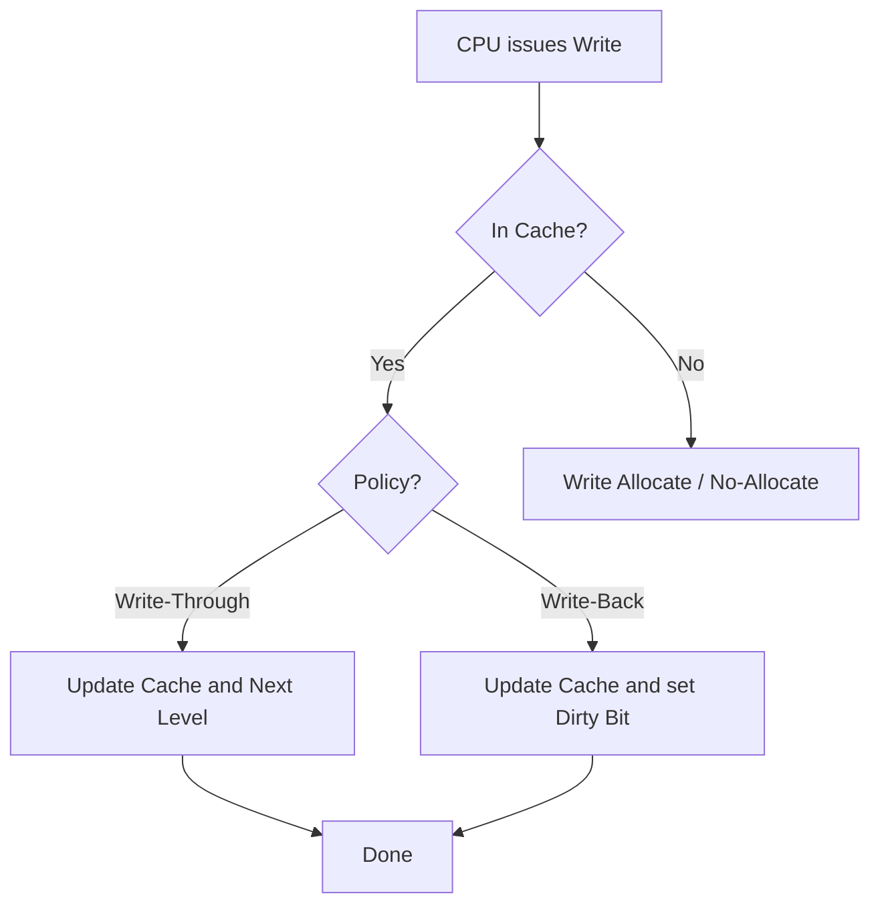

## Introduction

Imagine a world-class chef working in a high-end kitchen. To cook efficiently, the chef keeps salt, pepper, and frequently used oils on a small shelf right above the stove. If an ingredient isn't there, they walk to the pantry. If it isn't in the pantry, they must drive to the grocery store. The "performance" of the chef depends heavily on how often they find what they need on that small shelf. If they have to drive to the store for every single ingredient, the kitchen's output drops to nearly zero, regardless of how fast the chef can chop vegetables.

In computer architecture, the CPU is our fast chef, and the Main Memory (RAM) is the distant grocery store. Modern CPUs operate at speeds exceeding 4 GHz, meaning they can execute an instruction every 0.25 nanoseconds. However, a trip to RAM takes roughly 100 nanoseconds—the equivalent of 400 wasted clock cycles. To bridge this "Memory Wall," we use **caches**: small, fast memories that store copies of frequently used data.

This lesson focuses on quantifying exactly how well these caches work. We will move beyond simple "hit or miss" logic to calculate the **Average Memory Access Time (AMAT)**, analyze the impact of having multiple layers of cache (L1, L2, and L3), and understand how different strategies for writing data back to memory affect the bottom line of system performance.

**Before you start:** You should be familiar with the basic concepts of *Instruction Cycle & Assembly Language* and understand the mechanics of *Cache Associativity & Mapping*.

## Core theory

### The Metrics of Success: Hit and Miss Rates

To evaluate a cache, we first need to define how often it succeeds. When the CPU requests a piece of data and finds it in the cache, we call it a **cache hit**. If the data is not present, it is a **cache miss**.

*   **Hit Rate ($H$):** The fraction of memory accesses found in the cache.
*   **Miss Rate ($M$):** The fraction of memory accesses not found in the cache.

Since every access is either a hit or a miss, we have the simple identity:
$$H + M = 1$$

While a 95% hit rate sounds excellent, in high-performance computing, we often focus on the **Miss Rate**. A change from a 1% miss rate to a 2% miss rate actually doubles the number of expensive trips to main memory, potentially cutting system performance in half.

### Average Memory Access Time (AMAT)

The most critical formula in memory hierarchy analysis is **AMAT**. It represents the mean time the CPU spends waiting for a memory request to complete.

$$AMAT = \text{Hit Time} + (\text{Miss Rate} \times \text{Miss Penalty})$$

Where:
*   **Hit Time:** The time required to search the cache and deliver the data to the CPU (usually 1–4 clock cycles for an L1 cache).
*   **Miss Penalty:** The *additional* time required to fetch the data from the next level of the hierarchy (e.g., L2 cache or Main Memory) and load it into the cache.

It is a common mistake to think of the Miss Penalty as the total time to access memory. Rather, it is the **extra** latency incurred because the data was not in the current cache level.

### Multilevel Cache Hierarchies

Modern processors do not rely on a single cache. They use a hierarchy:
1.  **L1 Cache:** Smallest, fastest, usually split into Instruction (L1i) and Data (L1d).
2.  **L2 Cache:** Larger and slightly slower.
3.  **L3 Cache:** Shared across multiple CPU cores, much larger but slower than L2.

In a multilevel system, the AMAT formula becomes recursive. The "Miss Penalty" for the L1 cache is actually the AMAT of the L2 cache.

$$AMAT = \text{Hit Time}_{L1} + \text{Miss Rate}_{L1} \times (\text{Hit Time}_{L2} + \text{Miss Rate}_{L2} \times \text{Miss Penalty}_{L2})$$

### Local vs. Global Miss Rates

When dealing with multiple levels, we must be precise about how we define the miss rate:

*   **Local Miss Rate:** The number of misses in a specific cache level divided by the number of accesses to *that specific level*.
*   **Global Miss Rate:** The number of misses in a specific cache level divided by the total number of memory accesses generated by the CPU.

For an L2 cache:
$$\text{Miss Rate}_{Global, L2} = \text{Miss Rate}_{Local, L1} \times \text{Miss Rate}_{Local, L2}$$

The global miss rate tells you how often a CPU request bypasses both L1 and L2 to head toward L3 or RAM.

### The 3 Cs: Categorizing Misses

To improve cache performance, architects categorize misses into the **3 Cs**. Understanding which "C" is dominant helps engineers decide whether to increase cache size, change associativity, or improve prefetching.

| Type | Description | Solution |
| :--- | :--- | :--- |
| **Compulsory** | Also called "Cold Start" misses. Occur the first time a block is accessed. | Larger block sizes (spatial locality). |
| **Capacity** | Occur because the cache is too small to hold all the blocks needed during execution. | Increase total cache size. |
| **Conflict** | Occur in set-associative or direct-mapped caches when multiple blocks map to the same set. | Increase associativity (move toward fully-associative). |

### Write Policies and Performance

Performance isn't just about reading; it's about writing. There are two primary policies:

1.  **Write-Through:** Every write to the cache is immediately written to the next level (L2 or RAM).
    *   *Performance Impact:* Simple to implement but creates a "Write Stall" if the CPU writes faster than the memory can keep up.
2.  **Write-Back:** Writes are only updated in the cache. The block is written to the next level only when it is evicted.
    *   *Performance Impact:* Much faster for frequent writes. However, it requires a **dirty bit** to track which blocks have been modified. If an evicted block is "dirty," the Miss Penalty increases because we must write the old data out before reading the new data in.

## Worked examples

### Example 1: Basic AMAT Calculation

A processor has an L1 cache with a hit time of 1 clock cycle and a miss rate of 5%. The time to access main memory (the miss penalty) is 100 clock cycles. Calculate the AMAT.

**Step 1: Identify variables.**
*   $\text{Hit Time} = 1$
*   $\text{Miss Rate} = 0.05$
*   $\text{Miss Penalty} = 100$

**Step 2: Apply the formula.**
$$AMAT = 1 + (0.05 \times 100)$$
$$AMAT = 1 + 5 = 6 \text{ cycles}$$

**Answer:** The average memory access takes 6 clock cycles. Note that even a small 5% miss rate increased the access time by 600% compared to a perfect cache.

### Example 2: Multilevel Cache Performance

Consider a system with the following specs:
*   L1: 2 cycle hit time, 10% local miss rate.
*   L2: 15 cycle hit time, 20% local miss rate.
*   Main Memory: 200 cycle miss penalty.

What is the total AMAT?

**Step 1: Calculate the L2 Miss Penalty.**
The "Miss Penalty" for L2 is the time to go to Main Memory, which is 200.

**Step 2: Calculate the L2 AMAT (which is the L1 Miss Penalty).**
$$\text{Penalty}_{L1} = \text{Hit Time}_{L2} + (\text{Miss Rate}_{L2} \times \text{Penalty}_{Memory})$$
$$\text{Penalty}_{L1} = 15 + (0.20 \times 200) = 15 + 40 = 55 \text{ cycles}$$

**Step 3: Calculate the L1 AMAT.**
$$AMAT = \text{Hit Time}_{L1} + (\text{Miss Rate}_{L1} \times \text{Penalty}_{L1})$$
$$AMAT = 2 + (0.10 \times 55) = 2 + 5.5 = 7.5 \text{ cycles}$$

**Answer:** The AMAT for the hierarchy is 7.5 cycles.

### Example 3: The Cost of Dirty Evictions

A write-back cache has a miss penalty of 50 cycles. However, 30% of the evicted blocks are "dirty" and must be written back to memory, which takes an additional 50 cycles. The hit time is 1 cycle and the miss rate is 5%.

**Step 1: Calculate the average Miss Penalty.**
The penalty is 50 cycles if the block is clean, and $50 + 50 = 100$ cycles if the block is dirty.
$$\text{Avg Penalty} = (0.70 \times 50) + (0.30 \times 100)$$
$$\text{Avg Penalty} = 35 + 30 = 65 \text{ cycles}$$

**Step 2: Calculate AMAT.**
$$AMAT = 1 + (0.05 \times 65) = 1 + 3.25 = 4.25 \text{ cycles}$$

**Answer:** The AMAT is 4.25 cycles.

## Applications

*   **Compiler Optimization:** Compilers use knowledge of cache performance to perform **Loop Tiling**. By breaking large arrays into smaller "tiles" that fit into the L1 cache, the compiler reduces capacity misses and significantly lowers the AMAT of a program.
*   **Hardware Design:** CPU designers use AMAT to decide the size of L2 and L3 caches. Since larger caches have higher hit times (due to physical distance and logic complexity), designers must find the "sweet spot" where the decrease in miss rate outweighs the increase in hit time.
*   **Database Engines:** High-performance databases like PostgreSQL or MySQL manage their own "buffer pools" in RAM. This is essentially a software-managed cache. Developers tune the hit rate of these pools to ensure that the "Miss Penalty" (reading from a slow SSD) is incurred as rarely as possible.
*   **Real-time Systems:** In systems with hard deadlines (like flight controllers), engineers often disable certain cache features or use "scratchpad" memories. This is because while caches improve *average* performance (AMAT), they make the *worst-case* execution time harder to predict.

## Common mistakes

*   **The "Double Hit Time" Error.** When calculating multilevel AMAT, students often add the L1 hit time and then include it again inside the miss penalty. Remember: the Miss Penalty is the *additional* time spent after the initial hit time has already elapsed.
*   **Confusing Local and Global Miss Rates.** In exam questions, if you are told "The L2 miss rate is 5%," check if that is the *local* rate (5% of L1 misses) or the *global* rate (5% of all CPU references). Using the wrong one will lead to a massive error in AMAT.
*   **Ignoring the Units.** AMAT can be expressed in nanoseconds or clock cycles. Ensure all terms in your equation ($Hit Time + Miss Rate \times Miss Penalty$) use the same units. You cannot add 1 cycle to 100 nanoseconds without converting.
*   **Assuming 100% Hit Rate for Writes.** Students often forget that writes can also miss in the cache. Depending on the "Write-Allocate" policy, a write miss might require fetching the block from memory, incurring a full miss penalty just like a read.

## Revision notes

*   **AMAT Formula:** $AMAT = \text{Hit Time} + (\text{Miss Rate} \times \text{Miss Penalty})$.
*   **Miss Rate ($M$):** $1 - \text{Hit Rate}$.
*   **Multilevel AMAT:** $AMAT = L1_{Hit} + L1_{Miss} \times (L2_{Hit} + L2_{Miss} \times L2_{Penalty})$.
*   **Global Miss Rate:** $M_{Global, L2} = M_{Local, L1} \times M_{Local, L2}$.
*   **The 3 Cs:**
    *   *Compulsory:* First access.
    *   *Capacity:* Cache too small.
    *   *Conflict:* Mapping collisions in sets.
*   **Write-Back vs. Write-Through:** Write-back is generally faster but requires a dirty bit and can increase the miss penalty during eviction.
*   **Impact of Block Size:** Increasing block size reduces compulsory misses (spatial locality) but can increase conflict misses if the number of blocks becomes too small.

## Practice questions

:::question basic
A system has a cache hit time of 2 ns and a main memory access time of 80 ns. If the hit rate is 98%, what is the AMAT?
:::answer
First, find the miss rate: $M = 1 - 0.98 = 0.02$.
The miss penalty is the time to access main memory: 80 ns.
Apply the formula: $AMAT = 2 + (0.02 \times 80) = 2 + 1.6 = 3.6 \text{ ns}$.
The cache reduces the average access time from 80 ns to 3.6 ns.
:::

:::question basic
Define the "Compulsory Miss" and explain why increasing the cache size does not eliminate it.
:::answer
A compulsory miss (or cold-start miss) occurs the very first time a specific memory address is requested by the CPU, as the data cannot possibly be in the cache yet. Increasing the cache size only helps with capacity misses (keeping data in the cache longer); it does not change the fact that the first access to any data must fetch it from main memory.
:::

:::question intermediate
You are choosing between two L1 cache designs. 
Design A: Hit time 1 cycle, Miss rate 5%. 
Design B: Hit time 2 cycles, Miss rate 2%. 
If the miss penalty is 100 cycles, which design is faster?
:::answer
Calculate AMAT for both:
$AMAT_A = 1 + (0.05 \times 100) = 1 + 5 = 6 \text{ cycles}$.
$AMAT_B = 2 + (0.02 \times 100) = 2 + 2 = 4 \text{ cycles}$.
Design B is faster because the significant reduction in miss rate (from 5% to 2%) more than compensates for the slightly longer hit time.
:::

:::question intermediate
In a two-level cache system, the L1 local miss rate is 10% and the L2 local miss rate is 20%. What is the global miss rate of the L2 cache? If the CPU makes 1,000 memory references, how many of them reach Main Memory?
:::answer
The global miss rate is $M_{L1} \times M_{L2} = 0.10 \times 0.20 = 0.02$ (or 2%).
For 1,000 references, the number reaching main memory is $1,000 \times 0.02 = 20$.
This means 100 references missed L1, and of those 100, 20 also missed L2.
:::

:::question advanced
A processor uses a write-back cache. The hit time is 1 cycle and the miss rate is 10%. The miss penalty is 40 cycles. However, 40% of all evictions are of dirty blocks. When a dirty block is evicted, it must be written to a "write buffer." If the write buffer is full, the CPU stalls for an extra 20 cycles. If the write buffer is full 10% of the time during a dirty eviction, calculate the AMAT.
:::answer
First, calculate the penalty for a dirty eviction: $40 \text{ (standard)} + 0.10 \times 20 \text{ (stall)} = 42 \text{ cycles}$.
Now, calculate the average miss penalty:
$\text{Penalty} = (\text{Prob Clean} \times 40) + (\text{Prob Dirty} \times 42)$
$\text{Penalty} = (0.60 \times 40) + (0.40 \times 42) = 24 + 16.8 = 40.8 \text{ cycles}$.
Finally, $AMAT = 1 + (0.10 \times 40.8) = 1 + 4.08 = 5.08 \text{ cycles}$.
:::

:::question advanced
Explain the "Cache Performance Paradox": Why can increasing the associativity of a cache (e.g., from direct-mapped to 8-way set-associative) sometimes result in a *worse* AMAT, even if the miss rate decreases?
:::answer
AMAT depends on both Hit Time and Miss Rate. While increasing associativity reduces conflict misses (lowering the miss rate), it also increases the complexity of the cache's internal logic (multiplexers and comparators). This extra logic can increase the Hit Time. If the time saved by having fewer misses is less than the time lost on every single hit due to increased complexity, the overall AMAT will rise.
:::

## Further learning

*   **Next:** *Main Memory, Virtual Memory & TLBs* explores what happens when the data isn't even in the L3 cache and we have to manage the transition from RAM to Disk.
*   **Related:** *Instruction-Level & Multicore Parallelism* discusses how multiple CPU cores share an L3 cache and the performance challenges of keeping their data consistent (Cache Coherence).
*   **Related:** *Von Neumann Architecture & Performance Metrics* provides the broader context of the "CPI" (Cycles Per Instruction) metric, which is heavily influenced by the AMAT calculated in this lesson.
*   **Textbook:** *Computer Architecture: A Quantitative Approach* by John Hennessy and David Patterson is the definitive resource for understanding the trade-offs in memory hierarchy design.
