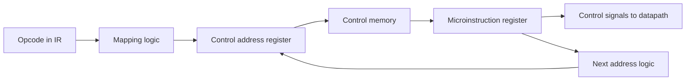

## Introduction

A processor's **datapath** (registers, ALU, buses, and memory interface) can do many things, but only when told exactly what to do at each clock cycle: which register to read, which ALU operation to perform, whether to write memory. Those instructions come from the **control unit** as **control signals**. There are two classic ways to build a control unit: as fixed logic circuits (**hardwired control**) or as a tiny program stored in a special memory (**microprogrammed control**). The choice shaped the history of processor design, from the microcoded mainframes of the 1960s to today's fast RISC cores.

**Before you start:** you should know the instruction cycle (fetch, decode, execute), registers, the ALU, and finite-state machines from digital logic.

## Core theory

### Control signals and micro-operations

Executing one machine instruction takes several **micro-operations**, each one clock cycle of register transfers. For a simple accumulator machine, fetching an instruction is:

1. $MAR \leftarrow PC$
2. $MDR \leftarrow M[MAR]$, $PC \leftarrow PC + 1$
3. $IR \leftarrow MDR$

and executing `ADD X` might then be $MAR \leftarrow IR.\text{address}$; $MDR \leftarrow M[MAR]$; $AC \leftarrow AC + MDR$. Each micro-operation corresponds to a set of **control signals** being active: `PC_out`, `MAR_in`, `Read`, `ALU_add`, `AC_in`, and so on. The control unit's job is to produce the right set of signals in the right cycle, based on the opcode in the instruction register, the current step, and status flags such as zero or carry.

### Hardwired control

A **hardwired** control unit is a **finite-state machine** built from logic gates and flip-flops. A step counter (or state register) tracks which cycle of the instruction is in progress; a decoder turns the opcode into one line per instruction; and combinational logic computes each control signal as a Boolean function of the step, the decoded opcode, and the flags. For example:

$$\text{AC\_in} = T_5 \cdot \text{ADD} + T_5 \cdot \text{SUB} + T_4 \cdot \text{LOAD}$$

where $T_k$ is "step $k$ is active". Because every signal comes straight out of logic, hardwired control is **fast**: it adds only gate delays. But the logic grows complicated for large instruction sets, and **changing** anything, such as fixing a bug or adding an instruction, means redesigning the circuit.

### Microprogrammed control

A **microprogrammed** control unit, proposed by Maurice Wilkes in 1951, stores the control signals for every step in a **control memory** (usually ROM). Each word is a **microinstruction**: a pattern of control bits plus information about which microinstruction comes next. The sequence of microinstructions that implements one machine instruction is a **microroutine**, and the whole collection is the **microprogram** or **microcode**.

The unit works like a tiny computer inside the processor:

The opcode is **mapped** to the start address of its microroutine; each cycle, the microinstruction at the control address is read out, its bits drive the datapath, and the next-address logic chooses the following microinstruction (the next in sequence, a branch on a flag, or a return to the fetch routine).

Two microinstruction formats trade width against speed:

- **Horizontal** microcode has one bit per control signal: wide words (often 100+ bits), many signals in parallel, no decoding delay.
- **Vertical** microcode encodes groups of mutually exclusive signals into short fields that are decoded: narrow words and smaller memory, but extra decoding delay and less parallelism.

### Comparing the two

| Property | Hardwired | Microprogrammed |
| :--- | :--- | :--- |
| Speed | faster (gate delays only) | slower (control-memory read each cycle) |
| Flexibility | changes need new hardware | change the microcode |
| Complex instruction sets | logic becomes unwieldy | handled naturally |
| Design and debugging | harder for large ISAs | systematic, like programming |
| Typical use | RISC processors, simple fast cores | CISC processors, especially historically |

**CISC** designs such as the IBM System/360 used microcode so one family of machines with different hardware could run the same instruction set. **RISC** designs keep instructions simple and regular so they can be hardwired and pipelined. Modern x86 processors combine both: common instructions are decoded by hardwired logic into simple internal micro-operations, while rare, complex instructions fall back to a microcode ROM. That microcode can even be patched by firmware updates, which is how some processor bugs and security flaws have been mitigated after shipping.

## Worked examples

### Example 1: Writing a microroutine

A machine has registers PC, MAR, MDR, IR, and an accumulator AC. Write the micro-operations for `LOAD X` (put memory word X into AC) and `ADD X`, including fetch.

**Fetch** (shared by all instructions):

- $T_0$: $MAR \leftarrow PC$
- $T_1$: $MDR \leftarrow M[MAR]$, $PC \leftarrow PC + 1$
- $T_2$: $IR \leftarrow MDR$, then branch to the opcode's microroutine

**LOAD X:**

- $T_3$: $MAR \leftarrow IR(\text{address})$
- $T_4$: $MDR \leftarrow M[MAR]$
- $T_5$: $AC \leftarrow MDR$, go to fetch

**ADD X:**

- $T_3$: $MAR \leftarrow IR(\text{address})$
- $T_4$: $MDR \leftarrow M[MAR]$
- $T_5$: $AC \leftarrow AC + MDR$, go to fetch

Both instructions take 6 cycles. In a hardwired unit, the signal `MAR_in` is active in $T_0$ for every instruction and in $T_3$ for memory-reference instructions, so its logic equation is $\text{MAR\_in} = T_0 + T_3 \cdot (\text{LOAD} + \text{ADD} + \dots)$. In a microprogrammed unit, the same information is simply a 1 in the `MAR_in` column of the corresponding microinstructions.

### Example 2: Sizing a control memory

A processor has 48 control signals, 3 condition flags to test, and a microprogram of 256 microinstructions. Compare horizontal and partly encoded formats.

**Horizontal format:** 48 bits of control signals, plus a next-address field of $\log_2 256 = 8$ bits, plus 2 bits to select one of 3 conditions or "unconditional": $48 + 8 + 2 = 58$ bits per word, so the control memory holds $256 \times 58 = 14{,}848$ bits.

**Encoded format:** suppose the 48 signals fall into 6 groups of mutually exclusive signals of sizes 15, 7, 7, 7, 6, and 6. Each group needs $\lceil \log_2(\text{size} + 1) \rceil$ bits to also encode "none": $4 + 3 + 3 + 3 + 3 + 3 = 19$ bits. The word is then $19 + 8 + 2 = 29$ bits, and the memory is $256 \times 29 = 7{,}424$ bits, half the size, at the cost of a decoder delay in every cycle and the inability to activate two signals from the same group at once.

## Applications

- **CISC processors:** microcode implements complex instructions such as string moves and decimal arithmetic.
- **Processor families:** one instruction set runs on cheap and fast models with different microcode.
- **Post-release fixes:** microcode updates patch errata and mitigate security vulnerabilities.
- **Teaching and FPGA designs:** microprogrammed control units are easy to build and modify.

## Common mistakes

- **Confusing microinstructions with machine instructions.** One machine instruction is carried out by a sequence of microinstructions.
- **Assuming microprogramming is obsolete.** Modern x86 cores still use microcode for complex instructions.
- **Forgetting the fetch routine.** Every instruction's microroutine begins after the shared fetch steps and ends by returning to them.
- **Ignoring mutual exclusion when encoding.** Only signals that are never active together can share an encoded field.

## Revision notes

- The control unit turns opcode, step, and flags into control signals for the datapath.
- Micro-operations are single-cycle register transfers; fetch is $MAR \leftarrow PC$, $MDR \leftarrow M[MAR]$, $IR \leftarrow MDR$.
- Hardwired: FSM with step counter, decoder, and logic equations; fast but inflexible.
- Microprogrammed: control memory of microinstructions, mapping logic, next-address logic; flexible but slower.
- Horizontal microcode is wide and parallel; vertical microcode is narrow and encoded.
- RISC favours hardwired control; CISC and modern x86 use microcode for complex instructions.

## Practice questions

:::question basic
What is a control signal, and give two examples?
:::answer
A control signal is a binary line from the control unit that enables one action in the datapath during a clock cycle. Examples are `MAR_in`, which loads the memory address register, and `ALU_add`, which selects the ALU's addition operation.
:::

:::question basic
Who proposed microprogramming, and what is a microinstruction?
:::answer
Maurice Wilkes proposed it in 1951. A microinstruction is one word of control memory: a pattern of control bits for one clock cycle, together with information that determines which microinstruction comes next.
:::

:::question intermediate
Why is hardwired control usually faster than microprogrammed control?
:::answer
Hardwired control produces signals directly from combinational logic, adding only a few gate delays per cycle. Microprogrammed control must read each microinstruction from the control memory every cycle, and possibly decode it, which adds memory-access time to the critical path.
:::

:::question intermediate
A microprogram has 1,024 microinstructions, 60 control signals in horizontal form, and 4 testable conditions plus "unconditional". How many bits wide is each microinstruction?
:::answer
The next-address field needs $\log_2 1024 = 10$ bits, and choosing among 5 condition options needs $\lceil \log_2 5 \rceil = 3$ bits. With 60 control bits, each microinstruction is $60 + 10 + 3 = 73$ bits wide.
:::

:::question advanced
Explain why RISC designers preferred hardwired control and how modern x86 processors use both approaches.
:::answer
RISC instruction sets are small and regular, with fixed-length instructions and mostly single-cycle operations, so their control logic stays simple enough to hardwire, which gives the speed needed for deep pipelining. Modern x86 processors decode most common instructions with hardwired decoders into simple internal micro-operations that flow through a RISC-like pipeline, and they use a microcode ROM, which can be patched, for rare and complex instructions that would be too costly to implement directly.
:::

## Further learning

- **Next:** *Main Memory, Virtual Memory & TLBs* follows the memory accesses that these control signals trigger.
- **Related:** *Instruction-Level & Multicore Parallelism* shows how simple, hardwired control enables pipelined and superscalar execution.
