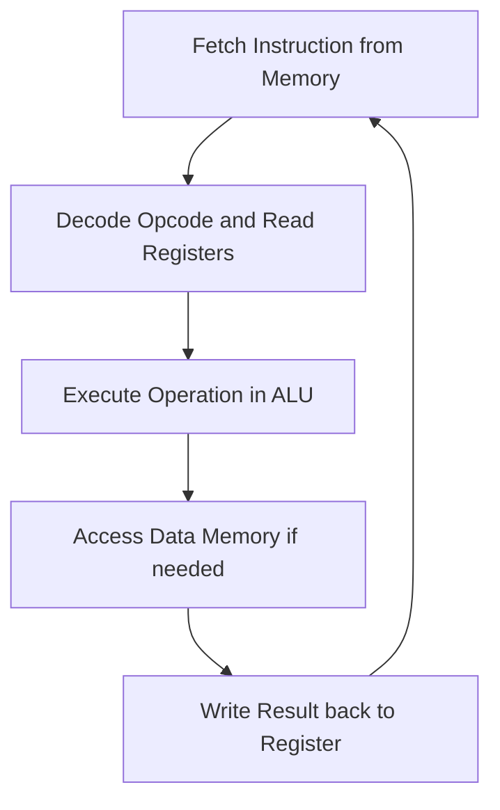

## Introduction

When you write a line of code like `x = y + 5;` in a high-level language, it feels instantaneous. However, beneath that abstraction, the Central Processing Unit (CPU) is performing a rhythmic, mechanical dance. It does not understand "variables" or "equations"; it understands only binary patterns fetched from memory. To bridge this gap, we must look at the **instruction cycle**—the continuous process by which a processor retrieves, interprets, and acts upon individual machine instructions.

Understanding this cycle is the "Aha!" moment for computer scientists. It transforms the CPU from a mysterious "black box" into a logical sequence of register transfers. In this lesson, we will explore the standard stages of instruction execution and learn how to read and write simple assembly programs. This knowledge is the foundation for understanding how hardware optimizations like pipelining and caching actually work.

**Before you start:** You should be familiar with the *Von Neumann Architecture & Performance Metrics*, understand *Binary Conversions & 2's Complement*, and recognize the basic differences between *RISC vs CISC & Instruction Formats*.

## Core theory

### The Instruction Cycle: The CPU's Heartbeat

The **instruction cycle** (also known as the fetch-decode-execute cycle) is the process by which a computer retrieves a program instruction from its memory, determines what actions the instruction requires, and carries out those actions. While different architectures may break these down into more or fewer steps, the standard model involves five distinct stages.

1.  **Instruction Fetch (IF):** The CPU retrieves the instruction from memory. The address of the instruction is held in a special register called the **Program Counter (PC)**.
2.  **Instruction Decode (ID):** The control unit interprets the binary pattern in the **Instruction Register (IR)**. It identifies the opcode (what to do) and the operands (what to do it to).
3.  **Execute (EX):** The **Arithmetic Logic Unit (ALU)** performs the operation, such as addition, logical AND, or a comparison.
4.  **Memory Access (MEM):** If the instruction involves reading from or writing to data memory (like a `load` or `store`), this stage handles that communication.
5.  **Write-Back (WB):** The result of the operation is written back to the destination register in the **register file**.



### Key Registers in the Cycle

To manage this cycle, the CPU relies on a set of internal storage locations called **registers**. Unlike RAM, registers are located directly inside the CPU and can be accessed within a single clock cycle.

*   **Program Counter (PC):** Holds the memory address of the *next* instruction to be fetched. In a 32-bit architecture with byte-addressable memory, the PC typically increments by 4 after each fetch ($PC \leftarrow PC + 4$).
*   **Instruction Register (IR):** Holds the actual binary code of the instruction currently being decoded.
*   **Memory Address Register (MAR):** Holds the address in memory that the CPU wants to read from or write to.
*   **Memory Data Register (MDR):** Also called the Memory Buffer Register (MBR), it holds the actual data being transferred to or from memory.
*   **Register File:** A collection of general-purpose registers (e.g., `x0` through `x31` in RISC-V) used to hold operands for immediate processing.

### RISC Assembly: The Load/Store Architecture

Reduced Instruction Set Computer (RISC) architectures, such as RISC-V, MIPS, or ARM, follow a **load/store architecture**. This means the CPU cannot perform math directly on values stored in RAM. Instead, data must be moved from memory into registers, processed, and then moved back.

Common instruction categories include:

| Category | Example (RISC-V style) | Meaning |
| :--- | :--- | :--- |
| **Arithmetic** | `add x1, x2, x3` | $x1 \leftarrow x2 + x3$ |
| **Immediate** | `addi x1, x2, 10` | $x1 \leftarrow x2 + 10$ |
| **Load** | `lw x1, 4(x2)` | Load word from $Memory[x2 + 4]$ into $x1$ |
| **Store** | `sw x1, 8(x2)` | Store word from $x1$ into $Memory[x2 + 8]$ |
| **Branch** | `beq x1, x2, label` | If $x1 == x2$, jump to `label` |

In these instructions, `x0` is often a special register that is hardwired to the value 0. This is a common RISC optimization that simplifies many operations (e.g., moving a value from `x2` to `x1` can be done as `add x1, x2, x0`).

### Control Flow and the PC

The default behavior of the CPU is sequential: it fetches the instruction at $PC$, then $PC+4$, then $PC+8$. **Control flow** instructions break this sequence to implement loops, `if` statements, and function calls.

*   **Unconditional Jumps:** The `j` or `jal` (jump and link) instructions force the PC to a new target address.
*   **Conditional Branches:** Instructions like `bne` (branch if not equal) or `blt` (branch if less than) only change the PC if a specific condition is met.

When a branch is "taken," the PC is updated to the target address. If the branch is "not taken," the PC simply increments to the next sequential instruction. The target address is often calculated using **PC-relative addressing**, where the instruction contains an **offset** that is added to the current PC.

$$TargetAddress = CurrentPC + Offset$$

### The Micro-Operations of Fetch

To see how the registers interact, we can look at the **micro-operations** (the smallest steps) of the Fetch stage. Let $[R]$ denote the contents of register $R$, and $M[address]$ denote the contents of memory at that address.

1.  $MAR \leftarrow [PC]$ (Copy PC to Memory Address Register)
2.  $MDR \leftarrow M[MAR]$ (Read memory into Memory Data Register)
3.  $IR \leftarrow [MDR]$ (Copy instruction to Instruction Register)
4.  $PC \leftarrow [PC] + 4$ (Increment PC for the next cycle)

These steps happen automatically, driven by the CPU's internal clock and control unit. By the time the "Execute" stage begins, the PC is already pointing to the *next* instruction in memory.

## Worked examples

### Example 1: Tracing a Simple Calculation

Consider the following C code snippet:
```c
int a = 5;
int b = 10;
int c = a + b;
```

A compiler might translate this into the following RISC-V assembly (assuming `x10` holds the base address of our variables in memory):

```text
addi x1, x0, 5      # x1 = 0 + 5
addi x2, x0, 10     # x2 = 0 + 10
add  x3, x1, x2     # x3 = x1 + x2
```

**Step-by-step trace of the third instruction (`add x3, x1, x2`):**

1.  **Fetch:** The CPU looks at the PC (let's say it is `0x00001008`). It fetches the 32-bit binary pattern for `add x3, x1, x2` from that address and puts it in the IR. The PC is updated to `0x0000100C`.
2.  **Decode:** The Control Unit sees the "ADD" opcode. It identifies `x1` and `x2` as the source registers and `x3` as the destination.
3.  **Execute:** The ALU receives the value `5` (from `x1`) and `10` (from `x2`). It performs the addition, resulting in `15`.
4.  **Memory:** This is an R-type (register-register) instruction. No data memory access is required. This stage is idle.
5.  **Write-Back:** The value `15` is written into register `x3`.

**Final Answer:** After execution, the register file contains `x1=5`, `x2=10`, and `x3=15`. The PC is `0x0000100C`.

### Example 2: PC-Relative Branch Calculation

Suppose we have a branch instruction at memory address `0x2000`. The instruction is `beq x1, x2, 12`. In many RISC architectures, the immediate value `12` represents a byte offset.

**Question:** If `x1` equals `x2`, what will be the new value of the PC?

**Step-by-step solution:**
1.  The instruction is fetched from `0x2000`.
2.  During the fetch/decode phase, the PC is automatically incremented to the next instruction: $PC_{next} = 0x2000 + 4 = 0x2004$.
3.  The branch condition is evaluated. Since `x1 == x2`, the branch is **taken**.
4.  The offset `12` is added to the *incremented* PC.
5.  $NewPC = 0x2004 + 12 = 0x2016$.

**Final Answer:** The new PC value is `0x2016`. Note that if the architecture adds the offset to the *current* instruction address instead of the *incremented* PC, the answer would be `0x2012`. Always check the specific ISA manual (RISC-V adds to the address of the branch instruction itself, but many textbooks use the incremented PC model). For this example, we followed the standard textbook model where $Target = PC_{after\_fetch} + Offset$.

### Example 3: High-Level Loop to Assembly

Let's look at how a simple loop is handled.

```c
// C Code
int sum = 0;
for (int i = 0; i < 3; i++) {
    sum += i;
}
```

**Assembly Translation:**
```text
    addi x1, x0, 0      # sum = 0
    addi x2, x0, 0      # i = 0
    addi x3, x0, 3      # limit = 3
loop:
    bge  x2, x3, end    # if i >= limit, go to end
    add  x1, x1, x2     # sum = sum + i
    addi x2, x2, 1      # i = i + 1
    jal  x0, loop       # jump back to loop
end:
```

**Trace of the first iteration:**
1. `x1` (sum) becomes 0.
2. `x2` (i) becomes 0.
3. `x3` (limit) becomes 3.
4. `bge` checks if $0 \ge 3$. It is false, so the branch is **not taken**. The PC moves to the next line.
5. `add x1, x1, x2` results in $0 + 0 = 0$. `x1` is 0.
6. `addi x2, x2, 1` results in $0 + 1 = 1$. `x2` is 1.
7. `jal` (jump) sets the PC back to the `loop` label.

**Final Answer:** After the loop finishes, `x1` will contain $0 + 1 + 2 = 3$. The value `3` is not added because the `bge` condition ($3 \ge 3$) becomes true at the start of the fourth check.

## Applications

*   **Compiler Design:** Compilers must understand the instruction cycle to generate efficient machine code. They perform "instruction scheduling" to ensure the CPU's pipeline stays full.
*   **Embedded Systems:** When programming microcontrollers (like those in a microwave or a car's engine control unit), developers often write in assembly to meet strict timing requirements or to minimize memory usage.
*   **Cybersecurity:** Understanding the instruction cycle and how the PC is manipulated is essential for identifying and preventing "buffer overflow" attacks, where an attacker tries to overwrite the PC to point to malicious code.
*   **Performance Debugging:** Software engineers use profilers to see which instructions are taking the most cycles. Knowing that a `lw` (load word) might stall the cycle while waiting for RAM helps them optimize data structures for better cache performance.
*   **Operating Systems:** The OS manages the instruction cycle for multiple programs by saving and restoring the state of registers (including the PC) during a "context switch."

## Common mistakes

*   **The PC Increment Timing.** A common mistake is forgetting that the PC usually increments *immediately* after the fetch. When calculating branch targets, you must know if your specific architecture adds the offset to the address of the branch instruction itself or the address of the *following* instruction.
*   **Confusing Immediate Values with Addresses.** In an instruction like `addi x1, x2, 100`, the `100` is a literal number (an immediate). In `lw x1, 100(x2)`, the `100` is an offset added to a base address in `x2` to find a location in RAM.
*   **Register vs. Memory.** Beginners often try to perform arithmetic on memory addresses directly. Remember: in RISC, you **must** load the value into a register first. You cannot do `add M[0x1000], x1, x2`.
*   **Off-by-one in Loops.** Just like in high-level languages, assembly loops often fail at the boundary. In the example `bge x2, x3, end`, if `x3` is 3, the loop runs for `x2 = 0, 1, 2`. If you wanted it to run for `3`, you would need a "greater than" (`bgt`) check or change the limit.
*   **Ignoring Register x0.** Forgetting that `x0` is hardwired to zero can lead to confusion. You cannot store a result in `x0`; any write to it is simply discarded by the hardware.

## Revision notes

*   **Instruction Cycle Stages:** Fetch (get instruction), Decode (understand instruction), Execute (ALU math), Memory (RAM access), Write-Back (save result).
*   **Program Counter (PC):** The pointer to the next instruction. Standard increment is +4 for 32-bit instructions.
*   **Load/Store Architecture:** RISC CPUs only perform math on registers. Memory access is restricted to specific `load` and `store` instructions.
*   **General Purpose Registers:** Fast, internal CPU storage. RISC-V has 32 (x0-x31).
*   **PC-Relative Addressing:** Branches use an offset from the current PC rather than an absolute memory address. This makes code "position-independent."
*   **Opcode:** The part of the machine instruction that specifies the operation to be performed.
*   **Micro-operations:** The register-level steps (like $MAR \leftarrow PC$) that make up a single stage of the instruction cycle.

## Practice questions

:::question basic
During which stage of the instruction cycle is the Program Counter (PC) typically updated to point to the next instruction?
:::answer
The PC is typically updated during the **Fetch** stage. As soon as the instruction is retrieved from memory and placed into the Instruction Register (IR), the PC is incremented (usually by 4 in a 32-bit system) so that it is ready for the next cycle.
:::

:::question basic
What is the primary difference between a `load` instruction and an `add` instruction in a RISC architecture?
:::answer
A `load` instruction interacts with **data memory (RAM)** to move a value into a register, whereas an `add` instruction only interacts with the **register file and the ALU**. In RISC, arithmetic instructions cannot access memory directly.
:::

:::question intermediate
A CPU is executing a program. The current PC is `0x4000`. The instruction at `0x4000` is a branch instruction: `beq x5, x6, 20`. If `x5` and `x6` are equal, and the architecture calculates the target as $PC_{next} + offset$, what is the address of the next instruction to be fetched?
:::answer
The next sequential address ($PC_{next}$) is `0x4000 + 4 = 0x4004`. Since the branch is taken, we add the offset of 20 to this value: `0x4004 + 20 = 0x4024`. The CPU will fetch the next instruction from `0x4024`.
:::

:::question intermediate
Translate the C statement `y = x - 1;` into RISC-V assembly. Assume `x` is in register `x10` and `y` should be stored in `x11`.
:::answer
The translation is `addi x11, x10, -1`. Even though it is a subtraction, RISC-V uses the "Add Immediate" instruction with a negative value to perform subtraction with a constant.
:::

:::question advanced
Explain why the "Memory Access" stage of the instruction cycle is often idle for instructions like `add` or `xor`. How does this affect CPU design?
:::answer
Instructions like `add` or `xor` are R-type instructions that only operate on registers; they do not need to read from or write to RAM. This creates a structural "gap" in the cycle where the memory interface is unused. In modern CPU design, this is solved by **pipelining**, where a second instruction (like a `load`) can use the Memory stage while the first instruction (`add`) is in the Write-Back stage, maximizing hardware utilization.
:::

:::question advanced
Consider a 32-bit RISC CPU where the PC is `0x1000`. The instruction at this address is `lw x1, 8(x2)`. If `x2` contains `0x2000`, describe the exact values in the MAR and MDR at the end of the **Memory Access** stage.
:::answer
The MAR (Memory Address Register) will contain `0x2008`, which is the base address `0x2000` plus the offset `8`. The MDR (Memory Data Register) will contain whatever 32-bit value was stored in RAM at the address `0x2008`.
:::

## Further learning

*   **Next:** *Datapath & Register Organization* explores the physical wires and logic gates that connect the registers and ALU mentioned in this lesson.
*   **Next:** *Hardwired vs Microprogrammed Control* explains how the "Decode" stage actually works—how bits in the IR trigger the correct control signals.
*   **Related:** *Pipelining Fundamentals & Speedup* shows how the CPU can overlap multiple instruction cycles to execute one instruction every clock cycle.
*   **Related:** *Addressing Modes* provides a deeper look at the different ways the "Execute" and "Memory" stages calculate operand locations.
*   **Textbook:** Patterson and Hennessy, *Computer Organization and Design: The Hardware/Software Interface*. (This is the definitive text for RISC-V and MIPS architectures).
