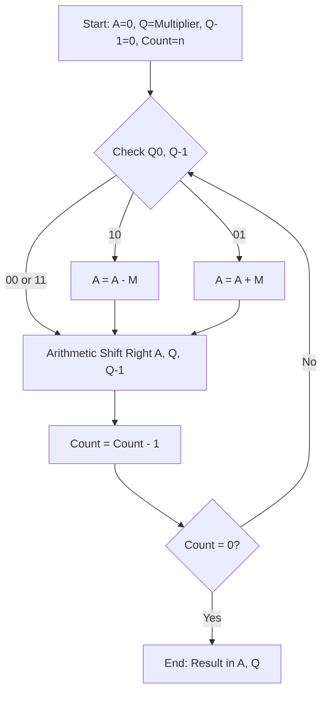

## Introduction

Imagine you are developing a high-frequency trading platform or a real-time physics engine for a video game. In these environments, billions of calculations happen every second. If the underlying hardware takes ten clock cycles to multiply numbers when it could take three, your system fails. If it rounds a decimal incorrectly, a bank account loses money or a character falls through the floor.

At the lowest level, a CPU does not "know" what a number is; it only knows how to manipulate voltages representing 0s and 1s. To make these bits useful, computer architects developed standardized methods for arithmetic. This lesson explores how we move from simple logic gates to complex units capable of handling signed integers and massive real numbers. We will cover the standard **Two's Complement Adder**, the clever shortcuts of **Booth's Multiplication**, and the ubiquitous **IEEE 754 Floating Point** standard.

**Before you start:** you should be comfortable with *Binary Conversions & 2's Complement* and basic logic gates (AND, OR, XOR).

## Core theory

### Addition and Subtraction Hardware

The fundamental building block of the Arithmetic Logic Unit (ALU) is the **Full Adder**. A full adder takes three inputs—two bits ($A$ and $B$) and a carry-in ($C_{in}$)—and produces two outputs: a Sum ($S$) and a Carry-out ($C_{out}$).

The logic equations are:
$$S = A \oplus B \oplus C_{in}$$
$$C_{out} = (A \cdot B) + (C_{in} \cdot (A \oplus B))$$

To add $n$-bit numbers, we chain $n$ full adders together in a **Ripple Carry Adder (RCA)**. The $C_{out}$ of one bit becomes the $C_{in}$ of the next. While simple, the RCA is slow because the carry must "ripple" from the least significant bit (LSB) to the most significant bit (MSB), creating a delay proportional to $n$.

**Two's Complement Subtraction** is elegantly handled by the same hardware. To compute $A - B$, we use the identity $A - B = A + (-B)$. In two's complement, $-B$ is found by inverting all bits of $B$ and adding 1. Hardware achieves this by:
1. Passing $B$ through XOR gates with a control signal (set to 1 for subtraction).
2. Feeding that same control signal into the $C_{in}$ of the LSB adder.

### Booth's Multiplication Algorithm

Simple binary multiplication (the "shift and add" method) is slow when dealing with long strings of ones. For example, multiplying by $14$ ($1110_2$) requires three additions. However, $14$ is also $16 - 2$. **Booth's Algorithm** exploits this by treating strings of ones as a single subtraction at the start of the string and a single addition at the end.

Booth's algorithm works on signed integers and follows these rules based on the current bit ($Q_0$) and the bit to its right ($Q_{-1}$, initially 0):

| $Q_0$ | $Q_{-1}$ | Action |
| :--- | :--- | :--- |
| 0 | 0 | Arithmetic Shift Right only |
| 0 | 1 | Add Multiplicand ($M$) to Accumulator ($A$), then Shift |
| 1 | 0 | Subtract Multiplicand ($M$) from Accumulator ($A$), then Shift |
| 1 | 1 | Arithmetic Shift Right only |

The **Arithmetic Shift Right** is crucial: it preserves the sign bit (the MSB), ensuring that negative numbers remain negative.



### IEEE 754 Floating Point Representation

To represent very large or very small real numbers, computers use **Scientific Notation** in binary. The IEEE 754 standard is the most widely used format. A **Single Precision** (32-bit) number consists of three parts:

1.  **Sign (S):** 1 bit (0 for positive, 1 for negative).
2.  **Exponent (E):** 8 bits, stored with a **Bias** of 127.
3.  **Mantissa (M):** 23 bits (also called the significand or fraction).

The value is calculated as:
$$\text{Value} = (-1)^S \times (1 + \text{Mantissa}) \times 2^{E - 127}$$

**The Hidden Bit:** To maximize precision, the mantissa is **normalized** so that the leading bit is always 1 (e.g., $1.011 \times 2^3$). Since the leading 1 is always there, we don't store it. This gives us 24 bits of precision using only 23 bits of space.

**The Bias:** We use a bias (127 for single precision, 1023 for double) so that the stored exponent is always a positive integer, simplifying hardware comparisons. An actual exponent of $0$ is stored as $127$. An exponent of $-5$ is stored as $122$.

### Special Values and Precision Limits

IEEE 754 reserves specific exponent patterns for special cases:
*   **Zero:** Exponent = 0, Mantissa = 0.
*   **Infinity:** Exponent = 255, Mantissa = 0.
*   **NaN (Not a Number):** Exponent = 255, Mantissa $\neq$ 0 (results from $0/0$ or $\sqrt{-1}$).
*   **Denormalized Numbers:** Exponent = 0, Mantissa $\neq$ 0. These represent numbers very close to zero.

Floating point arithmetic is not always exact. Because we have a finite number of bits, many decimal numbers (like $0.1$) cannot be represented perfectly in binary.

```python
# Demonstrating Floating Point Inexactness
a = 0.1
b = 0.2
c = 0.3
print(f"{a} + {b} == {c} is {a + b == c}")
print(f"Actual sum: {a + b:.20f}")
```

Output:
```text
0.1 + 0.2 == 0.3 is False
Actual sum: 0.30000000000000004441
```

## Worked examples

### Example 1: Booth's Algorithm Trace
Multiply $M = 3$ ($0011_2$) by $Q = -4$ ($1100_2$) using 4-bit Booth's Algorithm.
$M = 0011$, $-M = 1101$.

| Step | A | Q | $Q_{-1}$ | Action |
| :--- | :--- | :--- | :--- | :--- |
| Initial | 0000 | 1100 | 0 | - |
| 1 | 0000 | 1100 | 0 | $Q_0 Q_{-1} = 00 \to$ Shift |
| Shift | 0000 | 0110 | 0 | - |
| 2 | 0000 | 0110 | 0 | $Q_0 Q_{-1} = 00 \to$ Shift |
| Shift | 0000 | 0011 | 0 | - |
| 3 | 1101 | 0011 | 0 | $Q_0 Q_{-1} = 10 \to A = A - M$ |
| Shift | 1110 | 1001 | 1 | Shift |
| 4 | 1110 | 1001 | 1 | $Q_0 Q_{-1} = 11 \to$ Shift |
| Shift | 1111 | 0100 | 1 | Final Result |

**Result:** $11110100_2$. In two's complement, this is $-12_{10}$. Correct ($3 \times -4 = -12$).

### Example 2: Decimal to IEEE 754 Conversion
Convert $-6.5_{10}$ to IEEE 754 Single Precision hex format.

1.  **Sign:** The number is negative, so $S = 1$.
2.  **Binary Conversion:** $6 = 110_2$, $0.5 = 2^{-1} = 0.1_2$. So, $6.5 = 110.1_2$.
3.  **Normalization:** Move the decimal point to the left of the first '1': $1.101 \times 2^2$.
    *   The actual exponent is $2$.
    *   The mantissa (fractional part) is $101$.
4.  **Exponent with Bias:** $E = 2 + 127 = 129$.
    *   $129$ in binary is $10000001_2$.
5.  **Assemble the bits:**
    *   $S=1$
    *   $E=10000001$
    *   $M=10100000000000000000000$ (padded to 23 bits)
    *   Full string: `1 10000001 10100000000000000000000`
6.  **Hexadecimal:**
    *   `1100 0000 1101 0000 0000 0000 0000 0000`
    *   `C    0    D    0    0    0    0    0`

**Final Answer:** `0xC0D00000`.

### Example 3: Floating Point Addition
Add $1.0 \times 2^0$ and $1.1 \times 2^{-2}$ (simplified 4-bit mantissa).

1.  **Align Exponents:** Shift the smaller number so its exponent matches the larger.
    *   $1.1 \times 2^{-2} = 0.011 \times 2^0$.
2.  **Add Mantissas:**
    *   $1.000 + 0.011 = 1.011$.
3.  **Normalize:** The result $1.011 \times 2^0$ is already normalized.
4.  **Check for Overflow/Underflow:** None.

**Final Answer:** $1.011 \times 2^0$.

## Applications

*   **Graphics Processing Units (GPUs):** Modern GPUs perform trillions of floating-point operations per second (FLOPS) to calculate lighting, shadows, and geometry in 3D space.
*   **Digital Signal Processing (DSP):** Algorithms like the Fast Fourier Transform (FFT) rely heavily on fast integer multiplication (often using Booth-like hardware) to process audio and radio signals.
*   **Scientific Simulations:** Climate modeling and molecular dynamics require Double Precision (64-bit) IEEE 754 to maintain accuracy over millions of iterative steps where small errors could compound.
*   **Financial Systems:** While many systems use fixed-point for currency, high-speed trading algorithms use optimized floating-point hardware to calculate risk and pricing in microseconds.

## Common mistakes

*   **The mistake.** Forgetting to add the bias to the exponent in IEEE 754. **Why it is wrong and how to avoid it.** If you store the raw exponent, negative exponents will look like very large integers to the hardware. Always add 127 (single) or 1023 (double) before converting to binary.
*   **The mistake.** Confusing "Carry" with "Overflow" in integer addition. **Why it is wrong and how to avoid it.** Carry is a bit leaving the MSB; Overflow means the result is too large for the signed representation (e.g., adding two positives and getting a negative). Check the sign bits of the operands and the result to detect overflow.
*   **The mistake.** Incorrectly performing Arithmetic Shift Right in Booth's Algorithm. **Why it is wrong and how to avoid it.** A logical shift fills the MSB with 0, but an arithmetic shift must copy the existing sign bit. If the MSB was 1, it must stay 1 after the shift.
*   **The mistake.** Including the "hidden bit" in the stored IEEE 754 mantissa. **Why it is wrong and how to avoid it.** The leading 1 is implicit. If you store it, you shift your entire mantissa one bit to the right, effectively dividing your number by 2 and losing a bit of precision.

## Revision notes

*   **Full Adder:** $S = A \oplus B \oplus C_{in}$; $C_{out} = AB + C_{in}(A \oplus B)$.
*   **Subtraction:** $A - B$ is implemented as $A + \text{NOT}(B) + 1$.
*   **Booth's Recoding:** $01 \to$ Add $M$; $10 \to$ Subtract $M$; $00/11 \to$ Shift only.
*   **Arithmetic Shift:** Essential for signed multiplication to preserve the sign bit.
*   **IEEE 754 Single Precision:** 1-bit Sign, 8-bit Exponent (Bias 127), 23-bit Mantissa.
*   **Normalization:** Numbers are stored as $1.f \times 2^e$. The $1$ is not stored.
*   **Range vs. Precision:** Increasing exponent bits increases range; increasing mantissa bits increases precision.
*   **Special Values:** Exponent all 1s indicates Infinity (Mantissa 0) or NaN (Mantissa $\neq$ 0).

## Practice questions

:::question basic
A 4-bit Ripple Carry Adder is used to add $0111_2$ (7) and $0001_2$ (1). What are the values of the Sum bits and the Carry-out of the MSB? Does overflow occur?
:::answer
The sum is $1000_2$. The Carry-out of the MSB is 0. However, overflow **does** occur because we added two positive numbers (7 and 1) and received a negative result (-8 in 4-bit two's complement). This happens because the result 8 exceeds the maximum 4-bit signed value of 7.
:::

:::question basic
In IEEE 754 single precision, if the stored exponent bits are `10000010`, what is the actual power of 2 being represented?
:::answer
The stored exponent `10000010` is $130$ in decimal. Since the bias for single precision is $127$, the actual exponent is $130 - 127 = 3$. The value represents a multiplier of $2^3$.
:::

:::question intermediate
Perform one step of Booth's algorithm for $M = 0110$ and $Q = 0011$. Assume $A = 0000$ and $Q_{-1} = 0$. What are the values of $A, Q,$ and $Q_{-1}$ after the first "Add/Subtract" and "Shift" sequence?
:::answer
1. $Q_0=1, Q_{-1}=0 \to$ Action is $A = A - M$.
2. $A = 0000 - 0110 = 1010$.
3. Arithmetic Shift Right $(A, Q, Q_{-1})$: The combined string $1010\ 0011\ 0$ becomes $1101\ 0001\ 1$.
Result: $A=1101, Q=0001, Q_{-1}=1$.
:::

:::question intermediate
Convert the decimal number $0.75$ into IEEE 754 single-precision binary.
:::answer
1. Sign is 0 (positive).
2. $0.75 = 1/2 + 1/4 = 0.11_2$.
3. Normalize: $1.1 \times 2^{-1}$.
4. Exponent: $-1 + 127 = 126 = 01111110_2$.
5. Mantissa: $100...0$ (23 bits).
Result: `0 01111110 10000000000000000000000`.
:::

:::question advanced
Why does Booth's algorithm yield the correct result for signed numbers without any special correction steps, whereas the standard shift-and-add algorithm requires correction if the multiplier is negative?
:::answer
Booth's algorithm treats the multiplier as a sum of powers of 2. By using the $10$ (subtract) and $01$ (add) transitions, it effectively represents the multiplier in a "signed-digit" format. Because the final operation on a negative multiplier will always be a subtraction (due to the sign bit being 1 and eventually shifting to a $Q_0=1, Q_{-1}=0$ state or being part of a $11$ string), the algorithm inherently handles the negative weight of the MSB in two's complement.
:::

:::question advanced
Consider a hypothetical 10-bit floating point format: 1 bit sign, 4 bits exponent (bias 7), and 5 bits mantissa. What is the smallest positive **normalized** number and the largest finite number representable?
:::answer
Smallest normalized: Exponent = $0001$ (Actual $1-7 = -6$), Mantissa = $00000$. Value: $1.0 \times 2^{-6} = 1/64 = 0.015625$.
Largest finite: Exponent = $1110$ (Actual $14-7 = 7$), Mantissa = $11111$. Value: $1.11111_2 \times 2^7 = (1 + 31/32) \times 128 = 63/32 \times 128 = 63 \times 4 = 252$.
:::

## Further learning

*   **Next:** *Datapath & Register Organization* explores how the ALU we discussed here is connected to registers and buses to form a functioning CPU.
*   **Related:** *Binary Arithmetic, Overflow & Codes* provides a deeper dive into the mathematical proofs behind two's complement and alternative codes like BCD.
*   **Related:** *Pipelining Fundamentals & Speedup* explains how arithmetic operations are broken into stages to allow the CPU to process multiple instructions at once.
*   **Textbook:** Patterson and Hennessy, *Computer Organization and Design: The Hardware/Software Interface*.
