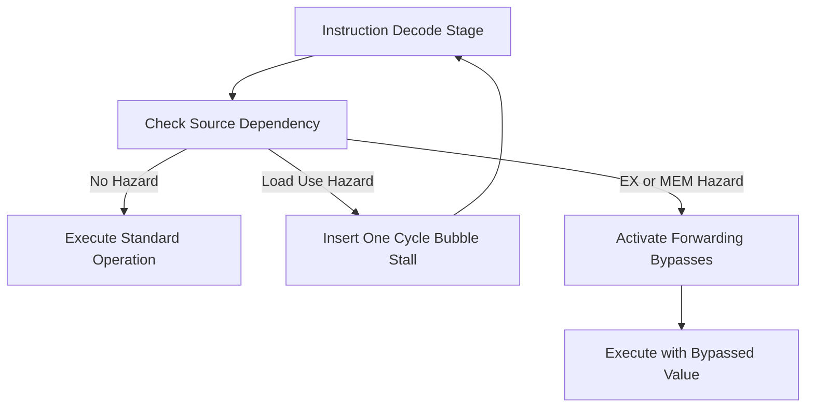

## Introduction

Pipelining increases CPU instruction throughput by overlapping the execution of multiple instructions, much like an assembly line. In an ideal 5-stage classic RISC pipeline—consisting of **Instruction Fetch (IF)**, **Instruction Decode (ID)**, **Execute (EX)**, **Memory Access (MEM)**, and **Write Back (WB)**—the processor completes one instruction per clock cycle, yielding an ideal **Cycles Per Instruction (CPI)** of $1.0$.

However, real programs rarely run smoothly without interruption. Dependencies between sequential instructions often prevent the next instruction from executing in its designated clock cycle. For example, if an arithmetic instruction requires the result of a calculation performed by the instruction immediately ahead of it, the execution pipeline must either delay or reroute the data. These disruptive conditions are called pipeline hazards.

Understanding how to detect, prevent, and resolve hazards is fundamental to processor architecture. In this lesson, you will learn to analyze Read-After-Write (RAW) data dependencies, derive hardware forwarding (bypassing) logic, implement load-use hazard stalls, and quantify the performance impact of control branch penalties and branch delay slots.

**Before you start:** You should be familiar with register transfer operations from *Datapath & Register Organization*, basic instruction execution steps from *Instruction Cycle & Assembly Language*, and ideal pipeline throughput concepts from *Pipelining Fundamentals & Speedup*.

## Core theory

### Taxonomy of Pipeline Hazards

A **pipeline hazard** is any condition that prevents the next instruction in the instruction stream from executing in its assigned clock cycle. Hazards reduce pipeline performance below the theoretical maximum by introducing **stalls** (also known as **bubbles**), which are empty cycles where no useful work is completed by one or more pipeline stages.

Pipeline hazards fall into three primary categories:

1. **Structural Hazard**: A hardware resource conflict where two or more overlapping instructions require the exact same physical component during the same clock cycle.
2. **Data Hazard**: An instruction depends on the result of a previous instruction that has not yet completed its write to the register file or memory.
3. **Control Hazard**: The pipeline cannot determine which instruction to fetch next because a branch or jump condition and target address have not yet been evaluated.



### Data Hazards: RAW, WAR, and WAW

Data hazards arise from data dependencies between instructions. Consider two instructions, $I_1$ followed later by $I_2$. Depending on the read and write access order to a shared register or memory location, three data hazard types exist theoretically:

| Hazard Type | Sequence | Description | Occurs in standard 5-stage RISC? |
| :--- | :--- | :--- | :--- |
| **Read-After-Write (RAW)** | $I_1$ writes, then $I_2$ reads | $I_2$ attempts to read a source operand before $I_1$ writes its updated value. | **Yes** (True Dependency) |
| **Write-After-Read (WAR)** | $I_1$ reads, then $I_2$ writes | $I_2$ attempts to write a destination before $I_1$ finishes reading its original value. | **No** (Anti-Dependency) |
| **Write-After-Write (WAW)** | $I_1$ writes, then $I_2$ writes | $I_2$ attempts to write a destination before $I_1$ writes its updated value. | **No** (Output Dependency) |

In a standard, in-order 5-stage RISC pipeline, instructions write to registers during Stage 5 (WB) and read registers during Stage 2 (ID). Because instructions proceed strict in-order, $I_1$ always reads in ID before $I_2$ writes in WB, preventing WAR hazards. Similarly, $I_1$ reaches WB before $I_2$ reaches WB, preserving write ordering and preventing WAW hazards. (WAR and WAW hazards do occur in out-of-order and multi-cycle execution pipelines).

Thus, **RAW dependencies** are the primary data hazard in basic pipelines. A standard design convention to reduce RAW stalls is the **split-phase register file**: register writes occur on the rising edge (first half) of the clock cycle, while register reads occur on the falling edge (second half). This allows an instruction in WB to write a result that an instruction in ID reads within the exact same clock cycle.

### Data Forwarding (Bypassing) Logic

Without special hardware, a RAW dependency between an instruction generating a result and an immediately following instruction reading that result forces the pipeline to stall for 2 cycles until the result reaches the WB stage.

However, the result of an arithmetic instruction is already computed at the end of the **EX** stage (Stage 3). Waiting for it to pass through **MEM** (Stage 4) and write into the register file in **WB** (Stage 5) is unnecessary. **Forwarding** (or **bypassing**) routes the freshly generated result directly from pipeline registers (`EX/MEM` or `MEM/WB`) to the inputs of the Execution stage's ALU, skipping the register file write-read loop entirely.

```text
Clock Cycle:      C1    C2    C3    C4    C5
ADD R1, R2, R3    IF    ID    EX    MEM   WB
                               \   
SUB R4, R1, R5          IF    ID   EX   MEM   WB
                                 (ALU Result Forwarded from EX/MEM to EX)
```

To control the forwarding multiplexers placed at the ALU inputs, the **Forwarding Unit** evaluates conditions based on destination registers (`RegisterRd`), source registers (`RegisterRs`, `RegisterRt`), and control signals (`RegWrite`):

1. **EX/MEM Hazard (Forwarding from EX/MEM register)**:
   If an instruction in the EX stage requires a source register that matches the destination register of the instruction currently in the MEM stage, and that previous instruction writes to a register:
   $$\text{If } (\text{EX/MEM.RegWrite} \land (\text{EX/MEM.RegisterRd} \neq 0) \land (\text{EX/MEM.RegisterRd} == \text{ID/EX.RegisterRs})) \implies \text{ForwardA} = 10_2$$
   $$\text{If } (\text{EX/MEM.RegWrite} \land (\text{EX/MEM.RegisterRd} \neq 0) \land (\text{EX/MEM.RegisterRd} == \text{ID/EX.RegisterRt})) \implies \text{ForwardB} = 10_2$$

2. **MEM/WB Hazard (Forwarding from MEM/WB register)**:
   If an instruction in the EX stage requires a source register that matches the destination of the instruction currently in the WB stage, and no newer EX/MEM hazard overrides it:
   $$\text{If } (\text{MEM/WB.RegWrite} \land (\text{MEM/WB.RegisterRd} \neq 0) \land \neg(\text{EX/MEM.RegWrite} \land (\text{EX/MEM.RegisterRd} \neq 0) \land (\text{EX/MEM.RegisterRd} == \text{ID/EX.RegisterRs})) \land (\text{MEM/WB.RegisterRd} == \text{ID/EX.RegisterRs})) \implies \text{ForwardA} = 01_2$$

*(Note: Register `$0` or `R0` in RISC architectures is hardwired to zero, so comparisons explicitly check `RegisterRd != 0` to prevent invalid forwarding when `$0` is the target).*

### Load-Use Data Hazards & Hardware Bubble Insertion

Data forwarding cannot solve every RAW hazard. Consider a **Load-Use hazard**, where a memory load instruction (`LW`) is followed immediately by an arithmetic instruction that consumes the loaded value:

```text
LW  R1, 0(R2)     IF    ID    EX    MEM   WB
                                     |
ADD R3, R1, R4          IF    ID    EX   MEM   WB
```

The `LW` instruction reads data from memory during the **MEM** stage (Stage 4). Therefore, the loaded value is not available until the end of Stage 4. However, the subsequent `ADD` instruction requires the value at the beginning of its **EX** stage (Stage 3). Because data cannot move backward in time, forwarding alone cannot resolve a Load-Use dependency without stalling.

The **Hazard Detection Unit** situated in the ID stage identifies this pattern and inserts a single **pipeline bubble** (stall):

$$\text{If } (\text{ID/EX.MemRead} \land ((\text{ID/EX.RegisterRt} == \text{IF/ID.RegisterRs}) \lor (\text{ID/EX.RegisterRt} == \text{IF/ID.RegisterRt})))$$

When this condition evaluates to true, the hardware performs two synchronized actions:
1. **Freeze Pipeline**: Disable updates to the Program Counter (`PCWrite = 0`) and the `IF/ID` pipeline register (`IF/IDWrite = 0`). This holds the dependent instruction in the ID stage and keeps the following instruction in the IF stage.
2. **Inject NOP**: Clear the control signals in the `ID/EX` register (setting them to 0). This creates a **No-Operation (NOP)** bubble that propagates down the pipeline through EX, MEM, and WB without modifying register or memory states.

After 1 cycle of stall, the loaded data reaches the `MEM/WB` pipeline register and can be forwarded to the ALU input for the `ADD` instruction in the EX stage.

### Control Hazards & Branch Delay Slots

A **control hazard** occurs when the processor fetches an instruction before knowing whether a preceding branch instruction will take the branch or which address to execute next.

If branch target calculation and comparison occur in the **EX** stage (Stage 3), the outcome is not known until Cycle 3. By this time, two subsequent instructions have already been fetched into the IF and ID stages. If the branch is taken, these two instructions must be discarded (**flushed**), converting their pipeline registers to NOPs. This results in a **branch penalty** of 2 stall cycles.

Architectures mitigate control hazard overhead using three main techniques:

1. **Early Branch Evaluation**: Dedicated hardware adders and comparators are moved from the EX stage into the **ID** stage (Stage 2). This evaluates branch targets and conditions by Cycle 2, reducing the branch penalty from 2 cycles down to 1 cycle.
2. **Branch Prediction**: The pipeline predicts whether a branch is taken or not taken. 
   - *Static Prediction*: Always predict "not taken" (continue fetching sequentially) or predict backward branches taken (common in loops). If correct, zero penalty; if wrong, flush the speculative instructions.
   - *Dynamic Prediction*: Uses hardware tables (Branch History Tables, Branch Target Buffers) to track historical branch behavior.
3. **Branch Delay Slots**: A architectural design choice used in classic MIPS and SPARC systems. The instruction slot immediately following a conditional or unconditional branch instruction is defined as a **branch delay slot**. The instruction placed in the delay slot is *always executed*, regardless of whether the branch is taken or not.

```text
Without Delay Slot (Branch Taken, 1-cycle penalty):
C1: BEQ R1, R2, Target  (Evaluated in ID at C2)
C2: ADD R3, R4, R5      (Fetched, must be FLUSHED/STALLED)
C3: Target Instruction  (Fetched)

With Delay Slot (Filled with useful instruction):
C1: BEQ R1, R2, Target
C2: SUB R8, R9, R10     (Delay Slot: Executes regardless of branch decision)
C3: Target Instruction  (Fetched if taken, or next sequential instruction if not taken)
```

The compiler attempts to fill the branch delay slot with an independent instruction that precedes the branch in the original code stream. If no such instruction can be found, the compiler inserts an explicit `NOP`.

---

## Worked examples

### Example 1: Tracing Pipeline Execution with Forwarding and Stalls

Consider the following MIPS assembly code segment running on a standard 5-stage pipeline with full forwarding (EX/MEM and MEM/WB to EX), split-phase register files, and branch evaluation in the EX stage:

```text
1: LW  R1, 0(R2)
2: ADD R3, R1, R4
3: SUB R5, R3, R1
4: AND R6, R5, R7
```

**Task:** Construct a cycle-by-cycle execution table showing stalls and data forwarding paths.

**Step-by-Step Solution:**

1. **Analyze Dependencies:**
   - Instruction 1 (`LW`) writes to `R1`. Instruction 2 (`ADD`) reads `R1` immediately after. This is a **Load-Use hazard**. Requires **1 stall cycle**.
   - Instruction 2 (`ADD`) writes to `R3`. Instruction 3 (`SUB`) reads `R3` immediately after. This is an **EX-to-EX RAW dependency**. Resolved by **EX/MEM to EX forwarding** without stalls.
   - Instruction 1 (`LW`) writes to `R1`. Instruction 3 (`SUB`) reads `R1`. `LW` is now in MEM/WB while `SUB` is in EX. Resolved by **MEM/WB to EX forwarding** without stalls.
   - Instruction 3 (`SUB`) writes to `R5`. Instruction 4 (`AND`) reads `R5`. Resolved by **EX/MEM to EX forwarding** without stalls.

2. **Construct Pipeline Execution Grid:**

| Instruction | C1 | C2 | C3 | C4 | C5 | C6 | C7 | C8 | C9 |
| :--- | :---: | :---: | :---: | :---: | :---: | :---: | :---: | :---: | :---: |
| `1: LW R1, 0(R2)` | IF | ID | EX | MEM | WB | | | | |
| `2: ADD R3, R1, R4` | | IF | **ID** | **stall** | EX | MEM | WB | | |
| `bubble (NOP)` | | | | | EX | MEM | WB | | |
| `3: SUB R5, R3, R1` | | | IF | **IF** | ID | EX | MEM | WB | |
| `4: AND R6, R5, R7` | | | | | IF | ID | EX | MEM | WB |

3. **Identify Data Bypasses:**
   - At **Cycle 5**: Data for `R1` loaded by `LW` is in `MEM/WB`. It is forwarded to the ALU input for `ADD` in `EX`.
   - At **Cycle 6**: Data for `R3` computed by `ADD` is in `EX/MEM`. Data for `R1` loaded by `LW` is written to register file, but also accessible via `MEM/WB`. Both are forwarded to ALU inputs for `SUB` in `EX`.
   - At **Cycle 7**: Data for `R5` computed by `SUB` is in `EX/MEM`. It is forwarded to the ALU input for `AND` in `EX`.

**Final Answer:** Total clock cycles to complete execution of all 4 instructions is **9 cycles**.

---

### Example 2: Quantitative CPI and Speedup Calculation with Hazards

A program consists of $10^6$ instructions executed on a $2.5\text{ GHz}$ CPU ($\text{Clock Cycle Time } T_c = 0.4\text{ ns}$) with a 5-stage pipeline. The instruction mix and hazard characteristics are as follows:
- $60\%$ Arithmetic/Logic instructions (ideal 1 cycle, no stalls).
- $25\%$ Load instructions. $20\%$ of these loads trigger a load-use hazard that causes a 1-cycle stall.
- $15\%$ Branch instructions. $60\%$ of branches are taken. Branch outcomes are evaluated in the ID stage (1-cycle penalty when taken; no static branch prediction).

**Task:**
1. Calculate the overall effective Cycles Per Instruction ($\text{CPI}_{\text{effective}}$).
2. Calculate total program execution time.
3. Calculate the speedup achieved over an unpipelined CPU where each instruction takes exactly 5 clock cycles.

**Step-by-Step Solution:**

1. **Calculate Stall Cycles per Instruction:**
   - **Load-use stalls:**
     $$\text{Stalls}_{\text{load}} = 0.25 \times 0.20 \times 1\text{ stall} = 0.05\text{ stalls/inst}$$
   - **Branch stalls:**
     $$\text{Stalls}_{\text{branch}} = 0.15 \times 0.60 \times 1\text{ stall} = 0.09\text{ stalls/inst}$$
   - **Total Stalls per Instruction:**
     $$\text{Stalls}_{\text{total}} = 0.05 + 0.09 = 0.14\text{ stalls/inst}$$

2. **Calculate Effective CPI:**
   $$\text{CPI}_{\text{effective}} = \text{CPI}_{\text{ideal}} + \text{Stalls}_{\text{total}} = 1.0 + 0.14 = 1.14$$

3. **Calculate Program Execution Time ($T_{\text{exec}}$):**
   $$T_{\text{exec}} = N \times \text{CPI}_{\text{effective}} \times T_c$$
   $$T_{\text{exec}} = 10^6 \times 1.14 \times 0.4 \times 10^{-9}\text{ s} = 4.56 \times 10^{-4}\text{ s} = 0.456\text{ ms}$$

4. **Calculate Speedup over Unpipelined Execution:**
   - Unpipelined $\text{CPI}_{\text{unpipelined}} = 5.0$.
   $$\text{Speedup} = \frac{\text{CPI}_{\text{unpipelined}}}{\text{CPI}_{\text{effective}}} = \frac{5.0}{1.14} \approx 4.3858$$

**Final Answer:**
1. $\text{CPI}_{\text{effective}} = 1.14$
2. Execution time $= 0.456\text{ ms}$
3. Speedup $= 4.39\times$

---

### Example 3: Software Instruction Rescheduling for Load-Use Hazards

The following C program simulates instruction execution timing. It evaluates how compiler instruction reordering (code scheduling) eliminates load-use stalls.

```c
#include <stdio.h>
#include <string.h>

typedef struct {
    char op[8];
    int dest;
    int src1;
    int src2;
} Instruction;

int simulate_pipeline(const Instruction code[], int n) {
    int execution_cycles = 0;
    int i;
    
    for (i = 0; i < n; i++) {
        execution_cycles++; // 1 cycle to issue each instruction
        
        // Detect Load-Use Hazard from immediate previous instruction
        if (i > 0 && strcmp(code[i-1].op, "LW") == 0) {
            int load_target_reg = code[i-1].dest;
            if (code[i].src1 == load_target_reg || code[i].src2 == load_target_reg) {
                execution_cycles++; // Add 1 hardware stall cycle (bubble)
            }
        }
    }
    
    // Add 4 cycles overhead for the initial pipeline fill and final drain
    execution_cycles += 4;
    return execution_cycles;
}

int main(void) {
    // Unoptimized sequence:
    // 1: LW R1, 0(R2)
    // 2: ADD R3, R1, R4   <-- Load-use hazard on R1! Requires stall.
    // 3: SUB R5, R6, R7   <-- Independent instruction.
    Instruction unoptimized[] = {
        {"LW", 1, 2, -1},
        {"ADD", 3, 1, 4},
        {"SUB", 5, 6, 7}
    };

    // Optimized sequence (rescheduled by compiler):
    // 1: LW R1, 0(R2)
    // 2: SUB R5, R6, R7   <-- Moved here to fill the load delay slot.
    // 3: ADD R3, R1, R4   <-- R1 is now ready in MEM/WB register!
    Instruction optimized[] = {
        {"LW", 1, 2, -1},
        {"SUB", 5, 6, 7},
        {"ADD", 3, 1, 4}
    };

    int cycles_unopt = simulate_pipeline(unoptimized, 3);
    int cycles_opt = simulate_pipeline(optimized, 3);

    printf("Unoptimized cycles: %d\n", cycles_unopt);
    printf("Optimized cycles: %d\n", cycles_opt);
    return 0;
}
```

Output:

```text
Unoptimized cycles: 8
Optimized cycles: 7
```

**Explanation:** In the unoptimized sequence, `ADD` uses `R1` immediately after `LW R1`. The hardware inserts 1 stall cycle, making the total run time 8 cycles. The optimizing compiler moves the independent instruction `SUB R5, R6, R7` into the slot between `LW` and `ADD`. This fills the execution gap with useful work, eliminating the load stall completely and reducing total cycles to 7.

---

## Applications

- **RISC Microprocessor Design**: Early architectures like the MIPS R2000/R3000 and SPARC processors exposed load delay slots and branch delay slots to assembly programmers and compilers to simplify hardware control units.
- **Optimizing Compilers**: Modern compilers (LLVM, GCC) build detailed dependency graphs of basic code blocks to reorder instructions (instruction scheduling). They eliminate load-use stalls and fill branch delay slots automatically without altering program semantics.
- **Deeply Pipelined High-Performance Processors**: High-frequency x86 (Intel Core, AMD Zen) and ARM Cortex-A processors feature deep pipelines (14–20+ stages). In these systems, hardware forwarding networks across multiple execution clusters and dynamic branch predictors are critical to prevent severe performance penalties.
- **Real-Time Embedded Systems**: Controllers in safety-critical applications (such as automotive ECU algorithms on ARM Cortex-R cores) rely on static hazard analysis to guarantee bounded execution time for deterministic real-time tasks.

---

## Common mistakes

- **Assuming forwarding eliminates all data hazard stalls.**
  *Why it is wrong:* Data forwarding routes results as soon as they are generated. For a Load-Use hazard, the data is not available until the end of the MEM stage, whereas the dependent instruction needs it at the start of EX. A 1-cycle hardware stall is mandatory even with full forwarding.
- **Confusing RAW dependencies with WAR or WAW hazards in basic pipelines.**
  *Why it is wrong:* In an in-order 5-stage pipeline, instructions read operands in Stage 2 (ID) and write results in Stage 5 (WB). Because execution proceeds in program order, reads always complete before subsequent writes, preventing WAR and WAW hazards completely.
- **Forgetting the `$0` register exception in forwarding conditions.**
  *Why it is wrong:* In architectures like MIPS or RISC-V, register `$0` (`R0`) reads as zero regardless of writes. If an instruction writes to `$0` (e.g., a NOP encoded as `ADD R0, R0, R0`), failing to include `RegisterRd != 0` in forwarding checks causes valid source values matching register 0 to be incorrectly overwritten by 0.
- **Miscounting branch penalty cycles.**
  *Why it is wrong:* The branch penalty depends on *where* the branch decision and target address are calculated. If resolved in EX (Stage 3), 2 instruction cycles are flushed; if resolved in ID (Stage 2), only 1 cycle is flushed. Do not assume a fixed penalty without checking the pipeline architecture.
- **Assuming instructions in branch delay slots are skipped if the branch is not taken.**
  *Why it is wrong:* By architectural specification, instructions placed in a branch delay slot *always* execute, regardless of whether the branch condition evaluates to true or false.

---

## Revision notes

- **Pipeline Hazard Types**: Structural (resource conflict), Data (RAW, WAR, WAW), Control (branch/jump target uncertainty).
- **In-Order Pipeline Hazards**: Standard 5-stage RISC pipelines suffer only from **RAW data hazards** and **control hazards**. WAR and WAW hazards do not occur.
- **Split-Phase Register File**: Write in the first half of the cycle, read in the second half. Allows WB and ID to share a register in the same clock cycle without stalling.
- **Data Forwarding (Bypassing)**: Connects `EX/MEM` or `MEM/WB` pipeline registers back to the ALU inputs, resolving EX and MEM hazards in 0 stall cycles.
- **Load-Use Data Hazard**: Occurs when an instruction reads a register loaded by an immediately preceding `LW`. Requires a **1-cycle hardware stall** (bubble) even with full forwarding.
- **Load-Use Detection Condition**: `ID/EX.MemRead` is true AND (`ID/EX.RegisterRt == IF/ID.RegisterRs` OR `ID/EX.RegisterRt == IF/ID.RegisterRt`).
- **Control Hazard Mitigation**: Branch evaluation in ID reduces branch penalty to 1 cycle. Static/dynamic branch prediction minimizes flushes.
- **Branch Delay Slot**: The instruction slot immediately following a branch; it always executes. Compilers fill it with independent instructions or `NOP`s.
- **Effective CPI Formula**: $\text{CPI}_{\text{eff}} = \text{CPI}_{\text{ideal}} + \text{Stalls}_{\text{data}} + \text{Stalls}_{\text{control}}$.

---

## Practice questions

:::question basic
Given the instruction sequence below running on a 5-stage pipeline *without* forwarding (but with a split-phase register file), how many stall cycles must be inserted between `ADD` and `SUB`?
```text
ADD R1, R2, R3
SUB R4, R1, R5
```
:::answer
Without data forwarding, `ADD` computes its result in EX (Cycle 3), passes through MEM (Cycle 4), and writes to `R1` in WB (Cycle 5). `SUB` requires `R1` in its ID stage. To read `R1` during Cycle 5 (via split-phase register file), `SUB` must enter ID in Cycle 5. Since `SUB` was fetched in Cycle 2, it must stall for 2 cycles in ID (during Cycles 3 and 4). Thus, 2 stall cycles are required.
:::

:::question basic
Why can forwarding *not* prevent a stall cycle when a `LW` instruction is immediately followed by an `ADD` instruction that uses the loaded register as a source?
:::answer
The `LW` instruction reads data from memory during the MEM stage (Stage 4), so the data is available only at the end of Stage 4. The subsequent `ADD` instruction requires this data at the start of its EX stage (Stage 3). Forwarding cannot transfer a value backward in time (from Cycle 4 back to Cycle 3), making a 1-cycle stall mandatory.
:::

:::question intermediate
Derive the complete Boolean logic expression for the control signal `ForwardB = 01_2` (which forwards data from the `MEM/WB` pipeline register to the second operand input of the ALU in the EX stage).
:::answer
The condition for `ForwardB = 01_2` requires that the instruction in the WB stage writes to a non-zero destination register matching source register `RegisterRt` of the instruction in EX, and that this dependency is not overridden by a newer result in the EX/MEM register:
$$\text{ForwardB} = \text{MEM/WB.RegWrite} \land (\text{MEM/WB.RegisterRd} \neq 0) \land \neg(\text{EX/MEM.RegWrite} \land (\text{EX/MEM.RegisterRd} \neq 0) \land (\text{EX/MEM.RegisterRd} == \text{ID/EX.RegisterRt})) \land (\text{MEM/WB.RegisterRd} == \text{ID/EX.RegisterRt})$$
:::

:::question intermediate
A 5-stage RISC processor resolves branch outcomes in the ID stage (Stage 2) and uses dynamic branch prediction. In a program execution of $1,000$ instructions, $20\%$ are conditional branches. The branch predictor achieves an $85\%$ accuracy rate. Calculate the total number of control stall cycles incurred by the program.
:::answer
Total branches $= 1,000 \times 0.20 = 200$ branches. 
Mispredicted branches $= 200 \times (1 - 0.85) = 200 \times 0.15 = 30$ branches.
Because branch evaluation occurs in the ID stage, a misprediction causes a penalty of exactly 1 cycle (the single speculative instruction fetched into IF must be flushed).
Total control stall cycles $= 30 \text{ mispredictions} \times 1 \text{ stall cycle} = 30$ stall cycles.
:::

:::question advanced
Consider the following assembly loop running on a pipeline with full forwarding, early branch evaluation in ID (1 cycle branch penalty for taken branches without delay slots), and no dynamic branch prediction (always predicts branch not taken):
```text
Loop: LW   R1, 0(R2)
      ADD  R3, R1, R4
      ADDI R2, R2, 4
      BNE  R3, R5, Loop
```
If the loop executes 10 iterations (taken 9 times, not taken on the 10th iteration), calculate the total number of cycles spent executing the loop from the fetch of the first instruction to the completion of the 5-stage writeback of the final instruction.
:::answer
Let us analyze one single iteration:
1. `LW R1, 0(R2)` (IF, ID, EX, MEM, WB)
2. `ADD R3, R1, R4` (Load-use hazard on `R1`: causes 1 stall cycle).
3. `ADDI R2, R2, 4` (Independent of `ADD`'s result target `R3`; no stall).
4. `BNE R3, R5, Loop` (`BNE` compares `R3` in ID stage. `ADDI` produced `R2` which doesn't affect `BNE`, but `ADD` produces `R3` in EX. Since `ADD` is immediately before `BNE`, `BNE` in ID must stall 1 cycle waiting for `ADD`'s result to evaluate target in ID).
For taken iterations (iterations 1 to 9):
- Instructions issued: 4 instructions.
- Stalls: 1 load-use stall (`LW` $\to$ `ADD`) + 1 EX-to-ID branch comparison stall (`ADD` $\to$ `BNE`) + 1 branch misprediction flush penalty (predict not taken, but taken) $= 3$ stall cycles.
- Total cycles consumed per taken iteration $= 4 + 3 = 7$ cycles.
For 9 taken iterations $= 9 \times 7 = 63$ cycles.

For the 10th (last) iteration (not taken):
- Instructions issued: 4 instructions.
- Stalls: 1 load-use stall + 1 branch comparison stall + 0 flush penalty (correctly predicted not taken) $= 2$ stall cycles.
- Total cycles for last iteration $= 4 + 2 = 6$ cycles.
Plus 4 cycles to drain the 5-stage pipeline after the last instruction:
Total execution cycles $= 63 + 6 + 4 = 73$ clock cycles.
:::

:::question advanced
A compiler designer wants to reorder the instructions inside the loop body below to eliminate all data stalls and utilize a single branch delay slot:
```text
Loop: LW   R1, 0(R2)
      ADD  R3, R1, R4
      ADDI R2, R2, 4
      BNE  R3, R5, Loop
```
Show the reordered instruction sequence and explain why it is valid and hazard-free.
:::answer
Optimized code sequence:
```text
Loop: ADDI R2, R2, 4
      LW   R1, -4(R2)
      BNE  R3, R5, Loop
      ADD  R3, R1, R4   ; Placed in Branch Delay Slot
```
Reasoning:
1. `ADDI R2, R2, 4` is moved ahead of `LW`. To preserve semantics, the offset in `LW` is adjusted from `0(R2)` to `-4(R2)`.
2. `BNE R3, R5, Loop` compares `R3` computed from the *previous* iteration. Moving `ADD R3, R1, R4` into the branch delay slot means `BNE` evaluates `R3` before `ADD` overwrites it, removing the branch comparison stall.
3. Placing `ADD R3, R1, R4` in the delay slot separates `LW` and `ADD` by the `BNE` instruction, completely eliminating the 1-cycle load-use stall while filling the delay slot with essential work.
:::

---

## Further learning

- **Next:** *Cache Associativity & Mapping* explores how cache memory structures provide low-latency data access to prevent memory-stage pipeline stalls.
- **Related:** *Pipelining Fundamentals & Speedup* establishes the baseline pipeline throughput equations and structural timing constraints.
- **Related:** *Instruction-Level & Multicore Parallelism* covers advanced techniques such as dynamic out-of-order execution (Tomasulo's algorithm), register renaming (eliminating WAR/WAW hazards), and superscalar execution.
- **Textbook:** Hennessy & Patterson, *Computer Architecture: A Quantitative Approach*.
