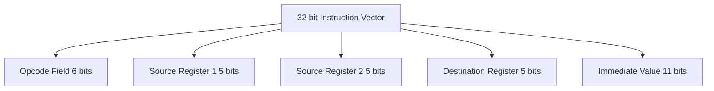

## Introduction

Every software application—from a simple shell script to a complex game engine—eventually executes as a sequence of machine instructions encoded in binary. How a CPU defines, structures, and executes these instructions defines its **Instruction Set Architecture (ISA)**. The ISA acts as the fundamental boundary between software and hardware.

Historically, computer architects faced a major design split: should the CPU provide a large library of complex, high-level instructions that perform multiple operations (including direct memory access), or should it provide a compact set of simple, fast instructions that execute in a single cycle? This debate produced two competing architectural paradigms: **Complex Instruction Set Computers (CISC)** and **Reduced Instruction Set Computers (RISC)**.

Understanding this divide requires examining how machine instructions are laid out in memory. The structure of instruction fields—opcodes, register specifiers, and immediate constants—directly dictates hardware decoding complexity, pipeline efficiency, and binary code density.

**Before you start:** You should be familiar with *Von Neumann Architecture & Performance Metrics* (specifically CPU clock cycles, IC, and CPI) and basic binary encoding concepts from *Integer Arithmetic & IEEE 754 Floating Point*.

## Core theory

### RISC vs CISC design philosophies

The architectural split between **Reduced Instruction Set Computer (RISC)** and **Complex Instruction Set Computer (CISC)** arose from evolving hardware constraints, memory costs, and compiler capabilities.

In the 1960s and 1970s, main memory was slow and expensive, while compilers were primitive. CISC architectures were designed to bridge the "semantic gap" between high-level programming languages and machine hardware. By supplying complex, multi-cycle instructions (such as string manipulation or direct polynomial evaluation), CISC reduced the number of instructions required to implement software programs.

By the 1980s, empirical studies revealed that compilers primarily generated simple operations (loads, stores, branches, integer addition). Complex CISC instructions were rarely utilized, yet their presence forced microarchitectures to use complex, multi-cycle decoding hardware and microcode control units. RISC was introduced to streamline hardware: simplify the instruction set so every instruction executes rapidly, easing the implementation of hardware pipelining.

| Feature | RISC | CISC |
| :--- | :--- | :--- |
| **Instruction complexity** | Simple, basic operations | Complex, multi-step operations |
| **Instruction length** | Fixed (typically 32 bits) | Variable (e.g., 1 to 15 bytes in x86) |
| **Memory access** | Restricted to explicit Load/Store instructions | Operands in arithmetic operations can be memory addresses |
| **Register file** | Large (typically 32 or more general-purpose registers) | Historically smaller (e.g., 8 in x86-32, 16 in x86-64) |
| **Control unit implementation** | Hardwired control logic | Microprogrammed control unit |
| **Execution time** | Mostly 1 clock cycle per instruction (unpipelined) | Variable clock cycles per instruction |

### Memory-operand vs load-store architectures

The defining hardware distinction between RISC and CISC is how instructions interact with main memory.

In a **memory-operand architecture** (typical of CISC ISAs like x86), arithmetic and logic unit (ALU) instructions can directly accept memory addresses as source or destination operands. For instance, a single CISC instruction can read a value from RAM, add it to a CPU register, and write the updated result back to RAM:

$$\text{ADD } [\text{EBX}], \text{ EAX} \quad \implies \quad \text{Memory}[\text{EBX}] \leftarrow \text{Memory}[\text{EBX}] + \text{EAX}$$

In a **load-store architecture** (typical of RISC ISAs like ARM, MIPS, and RISC-V), ALU operations are strictly forbidden from directly accessing main memory. All operational data must reside inside the internal **register file**. Memory interaction occurs exclusively through dedicated **load** and **store** instructions:

1. **Load**: Copy data from main memory into a target register.
2. **ALU operation**: Compute results using source and destination registers.
3. **Store**: Copy data from a register back to main memory.

$$\begin{aligned}
\text{LW } R_1, 0(R_2) &\quad \implies \quad R_1 \leftarrow \text{Memory}[R_2] \\
\text{ADD } R_3, R_1, R_0 &\quad \implies \quad R_3 \leftarrow R_1 + R_0 \\
\text{SW } R_3, 0(R_2) &\quad \implies \quad \text{Memory}[R_2] \leftarrow R_3
\end{aligned}$$

Load-store architectures isolate memory latency to specific instructions, preventing unexpected cache misses or memory delays during execution of the ALU stage in a processor pipeline.

### Anatomy of an instruction format

A machine instruction is a structured binary word divided into **instruction fields**. Each field carries a distinct operational payload decoded by the control unit hardware:

- **Opcode (Operation Code)**: Specifies the operation to execute (e.g., add, subtract, branch, load).
- **Register specifiers**: Identify source registers ($R_s, R_t$) and destination registers ($R_d$).
- **Immediate value**: Embedded constant data encoded directly within the instruction bit-string.
- **Displacement / Offset**: Memory address offsets used to compute effective memory targets.

If a CPU contains a register file with $R$ general-purpose registers, each register specifier field requires $b_r$ bits:

$$b_r = \lceil \log_2 R \rceil$$

For example, an architecture with 32 registers requires $\log_2 32 = 5$ bits per register field. If an opcode field spans $k$ bits, the processor can uniquely identify up to $2^k$ distinct operations.



### Fixed-length vs variable-length instruction encoding

Instruction sets handle instruction width in memory using one of two encoding strategies:

**Fixed-length encoding** requires every instruction to span an identical number of bits (commonly 32 bits for modern RISC ISAs). 
- *Advantages*: Simplifies instruction fetch hardware. The Program Counter (PC) always advances by a fixed byte offset: $PC \leftarrow PC + 4$. Decoding can proceed in parallel before the opcode is completely processed because register field bit locations are static.
- *Disadvantages*: Reduces **code density**. Instructions that require minimal information (such as a `NOP` or a simple register increment) must be padded with unused bits to fill the fixed instruction width.

**Variable-length encoding** allows instructions to vary in byte length depending on their complexity (for example, x86 instructions range from 1 byte to 15 bytes).
- *Advantages*: Maximizes code density. Common operations are encoded concisely, conserving main memory footprint and cache storage.
- *Disadvantages*: Sequentially complicates instruction fetch and decode units. The CPU cannot determine where the next instruction begins in memory until it decodes the length of the current instruction, creating structural bottlenecks in high-speed hardware pipelines.

### The instruction execution equation and trade-offs

To quantify the architectural trade-offs between RISC and CISC, consider the classic **CPU performance equation**:

$$T_{\text{exec}} = IC \times CPI \times T_{\text{clk}}$$

where:
- $T_{\text{exec}}$ is the total execution time of a program in seconds.
- $IC$ is the total **Instruction Count** (number of instructions executed).
- $CPI$ is the average **Cycles Per Instruction**.
- $T_{\text{clk}}$ is the processor **Clock Cycle Time** ($T_{\text{clk}} = 1 / f_{\text{clock}}$).

The philosophies tackle minimizing $T_{\text{exec}}$ through opposing strategies:

- **CISC Strategy**: Minimizes $IC$ by offering powerful instructions that accomplish complex software tasks in few commands. However, this raises average $CPI$ (due to multi-cycle execution) and increases $T_{\text{clk}}$ (due to complex control logic logic gates).
- **RISC Strategy**: Minimizes $CPI$ ($\approx 1.0$ in non-pipelined systems, or $\le 1.0$ in superscalar implementations) and reduces $T_{\text{clk}}$ (via simple, streamlined decoding circuits). However, this increases $IC$, as programs require more simple instructions to complete the same higher-level algorithm.

## Worked examples

### Example 1: Instruction field calculation for a custom RISC processor

A computer architect is designing a 32-bit fixed-length RISC processor with the following specifications:
- The register file contains 64 general-purpose registers.
- The ISA defines 52 distinct primary opcodes.
- The architecture supports two main instruction formats:
  1. **R-format (Register-Register)**: Uses one opcode, two source registers, and one destination register. Unused bits are assigned to a secondary function-code field.
  2. **I-format (Immediate)**: Uses one opcode, one source register, one destination register, and an embedded signed immediate integer.

**Task:**
1. Determine the minimum number of bits required for the opcode field and register fields.
2. Calculate the bit allocation and function-code size for the R-format instruction.
3. Calculate the bit allocation and maximum numerical range of the signed integer in the I-format instruction.

**Solution:**

**Step 1: Determine field widths.**
- Opcode width ($b_{\text{op}}$): $\lceil \log_2 52 \rceil = 6$ bits (since $2^5 = 32 < 52 \le 2^6 = 64$).
- Register specifier width ($b_{\text{reg}}$): $\lceil \log_2 64 \rceil = 6$ bits.

**Step 2: Calculate R-format allocation.**
An R-format instruction uses: 1 opcode + 3 register fields ($R_s, R_t, R_d$) + Function code.
$$\text{Bits used by Opcode and Registers} = b_{\text{op}} + 3 \times b_{\text{reg}} = 6 + (3 \times 6) = 24 \text{ bits}$$
Since the total instruction width is 32 bits, the remaining bits form the function code:
$$\text{Function Code width} = 32 - 24 = 8 \text{ bits}$$
This 8-bit function code allows up to $2^8 = 256$ extended sub-operations under a primary opcode.

**Step 3: Calculate I-format allocation and immediate range.**
An I-format instruction uses: 1 opcode + 2 register fields ($R_s, R_d$) + Immediate constant.
$$\text{Bits used by Opcode and Registers} = b_{\text{op}} + 2 \times b_{\text{reg}} = 6 + (2 \times 6) = 18 \text{ bits}$$
$$\text{Immediate field width } (b_{\text{imm}}) = 32 - 18 = 14 \text{ bits}$$

For a 14-bit signed 2's complement integer, the range of representable values is:
$$-2^{b_{\text{imm}}-1} \quad \text{to} \quad 2^{b_{\text{imm}}-1} - 1$$
$$-2^{13} \quad \text{to} \quad 2^{13} - 1 \quad \implies \quad -8192 \quad \text{to} \quad +8191$$

---

### Example 2: C program execution trace & CPU performance comparison

Consider the following standard C program that adds a constant value to each element of an integer array:

```c
#include <stdio.h>

int main(void) {
    int B[4] = {10, 20, 30, 40};
    int C = 5;
    int A[4];

    for (int i = 0; i < 4; i++) {
        A[i] = B[i] + C;
    }

    for (int i = 0; i < 4; i++) {
        printf("A[%d] = %d\n", i, A[i]);
    }

    return 0;
}
```

Output:
```text
A[0] = 15
A[1] = 25
A[2] = 35
A[3] = 45
```

Now, analyze the performance of executing 1,000 loop iterations of the statement `A[i] = B[i] + C;` on a CISC processor versus a RISC processor using the following metrics:

- **CISC Machine**:
  - Memory-operand instruction allowed: `ADD [A + i], [B + i], C_reg`
  - Loop compiled into $IC = 2,000$ instructions total.
  - Average $CPI_{\text{CISC}} = 3.2$
  - Clock period $T_{\text{clk, CISC}} = 1.2\text{ ns}$
- **RISC Machine**:
  - Load-store architecture requires separate `LW`, `ADD`, `SW`, and index instructions.
  - Loop compiled into $IC = 5,000$ instructions total.
  - Average $CPI_{\text{RISC}} = 1.1$
  - Clock period $T_{\text{clk, RISC}} = 0.8\text{ ns}$

**Task:**
Calculate total execution time ($T_{\text{exec}}$) for both machines and identify which architecture completes the program faster.

**Solution:**

**Step 1: Compute CISC execution time.**
$$T_{\text{exec, CISC}} = IC_{\text{CISC}} \times CPI_{\text{CISC}} \times T_{\text{clk, CISC}}$$
$$T_{\text{exec, CISC}} = 2000 \times 3.2 \times 1.2\text{ ns} = 7680\text{ ns} = 7.68\ \mu\text{s}$$

**Step 2: Compute RISC execution time.**
$$T_{\text{exec, RISC}} = IC_{\text{RISC}} \times CPI_{\text{RISC}} \times T_{\text{clk, RISC}}$$
$$T_{\text{exec, RISC}} = 5000 \times 1.1 \times 0.8\text{ ns} = 4400\text{ ns} = 4.40\ \mu\text{s}$$

**Step 3: Compare results.**
Even though the RISC processor executes $2.5\times$ more instructions ($5000$ vs $2000$), its lower CPI ($1.1$ vs $3.2$) and faster clock cycle ($0.8\text{ ns}$ vs $1.2\text{ ns}$) allow it to finish the task in $4.40\ \mu\text{s}$, compared to $7.68\ \mu\text{s}$ for CISC. 

$$\text{Speedup} = \frac{7.68\ \mu\text{s}}{4.40\ \mu\text{s}} \approx 1.75$$

The RISC processor is approximately **$1.75\times$ faster** for this workload.

## Applications

- **Mobile and IoT Systems**: RISC load-store architectures (such as ARMv8/v9 and RISC-V) dominate smartphones, tablets, and embedded devices because fixed instruction decoders consume drastically less power and silicon area than variable-length CISC decoders.
- **Desktop and Enterprise Microarchitectures**: Modern x86 processors (Intel Core, AMD Ryzen) maintain a CISC ISA for backwards software compatibility, but their internal microarchitecture converts variable-length CISC instructions into fixed-length RISC-like primitive operations (called **micro-ops** or $\mu$-ops) at runtime.
- **Compiler Design**: High-performance compilers (such as LLVM and GCC) utilize register-heavy RISC load-store structures to implement aggressive optimizations, including register allocation via graph coloring and instruction scheduling.
- **High-Performance Computing (HPC)**: Supercomputers increasingly employ 64-bit RISC ISAs (such as ARM Neoverse and RISC-V vectors) due to higher energy efficiency per floating-point operation (FLOPS).

## Common mistakes

- **Equating RISC to a smaller total instruction count in software.** RISC reduces instruction *complexity*, not software instruction count. Because RISC instructions carry out smaller individual steps, compiled RISC programs typically require *more* total instructions ($IC$) than equivalent CISC programs.
- **Assuming CISC ISAs are obsolete.** While microarchitectures execute RISC-like operations internally, CISC ISAs (notably x86-64) remain dominant in PC and server markets due to extensive software backwards compatibility and excellent code density.
- **Believing load-store architectures allow direct ALU memory operations.** In a true load-store architecture, an instruction such as `ADD R1, R2, (R3)` (adding directly to a memory address) is invalid. Data must explicitly pass into registers via load operations before ALU processing.
- **Confusing instruction fixed length with field fixed length.** A fixed 32-bit instruction length does not mean every internal field is a fixed size across all formats. Different instruction types (e.g., R-type vs I-type) repartition those 32 bits into different field sizes.
- **Thinking variable-length encoding is always superior for memory usage.** While variable-length encoding improves code density, it incurs penalty costs in decoder hardware area, pipeline complexity, and power consumption.

## Revision notes

- **CISC Architecture**: Emphasizes rich, complex instructions, memory-operand access, variable instruction lengths, and microprogrammed control logic to minimize instruction count ($IC$).
- **RISC Architecture**: Emphasizes simple instructions, load-store memory models, fixed instruction lengths, and large register files to minimize cycles per instruction ($CPI$) and clock period ($T_{\text{clk}}$).
- **Load-Store Model**: Memory access is strictly confined to explicit `LOAD` and `STORE` instructions; all ALU operations execute exclusively on registers.
- **Field Encoding Math**: A register specifier field for $R$ general-purpose registers requires $\lceil \log_2 R \rceil$ bits. An opcode field spanning $k$ bits supports $2^k$ distinct operations.
- **CPU Performance Equation**: $T_{\text{exec}} = IC \times CPI \times T_{\text{clk}}$. RISC trade-off yields higher $IC$, lower $CPI$, shorter $T_{\text{clk}}$. CISC trade-off yields lower $IC$, higher $CPI$, longer $T_{\text{clk}}$.
- **Fixed-Length Encoding**: Constant byte size (e.g., 32 bits) simplifies PC increments and parallel instruction decoding, but reduces code density.
- **Variable-Length Encoding**: Variable byte size (e.g., 1–15 bytes) maximizes code density, but complicates instruction fetch and pipeline stage decoding.

## Practice questions

:::question basic
A CPU architecture has a register file containing 128 general-purpose registers. How many bits are required for each register specifier field in its machine instruction format?
:::answer
Each register specifier field requires 7 bits. Since the register file contains $128$ registers, the number of bits needed to uniquely select any single register is calculated as $\lceil \log_2 128 \rceil = 7$.
:::

:::question basic
Why do load-store architectures require explicit load and store instructions to perform arithmetic operations on data stored in main memory?
:::answer
Load-store architectures restrict all arithmetic and logical operations strictly to values held within internal processor registers. Isolating memory access exclusively to dedicated load and store instructions simplifies ALU hardware design and removes unpredictable memory latency from arithmetic pipeline execution stages.
:::

:::question intermediate
A 32-bit fixed-length RISC instruction set specifies an 8-bit opcode field and supports instructions with two source register specifiers and one destination register specifier. If the architecture contains 32 registers, how many unused bits remain in this instruction format for optional function codes or extensions?
:::answer
There are 9 unused bits remaining. Each register specifier requires $\log_2 32 = 5$ bits, so three register specifiers require $3 \times 5 = 15$ bits. Adding the 8-bit opcode uses $8 + 15 = 23$ bits total, leaving $32 - 23 = 9$ unused bits.
:::

:::question intermediate
Program A is compiled for both a CISC processor and a RISC processor. The CISC version executes $4,000$ instructions with an average CPI of $2.5$ on a $2.0\text{ GHz}$ clock. The RISC version executes $8,000$ instructions with an average CPI of $1.2$ on a $3.0\text{ GHz}$ clock. Which processor executes Program A faster, and what is the execution time difference?
:::answer
The RISC processor executes the program faster, taking $3.2\ \mu\text{s}$ compared to the CISC processor's $5.0\ \mu\text{s}$ (a difference of $1.8\ \mu\text{s}$). The CISC execution time is calculated as $T_{\text{CISC}} = 4000 \times 2.5 \times (1 / (2.0 \times 10^9)) = 10000 / (2.0 \times 10^9) = 5.0 \times 10^{-6}\text{ s} = 5.0\ \mu\text{s}$. The RISC execution time is $T_{\text{RISC}} = 8000 \times 1.2 \times (1 / (3.0 \times 10^9)) = 9600 / (3.0 \times 10^9) = 3.2 \times 10^{-6}\text{ s} = 3.2\ \mu\text{s}$.
:::

:::question advanced
Explain how fixed-length instruction encoding enables simplified hardware design in multi-stage instruction pipelines compared to variable-length instruction encoding.
:::answer
Fixed-length instruction encoding guarantees that instruction boundaries occur at predictable, uniform memory intervals (such as every 4 bytes). This allows the Instruction Fetch unit to calculate the address of the next instruction instantaneously ($PC + 4$) without waiting for the current instruction to be decoded. Furthermore, because field locations (such as register source and destination bits) reside at fixed bit indexes within the instruction word, the Decode stage can pre-fetch values from the register file in parallel while simultaneously reading the opcode, drastically reducing pipeline decoding delay.
:::

:::question advanced
A hypothetical fixed-length 32-bit RISC processor uses a 7-bit primary opcode field. Format A uses 3 register specifiers (destination, source 1, source 2) and a sub-opcode field. Format B uses 1 destination register specifier, 1 source register specifier, and a signed immediate constant. If 64 general-purpose registers exist, calculate the maximum signed decimal integer that can be represented in Format B's immediate field.
:::answer
The maximum signed decimal integer that can be represented is $+2047$. With 64 general-purpose registers, each register specifier requires $\lceil \log_2 64 \rceil = 6$ bits. Format B allocates 7 bits for opcode, 6 bits for the destination register, and 6 bits for the source register, leaving $32 - (7 + 6 + 6) = 13$ bits for the signed immediate field. Using 2's complement representation, a 13-bit signed integer has a maximum positive value of $2^{13-1} - 1 = 2^{12} - 1 = 4095$ divided into sign and magnitude, giving a range of $-4096$ to $+4097$? No: $2^{12} = 4096$, so the range is $-2^{12}$ to $+2^{12}-1 = -4096$ to $+4095$. (Recalculating: $2^{12} = 4096$, so max value is $4095$).
:::

## Further learning

- **Next:** *Addressing Modes* explores how instructions compute effective memory addresses using register offset, indexed, indirect, and PC-relative modes.
- **Related:** *Instruction Cycle & Assembly Language* details the fetch-decode-execute cycle and assembly mnemonic syntax.
- **Related:** *Datapath & Register Organization* examines the internal bus structure, ALU interconnections, and register file implementations inside the CPU core.
- **Textbook:** David A. Patterson and John L. Hennessy, *Computer Organization and Design: The Hardware/Software Interface*.
