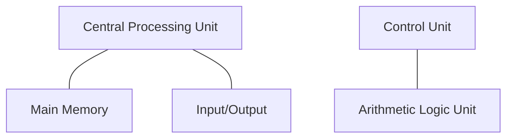

## Introduction

In the early days of computing, "programming" a machine often meant physically reconfiguring it. To change a task—from calculating ballistic trajectories to performing census tabulations—engineers had to flip switches, move patch cables, and manually reset gears. This hardware-centric approach was revolutionized by the concept of the **stored-program computer**, where instructions are treated as data and stored in the same memory as the numbers they manipulate.

This lesson introduces the **Von Neumann Architecture**, the blueprint for almost every modern computer, from the smartphone in your pocket to the servers powering the cloud. We will explore how these machines are structured and, crucially, how we measure their performance. You will learn why a higher "Gigahertz" rating doesn't always mean a faster computer and how to use mathematical models like **Amdahl's Law** to predict how much an upgrade will actually help.

Understanding these metrics is the first step in computer engineering. It allows us to move past marketing jargon and evaluate systems based on the physics of execution and the logic of instruction throughput.

**Before you start:** No prior topics are required for this lesson, though a basic familiarity with how programs are compiled into instructions will be helpful.

## Core theory

### The Von Neumann Model

The **Von Neumann Architecture** describes a computer design where the CPU is distinct from the memory, and both instructions and data are stored in the same physical memory units. This is known as the **stored-program concept**. Before this, machines were "fixed-program," meaning their function was hardwired.

A Von Neumann machine consists of four main components:

1.  **Central Processing Unit (CPU):** The "brain" of the system. It contains the **Arithmetic Logic Unit (ALU)** for calculations and the **Control Unit (CU)** for managing the flow of data and instructions.
2.  **Main Memory Unit:** A collection of storage cells that hold both the program instructions and the data required by those instructions.
3.  **Input/Output (I/O) System:** Mechanisms to move data between the computer and the outside world (e.g., keyboards, disks, displays).
4.  **System Bus:** The communication pathway that connects these components.

### The Von Neumann Bottleneck

Because the Von Neumann architecture uses a single bus to fetch both instructions and data, the CPU often spends a significant amount of time waiting for memory. This limitation is called the **Von Neumann Bottleneck**. 

As CPU speeds have increased exponentially over the decades, memory speeds have grown much more slowly. No matter how fast the CPU can process data, it is limited by the rate at which the bus can deliver instructions and data from memory. Modern architectures attempt to mitigate this using **caches** (small, fast memories located on the CPU chip), but the fundamental bottleneck remains a core challenge in computer design.

### CPU Performance Equation

To compare different computers, we need a standard way to measure performance. The most basic metric is **Response Time** (or Latency), which is the time between the start and completion of a task. For a computer scientist, the most important part of this is **CPU Execution Time**.

The performance of a processor is governed by the **CPU Performance Equation**:

$$T = IC \times CPI \times \tau$$

Where:
*   $T$ is the **CPU Time** (seconds per program).
*   $IC$ is the **Instruction Count** (number of instructions executed for a program).
*   $CPI$ is the average **Cycles Per Instruction** (how many clock cycles, on average, it takes to execute one instruction).
*   $\tau$ is the **Clock Cycle Time** (the duration of one clock pulse, usually measured in nanoseconds).

Alternatively, since the **Clock Rate** ($f$) is the reciprocal of the clock cycle time ($f = 1/\tau$), the formula is often written as:

$$T = \frac{IC \times CPI}{f}$$

This equation shows that performance depends on three distinct factors:
1.  **The Algorithm and Compiler:** These determine the $IC$. A better compiler might produce fewer instructions to perform the same task.
2.  **The Instruction Set Architecture (ISA):** This influences both $IC$ and $CPI$. Some ISAs use many simple instructions, while others use fewer, more complex ones.
3.  **The Hardware Implementation:** This determines the $f$ (Clock Rate) and the $CPI$. A highly efficient hardware pipeline can lower the $CPI$.

### MIPS and Throughput

While CPU Time is the "gold standard" for performance, other metrics are frequently cited:

*   **Throughput:** The total amount of work done in a given time (e.g., tasks per hour).
*   **MIPS (Millions of Instructions Per Second):** A measure of the instruction execution rate.

$$MIPS = \frac{IC}{T \times 10^6} = \frac{f}{CPI \times 10^6}$$

**MIPS** is often criticized as a "Meaningless Indicator of Processor Speed." Because different instructions take different amounts of time, and different architectures have different ISAs, a high MIPS rating does not necessarily mean a program will run faster. For example, a RISC processor might have a higher MIPS than a CISC processor but require more instructions to complete the same task, resulting in a longer execution time.

### Amdahl's Law

When we optimize a computer system, we rarely improve every single part. **Amdahl's Law** provides a formula to calculate the maximum theoretical speedup of a system when only a specific portion of it is improved.

If $f$ is the fraction of the original execution time that can be enhanced, and $s$ is the speedup factor for that specific portion, the overall speedup $S$ is:

$$S = \frac{1}{(1 - f) + \frac{f}{s}}$$

Key takeaways from Amdahl's Law:
*   **The Law of Diminishing Returns:** As you increase the speedup of a specific component ($s \to \infty$), the overall speedup is limited by the part that was *not* improved ($1 - f$).
*   **Make the Common Case Fast:** To get the best results, focus on optimizing the parts of the program that take the most time (the largest $f$).

## Worked examples

### Example 1: Comparing Two Processors

Suppose we have two processors, P1 and P2, executing the same program.
*   **P1:** Clock Rate = 4 GHz, $CPI$ = 1.5
*   **P2:** Clock Rate = 3 GHz, $CPI$ = 1.0

Which processor is faster, and by how much?

**Step 1: Define the variables.**
Let $IC$ be the number of instructions in the program (it is the same for both since the program is the same).
$f_1 = 4 \times 10^9$ Hz, $CPI_1 = 1.5$
$f_2 = 3 \times 10^9$ Hz, $CPI_2 = 1.0$

**Step 2: Calculate CPU Time for P1.**
$$T_1 = \frac{IC \times 1.5}{4 \times 10^9} = 0.375 \times 10^{-9} \times IC$$

**Step 3: Calculate CPU Time for P2.**
$$T_2 = \frac{IC \times 1.0}{3 \times 10^9} = 0.333 \times 10^{-9} \times IC$$

**Step 4: Compare the results.**
Since $T_2 < T_1$, Processor P2 is faster. To find the speedup:
$$Speedup = \frac{T_1}{T_2} = \frac{0.375}{0.333} \approx 1.126$$

**Final Answer:** Processor P2 is faster by approximately 12.6%, despite having a lower clock rate. This demonstrates that $CPI$ is just as important as frequency.

### Example 2: Applying Amdahl's Law

A web server spends 60% of its time performing database queries and 40% of its time processing logic. You are considering an upgrade to the database engine that would make queries 3 times faster. What is the overall speedup of the server?

**Step 1: Identify the fraction and the local speedup.**
The fraction of time affected is $f = 0.60$ (60%).
The speedup for that fraction is $s = 3$.

**Step 2: Apply Amdahl's Law.**
$$S = \frac{1}{(1 - 0.60) + \frac{0.60}{3}}$$
$$S = \frac{1}{0.40 + 0.20}$$
$$S = \frac{1}{0.60} \approx 1.67$$

**Final Answer:** The overall system will be 1.67 times faster (a 67% improvement).

### Example 3: Instruction Mix and CPI

A processor has three types of instructions with the following frequencies and cycle counts:

| Instruction Type | Frequency | Cycles |
| :--- | :--- | :--- |
| Arithmetic | 50% | 1 |
| Load/Store | 30% | 3 |
| Branch | 20% | 2 |

Calculate the average $CPI$ for this processor.

**Step 1: Use the weighted average formula.**
$$Average\ CPI = \sum (Frequency_i \times Cycles_i)$$

**Step 2: Plug in the values.**
$$CPI = (0.50 \times 1) + (0.30 \times 3) + (0.20 \times 2)$$
$$CPI = 0.5 + 0.9 + 0.4 = 1.8$$

**Final Answer:** The average $CPI$ for this instruction mix is 1.8.

## Applications

*   **Processor Design:** Engineers use the CPU performance equation to make trade-offs. For example, adding a complex instruction might decrease the Instruction Count ($IC$) but increase the $CPI$ or lower the clock frequency ($f$). They must model these changes to ensure a net gain in speed.
*   **Compiler Optimization:** Compilers aim to reduce the $IC$ or choose instructions with lower $CPI$. A "smart" compiler can significantly improve performance without any changes to the hardware.
*   **Cloud Computing and Virtualization:** Providers use throughput metrics to determine how many virtual machines can run on a single physical server without degrading the response time for individual users.
*   **Embedded Systems:** In battery-powered devices, performance is often traded for power efficiency. By lowering the clock rate ($f$), engineers can reduce power consumption, using the performance equation to ensure the device still meets its real-time deadlines.
*   **Parallel Programming:** Developers use Amdahl's Law to decide if parallelizing a piece of code is worth the effort. If a program is 90% sequential, even an infinite number of processors can only speed it up by a factor of 1.11.

## Common mistakes

*   **The "Megahertz Myth".** Assuming that a processor with a higher clock rate is always faster. As shown in Worked Example 1, a processor with a lower clock rate but a significantly lower $CPI$ can outperform a high-frequency chip.
*   **Misinterpreting Amdahl's Law.** Thinking that the speedup applies to the whole program. Amdahl's Law specifically measures the *total* effect of a *partial* improvement. If you make one part 100x faster, but that part only runs for 1% of the time, the total speedup is negligible.
*   **Using MIPS to compare different ISAs.** Comparing the MIPS of an Intel (CISC) processor to an ARM (RISC) processor is invalid. Because the ARM processor might need three instructions to do what the Intel processor does in one, the MIPS values do not represent comparable amounts of "work."
*   **Ignoring the Bottleneck.** Focusing entirely on CPU speed while ignoring memory latency. In many modern applications, the CPU is "memory-bound," meaning it spends most of its time idle, waiting for the Von Neumann bottleneck to clear.
*   **Confusing Latency and Throughput.** Latency is the time for one task; throughput is the number of tasks per unit of time. Improving one does not always improve the other (e.g., a pipeline increases throughput but might slightly increase the latency of a single instruction).

## Revision notes

*   **Von Neumann Architecture:** Key components are CPU (ALU + CU), Memory, I/O, and the System Bus. It uses the **stored-program concept**.
*   **Von Neumann Bottleneck:** The speed limit imposed by having a single bus for both data and instructions.
*   **CPU Time Formula:** $T = \frac{IC \times CPI}{f}$. Performance is the inverse of Execution Time ($1/T$).
*   **CPI:** Cycles Per Instruction. It is a weighted average based on the instruction mix of a specific program.
*   **Clock Rate ($f$):** Measured in Hertz (cycles per second). $1 \text{ GHz} = 10^9$ cycles per second.
*   **Amdahl's Law:** $S = 1 / [(1-f) + (f/s)]$. It highlights the limits of optimization.
*   **MIPS:** $Millions\ of\ Instructions\ Per\ Second$. Useful for comparing versions of the same architecture, but dangerous for comparing different architectures.

## Practice questions

:::question basic
A computer has a clock rate of 2 GHz. What is the duration of a single clock cycle in nanoseconds?
:::answer
The clock cycle time $\tau$ is the reciprocal of the clock rate $f$.
$\tau = 1 / (2 \times 10^9 \text{ Hz}) = 0.5 \times 10^{-9} \text{ seconds}$.
Since $10^{-9}$ seconds is 1 nanosecond, the duration is 0.5 ns.
:::

:::question basic
List the four main functional parts of the Von Neumann architecture.
:::answer
The four parts are the Central Processing Unit (CPU), the Main Memory Unit, the Input/Output (I/O) System, and the System Bus. The CPU is further divided into the Control Unit and the Arithmetic Logic Unit.
:::

:::question intermediate
Program A consists of 100,000 instructions. On Processor X, it takes 0.001 seconds to run. If the clock rate of Processor X is 500 MHz, what is the average $CPI$ for this program?
:::answer
Use the formula $T = (IC \times CPI) / f$.
Rearranging for $CPI$: $CPI = (T \times f) / IC$.
$CPI = (0.001 \text{ s} \times 500 \times 10^6 \text{ Hz}) / 100,000$.
$CPI = 500,000 / 100,000 = 5$.
The average $CPI$ is 5.
:::

:::question intermediate
You want to improve a computer's performance. You can either:
1. Improve the Floating Point unit (used 20% of the time) to be 10x faster.
2. Improve the Integer unit (used 80% of the time) to be 1.5x faster.
Which option provides a better overall speedup?
:::answer
Use Amdahl's Law for both.
Option 1: $S = 1 / [(1 - 0.2) + 0.2/10] = 1 / [0.8 + 0.02] = 1 / 0.82 \approx 1.22$.
Option 2: $S = 1 / [(1 - 0.8) + 0.8/1.5] = 1 / [0.2 + 0.533] = 1 / 0.733 \approx 1.36$.
Option 2 is better. Even though the improvement factor is smaller (1.5x vs 10x), it applies to a much larger portion of the execution time.
:::

:::question advanced
A processor designer increases the clock rate from 2 GHz to 3 GHz. However, this change causes the average $CPI$ to increase from 1.2 to 1.8 due to longer memory latencies. Does the performance improve?
:::answer
Compare the execution times $T_{old}$ and $T_{new}$.
$T_{old} \propto 1.2 / 2 = 0.6$.
$T_{new} \propto 1.8 / 3 = 0.6$.
The performance remains exactly the same. The 50% increase in clock rate was perfectly offset by the 50% increase in $CPI$.
:::

:::question advanced
According to Amdahl's Law, if 25% of a program is inherently sequential (cannot be parallelized), what is the absolute maximum speedup achievable by running the program on a multicore processor, no matter how many cores are added?
:::answer
As the number of cores (speedup $s$) approaches infinity, the term $f/s$ in Amdahl's Law approaches zero.
The formula becomes $S = 1 / (1 - f)$.
Here, the parallelizable fraction $f$ is $1 - 0.25 = 0.75$.
$S_{max} = 1 / (1 - 0.75) = 1 / 0.25 = 4$.
The maximum speedup is 4x.
:::

## Further learning

*   **Next:** *Instruction Cycle & Assembly Language* explains the step-by-step process (Fetch-Decode-Execute) the CPU uses to run the instructions we measured today.
*   **Related:** *RISC vs CISC & Instruction Formats* explores how different design philosophies impact the $IC$ and $CPI$ variables in our performance equation.
*   **Related:** *Pipelining Fundamentals & Speedup* looks at the primary hardware technique used to lower $CPI$ by overlapping the execution of multiple instructions.
*   **Related:** *Cache Performance & AMAT* dives deeper into how we solve the Von Neumann bottleneck by using memory hierarchies.

For a rigorous mathematical treatment of these metrics, see:
Hennessy and Patterson, *Computer Architecture: A Quantitative Approach*.
