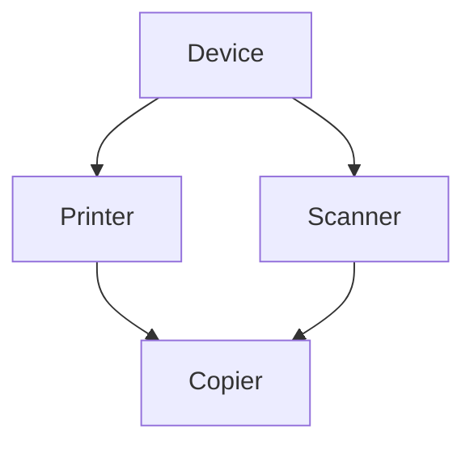

## Introduction

**Inheritance** lets a class reuse and extend another: a `SavingsAccount` is an `Account` with interest, a `Circle` is a `Shape`. In C++ the base part of an object is built first and destroyed last, access to base members is controlled carefully, and a class may inherit from several bases at once, which raises the famous **diamond problem**. This lesson covers how inheritance works mechanically; the next lesson covers virtual functions, which make it truly polymorphic.

**Before you start:** you should know classes, constructors, initializer lists, and access specifiers.

## Core theory

### Deriving a class

```cpp
class Account {
public:
    explicit Account(double b) : balance_(b) {}
protected:
    double balance_;
};

class Savings : public Account {
public:
    Savings(double b, double rate) : Account(b), rate_(rate) {}
    void add_interest() { balance_ += balance_ * rate_; }
private:
    double rate_;
};
```

A `Savings` object contains an `Account` **subobject** plus its own members. The derived constructor initialises the base by naming it first in the initializer list; if it does not, the base's default constructor is used. Construction proceeds from the base outwards (base, then members in declaration order, then the derived constructor body), and destruction runs in exactly the reverse order.

### Access and inheritance modes

- `public` members are visible to everyone; `private` members only to the class itself; `protected` members to the class and its derived classes.
- With `public` inheritance, the base's public members stay public in the derived class: this models **"is a"**, and a `Savings&` converts to an `Account&` automatically.
- With `protected` or `private` inheritance, the base's public members become protected or private in the derived class and the "is a" conversion is not available to outside code. Private inheritance means "implemented in terms of" and is usually better expressed by composition (a member object).

### Name hiding

A member declared in a derived class **hides** every base member with the same name, even ones with different parameters. If the base has `print()` and `print(int)` and the derived class declares `print(double)`, then `d.print()` no longer compiles. Bring the base overloads back with `using Base::print;` in the derived class.

### Multiple inheritance and the diamond

A class may inherit from several bases: `class Amphibian : public Car, public Boat`. Trouble arises when two bases share a common base:



By default a `Copier` then contains **two** `Device` subobjects, so a member such as `device_id` is ambiguous and the two copies can disagree. **Virtual inheritance** (`class Printer : virtual public Device`) tells the compiler to share a single `Device` subobject between all paths. The most derived class (`Copier`) is then responsible for constructing the virtual base directly. Because of this complexity, multiple inheritance is mostly used with **interface** classes that have no data.

## Worked examples

### Example 1: Construction order, protected members, and name hiding

```cpp
#include <iostream>
#include <string>

class Base {
public:
    explicit Base(std::string n) : name_(std::move(n)) { std::cout << "Base(" << name_ << ")\n"; }
    ~Base() { std::cout << "~Base\n"; }
    void describe() const { std::cout << "base " << name_ << '\n'; }
    void describe(int times) const { for (int i = 0; i < times; i++) describe(); }
protected:
    std::string name_;
};

class Member {
public:
    Member() { std::cout << "Member()\n"; }
    ~Member() { std::cout << "~Member\n"; }
};

class Derived : public Base {
public:
    explicit Derived(std::string n) : Base(std::move(n)) { std::cout << "Derived body\n"; }
    ~Derived() { std::cout << "~Derived\n"; }
    using Base::describe;
    void describe(const std::string& prefix) const { std::cout << prefix << name_ << '\n'; }
private:
    Member m_;
};

int main() {
    {
        Derived d("widget");
        d.describe("derived sees protected ");
        d.describe(2);
        const Base& as_base = d;
        as_base.describe();
    }
    std::cout << "done\n";
    return 0;
}
```

Output:

```text
Base(widget)
Member()
Derived body
derived sees protected widget
base widget
base widget
base widget
~Derived
~Member
~Base
done
```

The base is built first, then the member, then the derived body; destruction reverses this. Without `using Base::describe;`, the call `d.describe(2)` would not compile, because the derived `describe` hides both base overloads.

### Example 2: The diamond with and without virtual inheritance

```cpp
#include <iostream>

struct Device {
    int id;
    explicit Device(int i = 0) : id(i) { std::cout << "Device(" << i << ")\n"; }
};
struct Printer : Device { Printer() : Device(1) {} };
struct Scanner : Device { Scanner() : Device(2) {} };
struct PlainCopier : Printer, Scanner {};

struct VPrinter : virtual Device { VPrinter() : Device(1) {} };
struct VScanner : virtual Device { VScanner() : Device(2) {} };
struct Copier : VPrinter, VScanner { Copier() : Device(9) {} };

int main() {
    PlainCopier p;
    std::cout << "two ids: " << p.Printer::id << " and " << p.Scanner::id << '\n';
    Copier c;
    std::cout << "one shared id: " << c.id << '\n';
    return 0;
}
```

Output:

```text
Device(1)
Device(2)
two ids: 1 and 2
Device(9)
one shared id: 9
```

`PlainCopier` holds two `Device` subobjects, so `p.id` would be ambiguous and must be qualified. With virtual inheritance there is one shared `Device`, constructed once by the most derived class `Copier`; the `Device(1)` and `Device(2)` initialisers in `VPrinter` and `VScanner` are ignored in this case.

## Applications

- **Frameworks:** user classes derive from framework base classes to plug in behaviour.
- **GUI toolkits:** widgets inherit common geometry and event handling.
- **Standard library streams:** `std::iostream` inherits from both `std::istream` and `std::ostream`, which share a virtual base `std::ios_base`-derived class.
- **Interfaces:** multiple inheritance of data-free abstract classes describes several capabilities.

## Common mistakes

- **Using inheritance for code reuse only.** If "is a" does not hold, prefer a member object.
- **Forgetting that derived declarations hide base overloads.** Add `using Base::name;`.
- **Making data `protected` by default.** It couples derived classes to base internals; prefer private data with protected functions.
- **Ignoring the diamond.** Two copies of a common base cause ambiguity and inconsistent state; use virtual inheritance or avoid the design.

## Revision notes

- `class D : public B` models "is a"; a `D&` converts to `B&`.
- Construction: virtual bases, then bases, then members, then body; destruction is the reverse.
- Initialise the base in the derived initializer list.
- `protected`: visible to derived classes; `private`: only the class itself.
- A derived name hides all base members of that name; `using B::name;` restores them.
- The diamond gives two base copies; `virtual` inheritance shares one, constructed by the most derived class.

## Practice questions

:::question basic
In what order are the base class, a member object, and the derived class body constructed and destroyed?
:::answer
Construction runs base class first, then member objects in declaration order, then the derived constructor's body. Destruction runs in exactly the reverse order: the derived destructor body, then members, then the base.
:::

:::question basic
What does `protected` access allow that `private` does not?
:::answer
A `protected` member can be used by the class's own member functions and also by member functions of classes derived from it. A `private` member can be used only by the class itself (and its friends).
:::

:::question intermediate
A base class has `void show()` and `void show(int)`. A derived class declares `void show(double)`. Why does `d.show()` fail, and how do you fix it?
:::answer
Declaring `show` in the derived class hides every `show` in the base, so name lookup finds only `show(double)`, which cannot be called with no arguments. Adding `using Base::show;` in the derived class makes the base overloads visible again alongside the new one.
:::

:::question intermediate
What is the diamond problem in multiple inheritance?
:::answer
When a class inherits from two classes that share a common base, it contains two separate copies of that base. Its members are then ambiguous unless qualified, and the two copies can hold different values, which usually contradicts the design.
:::

:::question advanced
With virtual inheritance, why does the most derived class construct the shared base, and what happens to the base initialisers in the intermediate classes?
:::answer
A single shared base subobject must be constructed exactly once, but each intermediate class would initialise it differently, so the language gives that job to the most derived class, the only class that knows the complete object. When a complete object of the most derived type is created, the intermediate classes' initialisers for the virtual base are ignored; they are used only when an intermediate class is itself the most derived type.
:::

## Further learning

- **Next:** *Virtual Functions & VTable Dispatch* makes derived classes behave polymorphically through base references.
- **Related:** *Classes, Inheritance & Polymorphism* in Python compares inheritance in a dynamic language.
