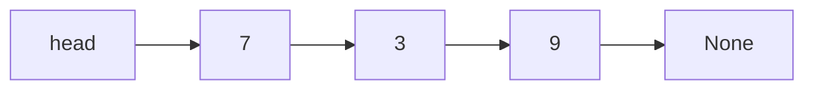

## Introduction

An array keeps its elements in one contiguous block, which makes indexing instant but insertion in the middle expensive. A **linked list** takes the opposite approach: each element lives in its own **node** somewhere in memory, and each node stores a **pointer** (a reference) to the next one. The elements are connected by links rather than by position.

This trade makes some operations very cheap: once you are at a node, inserting or deleting next to it takes constant time, because only a couple of pointers change and nothing shifts. The price is that you can no longer jump to the $i$-th element; you must walk there link by link.

Linked lists matter both directly (as queues, LRU caches, and memory allocators) and as the foundation for understanding trees and graphs, which are nodes linked in more elaborate patterns.

**Before you start:** you need classes and objects in Python and the array lesson's operation costs.

## Core theory

### Nodes and the head pointer

A **singly linked list** node holds a value and a reference to the next node. The list itself keeps a reference to the first node, the **head**. The last node's `next` is `None`, marking the end.



A **doubly linked list** node also stores `prev`, a reference to the previous node. It uses more memory per node but allows walking backwards and deleting a node in $O(1)$ when you already hold a reference to it.

### Traversal and search

To visit every element, start at `head` and follow `next` until you reach `None`. Search works the same way, stopping when the value is found. Both are $\Theta(n)$ in the worst case. Reaching the $i$-th node costs $\Theta(i)$; there is no address arithmetic.

### Insertion

- **At the head:** create the node, point its `next` at the current head, then move `head` to it. $\Theta(1)$.
- **After a given node `p`:** set `new.next = p.next`, then `p.next = new`. $\Theta(1)$. The order matters: if you set `p.next` first, you lose the rest of the list.
- **At the tail:** $\Theta(n)$ if you must walk to the end, but $\Theta(1)$ if the list keeps a **tail pointer**.
- **At position $i$:** $\Theta(i)$ to walk there, then $\Theta(1)$ to link.

### Deletion

To delete a node from a singly linked list you need the node **before** it, because that node's `next` must skip over the victim: `prev.next = prev.next.next`. Deleting the head just moves `head` forward. Finding the predecessor of an arbitrary value costs $\Theta(n)$.

In a doubly linked list, a node knows its predecessor, so deleting a node you already hold is $\Theta(1)$:

```text
node.prev.next = node.next
node.next.prev = node.prev
```

### Sentinel nodes

Special cases (empty list, deleting the head, inserting at the front) cause most linked-list bugs. A **sentinel** (dummy) node is a node that holds no real data and always sits before the first element. With a sentinel, every real node has a predecessor, so insertion and deletion use the same code everywhere. Doubly linked lists often use a single circular sentinel whose `next` is the first element and whose `prev` is the last, eliminating every `None` check.

### Comparison with dynamic arrays

| Operation | Dynamic array | Singly linked list | Doubly linked list |
| :--- | :--- | :--- | :--- |
| Access $i$-th element | $\Theta(1)$ | $\Theta(i)$ | $\Theta(\min(i, n-i))$ with a tail pointer |
| Insert or delete at front | $\Theta(n)$ | $\Theta(1)$ | $\Theta(1)$ |
| Insert at back | amortized $\Theta(1)$ | $\Theta(1)$ with tail pointer | $\Theta(1)$ |
| Delete at back | $\Theta(1)$ | $\Theta(n)$ (needs predecessor) | $\Theta(1)$ |
| Insert or delete next to a known node | $\Theta(n)$ (shifting) | $\Theta(1)$ after the node | $\Theta(1)$ either side |
| Memory per element | value only (plus spare capacity) | value + 1 pointer | value + 2 pointers |
| Cache behaviour | excellent (contiguous) | poor (scattered nodes) | poor |

In practice, dynamic arrays win most workloads because of cache effects, even when the asymptotic costs look similar. Linked lists win when a program holds references to nodes and needs constant-time insertion and removal at those points, as in an LRU cache or a scheduler's ready queue.

## Worked examples

### Example 1: A singly linked list class

```python
class Node:
    def __init__(self, value, next=None):
        self.value = value
        self.next = next

class LinkedList:
    def __init__(self):
        self.head = None

    def push_front(self, value):
        self.head = Node(value, self.head)

    def find(self, value):
        node = self.head
        while node is not None:
            if node.value == value:
                return node
            node = node.next
        return None

    def remove(self, value):
        if self.head is None:
            return False
        if self.head.value == value:          # special case: the head
            self.head = self.head.next
            return True
        prev = self.head
        while prev.next is not None and prev.next.value != value:
            prev = prev.next
        if prev.next is None:
            return False
        prev.next = prev.next.next            # unlink the node
        return True

    def __iter__(self):
        node = self.head
        while node:
            yield node.value
            node = node.next

items = LinkedList()
for v in (9, 3, 7):
    items.push_front(v)
print(list(items))
items.remove(3)
print(list(items), items.find(9) is not None, items.find(3))
```

Output:

```text
[7, 3, 9]
[7, 9] True None
```

`push_front` builds the list in reverse order of insertion, because each new value becomes the head. `remove` walks with `prev` one step behind the node being tested, so that when the value is found, `prev` is exactly the node whose pointer must change.

### Example 2: Reversing a list in place

```python
def reverse(head):
    prev = None
    current = head
    while current is not None:
        nxt = current.next      # remember the rest of the list
        current.next = prev     # flip this link
        prev = current          # move both pointers forward
        current = nxt
    return prev                 # the old tail is the new head

class Node:
    def __init__(self, value, next=None):
        self.value, self.next = value, next

def to_list(head):
    out = []
    while head:
        out.append(head.value)
        head = head.next
    return out

head = Node(1, Node(2, Node(3, Node(4))))
print(to_list(reverse(head)))
```

Output:

```text
[4, 3, 2, 1]
```

Each iteration flips one pointer. The three variables `prev`, `current`, and `nxt` are essential: without `nxt`, flipping `current.next` would lose the rest of the list. The algorithm runs in $\Theta(n)$ time with $\Theta(1)$ extra space.

| Step | prev | current | list so far |
| :---: | :---: | :---: | :--- |
| start | None | 1 | 1 → 2 → 3 → 4 |
| 1 | 1 | 2 | 1 → None; rest 2 → 3 → 4 |
| 2 | 2 | 3 | 2 → 1 → None |
| 3 | 3 | 4 | 3 → 2 → 1 → None |
| 4 | 4 | None | 4 → 3 → 2 → 1 → None |

### Example 3: Doubly linked list with a circular sentinel

```python
class DNode:
    def __init__(self, value=None):
        self.value, self.prev, self.next = value, self, self

class DoublyLinkedList:
    def __init__(self):
        self.sentinel = DNode()        # prev = last, next = first

    def insert_after(self, node, value):
        new = DNode(value)
        new.prev, new.next = node, node.next
        node.next.prev = new
        node.next = new
        return new

    def push_back(self, value):
        return self.insert_after(self.sentinel.prev, value)

    def unlink(self, node):            # O(1): no search needed
        node.prev.next = node.next
        node.next.prev = node.prev

    def values(self):
        out, node = [], self.sentinel.next
        while node is not self.sentinel:
            out.append(node.value)
            node = node.next
        return out

dl = DoublyLinkedList()
a = dl.push_back("a")
b = dl.push_back("b")
c = dl.push_back("c")
dl.unlink(b)
dl.insert_after(a, "z")
print(dl.values())
```

Output:

```text
['a', 'z', 'c']
```

Because the sentinel's `prev` and `next` point to itself when the list is empty, `insert_after` and `unlink` never test for `None`, and inserting at either end uses the same code as inserting in the middle. Unlinking `b` takes constant time because we already hold a reference to it.

## Applications

- **LRU caches** combine a hash map (key to node) with a doubly linked list ordered by recency: a hit moves the node to the front in $O(1)$, and eviction removes the tail in $O(1)$.
- **Operating system kernels** keep process queues, free memory blocks, and device request queues as linked lists of structures that are frequently inserted and removed.
- **Undo history and browser navigation** move backwards and forwards through doubly linked sequences.
- **Polynomial and sparse-matrix arithmetic** stores only non-zero terms as linked nodes.
- **Building blocks:** adjacency lists for graphs, separate chaining in hash tables, and functional languages' immutable lists are all linked structures.

## Common mistakes

- **Losing the rest of the list** by overwriting `next` before saving it, especially during reversal and insertion.
- **Forgetting the empty-list and single-node cases,** or the case where the head itself is removed. Sentinels remove most of these.
- **Deleting in a singly linked list without the predecessor.** You cannot unlink a node without changing the previous node's `next`.
- **Updating only one direction in a doubly linked list,** leaving `prev` and `next` pointers inconsistent.
- **Assuming linked lists are faster than arrays in general.** Poor cache locality usually makes arrays faster for traversal-heavy workloads.

## Revision notes

- Singly: value + `next`; doubly: value + `prev` + `next`. The list keeps `head` (and optionally `tail`).
- Traverse and search: $\Theta(n)$. Access by index: $\Theta(i)$.
- Insert at head or after a known node: $\Theta(1)$. Delete needs the predecessor (singly) or just the node (doubly).
- Set the new node's `next` before redirecting the old pointer.
- Reverse in place with `prev`, `current`, `nxt`: $\Theta(n)$ time, $\Theta(1)$ space.
- Sentinels remove special cases; a circular sentinel removes all `None` checks.

## Practice questions

:::question basic
What is the time complexity of finding the 50th element of a singly linked list, and why is it different from an array?
:::answer
$\Theta(50)$ in this case, $\Theta(i)$ in general: you must follow 49 `next` pointers from the head because nodes are scattered in memory and there is no formula for the address of the $i$-th node. An array computes the address directly in $\Theta(1)$.
:::

:::question basic
To insert a new node `x` after node `p` in a singly linked list, which assignment must happen first, `x.next = p.next` or `p.next = x`? Explain.
:::answer
`x.next = p.next` must happen first. It connects the new node to the rest of the list. If you set `p.next = x` first, the only reference to the old successor is overwritten and the rest of the list is lost (in languages without garbage collection, it is also leaked).
:::

:::question intermediate
Why is deleting the last node of a singly linked list $\Theta(n)$ even when the list keeps a tail pointer? How does a doubly linked list fix this?
:::answer
Deleting the last node requires setting the second-to-last node's `next` to `None` and moving the tail pointer to it. A singly linked list cannot reach the second-to-last node from the tail, so it must walk from the head, which is $\Theta(n)$. A doubly linked list reaches it directly through `tail.prev`, so the deletion is $\Theta(1)$.
:::

:::question intermediate
Trace the in-place reversal algorithm on the list `5 → 6 → 7` and give the values of `prev` and `current` after each iteration.
:::answer
Start: prev = None, current = 5. After iteration 1: 5 points to None, prev = 5, current = 6. After iteration 2: 6 points to 5, prev = 6, current = 7. After iteration 3: 7 points to 6, prev = 7, current = None. The loop ends and returns 7, giving `7 → 6 → 5`.
:::

:::question intermediate
How does a sentinel node simplify the `remove` method in Example 1?
:::answer
With a sentinel before the first element, every real node, including the first, has a predecessor. `remove` can always start with `prev = sentinel` and use the same unlinking line `prev.next = prev.next.next`, so the special case for removing the head and the check for an empty list disappear. The list's first element is simply `sentinel.next`.
:::

:::question advanced
Design an LRU cache with `get(key)` and `put(key, value)` in $O(1)$ time each, evicting the least recently used entry when full. Explain the role of each data structure.
:::answer
Use a hash map from key to node and a doubly linked list of nodes ordered from most to least recently used (with sentinels at both ends). `get`: look up the node in $O(1)$; if present, unlink it and reinsert it at the front in $O(1)$, then return its value. `put`: if the key exists, update the value and move the node to the front; otherwise create a node at the front and add it to the map, and if the capacity is exceeded, remove the node just before the tail sentinel (the least recently used) from both the list and the map. The map gives $O(1)$ lookup; the doubly linked list gives $O(1)$ reordering and eviction because any node can be unlinked without searching.
:::

## Further learning

- **Next:** *Fast & Slow Pointer Techniques* finds the middle of a list and detects cycles using two pointers that move at different speeds.
- **Related:** *Stack ADT & Implementations* and *Circular Queues & Deque* build stacks and queues on linked nodes and on arrays.
- **Related:** *Linked Data Structures in C* (C Programming) implements the same ideas with explicit memory allocation and freeing.
