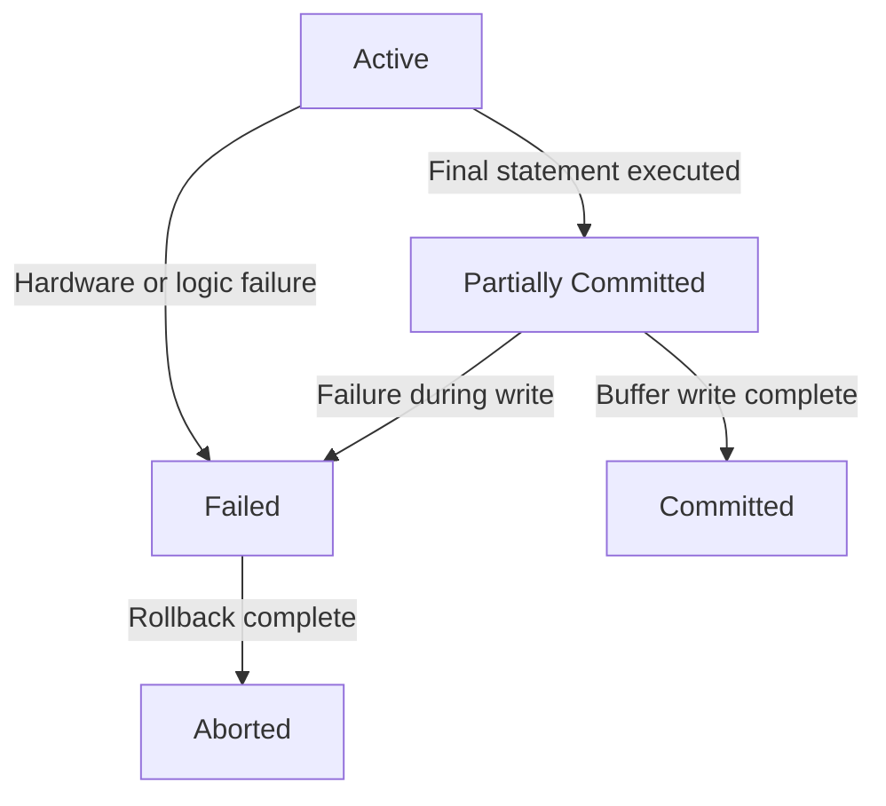

## Introduction

Imagine transferring $\$100$ from your bank account to a friend's account. In SQL, this operation requires two distinct steps: decrementing your balance by $\$100$ and incrementing your friend's balance by $\$100$. If the database server loses power, crashes, or encounters a network fault right after executing the first step, your money disappears into thin air while your friend receives nothing. 

To prevent such catastrophic failures, a Database Management System (DBMS) groups multiple database operations into a single logical execution unit called a **transaction**. A transaction ensures that multi-step updates take effect completely or not at all, maintaining database correctness even when hardware fails or hundreds of users access the database simultaneously.

This lesson explores the fundamental guarantees of database transactions—known as the **ACID properties** (Atomicity, Consistency, Isolation, and Durability)—and details the **transaction states** through which every database operation passes from initiation to completion.

**Before you start:** you need familiarity with standard SQL data modification statements (`UPDATE`, `INSERT`, `DELETE`) and relational integrity constraints such as primary keys, foreign keys, and `CHECK` constraints.

## Core theory

### What is a transaction?

A **transaction** is a sequence of read and write operations that performs a single logical unit of database work. In SQL, a transaction begins implicitly with the first executable SQL statement or explicitly with `BEGIN TRANSACTION`, and ends explicitly with either a `COMMIT` command (to permanently save changes) or a `ROLLBACK` command (to undo all changes).

At an abstract level, a DBMS models database items using key-value pairs or tuple identities and abstracts transaction actions into two basic operations:
- $R(X)$: Read database item $X$ into a local program buffer.
- $W(X)$: Write local value $X$ back to the database buffer/disk.

A bank transfer transaction $T$ moving $\$100$ from account $A$ to account $B$ is formally represented as:

$$T = \langle R(A), A \leftarrow A - 100, W(A), R(B), B \leftarrow B + 100, W(B), \text{Commit} \rangle$$

If any operation within $T$ fails, the entire transaction must be undone so the database is never left in a partially updated state.

### The ACID guarantees

To preserve database integrity across failures and concurrent access, the DBMS must satisfy four core principles known as the **ACID properties**:

| Guarantee | Name | Meaning | Primary Mechanism |
| :--- | :--- | :--- | :--- |
| **A** | **Atomicity** | "All-or-nothing" execution. Either all transaction operations take effect, or none do. | Undo log / Shadow paging |
| **C** | **Consistency** | The database transitions from one valid state to another, preserving all schema constraints and invariants. | Schema rules + Application logic |
| **I** | **Isolation** | Concurrent execution of transactions yields the same result as running them one after another in isolation. | Concurrency control (Locks, MVCC) |
| **D** | **Durability** | Once a transaction commits, its updates persist permanently, even surviving system crashes. | Redo log / Write-Ahead Logging |

#### Atomicity
Atomicity guarantees that a transaction is indivisible. If an error, system crash, or power loss occurs mid-execution, the DBMS performs a **rollback** (or abort) to restore all modified data items to their original pre-transaction values.

#### Consistency
Let $S$ represent a database state, and let $I(S)$ be a boolean integrity function that evaluates to $\text{true}$ if and only if $S$ satisfies all database integrity constraints (such as primary key uniqueness, foreign key references, and non-negative balances). Consistency asserts that if $I(S_{\text{initial}}) = \text{true}$, then after transaction $T$ executes to completion, $I(S_{\text{final}}) = \text{true}$.

#### Isolation
Even though the DBMS executes multiple transactions concurrently to optimize CPU and disk utilization, **isolation** ensures that transactions do not see each other's intermediate, uncommitted updates. Concurrent execution must yield a state equivalent to some purely sequential execution.

#### Durability
When a transaction receives confirmation that it has committed, its updates are guaranteed to survive any subsequent system crash. The DBMS achieves durability by writing transaction log entries to non-volatile secondary storage (such as disk or SSD) before acknowledging success to the user.

### Transaction states and transitions

During its lifecycle, a transaction passes through several operational states. The DBMS tracks these states to manage concurrency and crash recovery.



1. **Active**: The initial state. The transaction enters this state upon execution and remains here while performing read ($R$) and write ($W$) operations.
2. **Partially Committed**: Entered after the final statement of the transaction executes. Updates have been made in main memory (database buffers), but persistent storage log records or data pages may not yet be fully flushed to disk.
3. **Committed**: Entered after all log records demonstrating successful completion are safely written to non-volatile disk storage. The transaction is now complete and irreversible.
4. **Failed**: Entered if normal execution cannot proceed due to hardware faults, power failures, deadlock detection, division by zero, or integrity constraint violations.
5. **Aborted**: Entered after the DBMS undoes all modifications performed by a failed transaction and restores the database to its pre-transaction state. Once aborted, the transaction may be killed or re-executed from the beginning.

### Enforcing Atomicity and Durability: Logging mechanisms

To provide atomicity and durability, the database system maintains a specialized file called a **log** on non-volatile storage. The log records every update made by transactions.

An update log entry typically contains:
- Transaction identifier ($T_i$)
- Data item identifier ($X$)
- Old value of $X$ (used for **undo** operations)
- New value of $X$ (used for **redo** operations)

#### Write-Ahead Logging (WAL) protocol
The **Write-Ahead Logging** (WAL) protocol defines two essential rules for crash recovery:
1. Before any modified database block is written to disk from volatile memory, all log records describing the modification (old and new values) must be written to disk. (Enforces **Atomicity**).
2. Before a transaction enters the `COMMITTED` state, all log records associated with the transaction (including the `<Commit T>` record) must be written to disk. (Enforces **Durability**).

#### Shadow Paging
An alternative to log-based recovery is **shadow paging**. The DBMS maintains two page tables during a transaction's lifetime: a **current page table** and a **shadow page table**. Writes are executed on newly allocated memory pages pointed to by the current page table, while the shadow page table retains references to original pages. 

- To **commit**, the DBMS atomically updates the root pointer to point to the current page table and discards the old shadow table.
- To **abort**, the DBMS simply discards the current page table and restores the shadow page table pointer.

## Worked examples

### Example 1: Simulating transaction state transitions in Python

The following Python program simulates a simplified database transaction execution environment. It illustrates state transitions, write-ahead undo logging, success paths, and abort/rollback execution upon a constraint violation.

```python
class TransactionManager:
    def __init__(self, storage):
        self.storage = dict(storage)
        self.state = "IDLE"
        self.undo_log = []

    def begin(self):
        self.state = "ACTIVE"
        self.undo_log = []
        print(f"Transaction started. Current state: {self.state}")

    def write(self, item, new_value):
        if self.state != "ACTIVE":
            raise RuntimeError("Write denied: No active transaction.")
        old_value = self.storage.get(item, None)
        # Log old value BEFORE writing (Write-Ahead principle)
        self.undo_log.append((item, old_value))
        self.storage[item] = new_value
        print(f"Write operation: {item} updated to {new_value} (previous: {old_value})")

    def commit(self):
        if self.state == "ACTIVE":
            self.state = "PARTIALLY_COMMITTED"
            print(f"Final statement finished. Current state: {self.state}")
            # Simulate flushing write-ahead logs to disk
            self.state = "COMMITTED"
            print(f"Log written to persistent disk. Current state: {self.state}")

    def abort(self, reason):
        print(f"Failure encountered: {reason}")
        self.state = "FAILED"
        print(f"Current state: {self.state}")
        # Apply undo log in reverse order
        print("Initiating rollback using undo log...")
        while self.undo_log:
            item, old_value = self.undo_log.pop()
            if old_value is None:
                del self.storage[item]
            else:
                self.storage[item] = old_value
        self.state = "ABORTED"
        print(f"Rollback complete. Final state: {self.state}")

# Initialize system state
db = TransactionManager({"Alice": 500, "Bob": 200})

print("--- Scenario 1: Successful Transfer ---")
db.begin()
db.write("Alice", 400)
db.write("Bob", 300)
db.commit()
print("Database state after commit:", db.storage)

print("\n--- Scenario 2: Failed Transfer (Constraint Violation) ---")
db.begin()
db.write("Alice", 300)
# Attempt invalid update resulting in negative balance
db.write("Alice", -50)

# Constraint validation check
if db.storage["Alice"] < 0:
    db.abort("CHECK Constraint Violated: Account balance cannot be negative.")

print("Database state after abort:", db.storage)
```

Output:

```text
--- Scenario 1: Successful Transfer ---
Transaction started. Current state: ACTIVE
Write operation: Alice updated to 400 (previous: 500)
Write operation: Bob updated to 300 (previous: 200)
Final statement finished. Current state: PARTIALLY_COMMITTED
Log written to persistent disk. Current state: COMMITTED
Database state after commit: {'Alice': 400, 'Bob': 300}

--- Scenario 2: Failed Transfer (Constraint Violation) ---
Transaction started. Current state: ACTIVE
Write operation: Alice updated to 300 (previous: 400)
Write operation: Alice updated to -50 (previous: 300)
Failure encountered: CHECK Constraint Violated: Account balance cannot be negative.
Current state: FAILED
Initiating rollback using undo log...
Rollback complete. Final state: ABORTED
Database state after abort: {'Alice': 400, 'Bob': 300}
```

### Example 2: Crash recovery classification using log contents

Suppose a database system crashes unexpected at time $t_{\text{crash}}$. Analysis of the non-volatile system log reveals the following history for transactions $T_1, T_2, T_3,$ and $T_4$:

```text
<T1, Start>
<T1, A, 100, 150>
<T2, Start>
<T2, B, 500, 450>
<T1, Commit>
<T3, Start>
<T3, C, 200, 250>
<T2, Commit>
<T4, Start>
<T4, D, 300, 350>
<CRASH>
```

Identify the transaction state of $T_1, T_2, T_3,$ and $T_4$ at the moment of failure, and determine which recovery action (**Redo** or **Undo**) the DBMS recovery manager must take for each transaction upon restart.

#### Solution:
1. **Analyze $T_1$**: `<T1, Start>` and `<T1, Commit>` are present in the log. $T_1$ reached the `COMMITTED` state before the crash. Its updates must persist. **Action: REDO $T_1$** (reapply $A = 150$).
2. **Analyze $T_2$**: `<T2, Start>` and `<T2, Commit>` are both present. $T_2$ reached the `COMMITTED` state. **Action: REDO $T_2$** (reapply $B = 450$).
3. **Analyze $T_3$**: `<T3, Start>` is present, but no `<T3, Commit>` or `<T3, Abort>` record appears. $T_3$ was in the `ACTIVE` (or `PARTIALLY COMMITTED`) state during the crash, which transitions to `FAILED`. Its partial updates must be wiped out to guarantee Atomicity. **Action: UNDO $T_3$** (restore $C = 200$).
4. **Analyze $T_4$**: `<T4, Start>` is present without a commit record. $T_4$ was `ACTIVE`. **Action: UNDO $T_4$** (restore $D = 300$).

### Example 3: Verifying Database Consistency Constraints

Consider a database with a constraint $C$: $A + B = 1000$. The initial database state is $A = 600, B = 400$. 

Transaction $T$ executes the following pseudocode:
```text
BEGIN TRANSACTION;
A = A - 200;
B = B + 150;
COMMIT;
```

Determine whether transaction $T$ preserves database consistency.

#### Solution:
1. **Evaluate Initial State**: $I(S_{\text{initial}}) = (600 + 400 == 1000) \implies \text{true}$.
2. **Trace execution steps**:
   - $A \leftarrow 600 - 200 = 400$
   - $B \leftarrow 400 + 150 = 550$
3. **Evaluate Final State**: $S_{\text{final}}$ has $A = 400, B = 550$.
   - Calculate invariant sum: $A + B = 400 + 550 = 950$.
   - Check constraint: $950 \neq 1000$. $I(S_{\text{final}}) \implies \text{false}$.

**Conclusion**: Transaction $T$ contains a logic error (subtracting $200$ from $A$ but only adding $150$ to $B$). It violates database **Consistency**, even if the DBMS executes $T$ with perfect Atomicity, Isolation, and Durability. The DBMS application code or a `CHECK` trigger must reject this transaction.

## Applications

- **Banking and Ledger Accounting**: Financial networks rely strictly on Atomicity and Durability. A funds transfer must either complete both credit and debit steps or restore initial balances without leaving funds unaccounted for.
- **E-Commerce Inventory Control**: When a customer places an order, item allocation, payment processing, and inventory reduction must execute as an atomic transaction to avoid selling out-of-stock items.
- **Flight and Hotel Reservation Systems**: Isolation guarantees that two customers simultaneously attempting to book the final available seat on a flight cannot both reserve it.
- **Database Crash Recovery Systems**: Commercial RDBMS engines (Oracle, PostgreSQL, MySQL InnoDB, SQL Server) implement Write-Ahead Logging (WAL) and ARIES recovery algorithms to guarantee Durability following power outages or system crashes.

## Common mistakes

- **Confusing Consistency with Isolation.** Consistency refers to maintaining schema rules, invariants, and database constraints. Isolation refers to hiding concurrent execution anomalies between multiple transactions.
- **Assuming `PARTIALLY COMMITTED` means changes are safe on disk.** In the `PARTIALLY COMMITTED` state, execution is complete in memory, but log records or modified data pages may still reside in volatile buffer pools. A power failure at this exact point forces the transaction into the `FAILED` state, requiring a rollback.
- **Believing Atomicity alone guarantees correctness.** Atomicity guarantees that all statements in a transaction run or none run. If the transaction logic itself is flawed (e.g., deducting an incorrect amount), Atomicity will faithfully execute the bad code completely.
- **Assuming SQL `ROLLBACK` fixes application-level external side effects.** If a transaction sends an email or triggers an external physical API call before aborting, the database `ROLLBACK` cannot undo that external real-world side effect.
- **Equating log UNDO with log REDO.** Undo operations reverse changes made by incomplete transactions using their old values. Redo operations reapply changes made by committed transactions using their new values.

## Revision notes

- A transaction is a single logical unit of work consisting of read ($R$) and write ($W$) operations bracketed by `BEGIN` and `COMMIT`/`ROLLBACK`.
- **ACID properties**:
  - **Atomicity**: All updates take effect or none take effect.
  - **Consistency**: Invariants and schema constraints remain valid across transactions.
  - **Isolation**: Intermediate uncommitted states remain invisible to concurrent transactions.
  - **Durability**: Committed updates permanently survive hardware and software crashes.
- **Transaction Lifecycle States**: `Active` $\rightarrow$ `Partially Committed` $\rightarrow$ `Committed`; or `Active`/`Partially Committed` $\rightarrow$ `Failed` $\rightarrow$ `Aborted`.
- **Write-Ahead Logging (WAL)**: Log entries (containing old and new values) must reach non-volatile storage *before* data blocks are written to disk (for Atomicity) and *before* transaction completion is acknowledged (for Durability).
- In crash recovery:
  - Transactions logged with a `<Commit T>` record are **REDONE**.
  - Transactions logged without a `<Commit T>` record are **UNDONE**.

## Practice questions

:::question basic
Define the four ACID properties in a single sentence each.
:::answer
Atomicity ensures that all operations in a transaction complete successfully or all are rolled back. Consistency guarantees that a transaction moves the database from one valid state satisfying all rules to another. Isolation requires that concurrent execution of transactions yields results identical to executing them sequentially. Durability guarantees that committed transaction updates persist permanently even in the event of a system failure.
:::

:::question basic
What is the primary technical difference between the `FAILED` state and the `ABORTED` state in the transaction lifecycle?
:::answer
The `FAILED` state occurs immediately when an unexpected error, constraint violation, or crash interrupts normal execution. The `ABORTED` state is entered only after the DBMS recovery subsystem completes the rollback process, restoring all modified items to their original values via the undo log.
:::

:::question intermediate
A transaction updates value $X$ from $50$ to $100$. Before the transaction commits, another transaction reads $X$ as $100$. The first transaction subsequently encounters an error and aborts. Which ACID property has been broken, and how?
:::answer
The Isolation property has been broken because the second transaction was allowed to read an uncommitted, dirty intermediate write from an active transaction. When the first transaction aborted, the value $100$ ceased to exist in database history, leaving the second transaction operating on invalid data (a dirty read).
:::

:::question intermediate
During recovery after a power outage, the DBMS log shows that Transaction $T_A$ wrote `<TA, Start>` and `<TA, Commit>`, whereas Transaction $T_B$ wrote `<TB, Start>` but lacks a commit record. Describe the exact actions the recovery manager performs for $T_A$ and $T_B$.
:::answer
The DBMS performs a **REDO** operation on Transaction $T_A$ by scanning log records forward and re-writing its new values to disk, guaranteeing Durability. Conversely, the DBMS performs an **UNDO** operation on Transaction $T_B$ by reading log entries in reverse order and replacing modified data fields with their original old values, guaranteeing Atomicity.
:::

:::question advanced
Explain why writing transaction updates directly to secondary disk storage synchronously during execution (without buffering or logging) fails as a implementation strategy for Atomicity and Durability.
:::answer
Direct synchronous disk writes during execution compromise Atomicity because if a failure occurs halfway through writing a sequence of updated blocks to disk, disk pages contain a mix of old and new data without a mechanism to recover the original state. Furthermore, random disk writes for every statement degrade system performance by orders of magnitude compared to sequential Write-Ahead Logging (WAL) in buffer memory.
:::

:::question advanced
A database has an integrity constraint stating that balance $A \ge 0$. A transaction reads $A = 10$, subtracts $20$, and writes $A = -20$. Explain how the DBMS uses transaction states to handle this constraint violation while upholding ACID guarantees.
:::answer
When the DBMS executes the write statement, the active transaction detects the violation of the $A \ge 0$ invariant and immediately transitions from the `ACTIVE` state to the `FAILED` state. The DBMS then triggers its recovery system, reading the transaction's undo log to restore $A$ back to its original value of $10$, subsequently placing the transaction in the `ABORTED` state. This process ensures Atomicity (no partial invalid updates remain) and Consistency (the invariant $A \ge 0$ is preserved).
:::

## Further learning

- **Next:** *Schedules & Serializability* explores how to interleave operations from concurrent transactions without violating the Isolation property.
- **Related:** *Two-Phase Locking (2PL) & Conflicts* examines lock-based protocols used by database engines to enforce isolation levels in practice.
- **Related:** *Write-Ahead Logging & Checkpoints* details the recovery protocols, log record structures, and checkpointing strategies used during system startup after a crash.
- Textbook reference: Abraham Silberschatz, Henry F. Korth, and S. Sudarshan, *Database System Concepts*.
