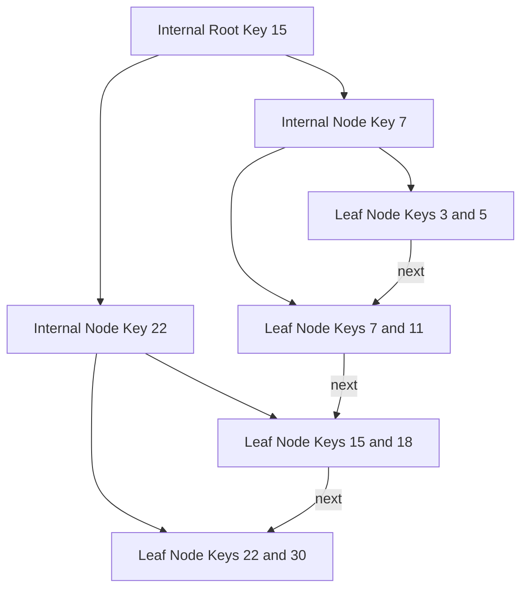

## Introduction

Imagine executing a database query that filters ten million records: `SELECT * FROM employees WHERE salary BETWEEN 50000 AND 70000`. Without an index, the database management system must perform a full table scan, reading every disk page sequentially. If a physical disk page holds 100 tuples, reading ten million records requires 100,000 random or sequential block transfers, taking several seconds or minutes.

Traditional binary search trees (BSTs) or AVL trees reduce search complexity to $O(\log_2 N)$ steps, but they are ill-suited for disk-based storage. A binary tree holding ten million nodes has a height of roughly 24. If each node resides on a different disk page, retrieving a single record requires up to 24 separate disk I/O operations. Because disk access is orders of magnitude slower than main memory access, binary trees create severe physical I/O bottlenecks.

**B+ trees** solve this problem by maximizing node fanout. By packing hundreds of search keys and pointers into a single block-sized node, a B+ tree maintains a wide, extremely short structure—rarely exceeding a height of 3 or 4—while keeping all data entries sorted in a doubly linked leaf chain. This lesson covers the architectural properties of B+ trees, primary and secondary indexing paradigms, logarithmic search complexity, and exact split and merge rebalancing routines.

**Before you start:** You should be familiar with physical block storage, key constraints from *Key Types & Integrity Constraints*, and Big-O logarithmic complexity notation from *Big-O, Big-Omega & Theta Notations*.

## Core theory

### Primary vs Secondary and Dense vs Sparse Indexes

An **index** is a auxiliary data structure designed to accelerate data retrieval without forcing a full table scan. Indexes are categorized by how they map search key values to physical data records.



- A **primary index** is built on a search key that determines the physical ordering of records on disk. A table can have at most one primary index.
- A **secondary index** is built on an attribute that does not dictate physical data ordering. Secondary index records point either to physical row identifiers (RIDs) or to primary key values.
- A **clustered index** (often synonymous with primary index in systems like MySQL InnoDB) stores the actual table data tuples directly inside the leaf nodes of the index structure.
- A **dense index** contains an index entry for every single search key value present in the data file.
- A **sparse index** contains index entries for only some data records—typically one entry per physical disk block, referencing the lowest or highest key on that block.

| Index Attribute | Dense Index | Sparse Index |
| :--- | :--- | :--- |
| **Entries present** | Every search key value in table | One entry per data block/page |
| **Physical constraint** | Works on ordered or unordered files | Requires data file physically ordered by key |
| **Lookup efficiency** | Direct pointer to exact row | Locates block, then scans block sequentially |
| **Space footprint** | Larger memory/disk footprint | Compact footprint |

> **Key Rule:** A secondary index **must** be dense because data records are not ordered by the secondary key. Sparse secondary indexes are impossible because adjacent key values do not reside on adjacent disk blocks.

### B+ Tree Node Structure and Invariants

A **B+ tree** is a self-balancing, multi-way search tree where all internal nodes act purely as navigation routing maps, and all actual record pointers (or full row tuples) reside strictly in leaf nodes.

An internal node in a B+ tree of **order $m$** contains at most $m$ child pointers and at most $m-1$ search keys. It is structured as an alternating sequence of pointers $P$ and keys $K$:

$$\langle P_1, K_1, P_2, K_2, \dots, K_{q-1}, P_q \rangle$$

For any search key value $x$ in the subtree pointed to by $P_i$:
- All keys in subtree $P_1$ are less than $K_1$.
- All keys in subtree $P_i$ (for $1 < i < q$) satisfy $K_{i-1} \le x < K_i$.
- All keys in subtree $P_q$ satisfy $x \ge K_{q-1}$.

#### Strict Invariants of an Order-$m$ B+ Tree:

1. **Balanced Depth:** All leaf nodes are at the exact same depth $h$.
2. **Internal Node Occupancy:** Every internal node (except the root) holds at least $\lceil m/2 \rceil$ child pointers and at least $\lceil m/2 \rceil - 1$ search keys. Maximum child pointers is $m$.
3. **Leaf Node Occupancy:** Let $m_L$ be the maximum key capacity of a leaf node. Every leaf node (except the root) contains at least $\lceil (m_L - 1)/2 \rceil$ keys and at most $m_L - 1$ keys.
4. **Root Exceptions:** The root node is either a single leaf (if the tree has fewer than $m_L$ total entries) or an internal node with at least 2 child pointers.
5. **Leaf Pointer Chain:** Each leaf node includes a pointer (`next`) to its right sibling leaf, enabling sequential scans.

### Search Algorithm and Logarithmic Complexity

Point lookup in a B+ tree traverses from the root down to a leaf node by comparing the target key $k$ against internal separator keys.

```text
Algorithm Search(node, key):
    if node is Leaf:
        if key is found in node:
            return pointer associated with key
        else:
            return NOT_FOUND
    else:
        let keys = [K_1, K_2, ..., K_{q-1}] in node
        if key < K_1:
            return Search(node.P_1, key)
        else if key >= K_{q-1}:
            return Search(node.P_q, key)
        else:
            find i such that K_i <= key < K_{i+1}
            return Search(node.P_{i+1}, key)
```

#### Point Search I/O Cost
Because each node occupies exactly one disk page, the number of page transfers required for a point search equals the height of the tree $h$.

For $N$ data entries and a minimum node fanout $f = \lceil m/2 \rceil$, the maximum height $h$ is bounded by:

$$h \le \left\lceil \log_{\lceil m/2 \rceil} \left( \frac{N}{\lceil (m_L - 1) / 2 \rceil} \right) \right\rceil$$

Because fanout $m$ is typically between 100 and 1,000, $h$ remains $\le 3$ or $4$ even for hundreds of millions of records.

#### Range Query Advantage
In a standard B-tree, key lookup requires traversing up and down internal node branches (in-order tree traversal). In a B+ tree, range searches locate the boundary key $K_{\text{start}}$ in $h$ I/Os, then follow the linked leaf node pointers horizontally until $K_{\text{end}}$ is reached.

$$\text{Total I/O for Range Query} = h + \left\lceil \frac{\text{Number of Matching Records}}{\text{Records per Leaf Block}} \right\rceil$$

### Insertion and Balanced Node Splitting

Inserting a key $K$ and pointer $P$ follows a bottom-up split strategy to preserve height balance.

1. **Locate Target Leaf:** Traverse from root to the correct leaf node $L$.
2. **Insert Key:** Insert $(K, P)$ into $L$ in sorted order.
3. **Check Leaf Capacity:**
   - If $L$ has at most $m_L - 1$ keys, insertion is complete.
   - If $L$ overflows (contains $m_L$ keys), **split leaf** $L$ into two leaves: $L_{\text{left}}$ and $L_{\text{right}}$.
     - Place the first $\lceil m_L / 2 \rceil$ items in $L_{\text{left}}$.
     - Place the remaining items in $L_{\text{right}}$.
     - **Copy up** the smallest key of $L_{\text{right}}$ into parent internal node along with pointer to $L_{\text{right}}$.
4. **Propagate Internal Overflow:**
   - If parent internal node $I$ overflows (contains $m$ child pointers and $m$ keys):
     - Split $I$ into $I_{\text{left}}$ and $I_{\text{right}}$.
     - Keep first $\lceil m/2 \rceil - 1$ keys in $I_{\text{left}}$.
     - **Promote** (push up) the median key to the parent node. (Unlike leaf splits, promoted internal keys are removed from the child level).
     - Keep remaining keys in $I_{\text{right}}$.
5. **Root Expansion:** If internal splits propagate up to the root, create a new root with 2 children and the promoted median key. Tree height grows by 1.

```python
def split_leaf(keys):
    mid = len(keys) // 2
    left_leaf = keys[:mid]
    right_leaf = keys[mid:]
    copy_up_key = right_leaf[0]  # Copy-up retains key in leaf
    return left_leaf, right_leaf, copy_up_key

def split_internal(keys):
    mid = len(keys) // 2
    left_node = keys[:mid]
    promoted_key = keys[mid]      # Promoted key leaves internal child
    right_node = keys[mid+1:]
    return left_node, right_node, promoted_key

# Demonstration of overflow handling with max 2 keys per node
overflow_leaf = [10, 20, 30]
l_leaf, r_leaf, k_copy = split_leaf(overflow_leaf)
print(f"Leaf Split -> Left: {l_leaf}, Right: {r_leaf}, Copied to Parent: {k_copy}")

overflow_internal = [10, 20, 30]
l_int, r_int, k_prom = split_internal(overflow_internal)
print(f"Internal Split -> Left: {l_int}, Right: {r_int}, Promoted to Parent: {k_prom}")
```

Output:

```text
Leaf Split -> Left: [10], Right: [20, 30], Copied to Parent: 20
Internal Split -> Left: [10], Right: [30], Promoted to Parent: 20
```

### Deletion, Redistribution, and Merging

Deleting a key $K$ reverses insertion steps and preserves minimum fill factor bounds.

1. **Locate Key:** Find target leaf $L$ containing key $K$.
2. **Remove Key:** Delete key and associated data pointer from $L$.
3. **Check Underflow:**
   - If $L$ retains at least $\lceil (m_L - 1)/2 \rceil$ keys, deletion is finished.
   - If $L$ underflows (fewer keys than threshold):
     - **Redistribution (Borrowing):** Check left and right sibling leaf nodes. If a sibling has more than the minimum allowed keys, borrow a key from it. Update parent separator key to reflect new minimum key of right sibling.
     - **Merging (Coalescing):** If neither sibling can spare a key, merge $L$ with a sibling leaf. Concatenate all keys into one node and delete the reference pointer/key from parent internal node.
4. **Internal Node Cascading:**
   - If removing key from parent internal node causes underflow (fewer than $\lceil m/2 \rceil$ child pointers):
     - Borrow pointer and key from an adjacent internal sibling via rotation through parent key.
     - If sibling has no spare keys, merge internal node with sibling, bringing down parent separator key.
5. **Root Shrinking:** If root becomes empty after losing all internal keys except 1 child pointer, the root is removed and its sole child becomes the new root. Tree height decreases by 1.

## Worked examples

### Example 1: Node Capacity and Tree Height Calculation

A database engine uses disk blocks of size $B = 4096$ bytes.
- Search Key Size $K = 16$ bytes.
- Record Pointer Size $R = 8$ bytes.
- Child Node Pointer Size $P = 8$ bytes.
- Leaf Next-Pointer Size $P_{leaf} = 8$ bytes.

Determine:
1. Maximum internal node order $m$.
2. Maximum leaf capacity $m_L$.
3. Maximum height $h$ for storing $N = 5,000,000$ records assuming a minimum 50% node fill factor.

#### Step 1: Internal Node Order $m$
An internal node has $m$ pointers and $m-1$ search keys:

$$m \cdot P + (m - 1) \cdot K \le B$$

$$m(8) + (m - 1)(16) \le 4096$$

$$8m + 16m - 16 \le 4096 \implies 24m \le 4112$$

$$m = \left\lfloor \frac{4112}{24} \right\rfloor = \lfloor 171.33 \rfloor = 171$$

An internal node can hold up to 171 pointers and 170 keys.

#### Step 2: Leaf Node Capacity $m_L$
A leaf node stores $m_L$ keys, $m_L$ record pointers, and 1 next-leaf pointer:

$$m_L \cdot K + m_L \cdot R + P_{leaf} \le B$$

$$m_L(16) + m_L(8) + 8 \le 4096$$

$$24 m_L + 8 \le 4096 \implies 24 m_L \le 4088$$

$$m_L = \left\lfloor \frac{4088}{24} \right\rfloor = \lfloor 170.33 \rfloor = 170$$

A leaf node can hold up to 170 search keys and data pointers.

#### Step 3: Minimum Occupancy and Height $h$ for $N = 5,000,000$
- Minimum keys per leaf $= \lceil (m_L - 1)/2 \rceil = \lceil 169 / 2 \rceil = 85$ keys.
- Minimum pointers per non-root internal node $= \lceil m/2 \rceil = \lceil 171 / 2 \rceil = 86$ pointers.

Calculate layer capacities from bottom to top:
1. **Leaf Level ($L_0$):**
   $$\text{Leaf nodes required} = \left\lceil \frac{5,000,000}{85} \right\rceil = 58,824 \text{ leaf nodes}$$
2. **First Internal Level ($L_1$):**
   $$\text{Parent internal nodes required} = \left\lceil \frac{58,824}{86} \right\rceil = 684 \text{ nodes}$$
3. **Second Internal Level ($L_2$):**
   $$\text{Nodes required} = \left\lceil \frac{684}{86} \right\rceil = 8 \text{ nodes}$$
4. **Root Level ($L_3$):**
   $$\text{Root node pointers required} = 8 \le 171 \implies 1 \text{ Root Node}$$

**Final Answer:**
- Internal Order $m = 171$.
- Leaf Capacity $m_L = 170$.
- Max Tree Height $h = 3$ internal index levels plus leaf level (total 4 disk page lookups per search).

---

### Example 2: Tracing B+ Tree Key Insertions and Splits

Construct a B+ tree where max internal order $m = 3$ (max 2 keys, 3 pointers) and max leaf capacity $m_L = 3$ (max 2 keys per leaf).
Trace the step-by-step insertion of keys: `10, 20, 5, 15`.

#### Step 1: Insert 10 and 20
Initial leaf $L_1$ has space for 2 keys.
- Leaf $L_1$: `[10, 20]`

#### Step 2: Insert 5 (Leaf Split)
Inserting 5 causes $L_1$ to overflow with keys `[5, 10, 20]`.
- Leaf split: $L_1$ splits into $L_1 = [5]$ and $L_2 = [10, 20]$.
- Key `10` (smallest of $L_2$) is **copied up** to parent root $R_1$.
- State:
  - Root $R_1$: `[10]`
  - Leaf $L_1$: `[5]` $\to$ Leaf $L_2$: `[10, 20]`

#### Step 3: Insert 15 (Leaf Split & Internal Propagation)
Key 15 routes to leaf $L_2$ (`[10, 20]`). $L_2$ overflows with `[10, 15, 20]`.
- Leaf split: $L_2$ splits into $L_2 = [10]$ and $L_3 = [15, 20]$.
- Key `15` is **copied up** to Root $R_1$.

Root $R_1$ had `[10]`. Now receiving key `15`, Root $R_1$ contains keys `[10, 15]` and pointers to $L_1, L_2, L_3$.
Root $R_1$ is at max capacity (2 keys, 3 pointers), but has not overflowed.

- Final Tree State:
  - Root $R_1$: Keys `[10, 15]`
  - Pointer 0 $\to$ Leaf $L_1$: `[5]`
  - Pointer 1 $\to$ Leaf $L_2$: `[10]`
  - Pointer 2 $\to$ Leaf $L_3$: `[15, 20]`
  - Leaf chain link: $L_1 \to L_2 \to L_3$

**Final Answer:**
The resulting tree has a height of 1 (root plus leaves), with root keys `[10, 15]` routing to leaves `[5]`, `[10]`, and `[15, 20]`.

## Applications

- **Relational DBMS Storage Engines:** MySQL InnoDB uses B+ trees for clustered primary key indexes (where leaf pages contain row data) and secondary indexes (where leaf pages contain primary keys).
- **File Systems:** Advanced file systems such as NTFS ($MFT B+ tree), XFS, and HFS+ use B+ trees to manage directory entries, file extent mappings, and block allocation maps.
- **Range Scan Query Optimization:** OLAP and OLTP systems rely on the double leaf pointer chain in B+ trees to rapidly execute range operators like `BETWEEN`, `>=`, and `<=` in $O(\log N + K)$ time.
- **Composite Indexing:** Multi-column indexes (such as `(last_name, first_name)`) use lexicographically ordered B+ trees to fulfill prefix search queries.

## Common mistakes

- **Confusing B-trees and B+ trees.** Why it is wrong and how to avoid it: B-trees store data records or row pointers inside internal nodes as well as leaf nodes, making range traversals expensive. B+ trees restrict all record data/pointers strictly to leaf nodes and chain leaves together.
- **Applying leaf copy-up logic to internal node splits.** Why it is wrong and how to avoid it: When a leaf splits, its lowest right key is copied up *and retained* in the leaf. When an internal node splits, the median key is promoted to the parent and *removed* from the child level.
- **Attempting to build a sparse secondary index.** Why it is wrong and how to avoid it: Sparse indexes require data files to be physically sorted by search key. Secondary keys do not match file physical order; thus, secondary indexes must always be dense.
- **Calculating internal order using incorrect node equations.** Why it is wrong and how to avoid it: Remember that an order-$m$ internal node holds $m$ pointers and $m-1$ keys. Do not equate number of keys to number of pointers.
- **Assuming tree height increases at leaf level.** Why it is wrong and how to avoid it: B+ trees grow upward. When node splits propagate all the way to the top, a new root is created above existing nodes, increasing height by 1.

## Revision notes

- **Leaf-Only Data Storage:** All record pointers or row data reside in leaf nodes. Internal nodes contain routing keys and child pointers only.
- **Sequential Range Traversal:** Leaf nodes are linked via pointer chains (`next` / `prev`), allowing $O(\log N + K)$ range searches.
- **Internal Order Equation:** For block size $B$, pointer size $P$, key size $K$: $m \cdot P + (m - 1) \cdot K \le B$.
- **Leaf Capacity Equation:** For leaf pointer $P_{leaf}$, data pointer $R$: $m_L \cdot K + m_L \cdot R + P_{leaf} \le B$.
- **Minimum Occupancy Invariant:** Non-root internal nodes must be at least half full: $\ge \lceil m/2 \rceil$ pointers. Non-root leaves must hold $\ge \lceil (m_L - 1)/2 \rceil$ keys.
- **Leaf Split Rule:** Split overflowed leaf, copy up lowest key of right leaf to parent.
- **Internal Split Rule:** Split overflowed internal node, promote median key to parent (key disappears from child level).
- **Underflow Resolution:** Try redistribution from adjacent sibling first; if sibling is at minimum capacity, merge nodes.

## Practice questions

:::question basic
How does a B+ tree differ from a standard B-tree in terms of internal node structure and range query execution?
:::answer
In a standard B-tree, data records or pointers are stored in both internal nodes and leaf nodes, which forces range queries to navigate back and forth across multiple tree levels using in-order traversal. In a B+ tree, internal nodes store search keys and child pointers exclusively, while all record pointers or row data reside strictly in leaf nodes. Furthermore, B+ tree leaf nodes are linked via sequential pointers, allowing range queries to find the starting key in $O(\log N)$ time and scan adjacent matching records horizontally across the leaf chain.
:::

:::question basic
Why must a secondary index on an unclustered database table be dense rather than sparse?
:::answer
A sparse index contains entries for only a subset of data pages (typically the minimum key per page) and relies on the physical data file being sorted by the index key so missing keys can be found on adjacent blocks. Because a table can only be physically sorted by one key (the primary key), records referenced by a secondary key are scattered arbitrarily across disk pages. Therefore, a secondary index must contain an explicit entry for every single search key value in the table (dense index).
:::

:::question intermediate
Calculate the maximum internal node order $m$ for a B+ tree operating on disk pages of size $B = 8192$ bytes. Search keys require $K = 32$ bytes and child pointers require $P = 8$ bytes.
:::answer
An internal node of order $m$ contains $m$ child pointers and $m-1$ search keys. Setting up the memory bound inequality: $m \cdot P + (m - 1) \cdot K \le B \implies 8m + 32(m - 1) \le 8192 \implies 40m - 32 \le 8192 \implies 40m \le 8224$. Solving for $m$: $m = \lfloor 8224 / 40 \rfloor = \lfloor 205.6 \rfloor = 205$. Thus, the maximum internal order $m$ is 205.
:::

:::question intermediate
An leaf node in an order $m_L = 4$ B+ tree (max 3 keys per leaf) contains keys `[20, 30, 40]`. Key `25` is inserted into this leaf. Detail the resulting leaf split, including keys present in the left and right leaves, and the exact key passed to the parent.
:::answer
Inserting 25 into `[20, 30, 40]` produces an overflowed leaf sequence of 4 keys: `[20, 25, 30, 40]`. Splitting this sequence into two equal halves yields a left leaf with keys `[20, 25]` and a right leaf with keys `[30, 40]`. Because this is a leaf split, the smallest key of the right leaf (`30`) is **copied up** to the parent internal node while remaining as the minimum search key in the right leaf node.
:::

:::question advanced
Suppose an internal node with capacity for 3 pointers (keys `[15, 30]`) experiences an overflow when key `22` and child pointer $P_{new}$ are inserted from a child leaf split, resulting in key sequence `[15, 22, 30]`. Trace the internal node split and state how it differs from a leaf split.
:::answer
The overflowed internal key sequence is `[15, 22, 30]`. For an internal split, the median key `22` is **promoted** to the parent internal node and removed from this level entirely. The remaining keys and pointers are partitioned into a left internal node containing key `[15]` and a right internal node containing key `[30]`. This differs fundamentally from a leaf split because in a leaf split the key sent to the parent is copied and retained in the leaf node, whereas in an internal split the promoted key moves up and is deleted from child nodes.
:::

:::question advanced
A B+ tree index holds $N = 10^7$ tuples. Block size is $4096$ bytes, key size is $20$ bytes, pointer size is $8$ bytes, and average node fill factor is 70%. If a query scans a range matching 2,000 contiguous records, estimate the total disk page I/O reads required.
:::answer
First calculate leaf node capacity: $m_L \cdot 20 + m_L \cdot 8 + 8 \le 4096 \implies 28 m_L \le 4088 \implies m_L = 146$ keys per leaf. At 70% fill factor, each leaf contains $146 \times 0.70 \approx 102$ records.
Next calculate internal order: $m \cdot 8 + (m-1) \cdot 20 \le 4096 \implies 28m \le 4116 \implies m = 147$ pointers. At 70% fill factor, internal fanout is $147 \times 0.70 \approx 103$.
Tree height $h$: Leaf blocks required $= 10^7 / 102 \approx 98,039$. Index level 1 needs $98,039 / 103 \approx 952$ nodes. Index level 2 needs $952 / 103 \approx 10$ nodes. Index level 3 is root ($10 \le 147$). Thus $h = 3$ index levels plus leaf level. Point search takes 4 block reads.
Scanning 2,000 matching records requires reading $\lceil 2000 / 102 \rceil = 20$ leaf blocks. Following leaf next-pointers adds 19 block transfers.
Total block reads $= h + \text{leaf blocks} = 3 \text{ internal} + 20 \text{ leaf} = 23$ I/O operations.
:::

## Further learning

- **Next:** *Query Processing & Optimization* details how relational database query planners select between full table scans, primary B+ tree index lookups, and secondary index joins.
- **Related:** *Write-Ahead Logging & Checkpoints* explores how page-level structural modifications (like node splits and merges) are logged atomically to protect B+ tree indexes against unexpected system crashes.
- **Related:** *File Systems vs DBMS* compares operating system disk block management against database storage managers.
- Textbook reference: Silberschatz, Korth, and Sudarshan, *Database System Concepts*.
