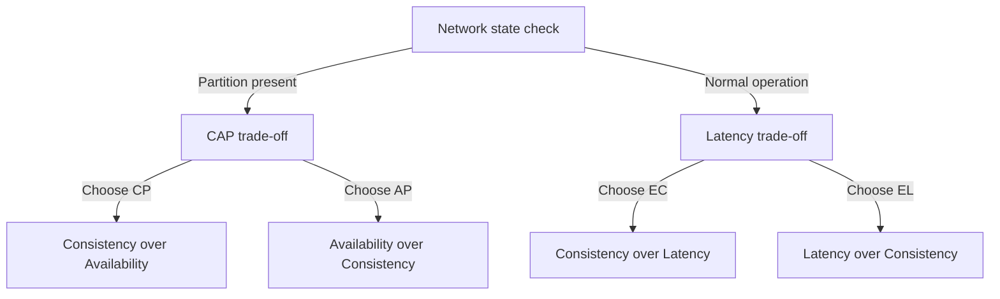

## Introduction

Relational database management systems (RDBMS) rely on rigid schemas, normalized tables, and strong ACID guarantees. While these design choices ensure strict data integrity, they introduce significant performance bottlenecks when scaled horizontally across hundreds of commodity server nodes. As web-scale applications began generating petabytes of unstructured or semi-structured data under heavy write loads, traditional relational databases struggled to meet throughput and availability demands.

**NoSQL** (Not Only SQL) databases emerged to solve these horizontal scaling and flexible schema challenges. However, distributing data across multiple network nodes forces system architects to make fundamental trade-offs between consistency, availability, and latency. 

This lesson examines the four primary NoSQL data models, formalizes the theoretical trade-offs of distributed systems through Brewer's CAP theorem and the PACELC model, and explores tunable quorum arithmetic used to configure distributed data stores.

**Before you start:** you need familiarity with ACID properties, transaction commit protocols, and index structures such as B+ trees (*ACID Properties & Transaction States*, *B+ Tree Index Structures*).

## Core theory

### Limitations of the Relational Model and the Rise of NoSQL

Relational systems enforce **schema-on-write**, requiring table structures, column data types, and integrity constraints to be declared before inserting data. This guarantees structural consistency, but changing a schema across billions of rows in production can require expensive locking operations or system downtime.

Furthermore, applications written in object-oriented languages must map objects into relational tables—a structural mismatch known as **impedance mismatch**. Retrieving a complex domain object (such as a customer order with multiple items, shipping addresses, and payment logs) often requires executing several `JOIN` operations across separate tables.

In a single-node system, B+ trees and lock-based concurrency control yield fast execution. But when data spans multiple physical machines, performing distributed joins, maintaining global foreign key integrity, and executing distributed transactions via two-phase commit (2PC) introduce prohibitive network latency and failure vulnerabilities. 

NoSQL databases address these bottlenecks by adopting **schema-on-read** (or schema-flexible) approaches, sacrificing arbitrary join capabilities in favor of data locality and partition-tolerant distributed architectures.

### The Four Major NoSQL Data Models

NoSQL systems prioritize different data patterns depending on their primary architectural goals.

| Model | Primary Abstraction | Key Characteristics | Typical Use Cases |
| :--- | :--- | :--- | :--- |
| **Key-Value** | Hash table (Key $\to$ Value blob) | Values are opaque blobs to the database; operations are restricted to `get`, `put`, and `delete` by key. | Caching, session management, user preferences. |
| **Document** | Semi-structured records (JSON/BSON) | Values are inspectable documents; internal fields can be indexed and queried without joins. | E-commerce catalogs, content management, user profiles. |
| **Column-Family** | Sparse matrix grouped by column families | Data stored by row key, but columns are grouped into column families and stored together on disk. | Time-series metrics, IoT sensor data, event logging. |
| **Graph** | Nodes, Edges, Properties | Explicit pointer-like links between nodes; optimized for graph traversal operations. | Social networks, fraud detection, recommendation engines. |

#### 1. Key-Value Stores
A **key-value store** models data as a collection of unique keys mapped to arbitrary byte arrays (values). Because the database does not parse the value, data operations achieve $O(1)$ time complexity on lookup using distributed hash rings. Systems such as Redis and AWS DynamoDB provide ultra-fast primary-key reads and writes, but secondary indexing and range queries are unsupported natively without fetching raw values to the application layer.

#### 2. Document Stores
A **document store** extends the key-value concept by encoding values into semi-structured formats such as JSON, BSON, or XML. The database engine parses the internal document structure, allowing developers to index nested fields and query subsets of documents. Systems such as MongoDB and Couchbase eliminate impedance mismatch by storing domain objects as single, self-contained documents.

#### 3. Column-Family Stores
A **column-family store** (wide-column store) structures data into rows identified by a row key, but groups related columns into **column families**. Unlike relational tables where every row shares the exact same schema, column-family rows can contain distinct sets of columns dynamically. 

On disk, data is sorted and stored by column family rather than by row. This layout drastically accelerates aggregation queries over specific columns (such as computing average temperatures across millions of IoT records) because the engine reads only the required column data from disk. Examples include Apache Cassandra and HBase.

#### 4. Graph Stores
A **graph store** represents data using explicit mathematical graphs composed of **nodes** (entities), **edges** (relationships), and **properties** (key-value attributes on nodes/edges). Relational databases execute relationships by matching foreign key values at query time using joins, yielding $O(n)$ complexity per hop. Graph databases implement **index-free adjacency**, where each node directly stores physical memory pointers to its adjacent neighbor nodes. Graph traversals proceed in time proportional to the number of traversed sub-graph elements, independent of the overall graph size. Neo4j and Amazon Neptune are common examples.

### Brewer's CAP Theorem

Formulated by Eric Brewer in 2000 and formally proven by Seth Gilbert and Nancy Lynch in 2002, the **CAP theorem** states that any distributed data store can simultaneously provide at most two of the following three guarantees during a network partition:

1. **Consistency** ($C$): Every read operation returns the most recent write or an error. In CAP literature, consistency specifically refers to **linearizability** (atomic consistency), where all nodes observe the exact same sequence of operations in global time order.
2. **Availability** ($A$): Every non-failing node returns a non-error response for every incoming request. The response is not guaranteed to contain the most recent write, but the system cannot refuse or drop requests.
3. **Partition Tolerance** ($P$): The system continues to operate despite arbitrary network message loss, delay, or network partitioning (where the network splits into disconnected sub-networks).



Because network hardware, routers, and cross-datacenter links inevitably experience failures, **network partitions ($P$) are unavoidable** in real-world distributed systems. Therefore, system designers cannot choose "CA". A distributed system must choose between:

- **$CP$ Systems (Consistency / Partition Tolerance):** When a network partition occurs, nodes in minority partitions reject read and write requests to prevent stale or conflicting state. The system sacrifices availability to guarantee linearizability.
- **$AP$ Systems (Availability / Partition Tolerance):** When a partition occurs, all nodes continue accepting reads and writes. Nodes in partitioned segments process operations using local state, risking inconsistent data replicas. The system sacrifices linearizability to remain fully operational.

### The PACELC Theorem

The CAP theorem only models system behavior during active network partitions ($P$). In 2012, Daniel Abadi introduced the **PACELC theorem** to account for trade-offs during normal operating conditions when no network partitions exist.

The PACELC theorem states:
> If there is a **P**artition, trade off **A**vailability ($A$) versus **C**onsistency ($C$);  
> **E**lse, trade off **L**atency ($L$) versus **C**onsistency ($C$).

Under normal operating conditions (**E**lse), maintaining strong consistency across replicas requires synchronous network round-trips to replicate write operations before returning a success response to the client. This introduces high query **L**atency. If an application demands low latency (**L**), it must replicate writes asynchronously, permitting temporary reads of stale data (**C**onsistency degradation).

#### PACELC Classification Matrix

- **PC/EC** (e.g., MongoDB primary writes, Spanner): Prefers consistency during partitions, and incurs latency to enforce consistency during normal operation.
- **PA/EL** (e.g., Apache Cassandra default, Amazon Dynamo): Prefers availability during partitions, and favors low latency over synchronous consistency during normal operation.
- **PA/EC** (e.g., PostgreSQL with synchronous streaming replication): Prefers availability on reads during partitions, but enforces synchronous write replication during normal conditions.

### Tunable Consistency and Quorum Arithmetic

Distributed databases such as Apache Cassandra and Amazon DynamoDB replace fixed strict consistency with **tunable consistency**. In these systems, data is replicated across $N$ physical storage nodes, where $N$ is the **replication factor**.

Clients can specify consistency levels per operation by defining:
- $W$: The **write quorum**—the minimum number of replica nodes that must acknowledge a write operation before it is marked successful.
- $R$: The **read quorum**—the minimum number of replica nodes that must respond to a read query before returning the value to the client.

#### The Quorum Condition for Strong Consistency

To guarantee **strong consistency** (linearizability), the read set and write set must overlap by at least one node. By the Pigeonhole Principle, this requirement is expressed as:

$$R + W > N$$

When $R + W > N$, any read set of $R$ nodes intersects with any write set of $W$ nodes in at least $R + W - N \ge 1$ node(s). The system can resolve conflicting data versions returned by nodes by using timestamps or vector clocks, guaranteeing that the client receives the latest written value.

```
Node Set (N = 5): [ Node 1 | Node 2 | Node 3 | Node 4 | Node 5 ]
Write Set (W = 3): [ Node 1 | Node 2 | Node 3 ]
Read Set  (R = 3):               [ Node 3 | Node 4 | Node 5 ]
                                   ^^^^^^
                             Overlapping Node
```

If $R + W \le N$, the read quorum and write quorum can target disjoint sets of nodes. In this configuration, reads may miss recent writes, degrading the system to **eventual consistency**. Under eventual consistency, if no new writes occur, all replicas will eventually converge to identical values, but short-term stale reads are possible.

## Worked examples

### Example 1: Evaluating Quorum Overlap and System Consistency

A distributed key-value store operates with a replication factor of $N = 5$. An engineer evaluates quorum settings across four different operational configurations:

1. Scenario 1: $N = 5$, $R = 3$, $W = 3$
2. Scenario 2: $N = 5$, $R = 1$, $W = 5$
3. Scenario 3: $N = 5$, $R = 2$, $W = 2$
4. Scenario 4: $N = 3$, $R = 2$, $W = 2$

For each scenario, determine whether strong consistency is guaranteed, calculate the node overlap count, and run a simulation script to verify node intersection behavior.

#### Solution:

- **Scenario 1 ($N=5, R=3, W=3$):** $R + W = 3 + 3 = 6$. Since $6 > 5$, strong consistency is guaranteed. Overlap count $= R + W - N = 6 - 5 = 1$ node.
- **Scenario 2 ($N=5, R=1, W=5$):** $R + W = 1 + 5 = 6$. Since $6 > 5$, strong consistency is guaranteed. Overlap count $= R + W - N = 6 - 5 = 1$ node. Writes must reach all 5 nodes, ensuring any single-node read sees the update.
- **Scenario 3 ($N=5, R=2, W=2$):** $R + W = 2 + 2 = 4$. Since $4 \le 5$, strong consistency is **not** guaranteed. The system operates under eventual consistency because read and write sets may be disjoint. Overlap count $= 0$.
- **Scenario 4 ($N=3, R=2, W=2$):** $R + W = 2 + 2 = 4$. Since $4 > 3$, strong consistency is guaranteed. Overlap count $= 4 - 3 = 1$ node.

Here is the Python evaluation script and its printed output:

```python
def evaluate_quorum(N: int, R: int, W: int) -> dict:
    is_strong = (R + W) > N
    overlap = (R + W - N) if is_strong else 0
    return {
        "N": N, "R": R, "W": W,
        "strong": is_strong,
        "overlap": overlap
    }

scenarios = [
    (5, 3, 3),
    (5, 1, 5),
    (5, 2, 2),
    (3, 2, 2)
]

for N, R, W in scenarios:
    res = evaluate_quorum(N, R, W)
    mode = "Strong" if res["strong"] else "Eventual"
    print(f"N={N} R={R} W={W} -> Mode: {mode}, Overlap: {res['overlap']}")
```

Output:

```text
N=5 R=3 W=3 -> Mode: Strong, Overlap: 1
N=5 R=1 W=5 -> Mode: Strong, Overlap: 1
N=5 R=2 W=2 -> Mode: Eventual, Overlap: 0
N=3 R=2 W=2 -> Mode: Strong, Overlap: 1
```

### Example 2: Analyzing CAP and PACELC Trade-Offs

Consider an online gaming application handling user inventory items across three global datacenters:

- Datacenter A (US-East)
- Datacenter B (EU-West)
- Datacenter C (AP-East)

During an underwater cable cut, network communication between Datacenter C and the other two datacenters is severed.

1. If the database engine is configured as an **$AP$ system**, describe how it handles inventory updates in Datacenter C during the outage. What problem occurs when the network heals?
2. If configured as a **$CP$ system**, how does it handle requests in Datacenter C?
3. Map this system's behavior to PACELC notation assuming it prioritizes low user read latencies during normal operations without enforcing synchronous multi-datacenter consensus.

#### Solution:

1. **AP Mode Behavior:** Datacenter C continues to accept write operations (e.g., spending gold, trading items) locally to remain available. Because it cannot communicate with A and B, state diverges. When the network heals, the system faces **split-brain** conflicts (e.g., an item was traded in C and simultaneously sold in A). The system must resolve conflicting versions using mechanisms such as **Last-Write-Wins (LWW)** or **CRDTs (Conflict-Free Replicated Data Types)**.
2. **CP Mode Behavior:** When Datacenter C loses network connectivity to the majority quorum of nodes, it rejects incoming write requests and returns error codes to clients. This prevents stale writes or split-brain states, preserving linearizability at the expense of availability in region C.
3. **PACELC Classification:** 
   - Under partition (**P**), if it chooses availability over consistency, it is **PA**.
   - Under normal conditions (**E**lse), if it chooses low latency over synchronous consistency, it is **EL**.
   - The overall PACELC classification is **PA/EL**.

## Applications

- **Real-Time Caching and Session Management:** Key-value stores such as Redis store web session tokens and high-throughput application cache entries in memory, providing sub-millisecond latency.
- **E-Commerce Product Catalogs:** Document databases (MongoDB, Couchbase) allow varying product attributes (e.g., electronics with screen sizes vs. apparel with cloth sizes) to coexist in the same collection without complex SQL schema migrations.
- **High-Volume Telemetry and IoT:** Column-family stores (Apache Cassandra) handle write-heavy metric logging from millions of smart sensors distributed across multi-datacenter environments.
- **Knowledge Graphs and Social Networks:** Graph databases (Neo4j) execute deep $k$-hop neighbor queries (such as finding mutual friends or tracing money laundering pathways) orders of magnitude faster than relational SQL joins.

## Common mistakes

- **Assuming "NoSQL" means "No SQL Language".** NoSQL stands for *Not Only SQL*. Many modern non-relational databases support SQL-like declarative query interfaces (e.g., Cassandra Query Language CQL, Couchbase N1QL/SQL++).
- **Believing a system can choose "CA" under the CAP theorem.** Network hardware failures, switch drops, and latency spikes are unavoidable in real networks. Every distributed system must handle network partitions; thus, the real choice is between consistency ($CP$) and availability ($AP$) during a partition.
- **Confusing CAP consistency with ACID consistency.** ACID consistency ($C$) means preserving database integrity invariants (e.g., check constraints, foreign keys). CAP consistency ($C$) strictly means **linearizability** (every node reads the latest written value globally).
- **Assuming $R + W > N$ eliminates all read anomalies.** While $R + W > N$ guarantees that read quorums intersect with write quorums, application-level issues such as uncommitted reads or concurrent write clock skew can still introduce anomalies unless conflict resolution algorithms (like vector clocks) are correctly implemented.

## Revision notes

- NoSQL data models trade strict normalization and ACID guarantees for horizontal scalability, flexible schemas, and high write throughput.
- **Key-Value Stores:** Hash-table abstraction, $O(1)$ operations on primary key, opaque values.
- **Document Stores:** Semi-structured JSON/BSON documents with indexable nested fields.
- **Column-Family Stores:** Tables organized by row key, storing data on disk grouped by column families to optimize analytical read queries.
- **Graph Stores:** Nodes and edges utilizing index-free adjacency to traverse connections without relational joins.
- **CAP Theorem:** In the presence of a network partition ($P$), a distributed database can guarantee **Consistency** ($CP$) or **Availability** ($AP$), but not both.
- **PACELC Theorem:** Expands CAP by stating: **P**artition $\to$ **A**vailability vs **C**onsistency; **E**lse $\to$ **L**atency vs **C**onsistency.
- **Quorum Equation:** Strong consistency requires $R + W > N$. Eventual consistency occurs when $R + W \le N$.

## Practice questions

:::question basic
Which NoSQL data model utilizes index-free adjacency to optimize query operations over heavily interconnected entities?
:::answer
The graph data model utilizes index-free adjacency. Instead of matching foreign key tables using join operations at query time, graph nodes store direct memory pointers to adjacent connected nodes, enabling $O(1)$ edge traversal speeds.
:::

:::question basic
In the context of the CAP theorem, what does Consistency ($C$) specifically mean?
:::answer
In the CAP theorem, consistency specifically means linearizability (or atomic consistency). It guarantees that every read operation across all nodes returns the most recent written value or an error, appearing as if all operations executed on a single global state.
:::

:::question intermediate
A distributed database is configured with a replication factor $N = 3$. If write operations require an acknowledgment from $W = 2$ nodes, what is the minimum read quorum $R$ required to ensure strong consistency?
:::answer
The minimum read quorum is $R = 2$. According to the quorum formula $R + W > N$, we must satisfy $R + 2 > 3$, which requires $R > 1$. Therefore, the smallest integer value for $R$ is $2$.
:::

:::question intermediate
Explain the difference between a system categorized as **PC/EC** and one categorized as **PA/EL** under the PACELC theorem.
:::answer
A **PC/EC** system chooses Consistency over Availability during a network partition (**PC**) and chooses Consistency over Latency during normal operations (**EC**), requiring synchronous replication even when the network is healthy. Conversely, a **PA/EL** system chooses Availability over Consistency during a network partition (**PA**) and prioritizes low Latency over Consistency during normal operations (**EL**) by utilizing asynchronous replication.
:::

:::question advanced
A distributed store uses $N = 5, W = 3, R = 3$. Suppose a network partition separates the 5 nodes into two isolated groups: Group 1 containing 3 nodes, and Group 2 containing 2 nodes. Analyze the read and write availability of both groups.
:::answer
Group 1 contains 3 nodes, which is sufficient to satisfy both the write quorum ($W = 3$) and read quorum ($R = 3$). As a result, Group 1 remains fully operational for both reads and writes. Group 2 contains only 2 nodes, which cannot satisfy either $W = 3$ or $R = 3$; therefore, Group 2 rejects all incoming read and write requests to preserve linearizability.
:::

:::question advanced
Why does setting $W = 1$ and $R = N$ provide strong consistency in theory, and what is the primary operational trade-off of this configuration?
:::answer
Setting $W = 1$ and $R = N$ satisfies $R + W = N + 1 > N$, ensuring that every read query accesses all $N$ replicas, which guarantees that at least one node in the read set contains the single node updated during the write. The operational trade-off is that write operations achieve minimum latency ($W=1$), but read operations become extremely slow and vulnerable to failure, as a single unresponsive or slow node among the $N$ replicas will block or fail the entire read operation.
:::

## Further learning

- **Next:** *File Systems vs DBMS* explores how physical file layout and OS-level buffer management differ between relational storage engines and distributed flat file logs.
- **Related:** *ACID Properties & Transaction States* contrasts single-node serializability guarantees with distributed consistency models.
- **Related:** *B+ Tree Index Structures* details standard relational disk indexing techniques, comparing them against append-only Log-Structured Merge (LSM) trees often used in column-family stores.
- Textbook reference: Martin Kleppmann, *Designing Data-Intensive Applications*.
