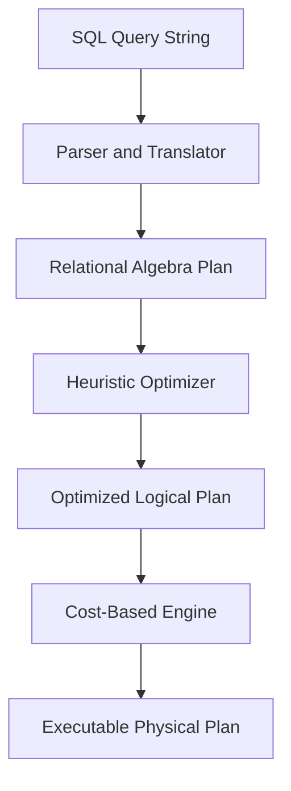

## Introduction

In a relational database management system, SQL is a declarative language: a user specifies *what* data to retrieve, not *how* to retrieve it. Consider a three-way join across tables containing millions of rows. Executed naively as a full Cartesian product followed by sequential scanning, the query could require billions of disk page reads and run for days. An optimized physical execution plan performing the identical logical operation might finish in 50 milliseconds.

The subsystem responsible for bridging this gap is the **query processor**. It translates declarative queries into efficient execution strategies by rewriting logical expressions and choosing concrete physical algorithms. Understanding query optimization reveals how database systems make intelligent, cost-based decisions under memory and storage constraints.

**Before you start:** you need familiarity with *Declarative SQL Queries & Filtering*, *Inner, Outer & Self Joins*, *Relational Model & Tuple Algebra*, and *B+ Tree Index Structures*.

## Core theory

### The Query Processing Pipeline

Query processing converts a SQL string into an executed result set through a structured multi-stage compilation and optimization pipeline.



1. **Parsing and Translation**: The database checks SQL syntax and schema validity, translating the query block into an initial **relational algebra tree** (the **logical query plan**).
2. **Heuristic Optimization**: The logical plan undergoes rewrite rules that apply equivalences to shrink intermediate results early.
3. **Cost-Based Optimization**: The engine evaluates alternative **physical query plans**—assigning specific algorithms (such as Index Nested Loop or Hash Join) and access paths (index scan vs. sequential scan). It selects the plan with the lowest estimated execution cost based on system stats.
4. **Plan Execution**: The execution engine runs the chosen physical plan against the storage engine and streams the resulting tuples to the client.

### Heuristic Optimization & Relational Algebra Equivalences

Two relational algebra expressions are equivalent if they produce the same multiset of tuples on every valid database instance. A **heuristic optimizer** applies **equivalence rules** to rewrite query trees into semantically identical forms that avoid unnecessary data movement.

Key equivalence rules include:

1. **Commutativity and Associativity of Joins**:
   $$R \bowtie S \equiv S \bowtie R$$
   $$(R \bowtie S) \bowtie T \equiv R \bowtie (S \bowtie T)$$

2. **Selection Pushdown** (Pushing $\sigma$ below $\bowtie$):
   If predicate $\theta_0$ involves only attributes present in relation $R$:
   $$\sigma_{\theta_0}(R \bowtie S) \equiv (\sigma_{\theta_0}(R)) \bowtie S$$
   Pushing selections down reduces the cardinality of operands before expensive join operations are evaluated.

3. **Projection Pushdown** (Pushing $\pi$ below $\bowtie$):
   If $L$ is a set of attributes in the join output, and $L_R, L_S$ represent attributes in $L$ along with any join attributes needed from $R$ and $S$ respectively:
   $$\pi_L(R \bowtie S) \equiv \pi_L(\pi_{L_R}(R) \bowtie \pi_{L_S}(S))$$
   Eliminating unused attributes early minimizes record width and reduces memory memory allocation per block.

4. **Cascading of Selections**:
   $$\sigma_{\theta_1 \wedge \theta_2}(R) \equiv \sigma_{\theta_1}(\sigma_{\theta_2}(R))$$

### Physical Join Algorithms and I/O Cost Models

Logical operators in an algebra tree must be mapped to physical algorithms. Because disk input/output (I/O) is typically the dominant bottleneck in database systems, performance is evaluated primarily by the total number of disk block transfers.

Let $R$ be the outer relation and $S$ be the inner relation. Let $T(R)$ and $T(S)$ denote the total number of tuples in $R$ and $S$. Let $B(R)$ and $B(S)$ denote the number of disk blocks required to store $R$ and $S$. Let $M$ be the size of the available main memory buffer measured in disk pages.

#### 1. Block Nested Loop Join (BNL)
Rather than scanning $S$ for every individual tuple of $R$, BNL reads $M - 2$ blocks of $R$ into memory at once. For each memory-resident chunk of $R$, it scans $S$ page by page, joining matching tuples.

$$\text{Cost}_{\text{BNL}}(R, S) = B(R) + \left\lceil \frac{B(R)}{M - 2} \right\rceil \times B(S) \text{ block I/Os}$$

#### 2. Index Nested Loop Join (INL)
If an index exists on the join attribute of the inner relation $S$, the optimizer can probe the index for each tuple of $R$ instead of scanning $S$. Let $C_{\text{idx}}$ be the cost of a single index lookup plus data page fetch.

$$\text{Cost}_{\text{INL}}(R, S) = B(R) + T(R) \times C_{\text{idx}} \text{ block I/Os}$$

For a clustered B+ Tree index, $C_{\text{idx}}$ is typically the tree height $h$ plus $1$ data block read per distinct matching value.

#### 3. Sort-Merge Join (SMJ)
SMJ sorts both $R$ and $S$ on the join attribute (if not already sorted) and then merges them in a single coordinated scan.
If external sorting requires 2 passes (i.e., $M \ge \sqrt{\max(B(R), B(S))}$), sorting costs $2 B(R) + 2 B(S)$ disk transfers to write and read intermediate runs. The merge step reads each relation once ($B(R) + B(S)$).

$$\text{Cost}_{\text{SMJ}}(R, S) = 3(B(R) + B(S)) \text{ block I/Os}$$

#### 4. Grace Hash Join
Grace Hash Join hashes tuples from both relations into $M-1$ matching partitions on disk using join attribute hash values. In the probing phase, each partition pair is loaded into memory to compute joins.
Provided the smaller partition fits in memory ($\frac{B(S)}{M-1} \le M-2$), partitioning requires reading and writing both relations ($2(B(R) + B(S))$), and probing reads them once ($B(R) + B(S)$).

$$\text{Cost}_{\text{Hash}}(R, S) = 3(B(R) + B(S)) \text{ block I/Os}$$

| Join Algorithm | I/O Cost Model | Key Operating Requirement |
| :--- | :--- | :--- |
| **Block Nested Loop** | $B(R) + \left\lceil \frac{B(R)}{M - 2} \right\rceil \cdot B(S)$ | None (general-purpose fallback) |
| **Index Nested Loop** | $B(R) + T(R) \cdot C_{\text{idx}}$ | Index present on inner relation's join attribute |
| **Sort-Merge Join** | $3(B(R) + B(S))$ | Buffer memory $M \ge \sqrt{\max(B(R), B(S))}$; efficient for range joins |
| **Grace Hash Join** | $3(B(R) + B(S))$ | Memory buffer $M \ge \sqrt{B(S)}$; equi-joins only |

### Catalog Statistics & Cardinality Estimation

To select the cheapest physical plan, a **cost-based optimizer** estimates the output size (**cardinality estimation**) of every intermediate operator. This estimation relies on **catalog statistics** maintained by the DBMS:

- $T(R)$: Total number of tuples in relation $R$.
- $B(R)$: Total number of disk blocks storing $R$.
- $V(A, R)$: Number of distinct values for attribute $A$ in relation $R$.
- $\min(A, R), \max(A, R)$: Minimum and maximum values for attribute $A$.

The **selectivity factor** ($s$) represents the fraction of tuples expected to satisfy a predicate condition ($0 \le s \le 1$).

#### Equality Selection ($\sigma_{A = v}(R)$)
Assuming a uniform distribution of values:
$$s = \frac{1}{V(A, R)} \implies T(\sigma_{A = v}(R)) = \frac{T(R)}{V(A, R)}$$

#### Inequality Selection ($\sigma_{A > v}(R)$)
Assuming a continuous uniform distribution:
$$s = \frac{\max(A, R) - v}{\max(A, R) - \min(A, R)} \implies T(\sigma_{A > v}(R)) = T(R) \times s$$

#### Natural Join / Equi-Join ($R \bowtie_{A} S$)
Assuming containment and uniform distribution of join keys:
$$T(R \bowtie_{A} S) = \frac{T(R) \times T(S)}{\max(V(A, R), V(A, S))}$$

### Join Search Space & Plan Enumeration

For an $n$-way join, the number of possible join orders grows exponentially. Optimizers restrict the search space using structural categories:

- **Left-Deep Trees**: Plans where the right child of every join operator must be a base relation (never an intermediate join result). Left-deep trees are preferred because they enable pipelined execution—the intermediate output of one join can be processed by the next operator in memory without writing intermediate tables to disk.
- **Bushy Trees**: Plans where both left and right children of a join operator can be intermediate join results. Bushy trees offer a broader search space and can yield significantly lower costs for complex queries.

The classic **System R dynamic programming algorithm** evaluates join orders by building optimal subplans for subsets of relations of size $1, 2, \dots, n$, pruning non-optimal subplans early.

## Worked examples

### Example 1: Heuristic Plan Optimization via Relational Algebra Rewriting

Consider two tables: `Employee` ($E$) and `Department` ($D$).
- Schema: $E(\underline{eid}, ename, dept\_id, salary)$, $D(\underline{dept\_id}, dname, location)$
- Query:
```sql
SELECT E.ename, D.dname
FROM Employee E, Department D
WHERE E.dept_id = D.dept_id 
  AND E.salary > 80000 
  AND D.location = 'Chicago';
```

**Step 1: Construct the Canonical Logical Plan**
The parser initially builds an unoptimized canonical tree using a Cartesian product:
$$\pi_{ename, dname}\left(\sigma_{E.dept\_id = D.dept\_id \wedge E.salary > 80000 \wedge D.location = 'Chicago'}(E \times D)\right)$$

**Step 2: Combine Cartesian Product and Join Condition**
Convert the product $\times$ and equality predicate into an equi-join operator $\bowtie_{E.dept\_id = D.dept\_id}$:
$$\pi_{ename, dname}\left(\sigma_{E.salary > 80000 \wedge D.location = 'Chicago'}(E \bowtie_{E.dept\_id = D.dept\_id} D)\right)$$

**Step 3: Apply Selection Pushdown**
Decompose the conjunction and push single-relation selection predicates down below the join:
$$\pi_{ename, dname}\left( (\sigma_{E.salary > 80000}(E)) \bowtie_{E.dept\_id = D.dept\_id} (\sigma_{D.location = 'Chicago'}(D)) \right)$$

**Step 4: Apply Projection Pushdown**
Project only the required columns before joining:
- From $E$: $\{ename, dept\_id\}$
- From $D$: $\{dname, dept\_id\}$

Final Optimized Logical Plan:
$$\pi_{ename, dname}\left( (\pi_{ename, dept\_id}(\sigma_{E.salary > 80000}(E))) \bowtie_{E.dept\_id = D.dept\_id} (\pi_{dname, dept\_id}(\sigma_{D.location = 'Chicago'}(D))) \right)$$

*Result:* By filtering non-matching tuples and stripping unneeded attributes prior to the join step, memory usage and tuple comparisons drop significantly.

### Example 2: I/O Cost Analysis Across Join Algorithms

Evaluate physical join algorithm performance given the following database specifications:
- Relation $R$ (Orders): $T(R) = 100,000$ tuples, $B(R) = 1,000$ blocks.
- Relation $S$ (Customers): $T(S) = 10,000$ tuples, $B(S) = 500$ blocks.
- Buffer Memory Available: $M = 52$ pages.
- Index on $S.cust\_id$: Primary (clustered) B+ Tree with height $h = 3$. Each key lookup needs $3$ index block reads plus $1$ data block read ($C_{\text{idx}} = 4$).

**Task:** Compute total disk I/O costs for evaluating $R \bowtie S$ using:
1. Block Nested Loop Join ($R$ as outer relation)
2. Index Nested Loop Join ($R$ as outer relation)
3. Grace Hash Join
4. Sort-Merge Join (assuming 2-pass external sort)

**Calculations:**

1. **Block Nested Loop Join:**
   - Outer buffer chunk size $= M - 2 = 52 - 2 = 50$ blocks.
   - Number of outer passes $= \lceil B(R) / 50 \rceil = \lceil 1000 / 50 \rceil = 20$.
   - $\text{Cost}_{\text{BNL}} = B(R) + 20 \times B(S) = 1,000 + (20 \times 500) = 11,000$ I/Os.

2. **Index Nested Loop Join:**
   - Scan outer relation $R$ ($B(R) = 1,000$ I/Os).
   - For each of the $T(R) = 100,000$ tuples, probe index at cost $C_{\text{idx}} = 4$.
   - $\text{Cost}_{\text{INL}} = B(R) + T(R) \times C_{\text{idx}} = 1,000 + (100,000 \times 4) = 401,000$ I/Os.

3. **Grace Hash Join:**
   - Partitioning requirement check: $S$ is smaller ($B(S) = 500$). Number of partitions $= M - 1 = 51$. Average partition size $= 500 / 51 \approx 9.8$ blocks, fitting in the 50 available memory buffer pages.
   - $\text{Cost}_{\text{Hash}} = 3(B(R) + B(S)) = 3(1,000 + 500) = 4,500$ I/Os.

4. **Sort-Merge Join:**
   - External sorting check: $M = 52 \ge \sqrt{1000} \approx 31.6$. Both relations can be sorted in 2 passes.
   - $\text{Cost}_{\text{SMJ}} = 3(B(R) + B(S)) = 3(1,000 + 500) = 4,500$ I/Os.

**Final Answer Summary:**
- BNL Cost: **11,000** block I/Os
- INL Cost: **401,000** block I/Os
- Grace Hash Join Cost: **4,500** block I/Os
- Sort-Merge Join Cost: **4,500** block I/Os

*(Note: INL is expensive here because $T(R)$ is very large. Index nested loops excel when $T(R)$ is small, such as after a highly selective search filter.)*

### Example 3: Estimating Multi-Join Plan Costs in Python

The following Python script calculates estimated join cardinalities and BNL costs for alternative left-deep join orderings of three tables: `Cities` ($T$), `Customers` ($S$), and `Orders` ($R$).

```python
def estimate_cardinality(t1, t2, v1, v2):
    return (t1 * t2) // max(v1, v2)

def bnl_cost(b_outer, b_inner, m):
    chunks = (b_outer + (m - 2) - 1) // (m - 2)
    return b_outer + chunks * b_inner

# Statistics
# Orders (R): T=100000, B=2000, V(cid)=10000
# Customers (S): T=10000, B=200, V(cid)=10000, V(city)=50
# Cities (T): T=50, B=5, V(city)=50
# Available Buffer Pages M = 12 (Outer block chunk size = 10)

m = 12

# Strategy A: (Cities x Customers) first, then join Orders
t_st = estimate_cardinality(50, 10000, 50, 50)
b_st = (t_st + 49) // 50  # Assuming 50 tuples per block -> 200 blocks
cost_st = bnl_cost(5, 200, m)
cost_st_r = bnl_cost(b_st, 2000, m)
total_a = cost_st + cost_st_r

# Strategy B: (Customers x Orders) first, then join Cities
t_sr = estimate_cardinality(10000, 100000, 10000, 10000)
b_sr = (t_sr + 49) // 50  # Assuming 50 tuples per block -> 2000 blocks
cost_sr = bnl_cost(200, 2000, m)
cost_sr_t = bnl_cost(5, b_sr, m)
total_b = cost_sr + cost_sr_t

print(f"Strategy A intermediate tuples: {t_st}, blocks: {b_st}")
print(f"Strategy A total cost: {total_a} I/Os")
print(f"Strategy B intermediate tuples: {t_sr}, blocks: {b_sr}")
print(f"Strategy B total cost: {total_b} I/Os")
```

Output:

```text
Strategy A intermediate tuples: 10000, blocks: 200
Strategy A total cost: 40405 I/Os
Strategy B intermediate tuples: 100000, blocks: 2000
Strategy B total cost: 42205 I/Os
```

*Explanation:* Strategy A evaluates the join between small relations first, producing a compact 200-block intermediate table. This cuts total I/O operations compared to Strategy B, which builds a 2,000-block intermediate table early.

## Applications

- **Commercial Database Engines**: Enterprise RDBMS platforms like PostgreSQL, Oracle, and Microsoft SQL Server use cost-based optimizers to select join algorithms and index paths dynamically.
- **Distributed Big Data Frameworks**: Apache Spark SQL and Trino (Presto) adapt classical join optimization algorithms to distributed clusters, making cost decisions based on network shuffle costs alongside disk I/O.
- **Embedded Databases**: Lightweight systems like SQLite and DuckDB apply heuristic algebraic rewrites and vector-optimized physical operators to maximize local CPU cache utilization.
- **Automated Physical Design Advisors**: Database tuning tools execute optimizer cost models offline to recommend index creation or table partitioning schemes.

## Common mistakes

- **Expecting global optimality from heuristics.** Why it is wrong and how to avoid it: Heuristic rules (like selection pushdown) almost always improve plan performance, but they do not guarantee the minimum I/O cost. Cost-based evaluation is still required to pick physical access paths and join orders.
- **Assuming Hash Join is always superior to Block Nested Loop.** Why it is wrong and how to avoid it: Hash Join requires build memory proportional to the inner table partition size and works only on equality predicates. For small tables or non-equality joins (e.g., $R.val > S.val$), Block Nested Loop is simpler and often faster.
- **Neglecting stale catalog statistics.** Why it is wrong and how to avoid it: Cost estimates depend on parameters like $V(A, R)$ and $T(R)$. If data changes significantly without updating statistics (via `ANALYZE`), the optimizer can make incorrect decisions—such as choosing Index Nested Loop when sequential scan is much faster.
- **Miscalculating Block Nested Loop chunk size.** Why it is wrong and how to avoid it: Remembering to reserve 2 buffer pages (1 for scanning the inner relation and 1 for writing output tuples) is critical. The outer relation chunk capacity is $M - 2$, not $M$.
- **Assuming Index Nested Loop is always the fastest algorithm.** Why it is wrong and how to avoid it: If the outer relation $T(R)$ is large and the inner index is unclustered, performing millions of individual random disk lookups causes severe I/O degradation compared to a single sequential Hash Join pass.

## Revision notes

- **Logical vs. Physical Plans**: Logical plans describe relational operators ($\sigma, \pi, \bowtie$); physical plans specify algorithms (e.g., Hash Join, B+ Tree Scan).
- **Selection Pushdown**: Moving $\sigma$ operations below joins minimizes intermediate relation sizes.
- **Block Nested Loop (BNL) Cost**: $B(R) + \lceil B(R) / (M - 2) \rceil \times B(S)$ I/Os.
- **Index Nested Loop (INL) Cost**: $B(R) + T(R) \times C_{\text{idx}}$ I/Os. Best when $T(R)$ is small.
- **Sort-Merge & Grace Hash Join Cost**: Both run in $3(B(R) + B(S))$ block I/Os under standard 2-pass memory conditions.
- **Equality Selectivity**: $s = 1 / V(A, R)$. Estimated output tuples = $T(R) / V(A, R)$.
- **Join Cardinality Formula**: $T(R \bowtie_A S) = (T(R) \cdot T(S)) / \max(V(A, R), V(A, S))$.
- **Left-Deep Trees**: Restrict join right children to base tables, allowing fully pipelined memory execution without writing intermediate relations to disk.

## Practice questions

:::question basic
Given a relation $R$ with $T(R) = 20,000$ tuples and a distinct value count $V(A, R) = 500$ for attribute $A$, what is the estimated cardinality of the selection $\sigma_{A = 42}(R)$ under a uniform distribution assumption?
:::answer
The selectivity factor for an equality condition is $s = 1 / V(A, R) = 1 / 500 = 0.002$. Multiplying selectivity by total tuples yields $T(\sigma_{A=42}(R)) = 20,000 \times 0.002 = 40$ tuples.
:::

:::question basic
Why are left-deep join trees widely preferred over arbitrary bushy trees in relational database execution engines?
:::answer
Left-deep join trees allow intermediate results to be passed directly from one join operator to the next in memory buffers without materializing them on disk. In contrast, bushy trees often require writing intermediate join outputs to temporary disk storage before high-level joins can process them.
:::

:::question intermediate
A relation $R$ occupies $B(R) = 800$ disk blocks, and $S$ occupies $B(S) = 300$ disk blocks. The database allocator grants $M = 32$ buffer pages. Compute the total disk block I/Os required for a Block Nested Loop Join, choosing the optimal relation as the outer loop.
:::answer
To minimize cost, select the smaller relation $S$ as the outer loop. The memory chunk size for the outer relation is $M - 2 = 30$ pages. The number of outer chunks is $\lceil B(S) / 30 \rceil = \lceil 300 / 30 \rceil = 10$. Total I/O cost is $B(S) + 10 \times B(R) = 300 + (10 \times 800) = 8,300$ block I/Os. (If $R$ were chosen as outer, cost would be $800 + \lceil 800/30 \rceil \times 300 = 800 + 27 \times 300 = 8,900$ I/Os.)
:::

:::question intermediate
Explain why pushing projection operators down a query tree can reduce the overall I/O execution cost of a subsequent physical join.
:::answer
Pushing projections down strips unused attributes from tuples before the join occurs, decreasing the byte size of each record. This increases the number of tuples that fit into a single disk page, reducing the total block count $B(R)$ and allowing larger tuple chunks to fit into the main memory join buffer $M-2$.
:::

:::question advanced
Relation $R$ has $T(R) = 50,000$ tuples and $B(R) = 1,000$ blocks. Relation $S$ has $T(S) = 500$ tuples and $B(S) = 20$ blocks. An unclustered B+ Tree index exists on attribute $S.id$ with height $h = 2$, where each key lookup takes $2$ index reads plus $1$ data page read ($C_{\text{idx}} = 3$). Evaluate whether Index Nested Loop Join with $R$ as the outer table is faster than Block Nested Loop Join with $S$ as the outer table in a system with $M = 12$ pages.
:::answer
For INL with $R$ as outer: $\text{Cost}_{\text{INL}} = B(R) + T(R) \times C_{\text{idx}} = 1,000 + (50,000 \times 3) = 151,000$ I/Os. For BNL with $S$ as outer: outer chunk capacity is $M - 2 = 10$ pages. Number of outer chunks $= \lceil 20 / 10 \rceil = 2$. $\text{Cost}_{\text{BNL}} = B(S) + 2 \times B(R) = 20 + (2 \times 1,000) = 2,020$ I/Os. Block Nested Loop Join is drastically faster ($2,020$ I/Os vs $151,000$ I/Os) because $T(R)$ is very large, causing INL to perform 50,000 individual index probes.
:::

:::question advanced
Suppose relations $R(A, B)$ and $S(B, C)$ have statistics $T(R) = 10,000$, $V(A, R) = 1,000$, $V(B, R) = 500$, and $T(S) = 5,000$, $V(B, S) = 100$, $V(C, S) = 2,500$. Estimate the output cardinality for the query $\sigma_{A = 10}(R \bowtie S)$ assuming attribute value independence and uniform distributions.
:::answer
First estimate join cardinality: $T(R \bowtie S) = (T(R) \times T(S)) / \max(V(B, R), V(B, S)) = (10,000 \times 5,000) / \max(500, 100) = 50,000,000 / 500 = 100,000$ tuples. Next apply the selection predicate $\sigma_{A=10}$ on the join result. The selectivity for $A = 10$ is $s = 1 / V(A, R) = 1 / 1,000$. Final estimated output cardinality is $100,000 \times (1 / 1,000) = 100$ tuples.
:::

## Further learning

- **Next:** *Write-Ahead Logging & Checkpoints* explores how transaction managers ensure durability and atomicity when executing physical query updates.
- **Related:** *B+ Tree Index Structures* details node fan-out and search costs, which feed directly into Index Nested Loop optimizer calculations.
- **Related:** *Declarative SQL Queries & Filtering* covers the logical structure of SQL statements evaluated by query parsers.
- Textbook reference: Abraham Silberschatz, Henry F. Korth, and S. Sudarshan, *Database System Concepts*.
