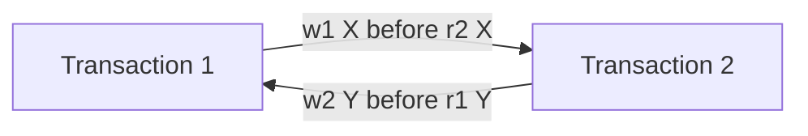

## Introduction

A modern database management system (DBMS) serves hundreds or thousands of concurrent user queries every second. Executing these transactions one at a time (serially) avoids data corruption, but it starves the CPU and disk by failing to overlap input/output operations. To maximize throughput, the database engine interleaves the operations of multiple transactions.

However, arbitrary interleaving introduces severe correctness risks. If transaction $A$ reads a account balance while transaction $B$ is mid-way through transferring funds out of it, $A$ may read an inconsistent intermediate state. The central challenge of concurrency control is to execute transactions concurrently while guaranteeing that the result is identical to executing them sequentially without any interleaving.

In this lesson, you will learn how to formalize interleaved execution as a **schedule**, test whether a schedule is **conflict serializable** using **precedence graphs**, and evaluate schedule safety in the presence of transaction failures using **recoverability** and **cascadelessness**.

**Before you start:** you should be familiar with *ACID Properties & Transaction States*, *Key Types & Integrity Constraints*, and basic set/graph terminology.

## Core theory

### Transactions, Operations, and Schedules

A **transaction** $T_i$ is a sequence of database operations that performs a logical unit of work. From the perspective of concurrency control, we abstract complex SQL queries into two fundamental data accesses:
- **Read operation**: $r_i(X)$, which reads data item $X$ into transaction $T_i$'s private workspace.
- **Write operation**: $w_i(X)$, which writes data item $X$ from $T_i$'s private workspace back to the database.

A transaction finishes by executing either a commit operation $c_i$ (making its updates permanent) or an abort operation $a_i$ (rolling back its updates).

When multiple transactions run concurrently, their individual operations are combined into an execution sequence called a **schedule** (or **history**).

A **schedule** $S$ over a set of transactions $\mathcal{T} = \{T_1, T_2, \dots, T_n\}$ is an ordering of all operations in $\mathcal{T}$ such that for every transaction $T_i \in \mathcal{T}$, the relative execution order of operations within $T_i$ is preserved.

| Type of Schedule | Definition | Properties |
| :--- | :--- | :--- |
| **Serial Schedule** | Operations of different transactions are never interleaved. | Guaranteed to be correct, but offers poor CPU/IO utilization. |
| **Concurrent Schedule** | Operations of different transactions interleave in time. | Maximizes throughput, but requires concurrency control to ensure correctness. |

### Conflicting Operations and Conflict Serializability

Two operations $o_i$ and $o_j$ within a schedule $S$ are said to be in **conflict** (or constitute a **conflicting pair**) if and only if all three of the following conditions hold:
1. They belong to different transactions ($i \neq j$).
2. They access the exact same data item $X$.
3. At least one of the operations is a write ($w_i(X)$ or $w_j(X)$).

This yields three types of operation conflicts:
- **Write-Read (W-R) conflict**: $w_i(X)$ precedes $r_j(X)$. Transaction $T_j$ reads data written by $T_i$.
- **Read-Write (R-W) conflict**: $r_i(X)$ precedes $w_j(X)$. Transaction $T_j$ overwrites data previously read by $T_i$.
- **Write-Write (W-W) conflict**: $w_i(X)$ precedes $w_j(X)$. Transaction $T_j$ overwrites data previously written by $T_i$.

Two read operations $r_i(X)$ and $r_j(X)$ **do not conflict** because reading data does not modify the database state.

Two schedules $S_1$ and $S_2$ defined over the same set of transactions are **conflict equivalent** ($S_1 \equiv_c S_2$) if $S_2$ can be derived from $S_1$ by repeatedly swapping adjacent, non-conflicting operations.

A schedule $S$ is **conflict serializable** if it is conflict equivalent to at least one serial schedule $S'$.

### Precedence Graphs and Cycle Detection

To test whether a schedule $S$ is conflict serializable, we build a directed graph called a **precedence graph** (or **serialization graph**), denoted $G(S) = (V, E)$.

1. **Vertices ($V$)**: Each committed transaction $T_i$ participating in schedule $S$ is represented by a node in $V$.
2. **Edges ($E$)**: A directed edge $T_i \to T_j$ is added to $E$ if there exists an operation in $T_i$ that conflicts with an operation in $T_j$, and $T_i$'s operation executes **before** $T_j$'s operation in $S$.



The fundamental theorem of conflict serializability states:

$$\text{Schedule } S \text{ is conflict serializable} \iff G(S) \text{ contains no directed cycles.}$$

If the precedence graph $G(S)$ is a Directed Acyclic Graph (DAG), any **topological sort** of $G(S)$ yields an equivalent serial execution order. If $G(S)$ contains at least one directed cycle, $S$ is not conflict serializable.

### View Serializability

**Conflict serializability** is a sufficient condition for schedule correctness, but it is not strictly necessary. A broader class of schedules is **view serializable**.

Two schedules $S_1$ and $S_2$ over $\mathcal{T}$ are **view equivalent** if:
1. **Initial reads**: For each data item $X$, if $T_i$ reads the initial value of $X$ in $S_1$, then $T_i$ must read the initial value of $X$ in $S_2$.
2. **Dependent reads**: For each data item $X$, if $T_j$ reads the value written by $T_i$ in $S_1$, then $T_j$ must read the value written by $T_i$ in $S_2$.
3. **Final writes**: For each data item $X$, if $T_i$ performs the final write to $X$ in $S_1$, then $T_i$ must perform the final write to $X$ in $S_2$.

A schedule $S$ is **view serializable** if it is view equivalent to some serial schedule. Every conflict serializable schedule is view serializable. However, some view serializable schedules are *not* conflict serializable; these schedules invariably involve **blind writes** (operations where a transaction writes a data item without reading it first).

Testing for conflict serializability takes polynomial time $O(|V| + |E|)$ via cycle detection algorithms, whereas testing for view serializability is NP-complete. Consequently, production database systems enforce conflict serializability rather than view serializability.

### Recoverable, Cascadeless, and Strict Schedules

Conflict serializability assumes that all transactions execute to completion. In practice, transactions may abort due to system crashes, deadlock resolution, or constraint violations. Correctness requires handling aborts cleanly.

A **dirty read** occurs when transaction $T_j$ reads a data item $X$ updated by transaction $T_i$ before $T_i$ commits. If $T_i$ subsequently aborts, $T_j$ has read state that technically never existed in the database.

To govern how aborts interact with concurrent operations, schedules are categorized into a containment hierarchy:

```text
All Schedules
 └── Recoverable Schedules
      └── Cascadeless Schedules (Avoids Cascading Aborts)
           └── Strict Schedules
```

1. **Recoverable schedule**: A schedule $S$ is recoverable if, for every pair of transactions $T_i$ and $T_j$ where $T_j$ reads a data item written by $T_i$, the commit operation $c_i$ appears before $c_j$ ($c_i < c_j$). This ensures that no transaction commits after reading uncommitted data.
2. **Cascadeless schedule** (ACA - Avoids Cascading Aborts): A schedule $S$ is cascadeless if transactions read only values written by committed transactions ($c_i < r_j(X)$). If $T_i$ aborts, no other transaction needs to be aborted, eliminating **cascading rollbacks**.
3. **Strict schedule**: A schedule $S$ is strict if no transaction reads or writes an item $X$ until the previous transaction that wrote $X$ has either committed or aborted ($c_i < r_j(X)$ and $c_i < w_j(X)$). Strict schedules simplify crash recovery because database writes can be restored using simple image overwrites.

## Worked examples

### Example 1: Testing Conflict Serializability with a Precedence Graph

Consider the schedule $S_1$ involving three transactions $T_1$, $T_2$, and $T_3$:

$$S_1 = r_1(X), w_1(X), r_2(X), w_2(Y), r_3(Y), w_3(X)$$

Determine whether $S_1$ is conflict serializable. If it is, list all equivalent serial orders.

**Step 1: Identify all conflicting pairs of operations.**
- $w_1(X)$ appears before $r_2(X)$ (R-W / W-R on $X$, $T_1 \to T_2$)
- $w_1(X)$ appears before $w_3(X)$ (W-W on $X$, $T_1 \to T_3$)
- $r_2(X)$ appears before $w_3(X)$ (R-W on $X$, $T_2 \to T_3$)
- $w_2(Y)$ appears before $r_3(Y)$ (W-R on $Y$, $T_2 \to T_3$)

**Step 2: Construct the directed precedence graph $G(S_1)$.**
- Vertices: $V = \{T_1, T_2, T_3\}$
- Edges:
  - From $T_1 \to T_2$ (due to $w_1(X) < r_2(X)$)
  - From $T_1 \to T_3$ (due to $w_1(X) < w_3(X)$)
  - From $T_2 \to T_3$ (due to $r_2(X) < w_3(X)$ and $w_2(Y) < r_3(Y)$)

**Step 3: Check for cycles and determine topological ordering.**
The graph edges are $T_1 \to T_2$, $T_2 \to T_3$, and $T_1 \to T_3$. 
There are no directed cycles in $G(S_1)$. 

Therefore, $S_1$ is **conflict serializable**.

Performing a topological sort on $G(S_1)$ yields exactly one valid linear ordering: $T_1 \to T_2 \to T_3$. The unique equivalent serial schedule is $S' = T_1; T_2; T_3$.

### Example 2: Classifying Schedules by Recoverability

Consider two schedules $S_A$ and $S_B$ involving transactions $T_1$ and $T_2$:

$$S_A = w_1(X), r_2(X), w_2(Y), c_2, c_1$$

$$S_B = w_1(X), r_2(X), w_2(Y), c_1, c_2$$

Classify $S_A$ and $S_B$ in terms of recoverability and cascadelessness.

**Analysis of Schedule $S_A$:**
- Operation $r_2(X)$ reads data written by $w_1(X)$ before $T_1$ commits.
- $T_2$ issues its commit $c_2$ *before* $T_1$ issues $c_1$.
- If $T_1$ aborts after $c_2$ executes, $T_2$ has committed dirty data. Because $T_2$ has already committed, the database engine cannot roll $T_2$ back without violating durability (the 'D' in ACID).
- **Conclusion for $S_A$**: $S_A$ is **non-recoverable**.

**Analysis of Schedule $S_B$:**
- Operation $r_2(X)$ reads data written by $w_1(X)$ before $T_1$ commits.
- $T_1$ issues its commit $c_1$ *before* $T_2$ issues $c_2$.
- If $T_1$ aborts before $c_1$, $T_2$ has not yet committed and can be aborted safely.
- **Conclusion for $S_B$**: $S_B$ is **recoverable**, but it is **not cascadeless** (ACA) because $T_2$ reads $X$ while $T_1$ is still uncommitted. If $T_1$ aborts, $T_2$ must undergo a cascading abort.

### Example 3: Simulating Cycle Detection in Python

The following Python program accepts a schedule represented as a list of operation tuples and tests for conflict serializability using Kahn's algorithm for topological sorting.

```python
from collections import defaultdict, deque

def analyze_schedule(transactions, schedule):
    nodes = set(transactions)
    adj = defaultdict(set)
    in_degree = {t: 0 for t in nodes}

    # Find conflicting pairs (op_type: 'r' or 'w')
    n = len(schedule)
    for i in range(n):
        t_i, op_i, item_i = schedule[i]
        for j in range(i + 1, n):
            t_j, op_j, item_j = schedule[j]
            if t_i != t_j and item_i == item_j:
                if op_i == 'w' or op_j == 'w':
                    if t_j not in adj[t_i]:
                        adj[t_i].add(t_j)

    # Calculate in-degrees
    for u in adj:
        for v in adj[u]:
            in_degree[v] += 1

    # Kahn's algorithm for cycle detection
    queue = deque([u for u in nodes if in_degree[u] == 0])
    topo_order = []

    while queue:
        u = queue.popleft()
        topo_order.append(u)
        for v in adj[u]:
            in_degree[v] -= 1
            if in_degree[v] == 0:
                queue.append(v)

    is_serializable = (len(topo_order) == len(nodes))
    return is_serializable, topo_order

txs = [1, 2, 3]

# S1: r1(X), w1(X), r2(X), w2(Y), r3(Y), w3(X)
sched1 = [
    (1, 'r', 'X'), (1, 'w', 'X'),
    (2, 'r', 'X'), (2, 'w', 'Y'),
    (3, 'r', 'Y'), (3, 'w', 'X')
]

# S2: r1(X), w2(X), w1(X) -> Cycle between T1 and T2
sched2 = [
    (1, 'r', 'X'),
    (2, 'w', 'X'),
    (1, 'w', 'X')
]

res1, order1 = analyze_schedule(txs, sched1)
res2, order2 = analyze_schedule([1, 2], sched2)

print(f"Schedule 1 Conflict Serializable: {res1}, Topological Order: {order1}")
print(f"Schedule 2 Conflict Serializable: {res2}")
```

Output:

```text
Schedule 1 Conflict Serializable: True, Topological Order: [1, 2, 3]
Schedule 2 Conflict Serializable: False
```

## Applications

- **Relational DBMS Engines**: Query schedulers in PostgreSQL, MySQL (InnoDB), and Oracle Database generate concurrent transaction execution plans and enforce conflict serializability via locking or timestamping.
- **Distributed Database Systems**: Distributed databases (such as Google Spanner and CockroachDB) map cross-node transaction operations into serializable global schedules using synchronized physical clocks and multi-version concurrency control (MVCC).
- **High-Frequency Financial Systems**: Core banking applications require strict serializability to prevent dirty reads and lost updates when thousands of concurrent operations alter account ledger balances.
- **In-Memory Key-Value Stores**: Memory-centric databases validate transactional schedules dynamically to allow optimistic execution, aborting non-serializable runs before commit.

## Common mistakes

- **Confusing Read-Read operations as conflicting.** Two read operations $r_i(X)$ and $r_j(X)$ never conflict. Adding edges between transactions for read-read pairs creates false cycles in precedence graphs.
- **Assuming conflict serializability guarantees safety under aborts.** Conflict serializability evaluates only the logical ordering of operations. A schedule can be conflict serializable yet non-recoverable if transaction commit orders are invalid.
- **Equating recoverable schedules with cascadeless schedules.** A recoverable schedule guarantees that committed transactions read true data, but it may still suffer from cascading rollbacks. Cascadelessness requires reading *only* committed data.
- **Reversing edge directions in precedence graphs.** An edge must point from the *earlier* operation $T_i$ to the *later* operation $T_j$ ($T_i \to T_j$). Reversing the edge flips the dependencies and misidentifies serial orders.
- **Assuming view serializability is checked at runtime.** Because testing view serializability is NP-complete, commercial engines enforce conflict serializability instead.

## Revision notes

- A **schedule** $S$ preserves the operational sequence of each individual transaction while interleaving operations from multiple transactions.
- Operations $o_i$ and $o_j$ conflict if $i \neq j$, both access item $X$, and at least one is a write ($w$).
- Two schedules are **conflict equivalent** ($S_1 \equiv_c S_2$) if one can be transformed into the other by swapping adjacent, non-conflicting operations.
- A schedule $S$ is **conflict serializable** if its precedence graph $G(S)$ is acyclic (a DAG).
- Topological sorting of $G(S)$ yields the equivalent serial execution order of transactions.
- **View serializability** allows blind writes, making it a broader category than conflict serializability, but checking it is NP-complete.
- **Recoverable schedule**: $c_i < c_j$ whenever $T_j$ reads data written by $T_i$.
- **Cascadeless schedule**: $c_i < r_j(X)$ whenever $T_j$ reads $X$ written by $T_i$. Eliminates cascading aborts.
- **Strict schedule**: $c_i < r_j(X)$ and $c_i < w_j(X)$. Prevents dirty reads and dirty writes, simplifying recovery.

## Practice questions

:::question basic
Given the schedule $S = r_1(A), w_2(A), r_1(B), w_2(B)$, identify all conflicting pairs of operations.
:::answer
The conflicting pairs are $(r_1(A), w_2(A))$ and $(r_1(B), w_2(B))$. In both pairs, the operations belong to different transactions ($T_1$ and $T_2$), access the same data item ($A$ or $B$), and $w_2$ is a write operation. $r_1(A)$ conflicts with $w_2(A)$ because one is a write, and $r_1(B)$ conflicts with $w_2(B)$ for the same reason.
:::

:::question basic
Why is every conflict serializable schedule also view serializable, but not every view serializable schedule conflict serializable?
:::answer
Conflict serializability enforces strict ordering on all conflicting operations, which automatically preserves initial reads, dependent reads, and final writes. View serializability is less restrictive because it allows non-equivalent operation swaps as long as the net view conditions (initial read, read-from, and final write) match a serial schedule. This occurs primarily in schedules containing blind writes ($w(X)$ without a prior $r(X)$).
:::

:::question intermediate
Consider the following schedule $S$ over transactions $T_1$, $T_2$, and $T_3$:
$$S = r_1(X), r_2(Z), r_1(Z), w_1(X), r_3(X), w_2(Y), w_3(Y), r_2(X)$$
Construct the precedence graph $G(S)$ and state whether $S$ is conflict serializable.
:::answer
First, identify conflicting operation pairs and construct graph edges:
1. $w_1(X)$ precedes $r_3(X) \implies T_1 \to T_3$
2. $w_1(X)$ precedes $r_2(X) \implies T_1 \to T_2$
3. $r_3(X)$ precedes $r_2(X)$ (No conflict, both reads)
4. $w_2(Y)$ precedes $w_3(Y) \implies T_2 \to T_3$

Edges in $G(S)$: $T_1 \to T_3$, $T_1 \to T_2$, and $T_2 \to T_3$.
The graph $G(S)$ is acyclic. Therefore, $S$ is conflict serializable, with the equivalent serial order $T_1 \to T_2 \to T_3$.
:::

:::question intermediate
A schedule $S$ executes operations as follows:
$$S = w_1(A), r_2(A), w_1(B), c_1, w_2(B), c_2$$
Is $S$ recoverable? Is $S$ cascadeless? Explain your reasoning.
:::answer
1. **Recoverability**: $T_2$ reads data item $A$ written by $T_1$. $T_1$ commits ($c_1$) before $T_2$ commits ($c_2$). Because $c_1 < c_2$, schedule $S$ is **recoverable**.
2. **Cascadelessness**: $T_2$ executes $r_2(A)$ *before* $T_1$ issues $c_1$. Since $T_2$ reads uncommitted data written by $T_1$, an abort of $T_1$ would force $T_2$ to abort as well. Therefore, schedule $S$ is **not cascadeless**.
:::

:::question advanced
Consider the schedule $S = w_1(X), w_2(X), w_1(Y), w_2(Y), c_1, c_2$. Is this schedule conflict serializable? If $T_1$ aborts right after $w_2(Y)$ executes, describe what an undo log recovery mechanism must do under a non-strict schedule.
:::answer
Constructing the precedence graph for $S$: $w_1(X) < w_2(X) \implies T_1 \to T_2$, and $w_1(Y) < w_2(Y) \implies T_1 \to T_2$. The graph is acyclic, so $S$ is conflict serializable (equivalent serial order $T_1 \to T_2$).

However, $S$ is **not strict** because $T_2$ writes to $X$ and $Y$ before $T_1$ has committed ($w_1(X) < w_2(X)$ before $c_1$). If $T_1$ aborts after $w_2(Y)$, simply restoring $X$ and $Y$ to their pre-$T_1$ values would overwrite $T_2$'s valid updates ($w_2(X)$ and $w_2(Y)$), creating a lost update for $T_2$. To recover correctly without reverting $T_2$, the engine must either force $T_2$ to abort as well (cascading rollback) or reconstruct $T_2$'s updates after restoring $T_1$'s before-images.
:::

:::question advanced
Prove that if a schedule $S$ is strict, it is guaranteed to be both cascadeless and recoverable.
:::answer
By definition, a strict schedule forbids any transaction $T_j$ from reading OR writing a data item $X$ until the transaction $T_i$ that previously wrote $X$ has committed or aborted ($c_i < r_j(X)$ and $c_i < w_j(X)$).

Since $c_i < r_j(X)$ is satisfied for all read operations on uncommitted data, no transaction ever reads uncommitted updates. This strictly satisfies the condition for a **cascadeless schedule** ($c_i < r_j(X)$). Furthermore, since all read operations on written items occur after the writing transaction commits ($c_i < r_j(X) < c_j$), $c_i$ naturally precedes $c_j$ ($c_i < c_j$), satisfying the condition for a **recoverable schedule**. Thus, strictness implies cascadelessness, which in turn implies recoverability.
:::

## Further learning

- **Next:** *Two-Phase Locking (2PL) & Conflicts* covers how database engines enforce conflict serializability at runtime using lock management protocols.
- **Related:** *Write-Ahead Logging & Checkpoints* explores how database systems implement crash recovery and handle transaction aborts for recoverable and strict schedules.
- **Related:** *ACID Properties & Transaction States* explains how atomicity, consistency, isolation, and durability requirements map to lower-level concurrency management.
- Silberschatz, Korth, and Sudarshan, *Database System Concepts*.
