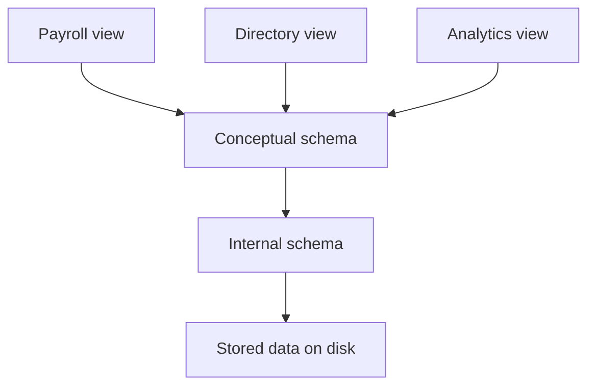

## Introduction

A large organisation's database is used by many groups with very different needs. A payroll clerk needs employees and salaries. A staff directory application needs names and departments, and must not show salaries. Analysts want summaries. Meanwhile, the database administrator wants freedom to reorganise how data is stored on disk, adding indexes or moving tables to faster drives, without breaking any of those users' programs.

The **three-schema architecture**, proposed in the 1970s by the ANSI/SPARC study group on database management systems, organises a database into three levels of description so that each group sees what it needs and each level can change without disturbing the others. This separation is called **data independence**, and it is one of the main reasons databases can evolve for decades while the applications that use them keep working. This lesson describes the three levels, the two kinds of independence, and how SQL views and indexes put them into practice.

**Before you start:** you should know why organisations use a DBMS instead of files.

## Core theory

### Schemas and instances

- A **schema** is the **description** of a database: its tables, columns, types, constraints, and relationships. It changes rarely.
- An **instance** (or state) is the **data** in the database at a particular moment. It changes with every insert, update, and delete.

The analogy is a variable's type versus its current value. A DBMS stores schemas in its **catalog** (data dictionary), and schemas are written in a **data definition language (DDL)**, such as SQL's `CREATE TABLE`. Data is queried and changed with a **data manipulation language (DML)**, such as `SELECT`, `INSERT`, `UPDATE`, and `DELETE`.

### The three levels



1. **External level (views).** Each user group gets an **external schema** describing just the part of the database it uses, possibly in a different shape: renamed columns, derived values, or combinations of tables. There can be many external schemas.
2. **Conceptual level (logical schema).** One schema describes the **whole** database for the organisation: all entities, attributes, relationships, and constraints, independent of storage. In a relational DBMS, this is the set of base tables and their constraints.
3. **Internal level (physical schema).** One schema describes **how** data is stored: file organisation, record layouts, indexes, compression, partitioning, and placement on devices.

Between the levels are **mappings**. The external/conceptual mapping says how each view is computed from the base tables; the conceptual/internal mapping says how each table is stored. A query on a view is translated through both mappings until it becomes operations on stored records.

### Data independence

**Data independence** is the ability to change the schema at one level without changing the schema at the next higher level, by adjusting only the mapping between them.

- **Physical data independence:** the internal schema can change without affecting the conceptual schema or applications. Examples: adding or dropping an index, reorganising a table's storage, compressing data, moving data to new disks. Queries return the same results; only their speed changes.
- **Logical data independence:** the conceptual schema can change without affecting external schemas or applications. Examples: adding a column, adding a table, or splitting a table into two and redefining the old shape as a view.

Physical independence is easier to achieve and is nearly complete in modern relational systems, because SQL queries never mention indexes or storage. Logical independence is harder: adding things is easy, but removing a column or changing its meaning can break views and programs that depend on it.

### Data models

The conceptual schema is written in a **data model**, a set of concepts for describing data:

| Data model | Describes data as | Examples |
| :--- | :--- | :--- |
| Relational | tables of rows and columns | PostgreSQL, MySQL, SQLite, Oracle, SQL Server |
| Entity-relationship | entities, attributes, and relationships | design diagrams, mapped to tables |
| Document | nested documents such as JSON | MongoDB, Couchbase |
| Key-value, wide-column, graph | keys with values, column families, nodes and edges | Redis, Cassandra, Neo4j |
| Hierarchical and network (historical) | trees and graphs of records with explicit links | IBM IMS, CODASYL systems |

The relational model's insistence that queries refer only to logical tables, never to storage paths, is what made physical data independence possible; earlier hierarchical and network systems exposed record links that programs navigated directly.

## Worked examples

### Example 1: A view, a new column, and an index

```python
import sqlite3

db = sqlite3.connect(":memory:")
db.executescript("""
-- conceptual schema: what data exists
CREATE TABLE employees (
    id INTEGER PRIMARY KEY,
    name TEXT NOT NULL,
    department TEXT NOT NULL,
    salary INTEGER NOT NULL
);
INSERT INTO employees (name, department, salary) VALUES
    ('Asha', 'Engineering', 95000), ('Ben', 'Sales', 60000),
    ('Chen', 'Engineering', 88000), ('Dara', 'Support', 52000);

-- external schema for the staff directory: no salaries
CREATE VIEW directory AS SELECT name, department FROM employees;
""")

def run(sql):
    return db.execute(sql).fetchall()

def uses_index(sql):
    return any("USING INDEX" in row[3] for row in db.execute("EXPLAIN QUERY PLAN " + sql))

query = "SELECT name FROM directory WHERE department = 'Engineering' ORDER BY name"
print("directory query:", run(query))

db.execute("ALTER TABLE employees ADD COLUMN email TEXT")          # conceptual schema changes
print("after adding a column:", run(query))

print("plan uses an index:", uses_index(query))
db.execute("CREATE INDEX idx_department ON employees(department)")  # internal schema changes
print("after creating an index:", run(query), "| plan uses an index:", uses_index(query))
```

Output:

```text
directory query: [('Asha',), ('Chen',)]
after adding a column: [('Asha',), ('Chen',)]
plan uses an index: False
after creating an index: [('Asha',), ('Chen',)] | plan uses an index: True
```

The directory application queries the view and never sees salaries. Adding the `email` column changes the conceptual schema, but the view's definition still selects only `name` and `department`, so the application is untouched: logical data independence. Creating an index changes the internal schema; the query text and its result are identical, but the DBMS now finds the Engineering rows through the index instead of scanning the whole table: physical data independence.

### Example 2: Restructuring a table behind a view

Suppose the designers split `employees` into `people(id, name, email)` and `jobs(id, department, salary)` to separate personal data from employment data. Programs written against the old single table can keep working if the old table's name is redefined as a view:

```sql
CREATE VIEW employees AS
SELECT p.id, p.name, j.department, j.salary, p.email
FROM people AS p JOIN jobs AS j ON j.id = p.id;
```

Queries that read `employees` return the same rows as before. Updates through such a view are harder: many DBMSs allow updates only on simple views, so programs that modify data may need `INSTEAD OF` triggers or changes. This is why logical data independence is harder to achieve than physical data independence.

### Example 3: Classifying changes

| Change | Level changed | Independence relied on |
| :--- | :--- | :--- |
| Create an index on `orders(customer_id)` | internal | physical |
| Move a table to a faster SSD | internal | physical |
| Compress old rows of a large table | internal | physical |
| Add a `phone` column to `customers` | conceptual | logical |
| Add a new `returns` table | conceptual | logical |
| Split `employees` into two tables, keeping a view with the old name | conceptual | logical |
| Remove the `salary` column that the payroll view uses | conceptual | breaks logical independence for that view |

The last row shows the limit: when a change removes information that an external schema needs, no mapping can hide it, and the dependent views and programs must change too.

## Applications

- **Security:** views give each role a restricted external schema, such as a support view that shows customers' names but not their payment details.
- **Performance tuning:** administrators add indexes, partition tables, and move data between storage tiers without touching applications.
- **Schema evolution:** long-lived systems add columns and tables for new features while old applications keep running.
- **Data warehousing and reporting:** external schemas present the same base data as summaries tailored to each team.
- **Database portability:** because SQL works at the conceptual level, applications can often move between storage engines or hardware with few changes.

## Common mistakes

- **Confusing schema with instance.** The schema is the structure; the instance is the current data.
- **Mixing up the two kinds of independence.** Physical independence protects the conceptual schema from storage changes; logical independence protects external schemas and applications from conceptual changes.
- **Thinking an index changes query results.** It changes only how fast results are found.
- **Assuming any view can be updated.** Views with joins, grouping, or aggregates are often read-only.
- **Believing logical independence is unlimited.** Removing or changing the meaning of data that a view depends on breaks it.

## Revision notes

- Schema = description (DDL, catalog); instance = current data (DML changes it).
- External level: many views per user group. Conceptual level: one logical schema of all data. Internal level: one physical storage description.
- Mappings connect external to conceptual and conceptual to internal.
- Physical data independence: change storage (indexes, files, devices) without changing the conceptual schema.
- Logical data independence: change the conceptual schema (add columns or tables, restructure behind views) without changing external schemas.
- Physical independence is easier and almost complete in SQL systems; logical independence is partial.

## Practice questions

:::question basic
What is the difference between a database schema and a database instance?
:::answer
The schema is the description of the database's structure, such as table names, columns, types, and constraints, and it changes rarely. The instance is the actual data stored at a given moment, which changes every time rows are inserted, updated, or deleted.
:::

:::question basic
Name the three levels of the three-schema architecture and what each describes.
:::answer
The external level describes the views that particular users or applications see. The conceptual level describes the whole database logically: all entities, attributes, relationships, and constraints. The internal level describes the physical storage: files, record formats, indexes, and access paths.
:::

:::question intermediate
For each change, say whether it relies on logical or physical data independence: (a) adding a B+ tree index, (b) adding a `date_of_birth` column, (c) storing a table in a new compressed format.
:::answer
(a) Physical: an index is part of the internal schema, and queries do not change. (b) Logical: the conceptual schema gains a column, and existing views and programs that do not use it are unaffected. (c) Physical: only the storage representation changes.
:::

:::question intermediate
Why is physical data independence easier to achieve than logical data independence?
:::answer
Applications never refer to storage details: SQL queries name tables and columns, not files or indexes, so storage can change freely as long as the conceptual schema stays the same. Applications do refer to conceptual elements (tables and columns), so changes there can affect them; the DBMS can hide additions and restructurings with views, but it cannot hide the removal or redefinition of data that an application actually uses.
:::

:::question intermediate
How can a view provide security as part of an external schema?
:::answer
A view can expose only some columns or rows of the underlying tables, for example names and departments but not salaries, or only the rows for one region. Users are granted access to the view but not to the base tables, so they can query what they need without being able to see the hidden data.
:::

:::question advanced
A table `orders(id, customer_name, customer_city, item)` is redesigned into `customers(id, name, city)` and `orders(id, customer_id, item)`. Describe how to preserve logical data independence for existing read-only reports, and what extra work is needed for programs that insert orders.
:::answer
Rename the new orders table (say to `order_lines`), and create a view named `orders` that joins `order_lines` with `customers` and presents the original columns `id, customer_name, customer_city, item`. Existing read-only reports query the view and see the same shape as before. Programs that insert into `orders` are harder, because inserting into a join view must decide whether to create a customer, look one up, or reject the row. That needs an `INSTEAD OF INSERT` trigger on the view implementing the rule, or the programs must be changed to insert into the new tables directly.
:::

## Further learning

- **Next:** *Relational Model & Tuple Algebra* formalises the conceptual level of relational databases.
- **Related:** *Subqueries, Views & Aggregation* covers SQL views in more depth.
- **Related:** *B+ Tree Index Structures* explains the most common internal-level structure.
