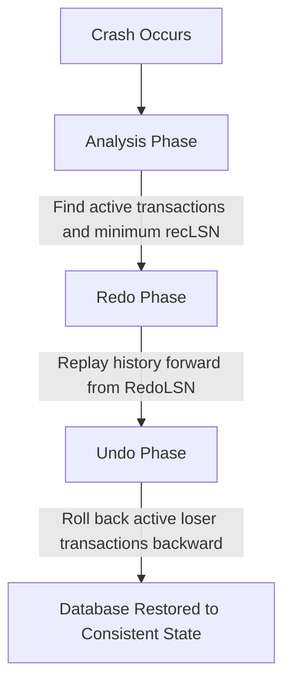

## Introduction

Imagine a database managing financial transactions. In the middle of executing a transfer that debits \$500 from Account A and credits \$500 to Account B, a power outage abruptly shuts down the server. At the exact moment of failure, the modified page for Account A has already been flushed from main memory to disk, but the update for Account B exists only in volatile memory (RAM). When the system reboots, the database is in an inconsistent state: money has vanished from the system.

To guarantee the ACID properties—specifically Atomicity (all changes occur or none do) and Durability (committed updates persist through failures)—a DBMS cannot rely on immediate, synchronous disk writes for every data operation. Main memory is volatile and fast, whereas non-volatile storage (SSD/HDD) is persistent but slower. 

This lesson covers how modern DBMSs resolve this tension using **Write-Ahead Logging (WAL)** and **checkpointing**. You will learn how buffer pool management decisions dictate recovery requirements, how log sequence numbers track state, how fuzzy checkpoints keep recovery time bounded without freezing the system, and how crash recovery algorithms achieve **idempotent log processing**.

**Before you start:** You should be familiar with *ACID Properties & Transaction States*, *Schedules & Serializability*, *Two-Phase Locking (2PL) & Conflicts*, and *B+ Tree Index Structures*.

## Core theory

### Buffer Management Policies and the Recovery Problem

A database system manages data in fixed-size blocks called pages. The **buffer pool** is an array of memory frames in volatile RAM that caches disk pages. When a transaction updates a record, it modifies the page inside the buffer pool frame. A page that has been modified in memory but not yet written to disk is called a **dirty page**.

The recovery architecture of a DBMS is dictated by two fundamental choices made by its buffer manager:

1. **STEAL vs. NO-STEAL policy:**
   - **STEAL:** The buffer pool manager is allowed to flush a dirty page containing updates from an *uncommitted* transaction to disk to free up a frame for another operation.
   - **NO-STEAL:** The buffer manager is *forbidden* from writing dirty pages to disk until the transaction commits.
2. **FORCE vs. NO-FORCE policy:**
   - **FORCE:** The buffer manager must flush *all* dirty pages modified by a transaction to non-volatile disk *before* the transaction completes its commit phase.
   - **NO-FORCE:** A transaction can commit as soon as its commit intent is recorded; modified data pages can remain dirty in RAM indefinitely.

| Policy Combination | Latency / Throughput | Recovery Mechanisms Required |
| :--- | :--- | :--- |
| **NO-STEAL / FORCE** | Very low throughput; high disk I/O bottlenecks | No UNDO required (uncommitted data never hits disk). No REDO required (all dirty pages written at commit). |
| **STEAL / FORCE** | Poor throughput; random I/O at commit time | **UNDO required** (dirty pages of uncommitted transactions may reside on disk). No REDO required. |
| **NO-STEAL / NO-FORCE** | High memory overhead; transaction size bounded by RAM | No UNDO required. **REDO required** (committed updates may reside only in RAM during crash). |
| **STEAL / NO-FORCE** | **Optimal performance**; maximum RAM flexibility | **Both UNDO and REDO required.** Standard policy for commercial high-performance DBMSs. |

Because enterprise database engines adopt a **STEAL / NO-FORCE** policy to maximize operational performance, they must maintain a transaction log on non-volatile storage capable of both rolling back uncommitted changes (UNDO) and replaying committed changes (REDO).

### The Write-Ahead Logging (WAL) Protocol Mechanics

The **Write-Ahead Logging (WAL)** protocol is the core operational invariant that enables safe execution under a STEAL / NO-FORCE buffer strategy. Instead of synchronously writing large data pages to disk, the DBMS appends small, sequential log records to an in-memory log buffer, which is periodically or event-flushed to stable storage.

Every log record is assigned a monotonically increasing 64-bit integer called a **Log Sequence Number (LSN)**. To coordinate the state between volatile RAM memory and non-volatile disk, the system tracks three specific LSN variables:

- $\text{pageLSN}$: Recorded in the header of every data page (both in RAM and on disk). Represents the LSN of the log record describing the *most recent update* applied to that specific page.
- $\text{flushedLSN}$: Recorded in memory. Represents the *largest LSN* whose log record has been successfully written to non-volatile disk.
- $\text{recLSN}$: Recorded in the Dirty Page Table for each dirty page in memory. Represents the LSN of the log record that *first dirtied* the page since it was last written to disk.

```
       Volatile Memory (RAM)                   Non-Volatile Storage (Disk)
+---------------------------------+        +---------------------------------+
| Log Buffer                      |        | Log File (Disk)                 |
| [LSN 101] [LSN 102] [LSN 103]   | ------>| [LSN 101] [LSN 102]             |
|                                 | Flush  | flushedLSN = 102                |
+---------------------------------+        +---------------------------------+
                                                            |
+---------------------------------+        +---------------------------------+
| Buffer Pool Page P1             |        | Page P1 on Disk                 |
| pageLSN = 103                   | CANNOT | pageLSN = 100                   |
| recLSN = 101                    | FLUSH  | (Must wait until flushedLSN     |
+---------------------------------+ -----> |  reaches 103!)                  |
```

The WAL protocol enforces two mandatory mathematical invariants:

$$\text{WAL Rule 1 (Undo / Steal Rule): } \text{flushedLSN} \ge \text{pageLSN}$$

Before a dirty page in the buffer pool can be written to disk (a STEAL operation), all log records describing modifications to that page up to its current $\text{pageLSN}$ must be flushed to disk. If $\text{flushedLSN} < \text{pageLSN}$, the disk write operation **must block** until the log buffer flushes log records up to $\text{pageLSN}$.

$$\text{WAL Rule 2 (Redo / No-Force Rule): } \text{flushedLSN} \ge \text{commitLSN}$$

Before a transaction's commit operation completes successfully, its commit log record (identified by $\text{commitLSN}$) and all preceding log records of that transaction must be written to non-volatile disk storage.

### Anatomy of Log Records and Log Types

Log records represent atomic units of state changes. A typical update log record contains the following fields:

$$\langle \text{LSN}, \text{TransID}, \text{PageID}, \text{Offset}, \text{PrevLSN}, \text{UndoData}, \text{RedoData} \rangle$$

- $\text{LSN}$: Unique, monotonically increasing identifier of the log entry.
- $\text{TransID}$: Identifier of the transaction making the change.
- $\text{PageID}$: Physical address of the data page being modified.
- $\text{PrevLSN}$: Pointer to the LSN of the previous log record written by this transaction (forming a reverse linked list for fast backward traversal).
- $\text{UndoData}$ / $\text{RedoData}$: The state values required to reverse (Undo) or re-apply (Redo) the update.

Log records are categorized into three primary logging paradigms:

1. **UNDO Log:** Stores only the old data state ($\text{UndoData}$). Under NO-STEAL / FORCE, UNDO logs allow rolling back aborted transactions. Once a transaction commits, its undo log entries can be discarded.
2. **REDO Log:** Stores only the new data state ($\text{RedoData}$). Under STEAL / FORCE, REDO logs allow replaying updates for committed transactions whose pages were not flushed before a crash.
3. **UNDO/REDO Log:** Stores both old and new states ($\text{UndoData}$ and $\text{RedoData}$). Necessary under STEAL / NO-FORCE policies.

During crash recovery or transaction abort, the DBMS writes a special log record called a **Compensation Log Record (CLR)**. A CLR is logged when an operation is undone. It prevents duplicate undo actions if the database crashes repeatedly during recovery. A CLR contains an explicit field called $\text{UndoNextLSN}$, which points to the next un-undone LSN of the transaction being rolled back.

### Checkpointing Strategies

If a database system processes millions of log records over weeks, scanning the log from the beginning of time during crash recovery is impossible. A **checkpoint** limits the portion of the log that must be scanned during recovery.

#### Sharp Checkpoint
A **sharp checkpoint** pauses all active transaction processing, flushes all dirty pages in the buffer pool to disk, writes a $\langle \text{CHECKPOINT} \rangle$ record to stable log storage, and resumes execution.

*Disadvantage:* Creating a sharp checkpoint causes severe latency spikes (convoy effect) because transaction execution stalls while thousands of dirty pages are written to disk.

#### Fuzzy Checkpoint
Modern engines utilize a **fuzzy checkpoint**. Instead of forcing all dirty pages to disk during the checkpoint, a fuzzy checkpoint takes a dynamic snapshot of internal buffer manager metadata without stopping active transactions.

A fuzzy checkpoint writes a pair of records: $\langle \text{CHECKPOINT\_BEGIN} \rangle$ and $\langle \text{CHECKPOINT\_END} \rangle$. The $\text{CHECKPOINT\_END}$ record stores two vital memory tables:

1. **Transaction Table (TT):** Contains one entry for every active transaction running at the checkpoint start time, tracking its $\text{TransID}$, status (`Running`, `Committing`, `Aborting`), and $\text{LastLSN}$ (the LSN of its most recent log record).
2. **Dirty Page Table (DPT):** Contains one entry for every dirty page present in the memory buffer pool, tracking its $\text{PageID}$ and $\text{recLSN}$.

The minimum $\text{recLSN}$ in the DPT recorded at fuzzy checkpoint completion defines the **checkpoint LSN**, establishing the earliest point in the log where the Redo phase must begin during recovery.

### Idempotent Log Processing & Crash Recovery

Log processing must be **idempotent**. An operation $f$ is idempotent if applying it multiple times produces the exact same state as applying it once:

$$f(f(x)) = f(x)$$

Idempotency is crucial because a recovery process can itself be interrupted by another power outage or system failure. If recovery restarts from the beginning, re-executing log records must not corrupt data state (for example, incrementing a balance twice instead of once).

The industry-standard algorithm for WAL recovery is **ARIES** (Algorithms for Recovery and Isolation Exploiting Semantics). ARIES adheres to two foundational principles:

- **Repeat History:** On restart, ARIES reconstructs the precise database state at the moment of failure by replaying *all* logged changes (both committed and uncommitted transactions) forward from the calculated checkpoint LSN.
- **Logging Changes During Undo:** Reversing changes during the Undo phase writes CLRs to disk, guaranteeing that undo operations are never repeated even if crashes recur.



The ARIES recovery process executes in three sequential phases:

1. **Analysis Phase:** Scans the log *forward* starting from the most recent $\text{CHECKPOINT\_BEGIN}$ record up to the end of the log. Reconstructs the state of the Dirty Page Table (DPT) and Transaction Table (TT) as they existed at the moment of the crash. Identifies **loser transactions** (transactions active at crash time that never committed).
2. **Redo Phase:** Determines the starting point:
   $$\text{RedoLSN} = \min(\text{recLSN} \text{ across all pages in the restored DPT})$$
   Scans the log *forward* from $\text{RedoLSN}$ to the end of the log. For every update record or CLR, it re-applies the change **unless** the physical page on disk already reflects the modification. The exact condition to skip redo for a log record with identifier $L$ on page $P$ is:
   $$\text{Page } P \text{ exists on disk AND } \text{pageLSN}_P \ge L$$
3. **Undo Phase:** Scans the log *backward* from the crash point, processing all active loser transactions simultaneously in reverse LSN order. Undoes updates made by loser transactions and writes corresponding CLRs.

---

## Worked examples

### Example 1: Evaluating WAL Invariants and Page Flushes

Consider a DBMS running a STEAL / NO-FORCE memory management policy. The system maintains the following state in volatile memory:

- Current volatile log buffer contains LSN 200 through LSN 205.
- $\text{flushedLSN} = 202$ (log records up to LSN 202 reside on non-volatile disk).

The buffer pool contains three modified dirty pages with the following parameters:

| Page ID | In-Memory $\text{pageLSN}$ | Disk $\text{pageLSN}$ | $\text{recLSN}$ |
| :--- | :--- | :--- | :--- |
| **P1** | 201 | 180 | 195 |
| **P2** | 205 | 200 | 205 |
| **P3** | 202 | 150 | 160 |

#### Tasks:
1. Determine which of the pages (P1, P2, P3) can be written to disk immediately by the buffer pool frame stealer without violating the WAL protocol.
2. If the buffer manager must flush Page P2 to free up a memory frame, state the exact log flush operation required prior to writing P2 to disk.

#### Solution:

**Step 1: Apply WAL Rule 1 ($\text{flushedLSN} \ge \text{pageLSN}$)**
- **Page P1:** In-memory $\text{pageLSN} = 201$. $\text{flushedLSN} = 202$. 
  Since $202 \ge 201$, WAL Rule 1 is satisfied. Page P1 **can** be written to disk immediately.
- **Page P2:** In-memory $\text{pageLSN} = 205$. $\text{flushedLSN} = 202$. 
  Since $202 < 205$, writing P2 to disk immediately violates WAL Rule 1. Page P2 **cannot** be written to disk yet.
- **Page P3:** In-memory $\text{pageLSN} = 202$. $\text{flushedLSN} = 202$. 
  Since $202 \ge 202$, WAL Rule 1 is satisfied. Page P3 **can** be written to disk immediately.

**Step 2: Buffer Action for Page P2**
To flush Page P2 safely, the log manager must issue an explicit log flush operation to write log records from $\text{LSN} = 203$ up to $\text{LSN} = 205$ to stable storage, advancing $\text{flushedLSN}$ from 202 to 205. Once $\text{flushedLSN} = 205$, Page P2 can be written to disk.

---

### Example 2: Tracing ARIES Recovery Phases

A database crashes due to a power failure. The disk state contains the following log entries and tables:

#### Log Contents on Disk:
```text
LSN 100: T1 update P1 (PrevLSN: null)
LSN 105: CHECKPOINT_BEGIN
LSN 110: T2 update P2 (PrevLSN: null)
LSN 115: CHECKPOINT_END  (DPT: {P1: recLSN=100}; TT: {T1: LastLSN=100, Status=Running})
LSN 120: T1 commit
LSN 125: T2 update P1 (PrevLSN: 110)
LSN 130: T3 update P3 (PrevLSN: null)
--- CRASH ---
```

#### Disk Page States at Restart:
- Page P1 on disk has $\text{pageLSN} = 100$.
- Page P2 on disk has $\text{pageLSN} = 110$.
- Page P3 on disk has $\text{pageLSN} = 0$ (unwritten).

#### Tasks:
1. Identify the log record where the **Analysis Phase** begins.
2. Determine the restored **Dirty Page Table (DPT)**, **Transaction Table (TT)**, and the identified **Loser Transactions** at the end of the Analysis Phase.
3. Calculate $\text{RedoLSN}$ and list all log records replayed during the **Redo Phase**.
4. Trace the operations executed during the **Undo Phase**.

#### Solution:

**Step 1: Analysis Phase Start Point**
The Analysis Phase scans forward starting at the most recent $\text{CHECKPOINT\_BEGIN}$ record, which is at **LSN 105**.

**Step 2: Analysis Phase Execution**
- Start with tables loaded from LSN 115 ($\text{CHECKPOINT\_END}$):
  - DPT = $\{ \text{P1: recLSN}=100 \}$
  - TT = $\{ \text{T1: LastLSN}=100, \text{Status}=\text{Running} \}$
- **Process LSN 120 (T1 commit):** Change T1 status in TT to `Committed`. Remove T1 from TT.
- **Process LSN 125 (T2 update P1):** Add/update T2 in TT ($\text{LastLSN}=125, \text{Status}=\text{Running}$). Add P1 to DPT if missing; P1 is already in DPT with $\text{recLSN}=100$, so preserve original $\text{recLSN}=100$.
- **Process LSN 130 (T3 update P3):** Add T3 to TT ($\text{LastLSN}=130, \text{Status}=\text{Running}$). Add P3 to DPT with $\text{recLSN}=130$.

**Final Restored State after Analysis Phase:**
- **Dirty Page Table (DPT):** $\{ \text{P1: recLSN}=100, \text{P2: recLSN}=110, \text{P3: recLSN}=130 \}$
- **Transaction Table (TT):** $\{ \text{T2: LastLSN}=125, \text{Status}=\text{Running}; \text{T3: LastLSN}=130, \text{Status}=\text{Running} \}$
- **Loser Transactions:** **T2** and **T3** (both active without commit records).

**Step 3: Redo Phase**
$$\text{RedoLSN} = \min(\text{recLSN} \text{ in DPT}) = \min(100, 110, 130) = 100$$
The Redo Phase scans forward from LSN 100 to LSN 130:
- **LSN 100 (T1 update P1):** Disk $\text{pageLSN}_{\text{P1}} = 100 \ge 100$. Update already on disk; **Skip Redo**.
- **LSN 110 (T2 update P2):** Disk $\text{pageLSN}_{\text{P2}} = 110 \ge 110$. Update already on disk; **Skip Redo**.
- **LSN 125 (T2 update P1):** Disk $\text{pageLSN}_{\text{P1}} = 100 < 125$. **Re-apply update LSN 125** to P1; set memory $\text{pageLSN}_{\text{P1}} = 125$.
- **LSN 130 (T3 update P3):** Disk $\text{pageLSN}_{\text{P3}} = 0 < 130$. **Re-apply update LSN 130** to P3; set memory $\text{pageLSN}_{\text{P3}} = 130$.

**Step 4: Undo Phase**
The Undo Phase processes active loser transactions $\{T2, T3\}$ in reverse order of their LSNs (starting at $\max(\text{LastLSN}) = 130$):
1. **LSN 130 (T3 update P3):** Undo LSN 130. Write **CLR** for LSN 130 (pointing $\text{UndoNextLSN} = \text{null}$). Set $\text{LastLSN}_{\text{T3}} = \text{null}$.
2. **LSN 125 (T2 update P1):** Undo LSN 125. Write **CLR** for LSN 125 (pointing $\text{UndoNextLSN} = 110$). Set $\text{LastLSN}_{\text{T2}} = 110$.
3. **LSN 110 (T2 update P2):** Undo LSN 110. Write **CLR** for LSN 110 (pointing $\text{UndoNextLSN} = \text{null}$). Set $\text{LastLSN}_{\text{T2}} = \text{null}$.

Both T2 and T3 are fully rolled back. Write $\langle \text{ABORT} \rangle$ records for T2 and T3. Database recovery complete.

---

### Example 3: Simulating Idempotent Log Processing

The following Python program simulates an idempotent recovery log player demonstrating that re-executing log records after a secondary crash produces identical data states without duplication.

```python
class RecoveryEngine:
    def __init__(self):
        # Database pages on disk storing (value, pageLSN)
        self.disk_pages = {
            "P1": {"val": 100, "pageLSN": 50},
            "P2": {"val": 200, "pageLSN": 60}
        }

    def process_redo_record(self, lsn: int, page_id: str, new_val: int):
        page = self.disk_pages[page_id]
        # Idempotency condition check
        if page["pageLSN"] < lsn:
            page["val"] = new_val
            page["pageLSN"] = lsn
            return f"LSN {lsn}: REDO applied to {page_id} (New Val = {new_val})"
        else:
            return f"LSN {lsn}: REDO skipped for {page_id} (pageLSN {page['pageLSN']} >= {lsn})"

engine = RecoveryEngine()

# Log sequence of REDO operations
redo_log = [
    (55, "P1", 150),  # LSN 55 > pageLSN 50 (Applies)
    (60, "P2", 250),  # LSN 60 <= pageLSN 60 (Skipped)
    (70, "P1", 175)   # LSN 70 > pageLSN 55 (Applies)
]

print("--- Initial Recovery Pass ---")
for record in redo_log:
    print(engine.process_redo_record(*record))

print("\n--- SECONDARY CRASH & RE-RUN RECOVERY ---")
# Re-running exact log replay over modified disk state
for record in redo_log:
    print(engine.process_redo_record(*record))

print("\nFinal Disk State:", engine.disk_pages)
```

Output:
```text
--- Initial Recovery Pass ---
LSN 55: REDO applied to P1 (New Val = 150)
LSN 60: REDO skipped for P2 (pageLSN 60 >= 60)
LSN 70: REDO applied to P1 (New Val = 175)

--- SECONDARY CRASH & RE-RUN RECOVERY ---
LSN 55: REDO skipped for P1 (pageLSN 70 >= 55)
LSN 60: REDO skipped for P2 (pageLSN 60 >= 60)
LSN 70: REDO skipped for P1 (pageLSN 70 >= 70)

Final Disk State: {'P1': {'val': 175, 'pageLSN': 70}, 'P2': {'val': 200, 'pageLSN': 60}}
```

---

## Applications

- **Relational DBMS Engines (PostgreSQL, MySQL InnoDB):** PostgreSQL utilizes WAL to guarantee durability and support physical streaming replication, sending WAL records continuously to standby nodes. InnoDB uses a write-ahead redo log (`ib_logfile`) alongside doublewrite buffers to prevent partial page writes.
- **Distributed Key-Value Stores (RocksDB, Cassandra):** Distributed stores write incoming mutations to a sequential Write-Ahead Log (CommitLog) on disk before updating in-memory MemTables, ensuring fast append operations while guaranteeing durability.
- **Transactional File Systems (NTFS, ext4):** Modern OS file systems employ journaling—a variant of WAL—to log metadata updates prior to modifying file allocation tables, preventing disk corruption upon unexpected system shutdowns.
- **High-Frequency Financial Engines:** Enterprise banking systems split transaction execution using NO-FORCE policies to maximize memory-speed throughput while streaming WAL logs to redundant hardware to preserve absolute durability.

---

## Common mistakes

- **The mistake.** Believing that a committed transaction's data pages are immediately written to disk upon commit. Why it is wrong and how to avoid it: Modern systems use a NO-FORCE policy where committed dirty pages reside in RAM indefinitely. Durability is guaranteed because the transaction's *log records* are flushed to disk, not its data pages.
- **The mistake.** Flushing a dirty page to disk before its associated log records are written. Why it is wrong and how to avoid it: Flushes under a STEAL policy without enforcing $\text{flushedLSN} \ge \text{pageLSN}$ render uncommitted changes unrecoverable if a crash occurs before the undo log entry hits disk. Always verify the WAL invariant before executing disk writes.
- **The mistake.** Assuming recovery starts replaying logs from the location of the checkpoint record itself. Why it is wrong and how to avoid it: In fuzzy checkpointing, dirty pages modified prior to the checkpoint may remain unwritten. The Redo phase must start from $\text{RedoLSN} = \min(\text{recLSN} \text{ in DPT})$, which is typically earlier than the checkpoint LSN.
- **The mistake.** Re-executing undo operations for CLRs during repeated crash recoveries. Why it is wrong and how to avoid it: CLRs represent compensating actions that have already been executed. CLRs contain an $\text{UndoNextLSN}$ pointer that skips previously undone operations during subsequent rollback passes.
- **The mistake.** Confusing $\text{pageLSN}$ with $\text{recLSN}$. Why it is wrong and how to avoid it: $\text{pageLSN}$ records the *most recent* change applied to a page, updated on every write. $\text{recLSN}$ records the LSN that *first dirtied* the page since it was last flushed to disk, used solely to compute $\text{RedoLSN}$.

---

## Revision notes

- **STEAL / NO-FORCE Policy:** STEAL permits flushing uncommitted dirty pages to disk (requires UNDO log); NO-FORCE permits committing without flushing dirty pages to disk (requires REDO log).
- **WAL Invariants:**
  1. $\text{flushedLSN} \ge \text{pageLSN}$ (Must flush log up to $\text{pageLSN}$ before writing dirty page to disk).
  2. $\text{flushedLSN} \ge \text{commitLSN}$ (Must flush log up to $\text{commitLSN}$ before completing commit).
- **LSN Attributes:**
  - $\text{pageLSN}$: Most recent update LSN on a specific page.
  - $\text{flushedLSN}$: Highest LSN safely written to non-volatile disk.
  - $\text{recLSN}$: Log record LSN that first dirtied a page in memory.
- **Fuzzy Checkpoint:** Writes active Transaction Table (TT) and Dirty Page Table (DPT) without pausing ongoing transaction execution.
- **Idempotence:** Property guaranteeing that re-executing log processing multiple times yields identical results.
- **ARIES Recovery Phases:**
  1. **Analysis Phase:** Scans log forward from checkpoint to compute DPT, TT, and loser transactions.
  2. **Redo Phase:** Scans log forward from $\text{RedoLSN} = \min(\text{recLSN})$ to end of log, replaying updates ("repeating history").
  3. **Undo Phase:** Scans log backward to roll back all active loser transactions, logging CLRs.
- **Compensation Log Record (CLR):** Logged during undo operations; contains $\text{UndoNextLSN}$ to avoid repeating undone work on crash restart.

---

## Practice questions

:::question basic
Under a NO-STEAL / FORCE buffer pool policy, explain why a DBMS does not require log entries for UNDO or REDO operations during crash recovery.
:::answer
Under NO-STEAL, dirty pages belonging to uncommitted transactions are never written to disk, so uncommitted changes never exist on disk and no UNDO log entries are needed. Under FORCE, all modified pages of a transaction are synchronously written to disk before commit completes, so committed updates are guaranteed to be on disk and no REDO log entries are needed.
:::

:::question basic
A data page in RAM has $\text{pageLSN} = 450$. The log manager reports $\text{flushedLSN} = 410$. Can the buffer manager flush this page to disk immediately to free up RAM? Explain.
:::answer
No. The buffer manager cannot flush the page immediately because doing so violates WAL Rule 1 ($\text{flushedLSN} \ge \text{pageLSN}$). Because $410 < 450$, flushing this page to disk would write uncommitted page changes whose corresponding log records do not yet exist on disk, risking database corruption if a crash occurs.
:::

:::question intermediate
Why is a fuzzy checkpoint preferred over a sharp checkpoint in high-throughput transaction processing systems? How does a fuzzy checkpoint determine where the Redo phase must start?
:::answer
A sharp checkpoint requires pausing all active transactions and synchronously flushing every dirty memory page to disk, creating severe latency spikes and throughput bottlenecks. A fuzzy checkpoint avoids stalling transactions by writing only internal metadata (the Transaction Table and Dirty Page Table) to the log while transactions continue. The fuzzy checkpoint determines the Redo phase start point by finding $\text{RedoLSN} = \min(\text{recLSN})$ across all entries in the Dirty Page Table recorded during the checkpoint.
:::

:::question intermediate
During the ARIES Redo phase, a log record with $\text{LSN} = 320$ modifies Page P5. Describe the exact condition under which the recovery manager can safely skip re-applying this log record to Page P5.
:::answer
The recovery manager can skip re-applying log record $\text{LSN} = 320$ if Page P5 exists on disk and its header $\text{pageLSN}$ is greater than or equal to 320 ($\text{pageLSN}_{\text{P5}} \ge 320$). This condition proves that the update at $\text{LSN} = 320$ (or a subsequent update) was already flushed to non-volatile disk storage before the crash.
:::

:::question advanced
Suppose a system crashes during the Undo phase of recovery while rolling back a loser transaction $T1$. Upon reboot, recovery starts again. How do Compensation Log Records (CLRs) prevent duplicate undo actions and endless recovery loops?
:::answer
When an operation is undone during the Undo phase, the recovery manager writes a CLR to the log containing an $\text{UndoNextLSN}$ field that stores the LSN of the next un-undone log record for that transaction. When recovery restarts after a second crash, the Analysis and Redo phases replay the CLRs to restore memory state. During the second Undo phase, when the recovery manager encounters a CLR, it does not undo the operation again; instead, it reads $\text{UndoNextLSN}$ and immediately jumps backward to that prior LSN, skipping already-processed updates and preventing infinite loops.
:::

:::question advanced
A database crashes. The restored Dirty Page Table contains two pages: P1 ($\text{recLSN} = 150$) and P2 ($\text{recLSN} = 220$). The most recent checkpoint start record is at $\text{LSN} = 200$. Identify the exact LSN where the Analysis phase begins and the exact LSN where the Redo phase begins.
:::answer
The Analysis phase begins at $\text{LSN} = 200$, which is the location of the most recent $\text{CHECKPOINT\_BEGIN}$ record. The Redo phase begins at $\text{RedoLSN} = \min(\text{recLSN} \text{ in DPT}) = \min(150, 220) = 150$. Notice that the Redo phase starts *earlier* than the checkpoint record because Page P1 became dirty at LSN 150 and was never flushed to disk before the crash.
:::

---

## Further learning

- **Next:** *ACID Properties & Transaction States* provides deep foundational knowledge on serializability invariants and state transitions underlying transactional recovery.
- **Related:** *B+ Tree Index Structures* explores physical leaf page structures and node splitting, showing how index pages generate log records subject to WAL rules.
- **Related:** *OS Roles & Kernel Architectures* covers kernel page caching, memory-mapped I/O, and disk synchronization system calls (`fsync`) used to implement durable log buffers.
- Textbook: Silberschatz, Korth, and Sudarshan, *Database System Concepts*.
