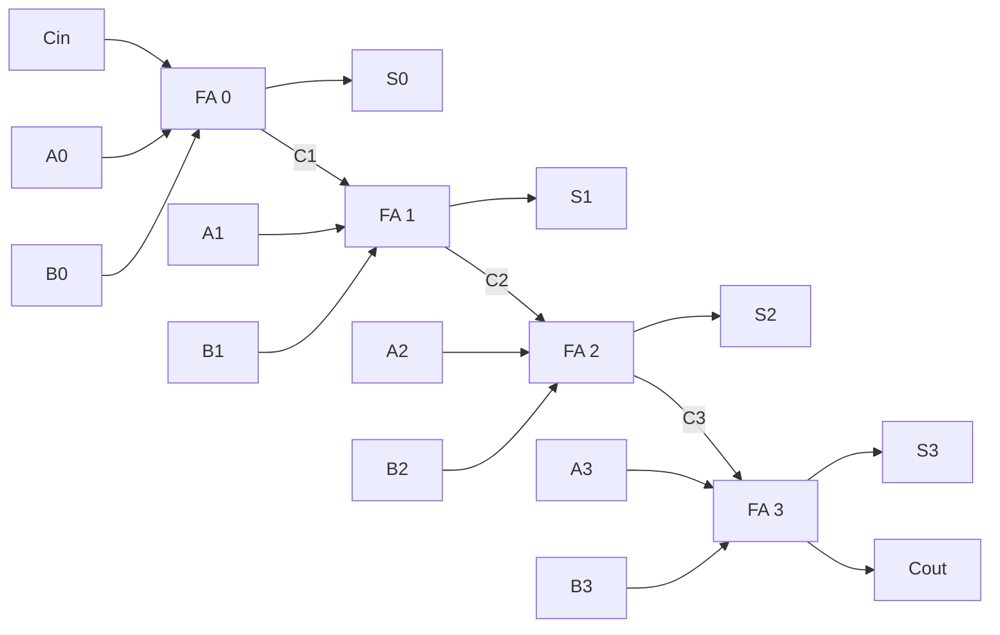

## Introduction

Every time a processor executes an instruction like `ADD R1, R2`, it relies on a specialized combinational circuit called an **Arithmetic Logic Unit (ALU)**. At the heart of the ALU lies the binary adder. While adding two single bits is trivial, scaling this to 32-bit or 64-bit integers requires an understanding of how carries propagate through a system.

In this lesson, we will move from the simplest **Half Adder** to the multi-bit **Ripple Carry Adder**. We will also explore the **Multiplexer (MUX)**, a versatile component that acts as a digital switch. Beyond simply routing data, you will learn how a MUX can be used as a "universal logic module" to implement any truth table without needing a complex network of individual AND, OR, and NOT gates. This technique is fundamental to how modern Field Programmable Gate Arrays (FPGAs) function.

**Before you start:** you need a solid grasp of **Binary Arithmetic, Overflow & Codes**, **De Morgan's Laws & Canonical Forms**, and **Karnaugh Map Minimization**.

## Core theory

### The Half Adder (HA)

The **Half Adder** is the simplest arithmetic circuit. It takes two binary inputs, $A$ and $B$, and produces two outputs: the **Sum** ($S$) and the **Carry** ($C$).

The logic follows the rules of binary addition:
- $0 + 0 = 0$ (Sum 0, Carry 0)
- $0 + 1 = 1$ (Sum 1, Carry 0)
- $1 + 0 = 1$ (Sum 1, Carry 0)
- $1 + 1 = 10_2$ (Sum 0, Carry 1)

From this, we derive the Boolean expressions:
$$S = A \oplus B$$
$$C = A \cdot B$$

The Half Adder is limited because it cannot accept a carry-in from a previous stage, making it insufficient for multi-bit addition on its own.

### The Full Adder (FA)

A **Full Adder** overcomes the limitation of the Half Adder by including a third input: the **Carry-in** ($C_{in}$). This allows adders to be chained together.

The truth table for a Full Adder is:

| $A$ | $B$ | $C_{in}$ | $S$ | $C_{out}$ |
| :--- | :--- | :--- | :--- | :--- |
| 0 | 0 | 0 | 0 | 0 |
| 0 | 0 | 1 | 1 | 0 |
| 0 | 1 | 0 | 1 | 0 |
| 0 | 1 | 1 | 0 | 1 |
| 1 | 0 | 0 | 1 | 0 |
| 1 | 0 | 1 | 0 | 1 |
| 1 | 1 | 0 | 0 | 1 |
| 1 | 1 | 1 | 1 | 1 |

Using Karnaugh Maps, we derive the optimized expressions:
$$S = A \oplus B \oplus C_{in}$$
$$C_{out} = AB + C_{in}(A \oplus B)$$

Note that $C_{out}$ can also be written as $AB + BC_{in} + AC_{in}$, but the version above is often preferred in hardware because the term $(A \oplus B)$ is already calculated for the Sum, saving gate area.

### Ripple Carry Adders (RCA)

To add two $n$-bit numbers, we chain $n$ Full Adders together. The $C_{out}$ of one stage becomes the $C_{in}$ of the next. This configuration is known as a **Ripple Carry Adder**.



The primary disadvantage of the RCA is **propagation delay**. The most significant bit (MSB) cannot calculate its final sum until the carry has "rippled" through all previous stages. If each Full Adder has a delay of $t_{FA}$, an $n$-bit adder has a total delay of approximately $n \times t_{FA}$.

### Multiplexers (MUX)

A **Multiplexer** is a combinational circuit that selects one of many input signals and forwards it to a single output line. The selection is controlled by a set of **select lines**.

A MUX with $n$ select lines can handle $2^n$ input lines. For example, a **4-to-1 MUX** has:
- 4 Data Inputs ($I_0, I_1, I_2, I_3$)
- 2 Select Lines ($S_1, S_0$)
- 1 Output ($Y$)

The logic equation for a 4:1 MUX is:
$$Y = \bar{S_1}\bar{S_0}I_0 + \bar{S_1}S_0I_1 + S_1\bar{S_0}I_2 + S_1S_0I_3$$

### Implementing Logic with Multiplexers

A MUX is essentially a hardware implementation of a truth table. Any $n$-variable function can be implemented using a $2^n$-to-1 MUX by connecting the variables to the select lines and the function's output values (0 or 1) to the corresponding data inputs.

However, we can be more efficient. Any $n$-variable function can be implemented using a **$2^{n-1}$-to-1 MUX**. We do this by:
1. Assigning $n-1$ variables to the select lines.
2. Expressing the output $F$ in terms of the remaining variable (let's call it $Z$).
3. For each combination of select lines, the data input will be either $0, 1, Z,$ or $\bar{Z}$.

This technique is powerful because it reduces the size of the MUX required for complex logic.

## Worked examples

### Example 1: Full Adder Simulation in C

To verify the logic of a Full Adder, we can write a simple program that iterates through all possible input combinations and calculates the Sum and Carry-out using bitwise operators.

```c
#include <stdio.h>

int main(void) {
    int a, b, ci;
    int s, co;

    printf("A B Ci | S Co\n");
    printf("-----------\n");

    for (int i = 0; i < 8; i++) {
        // Extract bits from the counter i
        a = (i >> 2) & 1;
        b = (i >> 1) & 1;
        ci = i & 1;

        // Full Adder Logic
        s = a ^ b ^ ci;          // XOR for Sum
        co = (a & b) | (ci & (a ^ b)); // Carry-out logic

        printf("%d %d %d  | %d %d\n", a, b, ci, s, co);
    }

    return 0;
}
```

Output:
```text
A B Ci | S Co
-----------
0 0 0  | 0 0
0 0 1  | 1 0
0 1 0  | 1 0
0 1 1  | 0 1
1 0 0  | 1 0
1 0 1  | 0 1
1 1 0  | 0 1
1 1 1  | 1 1
```

### Example 2: Implementing a 3-variable function with a 4:1 MUX

Suppose we want to implement the function $F(A, B, C) = \sum m(1, 2, 6, 7)$ using a 4:1 MUX. We will use $A$ and $B$ as our select lines ($S_1, S_0$).

**Step 1: Create the implementation table.**
We group the minterms by the values of $A$ and $B$.

| $A$ | $B$ | $C=0$ | $C=1$ | Input to MUX |
| :--- | :--- | :--- | :--- | :--- |
| 0 | 0 | $m_0 = 0$ | $m_1 = 1$ | $I_0 = C$ |
| 0 | 1 | $m_2 = 1$ | $m_3 = 0$ | $I_1 = \bar{C}$ |
| 1 | 0 | $m_4 = 0$ | $m_5 = 0$ | $I_2 = 0$ |
| 1 | 1 | $m_6 = 1$ | $m_7 = 1$ | $I_3 = 1$ |

**Step 2: Determine the inputs.**
- For $AB=00$: $F$ is 0 when $C=0$ and 1 when $C=1$. Thus, $I_0 = C$.
- For $AB=01$: $F$ is 1 when $C=0$ and 0 when $C=1$. Thus, $I_1 = \bar{C}$.
- For $AB=10$: $F$ is 0 for both values of $C$. Thus, $I_2 = 0$.
- For $AB=11$: $F$ is 1 for both values of $C$. Thus, $I_3 = 1$.

**Final Answer:** Connect $A$ to $S_1$, $B$ to $S_0$. Set $I_0=C, I_1=\bar{C}, I_2=0, I_3=1$.

### Example 3: Ripple Carry Delay Calculation

Calculate the total propagation delay for an 8-bit Ripple Carry Adder. Assume each Full Adder is constructed such that the delay from any input to $S$ is 4 ns, and the delay from any input to $C_{out}$ is 3 ns.

**Step 1: Identify the critical path.**
The carry must ripple through all stages. The first stage ($FA_0$) produces $C_1$ after 3 ns. Each subsequent stage ($FA_1$ to $FA_6$) takes 3 ns to produce its $C_{out}$ once its $C_{in}$ arrives. The final stage ($FA_7$) takes 4 ns to produce the final sum $S_7$ or 3 ns to produce the final $C_{out}$.

**Step 2: Sum the delays.**
- Delay to $C_1$: 3 ns
- Delay from $C_1$ to $C_7$: $6 \text{ stages} \times 3 \text{ ns/stage} = 18 \text{ ns}$
- Delay from $C_7$ to $S_7$: 4 ns

**Final Answer:** The total worst-case delay is $3 + 18 + 4 = 25 \text{ ns}$.

## Applications

- **Arithmetic Logic Units (ALUs):** Adders are the core component of every processor, performing not just addition but also subtraction (via 2's complement), incrementing, and decrementing.
- **Data Routing:** Multiplexers are used in communication systems to send multiple signals over a single shared medium (Time Division Multiplexing).
- **FPGA Logic Blocks:** Field Programmable Gate Arrays use Look-Up Tables (LUTs), which are essentially small multiplexers, to allow users to program any logic function into the chip.
- **Parallel-to-Serial Conversion:** By cycling through the select lines of a MUX with a counter, parallel data bits on the inputs can be converted into a serial stream on the output.
- **Memory Addressing:** Multiplexers help select specific memory banks or rows in RAM based on the address provided by the CPU.

## Common mistakes

- **Forgetting the Carry-in on the LSB.** In a Ripple Carry Adder, the first Full Adder's $C_{in}$ must be tied to logic 0 for addition. If you are using the adder for subtraction in 2's complement, this $C_{in}$ is often tied to 1.
- **Incorrect MUX Select Line Order.** Swapping $S_1$ and $S_0$ will completely change which input is mapped to which minterm. Always map the most significant variable to the most significant select line.
- **Ignoring Propagation Delay.** Assuming that all bits of an addition are ready simultaneously is a common error in high-speed design. This leads to "glitches" or incorrect results if the clock speed is too high for the carry to ripple.
- **Confusing MUX and Demux.** A MUX is "many-to-one," while a Demultiplexer (Demux) is "one-to-many." Using the wrong component will result in a circuit that cannot route data correctly.
- **Misapplying the $2^{n-1}$ MUX rule.** When using the "remaining variable" method, students often forget to check if the output is the inverse of the variable ($\bar{Z}$) or a constant (0 or 1).

## Revision notes

- **Half Adder:** $S = A \oplus B$, $C = AB$. No carry-in capability.
- **Full Adder:** $S = A \oplus B \oplus C_{in}$, $C_{out} = AB + C_{in}(A \oplus B)$.
- **Ripple Carry Adder:** Chained FAs where $C_{out, i} \to C_{in, i+1}$. Delay is $O(n)$.
- **Multiplexer (MUX):** A digital selector. $2^n$ inputs require $n$ select lines.
- **MUX as Logic:** A $2^n:1$ MUX can implement any $n$-variable function by hardwiring inputs to 0 or 1.
- **Efficient MUX Logic:** A $2^{n-1}:1$ MUX can implement an $n$-variable function by using the $n^{th}$ variable as a data input ($0, 1, Z, \bar{Z}$).
- **Carry Lookahead:** An advanced adder (covered later) that reduces delay by calculating carries in parallel rather than rippling them.

## Practice questions

:::question basic
Draw the truth table for a Half Adder and write the Boolean expressions for Sum and Carry.
:::answer
The truth table has inputs $A, B$ and outputs $S, C$. Rows: (0,0 $\to$ 0,0), (0,1 $\to$ 1,0), (1,0 $\to$ 1,0), (1,1 $\to$ 0,1). The expressions are $S = A \oplus B$ and $C = AB$. This is derived from the fact that $S$ is high only when inputs differ, and $C$ is high only when both are high.
:::

:::question basic
How many select lines are required for a 16-to-1 Multiplexer?
:::answer
4 select lines. Since $2^n = \text{number of inputs}$, we solve $2^n = 16$, which gives $n = 4$.
:::

:::question intermediate
Show how a Full Adder can be constructed using two Half Adders and one OR gate.
:::answer
The first HA adds $A$ and $B$ to produce $S_1$ and $C_1$. The second HA adds $S_1$ and $C_{in}$ to produce the final $S$ and a second carry $C_2$. The final $C_{out}$ is the result of $C_1 \text{ OR } C_2$. This works because a carry can be generated by either the first addition or the second, but never both simultaneously.
:::

:::question intermediate
Implement the function $F(X, Y) = X \text{ NAND } Y$ using a 2-to-1 MUX. Use $X$ as the select line.
:::answer
For a 2:1 MUX with select $X$, the output is $Y = \bar{X}I_0 + XI_1$. For NAND, if $X=0$, $F=1$ (regardless of $Y$). If $X=1$, $F=\bar{Y}$. Therefore, connect $I_0 = 1$ and $I_1 = \bar{Y}$.
:::

:::question advanced
A 16-bit Ripple Carry Adder uses Full Adders with a 2 ns delay for carry propagation ($C_{in}$ to $C_{out}$) and a 3 ns delay for sum generation ($C_{in}$ to $S$). If the inputs $A$ and $B$ are stable at $t=0$, at what time is the final 16-bit sum guaranteed to be correct?
:::answer
The carry must ripple through 15 stages to reach the 16th FA. The delay to $C_{15}$ is $15 \times 2 \text{ ns} = 30 \text{ ns}$. The 16th FA then takes 3 ns to produce the final sum $S_{15}$ from $C_{15}$. Thus, the total time is $30 + 3 = 33 \text{ ns}$.
:::

:::question advanced
Implement $F(A, B, C, D) = \sum m(0, 2, 5, 7, 8, 10, 13, 15)$ using an 8-to-1 MUX with $A, B, C$ as select lines.
:::answer
Group minterms by $ABC$: (0,1), (2,3), (4,5), (6,7), (8,9), (10,11), (12,13), (14,15).
- $ABC=000: m_0=1, m_1=0 \to I_0 = \bar{D}$
- $ABC=001: m_2=1, m_3=0 \to I_1 = \bar{D}$
- $ABC=010: m_4=0, m_5=1 \to I_2 = D$
- $ABC=011: m_6=0, m_7=1 \to I_3 = D$
- $ABC=100: m_8=1, m_9=0 \to I_4 = \bar{D}$
- $ABC=101: m_{10}=1, m_{11}=0 \to I_5 = \bar{D}$
- $ABC=110: m_{12}=0, m_{13}=1 \to I_6 = D$
- $ABC=111: m_{14}=0, m_{15}=1 \to I_7 = D$
The MUX effectively implements the function by selecting $D$ or $\bar{D}$ for each $ABC$ combination.
:::

## Further learning

- **Next:** *Decoders, Encoders & Comparators* explores other essential combinational building blocks that complement adders and multiplexers in complex systems.
- **Related:** *Latches vs Flip-Flops Timing* explains what happens when we add memory to these circuits, moving from combinational to sequential logic.
- **Related:** *Von Neumann Architecture & Performance Metrics* provides context on how these arithmetic circuits fit into the broader CPU architecture and how their delays impact clock speed.
- **Textbook:** M. Morris Mano and Michael D. Ciletti, *Digital Design*. This is a standard reference for the formal derivation of carry-lookahead logic and complex MUX trees.
