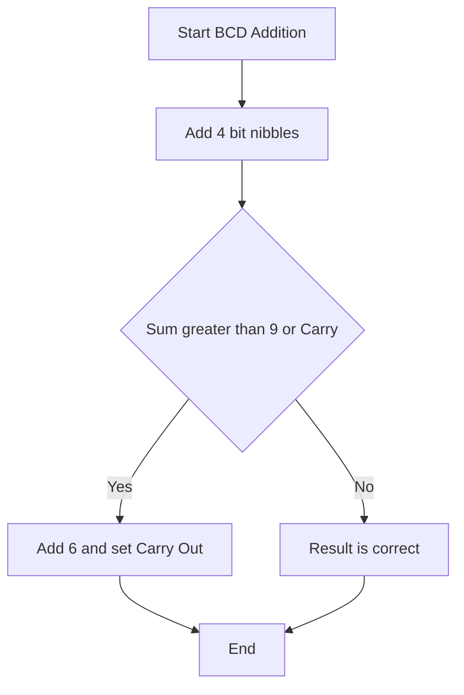

## Introduction

Imagine you are designing the software for a high-precision digital scale. When a user adds a weight that exceeds the maximum capacity of the internal register, the system must not simply "wrap around" and show a small number; it must recognize that an error has occurred. Similarly, when sending data from a sensor to a processor, a single bit flipped by electromagnetic interference could turn a "safe" reading into a "danger" signal. Handling these scenarios requires more than just knowing how to count in binary; it requires a deep understanding of how computers perform arithmetic and how they encode data to ensure reliability.

In this lesson, we will explore the mechanics of binary arithmetic within the constraints of fixed-width registers. We will learn how to distinguish between a legitimate result and an **overflow** error, and we will examine specialized codes like **Binary Coded Decimal (BCD)** for human-readable displays, **Gray code** for mechanical reliability, and **Parity** for error detection. By the end of this lesson, you will understand how digital systems maintain mathematical integrity and data accuracy.

**Before you start:** you need to be comfortable with the concepts in *Binary Conversions & 2's Complement*, specifically how to represent negative numbers using the "invert and add one" method and the difference between weighted and non-weighted number systems.

## Core theory

### Signed Arithmetic and 2's Complement Addition

In digital systems, we almost exclusively use **2's complement** for signed integer arithmetic. The primary advantage of this system is that addition and subtraction can be performed using the same hardware logic, regardless of whether the operands are positive or negative.

When adding two numbers in 2's complement, we treat the **sign bit** (the most significant bit or MSB) just like any other magnitude bit. If we have an $n$-bit register, we perform the addition and simply discard any carry-out from the MSB position.

For subtraction, we utilize the property that $A - B = A + (-B)$. To subtract $B$ from $A$, we find the 2's complement of $B$ and add it to $A$. This elegance allows a CPU to use a single "Adder" circuit for both operations, simplifying the **Arithmetic Logic Unit (ALU)** design.

### Arithmetic Overflow

A critical concept in finite-precision arithmetic is **Overflow**. This occurs when the result of an arithmetic operation is too large or too small to be represented within the available number of bits. It is vital to distinguish between a **Carry** and an **Overflow**, as they mean different things depending on the context of the data.

1.  **Unsigned Overflow:** In unsigned arithmetic, an overflow occurs if there is a **Carry-out** ($C_{out}$) from the MSB. This indicates the sum exceeded $2^n - 1$.
2.  **Signed Overflow:** In signed 2's complement arithmetic, a carry-out does *not* necessarily mean an error. Instead, an overflow occurs if the result's sign is mathematically impossible.

The rule for **Signed Overflow** ($V$) detection is:
*   If you add two positive numbers and get a negative result, overflow occurred.
*   If you add two negative numbers and get a positive result, overflow occurred.
*   If you add a positive and a negative number, overflow is **impossible**.

In logic gate terms, if $C_{in}$ is the carry into the MSB and $C_{out}$ is the carry out of the MSB, overflow is detected by:
$$V = C_{in} \oplus C_{out}$$

### Binary Coded Decimal (BCD)

While binary is efficient for computation, humans think in decimal. **Binary Coded Decimal (BCD)** is a compromise where each decimal digit ($0$ through $9$) is represented by a fixed group of four bits (a nibble).

| Decimal | BCD (8421) |
| :--- | :--- |
| 0 | 0000 |
| 5 | 0101 |
| 9 | 1001 |
| 10 | 0001 0000 |

Note that in BCD, the bit patterns $1010$ through $1111$ are **invalid**. Because 4 bits can represent 16 values but we only use 10, BCD is less "dense" than pure binary. However, it is widely used in financial applications and digital clocks where exact decimal representation is required to avoid rounding errors common in floating-point math.

**BCD Addition Rule:** When adding BCD numbers, we add them like normal binary. If the result of a nibble addition is greater than 9, or if a carry-out is generated, the result is invalid. We must add **6** ($0110_2$) to that nibble to "skip" the six invalid states and return to a valid BCD digit, passing the carry to the next nibble.



### Gray Code

**Gray code** is a non-weighted code where only one bit changes at a time between consecutive numbers. This property is known as the **unit-distance** property.

In standard binary, moving from $3$ ($011$) to $4$ ($100$) involves three bit flips. In a physical system, such as a rotating shaft encoder, these bits might not flip at the exact same nanosecond. A sensor might briefly read $111$ ($7$) or $101$ ($5$) during the transition, leading to massive errors. Gray code prevents this by ensuring only one bit is ever in transition.

**Binary to Gray Conversion:**
To convert a binary number $B = b_n b_{n-1} \dots b_0$ to Gray code $G = g_n g_{n-1} \dots g_0$:
1.  The MSB remains the same: $g_n = b_n$.
2.  Each subsequent Gray bit is the XOR of the current binary bit and the previous binary bit: $g_i = b_{i+1} \oplus b_i$.

**Gray to Binary Conversion:**
1.  The MSB remains the same: $b_n = g_n$.
2.  Each subsequent binary bit is the XOR of the previous *calculated* binary bit and the current Gray bit: $b_i = b_{i+1} \oplus g_i$.

### Error Detection: Parity

Data transmission is prone to noise. **Parity** is the simplest form of error detection, adding a single **redundant bit** to a data word to ensure the total number of 1s meets a specific rule.

*   **Even Parity:** The parity bit is set so that the total number of 1s (including the parity bit) is **even**.
*   **Odd Parity:** The parity bit is set so that the total number of 1s is **odd**.

If a 7-bit data word is $1011001$, it contains four 1s.
*   For Even Parity: Add a $0$ (Total 1s = 4, which is even).
*   For Odd Parity: Add a $1$ (Total 1s = 5, which is odd).

If a single bit flips during transmission, the parity will no longer match the rule, and the receiver knows the data is corrupt. However, parity cannot detect an even number of bit flips (e.g., if two bits flip, the parity remains the same), nor can it correct the error.

## Worked examples

### Example 1: 2's Complement Addition and Overflow

Perform the addition of $(+5) + (+4)$ and $(-6) + (-3)$ using 4-bit signed 2's complement arithmetic. Identify if overflow occurs.

**Case A: $5 + 4$**
1.  Represent $+5$ in 4-bit: $0101$.
2.  Represent $+4$ in 4-bit: $0100$.
3.  Add them:
    $$0101 + 0100 = 1001$$
4.  **Analysis:** We added two positive numbers (MSB=0) and received a negative result (MSB=1). In 4-bit signed, $1001$ represents $-7$.
5.  **Conclusion:** **Overflow occurred**. The range of 4-bit signed numbers is $-8$ to $+7$. Since $9$ is outside this range, the result is invalid.

**Case B: $(-6) + (-3)$**
1.  Represent $+6$ as $0110$. 2's complement is $1001 + 1 = 1010$ ($-6$).
2.  Represent $+3$ as $0011$. 2's complement is $1100 + 1 = 1101$ ($-3$).
3.  Add them:
    $$1010 + 1101 = (1)0111$$
4.  **Analysis:** We discard the carry-out $(1)$. We added two negative numbers (MSB=1) and received a positive result $0111$ ($+7$).
5.  **Conclusion:** **Overflow occurred**. Mathematically, $-6 + -3 = -9$, which is below the minimum representable value of $-8$.

### Example 2: BCD Addition with Correction

Calculate $8 + 5$ in BCD.

1.  Represent $8$ in BCD: $1000$.
2.  Represent $5$ in BCD: $0101$.
3.  Perform binary addition:
    $$1000 + 0101 = 1101$$
4.  **Check validity:** $1101_2$ is $13$ in decimal. Since $13 > 9$, this is an invalid BCD digit.
5.  **Apply correction:** Add $6$ ($0110$):
    $$1101 + 0110 = (1)0011$$
6.  **Final Result:** The carry-out $(1)$ becomes the tens digit, and $0011$ becomes the units digit.
    Result: $0001 \ 0011$ (BCD for 13).

### Example 3: Gray Code Conversion Logic

The following Python code demonstrates the conversion from a 3-bit binary sequence to Gray code. This illustrates the "unit-distance" property where only one bit changes at each step.

```python
def binary_to_gray(n, width):
    # The standard algorithm: G = B XOR (B >> 1)
    gray = n ^ (n >> 1)
    # Format as a binary string with leading zeros
    return bin(gray)[2:].zfill(width)

print("Dec | Bin | Gray")
print("----|-----|-----")
for i in range(8):
    binary_str = bin(i)[2:].zfill(3)
    gray_str = binary_to_gray(i, 3)
    print(f" {i}  | {binary_str} | {gray_str}")
```

Output:

```text
Dec | Bin | Gray
----|-----|-----
 0  | 000 | 000
 1  | 001 | 001
 2  | 010 | 011
 3  | 011 | 010
 4  | 100 | 110
 5  | 101 | 111
 6  | 110 | 101
 7  | 111 | 100
```

Observe the Gray column: from $010$ (Dec 3) to $110$ (Dec 4), only the first bit changes. In standard binary, all three bits changed.

## Applications

*   **ALU Design:** Modern processors use 2's complement and overflow detection logic ($V = C_{in} \oplus C_{out}$) to perform all integer math. This allows the CPU to set "Flags" (like the Overflow Flag in x86) that programmers can check to handle errors.
*   **Rotary Encoders:** Industrial robots and volume knobs on high-end audio equipment use Gray code discs. Because physical sensors are never perfectly aligned, Gray code ensures that the controller never reads a wildly incorrect position during a transition between two states.
*   **Financial and Display Systems:** Calculators and older mainframe systems often store numbers in BCD. This avoids the precision issues of binary floating-point (where $0.1 + 0.2$ might not exactly equal $0.3$) and makes it trivial to drive 7-segment decimal displays.
*   **Network Communication:** Simple protocols (like UART/Serial) use a parity bit to verify that a byte of data wasn't corrupted by a voltage spike on the wire. While more advanced codes (like CRC) are used for large files, parity remains the "first line of defense" for low-level hardware.

## Common mistakes

*   **Confusing Carry and Overflow.** This is the most frequent error. A **Carry** is a bit that "falls off" the end of the register; in unsigned math, it's an error, but in signed math, it's often normal. **Overflow** is a logic error where the sign bit is corrupted because the magnitude was too large.
*   **Forgetting the BCD Correction.** Students often add BCD numbers and leave the result as $1011$ (11). You must remember that BCD digits *cannot* exceed 9. If they do, you must add 6 to skip the "dead space" in the 4-bit encoding.
*   **Incorrectly calculating 2's complement for subtraction.** When performing $A - B$, you must negate *only* the subtrahend ($B$). A common mistake is negating both numbers or forgetting to add the "plus one" when inverting $B$.
*   **Assuming Parity Corrects Errors.** Parity is for **detection** only. It tells you that something is wrong, but it doesn't tell you which bit is wrong or how to fix it.
*   **Treating Gray Code as Weighted.** You cannot add Gray code numbers directly (e.g., $Gray(2) + Gray(1) \neq Gray(3)$). You must convert them back to binary, perform the math, and then convert the result back to Gray code.

## Revision notes

*   **2's Complement Addition:** Add all bits including the sign bit; discard the final carry-out.
*   **Signed Overflow Rule:** Overflow occurs if $(Positive + Positive = Negative)$ or $(Negative + Negative = Positive)$.
*   **Overflow Logic:** $V = C_{in} \oplus C_{out}$ (XOR of carries into and out of the MSB).
*   **BCD (Binary Coded Decimal):** Each decimal digit is 4 bits. Valid range $0000$ to $1001$.
*   **BCD Correction:** If sum $> 9$ or $C_{out} = 1$, add $0110$ ($6$) to the nibble.
*   **Gray Code:** A unit-distance code where only one bit changes per step. Used to prevent glitches in physical sensors.
*   **Parity Bit:** A single bit added to detect single-bit errors. Even parity makes the total count of 1s even; odd parity makes it odd.
*   **Range:** An $n$-bit signed number has a range of $[-2^{n-1}, 2^{n-1}-1]$. For 8 bits, this is $-128$ to $+127$.

## Practice questions

:::question basic
A system uses 8-bit signed 2's complement integers. What is the decimal range of numbers that can be represented?
:::answer
The range for $n$ bits is $-2^{n-1}$ to $2^{n-1}-1$. For $n=8$, this is $-2^7$ to $2^7-1$, which equals $-128$ to $+127$.
:::

:::question basic
Calculate the even parity bit for the 7-bit message $1101001$.
:::answer
First, count the number of 1s in the message: there are four 1s ($1, 1, 1, 1$). Since 4 is already an even number, the even parity bit must be $0$ to keep the total count even.
:::

:::question intermediate
Perform the BCD addition of $0111$ (7) and $0110$ (6). Show the correction step.
:::answer
Binary addition: $0111 + 0110 = 1101$ (13 in decimal). Since $1101 > 1001$ (9), we add the correction factor $0110$ (6).
$1101 + 0110 = (1)0011$.
The result is $0001 \ 0011$ in BCD, which represents 13.
:::

:::question intermediate
Convert the binary number $10110$ to Gray code.
:::answer
Using the $g_i = b_{i+1} \oplus b_i$ rule:
1. $g_4 = b_4 = 1$
2. $g_3 = b_4 \oplus b_3 = 1 \oplus 0 = 1$
3. $g_2 = b_3 \oplus b_2 = 0 \oplus 1 = 1$
4. $g_1 = b_2 \oplus b_1 = 1 \oplus 1 = 0$
5. $g_0 = b_1 \oplus b_0 = 1 \oplus 0 = 1$
Result: $11101$.
:::

:::question advanced
In a 4-bit signed system, you perform the operation $1011 + 1100$. Does a carry-out occur? Does an overflow occur? Explain the meaning of the result.
:::answer
$1011$ is $-5$ and $1100$ is $-4$.
Addition: $1011 + 1100 = (1)0111$.
A **carry-out** occurs (the 1 in parentheses). However, **overflow does not occur** because we added two negative numbers ($1011, 1100$) and the result ($0111$) is positive. Wait—re-checking the rule: adding two negatives must yield a negative. Since $1011(-5) + 1100(-4) = 0111(+7)$, the sign changed, so **overflow did occur**. The mathematical result $-9$ is outside the 4-bit range of $[-8, +7]$.
:::

:::question advanced
Prove that the XOR of the carries into and out of the MSB ($C_{in} \oplus C_{out}$) correctly identifies overflow for 2's complement addition.
:::answer
Consider adding two positive numbers: $C_{out}$ will always be 0. If $C_{in}$ is 1, it will flip the sign bit to 1 (negative), creating an overflow; here $1 \oplus 0 = 1$. If $C_{in}$ is 0, the sign remains 0; $0 \oplus 0 = 0$.
Consider adding two negative numbers: The sign bits are both 1, so $C_{out}$ will be 1. If $C_{in}$ is 0, the sign bit becomes $1+1+0 = 0$ (positive), creating an overflow; here $0 \oplus 1 = 1$. If $C_{in}$ is 1, the sign bit becomes $1+1+1 = 1$ (negative); $1 \oplus 1 = 0$.
In all cases where the sign is incorrectly flipped, the XOR of the carries is 1.
:::

## Further learning

*   **Next:** *Adders & Multiplexers Design* explores the actual gate-level circuits (Half-Adders and Full-Adders) that perform the arithmetic discussed here.
*   **Related:** *Integer Arithmetic & IEEE 754 Floating Point* covers how computers handle much larger integers and decimal fractions using scientific notation.
*   **Related:** *Karnaugh Map Minimization* is the primary tool used to derive the simplified logic for BCD-to-7-segment decoders and Gray code converters.
*   **Textbook:** M. Morris Mano and Michael D. Ciletti, *Digital Design*.
