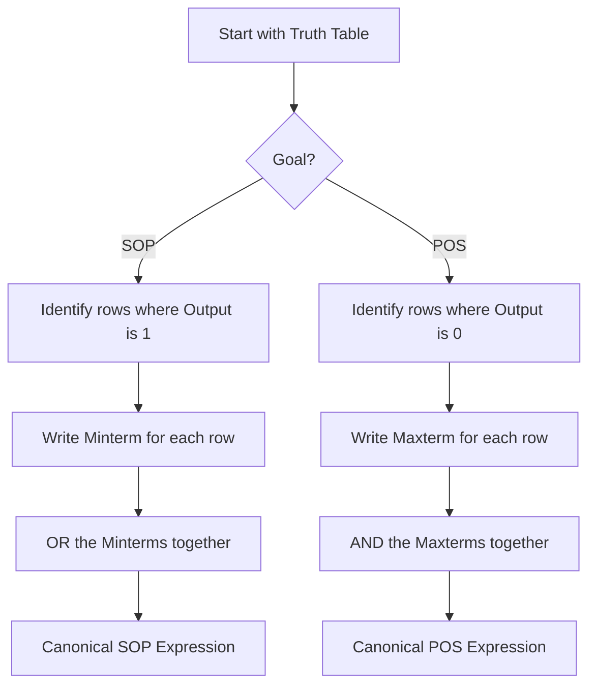

## Introduction

In digital logic design, we often face a challenge: how do we translate a complex set of requirements into the most efficient circuit possible? Imagine you are designing a safety system for an industrial robot. The robot should stop if the emergency button is pressed, OR if the light curtain is broken AND the manual override is NOT active. While this sounds like a simple set of rules, expressing it mathematically allows us to simplify the hardware, reducing costs and increasing speed.

This lesson introduces two of the most powerful tools in a digital engineer's toolkit. First, we explore **De Morgan's Laws**, which provide a mathematical "bridge" between AND and OR operations, allowing us to transform logic gates into their complements. Second, we study **Canonical Forms**. In engineering, a "canonical" form is a unique, standardized way of representing a mathematical object. By converting any logic requirement into a canonical Sum-of-Products (SOP) or Product-of-Sums (POS) form, we create a blueprint that can be directly implemented using standard logic gates or programmed into hardware like FPGAs.

**Before you start:** You should be familiar with the basic Boolean operations (AND, OR, NOT) and have a solid understanding of *Binary Conversions & 2's Complement* and *Binary Arithmetic, Overflow & Codes*.

## Core theory

### De Morgan's Laws

Augustus De Morgan, a 19th-century mathematician, formulated two laws that are fundamental to Boolean algebra. These laws describe how to distribute a negation (NOT operation) over a conjunction (AND) or a disjunction (OR).

The first law states that the complement of a product is equal to the sum of the complements:
$$\overline{A \cdot B} = \overline{A} + \overline{B}$$

The second law states that the complement of a sum is equal to the product of the complements:
$$\overline{A + B} = \overline{A} \cdot \overline{B}$$

In practical terms, students often remember this with the mnemonic: **"Break the bar, change the sign."** If you have a long bar (negation) over an expression, you can break it into smaller pieces as long as you flip the operator underneath from AND to OR (or vice versa). These laws are essential because they allow us to implement any logic function using only NAND or only NOR gates, a concept explored further in *Universal Gates & Truth Tables*.

### Boolean Literals and Terms

To understand canonical forms, we must first define our building blocks:

*   A **Literal** is a single variable (e.g., $A$) or its complement (e.g., $\overline{A}$).
*   A **Product Term** is one or more literals connected by the AND operator (e.g., $A \cdot \overline{B} \cdot C$).
*   A **Sum Term** is one or more literals connected by the OR operator (e.g., $A + \overline{B} + C$).

A Boolean function can be expressed in many ways, but a **Canonical Form** is a specific representation where every term contains every variable of the function exactly once, either in its true or complemented form.

### Minterms and the Sum-of-Products (SOP)

A **Minterm** is a product term that contains all the variables of a function. For a function with $n$ variables, there are $2^n$ possible minterms. Each minterm is true (equal to 1) for exactly one combination of input values.

By convention, we use the symbol $m_i$ to represent a minterm, where $i$ is the decimal equivalent of the binary input combination. For a 3-variable function $(A, B, C)$:
*   If the input is $A=0, B=0, C=0$, the binary is $000_2$, which is decimal 0. The minterm $m_0$ is $\overline{A} \cdot \overline{B} \cdot \overline{C}$.
*   If the input is $A=1, B=0, C=1$, the binary is $101_2$, which is decimal 5. The minterm $m_5$ is $A \cdot \overline{B} \cdot C$.

The **Sum-of-Products (SOP)** form is created by ORing together all the minterms for which the function's output is 1. This is also called the **Disjunctive Normal Form**.

### Maxterms and the Product-of-Sums (POS)

A **Maxterm** is a sum term that contains all the variables of a function. Like minterms, there are $2^n$ maxterms for $n$ variables. However, a maxterm is false (equal to 0) for exactly one combination of input values.

We use the symbol $M_i$ for maxterms. To create a maxterm for a specific row in a truth table, we complement the variables that are 1 and leave the variables that are 0 as they are. This is the opposite of the minterm rule.
*   For $A=0, B=0, C=0$ (decimal 0), the maxterm $M_0$ is $A + B + C$.
*   For $A=1, B=0, C=1$ (decimal 5), the maxterm $M_5$ is $\overline{A} + B + \overline{C}$.

The **Product-of-Sums (POS)** form is created by ANDing together all the maxterms for which the function's output is 0. This is also called the **Conjunctive Normal Form**.

### Shorthand Notation

Because writing out full Boolean expressions is tedious, engineers use shorthand notation.
*   For SOP, we use the summation symbol: $F(A, B, C) = \sum m(1, 4, 7)$. This means the function is 1 when the inputs represent decimal 1, 4, or 7.
*   For POS, we use the product symbol: $F(A, B, C) = \prod M(0, 2, 3, 5, 6)$. This means the function is 0 when the inputs represent decimal 0, 2, 3, 5, or 6.

Note that the indices in the SOP list and the POS list for the same function are mutually exclusive and collectively cover all possible indices from $0$ to $2^n - 1$.

### Summary of Minterms and Maxterms (3 Variables)

| A | B | C | Index | Minterm ($m_i$) | Maxterm ($M_i$) |
| :--- | :--- | :--- | :--- | :--- | :--- |
| 0 | 0 | 0 | 0 | $\overline{A}\overline{B}\overline{C}$ | $A+B+C$ |
| 0 | 0 | 1 | 1 | $\overline{A}\overline{B}C$ | $A+B+\overline{C}$ |
| 0 | 1 | 0 | 2 | $\overline{A}B\overline{C}$ | $A+\overline{B}+C$ |
| 0 | 1 | 1 | 3 | $\overline{A}BC$ | $A+\overline{B}+\overline{C}$ |
| 1 | 0 | 0 | 4 | $A\overline{B}\overline{C}$ | $\overline{A}+B+C$ |
| 1 | 0 | 1 | 5 | $A\overline{B}C$ | $\overline{A}+B+\overline{C}$ |
| 1 | 1 | 0 | 6 | $AB\overline{C}$ | $\overline{A}+\overline{B}+C$ |
| 1 | 1 | 1 | 7 | $ABC$ | $\overline{A}+\overline{B}+\overline{C}$ |

### Deriving Canonical Forms

The process of moving from a truth table to a canonical form follows a logical flow:



## Worked examples

### Example 1: Applying De Morgan's Laws

Simplify the following expression using De Morgan's Laws: $F = \overline{A \cdot (B + \overline{C})}$.

**Step 1: Identify the outermost operation.**
The outermost operation is the NOT over the entire expression. The main operator inside the bar is the AND between $A$ and the term $(B + \overline{C})$.

**Step 2: Apply the first law.**
$\overline{X \cdot Y} = \overline{X} + \overline{Y}$.
Here, $X = A$ and $Y = (B + \overline{C})$.
So, $F = \overline{A} + \overline{(B + \overline{C})}$.

**Step 3: Apply the second law to the remaining barred term.**
$\overline{B + \overline{C}} = \overline{B} \cdot \overline{(\overline{C})}$.

**Step 4: Use the Double Negation Law.**
$\overline{(\overline{C})} = C$.
So, the term becomes $\overline{B} \cdot C$.

**Final Answer:**
$F = \overline{A} + \overline{B} \cdot C$.

### Example 2: Truth Table to Canonical Forms

Given the following truth table for $F(A, B)$, find the canonical SOP and POS forms.

| A | B | F |
| :--- | :--- | :--- |
| 0 | 0 | 1 |
| 0 | 1 | 0 |
| 1 | 0 | 1 |
| 1 | 1 | 1 |

**Step 1: Find the SOP form.**
Identify rows where $F=1$:
*   Row 0 ($A=0, B=0$): Minterm $m_0 = \overline{A}\overline{B}$
*   Row 2 ($A=1, B=0$): Minterm $m_2 = A\overline{B}$
*   Row 3 ($A=1, B=1$): Minterm $m_3 = AB$

SOP: $F = \overline{A}\overline{B} + A\overline{B} + AB$.
Shorthand: $F = \sum m(0, 2, 3)$.

**Step 2: Find the POS form.**
Identify rows where $F=0$:
*   Row 1 ($A=0, B=1$): Maxterm $M_1 = A + \overline{B}$

POS: $F = A + \overline{B}$.
Shorthand: $F = \prod M(1)$.

**Final Answer:**
SOP: $F = \overline{A}\overline{B} + A\overline{B} + AB$
POS: $F = A + \overline{B}$

### Example 3: Verifying Logic with Python

We can use a simple Python script to generate a truth table for a Boolean expression to verify our manual derivations. Let's evaluate $F = (A \lor B) \land \neg(B \land C)$.

```python
def boolean_function(A, B, C):
    # Python uses 'or', 'and', 'not' for Boolean logic
    return (A or B) and not (B and C)

print("A B C | F")
print("---------")
for a in [0, 1]:
    for b in [0, 1]:
        for c in [0, 1]:
            # Convert boolean True/False to 1/0 for display
            result = int(boolean_function(a, b, c))
            print(f"{a} {b} {c} | {result}")
```

Output:

```text
A B C | F
---------
0 0 0 | 0
0 0 1 | 0
0 1 0 | 1
0 1 1 | 0
1 0 0 | 1
1 0 1 | 1
1 1 0 | 1
1 1 1 | 0
```

From this output, we can immediately write the shorthand SOP: $F(A, B, C) = \sum m(2, 4, 5, 6)$.

## Applications

*   **Logic Minimization:** Canonical forms are the starting point for minimization techniques like *Karnaugh Map Minimization*. By starting with a standard form, we ensure no logic states are missed before we begin simplifying the circuit.
*   **Programmable Logic:** Devices like PLAs (Programmable Logic Arrays) are physically structured as an "AND plane" followed by an "OR plane." This architecture directly implements the Sum-of-Products form.
*   **Software Optimization:** Compilers use De Morgan's laws to simplify complex conditional statements in code. For example, `if (!(x > 5 && y < 10))` can be transformed to `if (x <= 5 || y >= 10)`, which may be faster to evaluate on some architectures.
*   **Circuit Testing:** Canonical forms provide a unique signature for a logic function. Engineers use these to verify that two different circuit designs (e.g., one using NAND gates and one using NOR gates) are logically identical.

## Common mistakes

*   **The "Sign" Mistake.** When applying De Morgan's laws, students often forget to change the operator. They might write $\overline{A \cdot B} = \overline{A} \cdot \overline{B}$, which is incorrect. Remember: "Break the bar, **change the sign**."
*   **Minterm vs. Maxterm Variables.** In a minterm, a variable is complemented if its value is 0 (e.g., $A=0 \to \overline{A}$). In a maxterm, it is the opposite: a variable is complemented if its value is 1 (e.g., $A=1 \to \overline{A}$). Confusing these two is the most common source of error in canonical conversions.
*   **Partial Application.** Applying De Morgan's to only part of an expression under a bar. If the bar covers $A+B+C$, you cannot break it between $A$ and $B$ while leaving the bar over $B+C$ without changing the operator between $A$ and the rest.
*   **Shorthand Confusion.** Using the $\sum$ symbol for POS or the $\prod$ symbol for SOP. Remember that $\sum$ (Sum) corresponds to SOP and $\prod$ (Product) corresponds to POS.

## Revision notes

*   **De Morgan's Law 1:** $\overline{A \cdot B} = \overline{A} + \overline{B}$
*   **De Morgan's Law 2:** $\overline{A + B} = \overline{A} \cdot \overline{B}$
*   **Minterm ($m_i$):** A product term that is 1 for exactly one input combination. Use $X$ for 1 and $\overline{X}$ for 0.
*   **Maxterm ($M_i$):** A sum term that is 0 for exactly one input combination. Use $X$ for 0 and $\overline{X}$ for 1.
*   **SOP:** Sum of Products. Formed by ORing minterms where the function is 1.
*   **POS:** Product of Sums. Formed by ANDing maxterms where the function is 0.
*   **Complementary Relationship:** $m_i = \overline{M_i}$ and $M_i = \overline{m_i}$.
*   **Completeness:** For any function, the set of indices in $\sum m$ and $\prod M$ must include all integers from $0$ to $2^n - 1$.

## Practice questions

:::question basic
Apply De Morgan's laws to simplify the expression $\overline{\overline{X} + Y}$.
:::answer
Using the law $\overline{A + B} = \overline{A} \cdot \overline{B}$, we let $A = \overline{X}$ and $B = Y$. The expression becomes $\overline{(\overline{X})} \cdot \overline{Y}$. Applying the double negation law, we get $X \cdot \overline{Y}$.
:::

:::question basic
For a 3-variable function $F(A, B, C)$, what is the algebraic expression for the minterm $m_3$?
:::answer
The index 3 in binary is $011_2$. This corresponds to $A=0, B=1, C=1$. In a minterm, we complement variables that are 0, so $m_3 = \overline{A}BC$.
:::

:::question intermediate
A function $F(X, Y, Z)$ is given by the shorthand $\sum m(0, 2, 4, 6)$. Express this function in shorthand POS notation.
:::answer
A 3-variable function has $2^3 = 8$ possible indices (0 through 7). The POS form uses the indices not present in the SOP form. Therefore, $F(X, Y, Z) = \prod M(1, 3, 5, 7)$.
:::

:::question intermediate
Convert the truth table below into a canonical SOP expression.
| A | B | F |
|---|---|---|
| 0 | 0 | 0 |
| 0 | 1 | 1 |
| 1 | 0 | 1 |
| 1 | 1 | 0 |
:::answer
The function is 1 for rows 1 and 2. Row 1 ($A=0, B=1$) gives minterm $\overline{A}B$. Row 2 ($A=1, B=0$) gives minterm $A\overline{B}$. ORing them together gives $F = \overline{A}B + A\overline{B}$.
:::

:::question advanced
Use De Morgan's laws to show that a NOR gate (output $\overline{A+B}$) is equivalent to an AND gate with inverted inputs.
:::answer
De Morgan's second law states that $\overline{A + B} = \overline{A} \cdot \overline{B}$. The left side is the definition of a NOR gate, while the right side represents the ANDing of two complemented variables ($\overline{A}$ and $\overline{B}$). This equivalence is why a NOR gate is sometimes drawn as an " Bubbled AND" gate in circuit diagrams.
:::

:::question advanced
Find the canonical POS expression for $F(A, B, C) = \overline{A}B + C$.
:::answer
First, expand the expression to include all variables in each term. $\overline{A}B = \overline{A}B(C + \overline{C}) = \overline{A}BC + \overline{A}B\overline{C}$ (minterms $m_3, m_2$). $C = C(A + \overline{A})(B + \overline{B}) = ABC + A\overline{B}C + \overline{A}BC + \overline{A}\overline{B}C$ (minterms $m_7, m_5, m_3, m_1$). The SOP shorthand is $\sum m(1, 2, 3, 5, 7)$. The POS shorthand is the missing indices: $\prod M(0, 4, 6)$. Algebraically, this is $(A+B+C)(\overline{A}+B+C)(\overline{A}+\overline{B}+C)$.
:::

## Further learning

*   **Next:** *Universal Gates & Truth Tables* explores how De Morgan's Laws allow us to build any logic circuit using only NAND or NOR gates.
*   **Next:** *Karnaugh Map Minimization* introduces a visual method to simplify the canonical SOP and POS forms you learned here into their simplest possible versions.
*   **Related:** *Decoders, Encoders & Comparators* covers hardware components that are essentially "minterm generators" used to implement complex logic.
*   **Textbook:** Morris Mano and Michael Ciletti, *Digital Design*.
