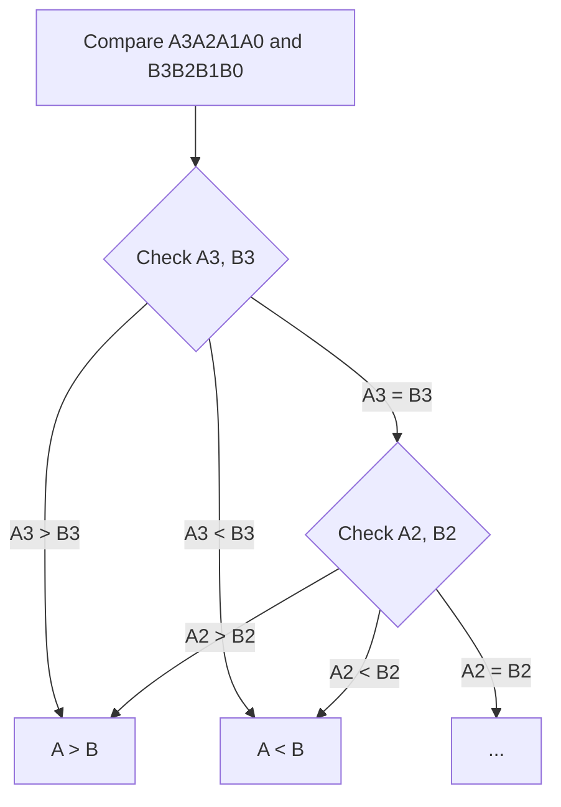

## Introduction

In previous lessons, you learned how to manipulate individual bits using logic gates and how to select between data streams using multiplexers. However, computers rarely work with isolated bits. They work with "words" of data—groups of bits that represent memory addresses, keyboard characters, or numerical values. To make sense of these groups, we need circuits that can "translate" between coded and uncoded forms.

Imagine a computer's memory. If you have 4 gigabytes of RAM, there are billions of unique locations where data can be stored. It would be physically impossible to have a separate wire running from the CPU to every single memory cell. Instead, the CPU sends a binary "address" (a code), and a specific circuit—a **decoder**—identifies exactly which memory cell that code refers to. Conversely, when you press a key on a keyboard, an **encoder** takes that physical event and converts it into a binary code the computer understands. Finally, when a processor needs to decide if one number is larger than another to execute an `if` statement, it uses a **magnitude comparator**.

This lesson covers these three fundamental building blocks of combinational logic. We will explore how they are constructed, how they can be used to implement complex logic functions without K-maps, and how they scale to handle larger data widths.

**Before you start:** You should be comfortable with binary-to-decimal conversion, truth tables, and the concept of minterms from *De Morgan's Laws & Canonical Forms* and *Karnaugh Map Minimization*.

## Core theory

### Line Decoders

A **decoder** is a combinational circuit that converts binary information from $n$ input lines to a maximum of $2^n$ unique output lines. If the $n$-bit decoded information has unused combinations, the decoder may have fewer than $2^n$ outputs.

The most common type is the **n-to-$2^n$ line decoder**. Its purpose is to detect the presence of a specific binary combination at the input. For any given input code, exactly one output will be "active" (usually logic 1), while all others remain "inactive" (logic 0). This is why decoders are often called **minterm generators**: each output corresponds to exactly one minterm of the input variables.

Consider a **2-to-4 line decoder** with inputs $A$ and $B$. The outputs $Y_0, Y_1, Y_2, Y_3$ represent the minterms $m_0, m_1, m_2, m_3$:

| $A$ | $B$ | $Y_0$ ($m_0$) | $Y_1$ ($m_1$) | $Y_2$ ($m_2$) | $Y_3$ ($m_3$) |
| :--- | :--- | :--- | :--- | :--- | :--- |
| 0 | 0 | 1 | 0 | 0 | 0 |
| 0 | 1 | 0 | 1 | 0 | 0 |
| 1 | 0 | 0 | 0 | 1 | 0 |
| 1 | 1 | 0 | 0 | 0 | 1 |

Most commercial decoders include an **Enable (E)** input. If $E=0$, all outputs are forced to 0 regardless of $A$ and $B$. If $E=1$, the decoder functions normally. This allows for "cascading"—connecting smaller decoders to build larger ones.

### Implementing Functions with Decoders

Because an $n$-to-$2^n$ decoder provides all possible minterms of $n$ variables, any Boolean function expressed as a **Sum of Minterms** can be implemented using a single decoder and an OR gate.

If a function is defined as $f(A, B, C) = \sum m(1, 2, 4, 7)$, you simply connect the outputs $Y_1, Y_2, Y_4,$ and $Y_7$ of a 3-to-8 decoder to the inputs of a 4-input OR gate. This approach is highly efficient for functions with many outputs that share the same input variables, such as a Full Adder.

### Encoders and the Priority Problem

An **encoder** performs the inverse operation of a decoder. It has $2^n$ (or fewer) input lines and $n$ output lines. The output lines generate the binary code corresponding to the input value that is active.

A basic encoder has a significant flaw: it assumes that only one input is active at a time. If two inputs (say $I_2$ and $I_3$) are high simultaneously, the output might be an incorrect combination (like $11$ in binary, which is 3). Furthermore, if all inputs are 0, the output is 00, which is indistinguishable from the case where $I_0$ is active.

To solve this, we use a **Priority Encoder**. This circuit includes logic to ensure that if multiple inputs are active, only the one with the highest priority (usually the highest index) is encoded. It also provides a **Valid (V)** output bit to indicate if any input is active at all.

For a 4-to-2 Priority Encoder, the truth table uses "don't care" conditions ($X$):

| $I_3$ | $I_2$ | $I_1$ | $I_0$ | $Y_1$ | $Y_0$ | $V$ |
| :--- | :--- | :--- | :--- | :--- | :--- | :--- |
| 0 | 0 | 0 | 0 | X | X | 0 |
| 0 | 0 | 0 | 1 | 0 | 0 | 1 |
| 0 | 0 | 1 | X | 0 | 1 | 1 |
| 0 | 1 | X | X | 1 | 0 | 1 |
| 1 | X | X | X | 1 | 1 | 1 |

In this table, if $I_3$ is 1, the outputs are $11$ regardless of the state of $I_2, I_1,$ or $I_0$.

### Magnitude Comparators

A **magnitude comparator** is a combinational circuit that compares two numbers, $A$ and $B$, and determines their relative magnitudes. The circuit typically has three outputs: $A > B$, $A < B$, and $A = B$.

For 1-bit numbers $A$ and $B$:
- $A = B$ is true if both are 0 or both are 1. This is the **XNOR** operation: $x = A \odot B$.
- $A > B$ is true only if $A=1$ and $B=0$: $y = A\overline{B}$.
- $A < B$ is true only if $A=0$ and $B=1$: $z = \overline{A}B$.

For $n$-bit numbers, the equality $A=B$ requires every corresponding pair of bits to be equal:
$$(A=B) = (A_{n-1} \odot B_{n-1}) \cdot (A_{n-2} \odot B_{n-2}) \dots (A_0 \odot B_0)$$

To determine if $A > B$, we examine the bits from **Most Significant (MSB)** to **Least Significant (LSB)**. $A$ is greater than $B$ if:
1. The MSB of $A$ is 1 and the MSB of $B$ is 0.
2. The MSBs are equal, but the next bit of $A$ is 1 and the next bit of $B$ is 0.
3. ...and so on.

## Worked examples

### Example 1: Implementing a Full Adder using a Decoder

A Full Adder takes three inputs ($A, B, C_{in}$) and produces two outputs: Sum ($S$) and Carry-out ($C_{out}$). We can implement this using a 3-to-8 line decoder.

**Step 1: Identify the minterms.**
From the Full Adder truth table:
- $S(A, B, C_{in}) = \sum m(1, 2, 4, 7)$
- $C_{out}(A, B, C_{in}) = \sum m(3, 5, 6, 7)$

**Step 2: Select the components.**
We need one 3-to-8 decoder (inputs $A, B, C_{in}$) and two OR gates.

**Step 3: Connect the outputs.**
- To get $S$, connect decoder outputs $Y_1, Y_2, Y_4,$ and $Y_7$ to a 4-input OR gate.
- To get $C_{out}$, connect decoder outputs $Y_3, Y_5, Y_6,$ and $Y_7$ to a 4-input OR gate.

**Final Answer:** The Full Adder is implemented by treating the decoder as a minterm generator and ORing the specific minterms where the Sum and Carry functions are high.

### Example 2: Logic for a 4-to-2 Priority Encoder

Let's derive the Boolean expressions for the outputs $Y_1$ and $Y_0$ of the priority encoder described in the Core Theory.

**Step 1: Analyze $Y_1$.**
$Y_1$ is 1 in the last two rows of the truth table.
- Row 4: $I_3=0, I_2=1$ (regardless of $I_1, I_0$)
- Row 5: $I_3=1$ (regardless of $I_2, I_1, I_0$)
$$Y_1 = I_3 + \overline{I_3}I_2 = I_3 + I_2$$
(Using the simplification rule $X + \overline{X}Y = X + Y$).

**Step 2: Analyze $Y_0$.**
$Y_0$ is 1 in Row 3 and Row 5.
- Row 3: $I_3=0, I_2=0, I_1=1$
- Row 5: $I_3=1$
$$Y_0 = I_3 + \overline{I_3}\overline{I_2}I_1 = I_3 + \overline{I_2}I_1$$

**Step 3: Analyze Valid bit $V$.**
$V$ is 1 if any input is 1.
$$V = I_3 + I_2 + I_1 + I_0$$

**Final Answer:** The logic gates required are $Y_1 = I_3 \lor I_2$ and $Y_0 = I_3 \lor (\neg I_2 \land I_1)$.

### Example 3: Cascading 2-to-4 Decoders

Suppose we need a 3-to-8 decoder but only have 2-to-4 decoders with an Enable ($E$) pin.

**Step 1: Assign inputs.**
Let the 3-bit input be $A_2, A_1, A_0$. $A_2$ is the MSB.

**Step 2: Use the MSB as a selector.**
- When $A_2 = 0$, we want to activate the first decoder (handling minterms $m_0$ to $m_3$).
- When $A_2 = 1$, we want to activate the second decoder (handling minterms $m_4$ to $m_7$).

**Step 3: Connect the Enable pins.**
- Connect $A_2$ through a NOT gate to the $E$ pin of Decoder 0.
- Connect $A_2$ directly to the $E$ pin of Decoder 1.
- Connect $A_1$ and $A_0$ to the select inputs of both decoders in parallel.

**Final Answer:** By using the MSB to enable one of two smaller decoders, we effectively double the decoding range.

## Applications

- **Memory Address Decoding:** In a computer system, the CPU places an address on the address bus. A decoder circuit takes this binary address and activates the "Chip Select" (CS) pin of the specific memory chip or I/O device assigned to that address range.
- **Interrupt Controllers:** Priority encoders are used in CPUs to handle hardware interrupts. If multiple devices (like a keyboard, mouse, and disk drive) request attention at once, the priority encoder ensures the CPU services the most critical device first.
- **Seven-Segment Displays:** A BCD-to-Seven-Segment decoder (like the 7447 IC) takes a 4-bit binary coded decimal and activates the specific LEDs (a through g) required to display that digit.
- **Data Routing:** Decoders are used in demultiplexers to route a single data input to one of many possible destinations based on a select code.
- **ALU Comparison Logic:** Magnitude comparators are the core of the Arithmetic Logic Unit (ALU) instructions like `CMP` (compare) or `JZ` (jump if zero), which control the flow of software.

## Common mistakes

- **Forgetting the Enable Pin.** Many students design decoder logic but forget that without an active Enable signal, the outputs are undefined or all zero. Always check if your chip is active-high or active-low enable.
- **Ignoring the Priority in Encoders.** Using a simple encoder when multiple inputs might be high leads to "garbage" outputs. If your application involves human input (like a keypad), always use a Priority Encoder.
- **Incorrect Cascading Order.** When cascading comparators, you must start the comparison from the MSB. If you start from the LSB, the final result will only reflect the least significant bits, ignoring the more important higher-order bits.
- **Confusing Decoders with Multiplexers.** A decoder expands $n$ lines to $2^n$ lines (one-hot). A multiplexer selects one of $2^n$ data lines to pass to a single output. They are related but perform opposite data-flow tasks.
- **Active-Low Output Confusion.** Many physical decoder ICs (like the 74LS138) have active-low outputs, meaning the "selected" line goes to 0V while others stay at 5V. Failing to account for this with bubbles/inverters in your logic diagram will result in inverted logic.

## Revision notes

- **n-to-2^n Decoder:** $n$ inputs, $2^n$ outputs. Only one output is high at a time.
- **Minterm Generation:** A decoder with $n$ inputs generates all $2^n$ minterms.
- **Function Implementation:** $f = \sum m(\dots)$ can be built with a decoder + OR gate.
- **Priority Encoder:** Converts $2^n$ inputs to $n$ outputs; resolves multiple active inputs by index priority; includes a Valid ($V$) bit.
- **Magnitude Comparator:** Outputs $A > B, A < B, A = B$.
- **Equality Logic:** $A=B$ if $(A_i \oplus B_i)'$ is true for all $i$.
- **Cascading Decoders:** Use the MSB of the larger input to drive the Enable pins of smaller decoders.
- **Cascading Comparators:** Connect the "Equal" output of the higher-order stage to the enable or input of the lower-order stage, or use a tree structure where MSBs have veto power over LSBs.

## Practice questions

:::question basic
A 3-to-8 line decoder has the input $(A_2, A_1, A_0) = (1, 0, 1)$. Which output line is active?
:::answer
The input $101_2$ corresponds to the decimal value 5. Therefore, the output line $Y_5$ will be active (logic 1), while all other lines ($Y_0-Y_4, Y_6, Y_7$) will be inactive (logic 0).
:::

:::question basic
What is the purpose of the "Valid" (V) output in a priority encoder?
:::answer
The Valid output distinguishes between the state where the input $I_0$ is active (which results in an output code of $00\dots0$) and the state where no inputs are active at all (which would also result in $00\dots0$ in a simple encoder). $V=1$ means at least one input is being encoded; $V=0$ means the output should be ignored.
:::

:::question intermediate
You need to implement the function $F(X, Y, Z) = \prod M(0, 3, 4, 7)$ using a 3-to-8 decoder. Which outputs should you connect to an OR gate?
:::answer
First, convert the Product of Maxterms to a Sum of Minterms. Since there are 8 possible terms (0-7), the minterms are the indices not present in the Maxterm list: $\sum m(1, 2, 5, 6)$. Therefore, you should connect outputs $Y_1, Y_2, Y_5,$ and $Y_6$ to the OR gate.
:::

:::question intermediate
A 4-bit magnitude comparator is comparing $A = 1011$ and $B = 1001$. Describe the step-by-step logic the circuit follows to determine $A > B$.
:::answer
1. Compare MSB ($A_3, B_3$): Both are 1, so they are equal. Move to next bit.
2. Compare $A_2, B_2$: Both are 0, so they are equal. Move to next bit.
3. Compare $A_1, B_1$: $A_1 = 1$ and $B_1 = 0$. Since $A_1 > B_1$, the $A > B$ output is set to 1 immediately.
4. The LSB ($A_0, B_0$) is ignored because a higher-order bit has already determined the inequality.
:::

:::question advanced
Design a 4-to-16 line decoder using only 2-to-4 line decoders that have an Enable ($E$) input. How many 2-to-4 decoders are needed, and how are they arranged?
:::answer
You need 5 decoders in total. Arrange 4 decoders to provide the 16 outputs (these are the "output stage"). Use a 5th decoder (the "steering stage") to manage the Enable pins. The two most significant bits ($A_3, A_2$) go to the steering decoder. Its four outputs ($Y_0 \dots Y_3$) connect to the Enable pins of the four output-stage decoders. The two least significant bits ($A_1, A_0$) connect to the select inputs of all four output-stage decoders in parallel.
:::

:::question advanced
A priority encoder has 8 inputs ($I_7$ highest priority). If $I_2, I_5,$ and $I_6$ are all high (1) and all other inputs are low (0), what is the 3-bit binary output $Y_2 Y_1 Y_0$ and the status of the $V$ bit?
:::answer
Because it is a priority encoder, it only encodes the highest-index active input. Here, $I_6$ is the highest active input. The binary output for 6 is $110$, so $Y_2=1, Y_1=1, Y_0=0$. Since at least one input is active, the Valid bit $V=1$.
:::

## Further learning

- **Next:** *Latches vs Flip-Flops Timing* explores what happens when we add feedback to these circuits to create memory.
- **Related:** *Adders & Multiplexers Design* provides the foundation for the Sum-of-Minterms approach used with decoders.
- **Related:** *Karnaugh Map Minimization* is the alternative to using decoders for function implementation; it helps you decide if a custom gate circuit or a standard decoder is more area-efficient.
- **Textbook:** M. Morris Mano and Michael D. Ciletti, *Digital Design*. This is the definitive text for understanding the gate-level implementation of these MSI (Medium Scale Integration) components.
