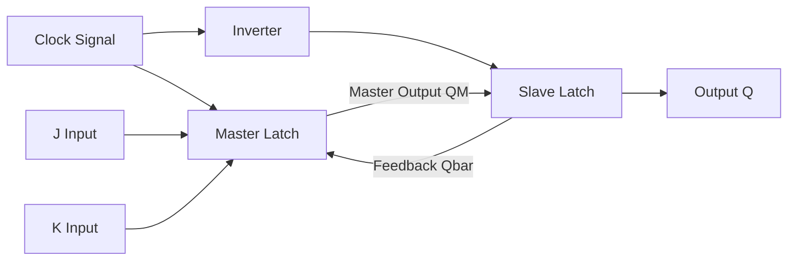

## Introduction

Imagine designing an odometer for an autonomous rover or a frequency divider that cuts a high-speed clock down to a manageable sampling frequency. In both cases, you need a circuit that reverses its state on demand: if the current state is 0, the next state must become 1; if the current state is 1, the next state must become 0. 

In basic Set-Reset (SR) latches, asserting both control inputs simultaneously ($S = 1, R = 1$) drives both outputs to zero and risks an unpredictable, metastable state once the inputs are de-asserted. An SR circuit cannot reliably toggle. To build robust counters, registers, and sequential state machines, digital systems require bistable elements that handle every input combination gracefully.

This lesson explores the two workhorses of synchronous digital logic: the **JK flip-flop** and the **D flip-flop**. You will examine how internal cross-coupling eliminates invalid states to produce deterministic toggling, why naive feedback leads to the catastrophic **race-around condition**, how master-slave topologies solve this problem, and how the **D flip-flop** provides clean, edge-synchronized data storage.

**Before you start:** you need familiarity with basic logic gates, Boolean algebra, SR latches, and the distinction between propagation delay and enable signals from *Latches vs Flip-Flops Timing*.

## Core theory

### From SR Latches to the JK Architecture

A basic gated SR latch uses two cross-coupled NOR or NAND gates combined with two input-steering gates enabled by a clock signal $\text{CLK}$. When $S = R = 0$, the latch holds its prior state:

$$Q_{\text{next}} = Q$$

When $S = 1$ and $R = 0$, the latch sets ($Q_{\text{next}} = 1$); when $S = 0$ and $R = 1$, it resets ($Q_{\text{next}} = 0$). However, when $S = 1$ and $R = 1$ during an active clock, both outputs $\overline{Q}$ and $Q$ are forced to the same logic level (0 for NOR implementations, 1 for NAND implementations). If the clock signal falls while both inputs remain active, the gate delays determine which output falls or rises first, resulting in indeterminate behavior or metastability.

The **JK flip-flop** eliminates this illegal state by feeding the latch outputs back into the input steering logic. The input labeled $J$ acts as a Set command, while $K$ acts as a Reset command. The steering logic feeds the complementary output $\overline{Q}$ back into the $J$ AND gate, and the true output $Q$ into the $K$ AND gate:

$$S = J \cdot \overline{Q}$$

$$R = K \cdot Q$$

Because the circuit gates $J$ with $\overline{Q}$, a Set pulse can only activate when the current state is 0 ($Q = 0 \implies \overline{Q} = 1$). Likewise, a Reset pulse can only activate when the current state is 1 ($Q = 1$). 

When $J = 1$ and $K = 1$:
- If $Q = 0$ (so $\overline{Q} = 1$), then $S = 1 \cdot 1 = 1$ and $R = 1 \cdot 0 = 0$, which sets the latch to $Q_{\text{next}} = 1$.
- If $Q = 1$ (so $\overline{Q} = 0$), then $S = 1 \cdot 0 = 0$ and $R = 1 \cdot 1 = 1$, which resets the latch to $Q_{\text{next}} = 0$.

Under $J = K = 1$, the output inverts on each cycle. This operational behavior is known as **toggle mode**.

| $J$ | $K$ | $Q_{\text{next}}$ | Action |
| :-: | :-: | :-: | :--- |
| 0 | 0 | $Q$ | No change (Hold) |
| 0 | 1 | 0 | Reset |
| 1 | 0 | 1 | Set |
| 1 | 1 | $\overline{Q}$ | Toggle |

### The Race-Around Condition

While the feedback logic solves the indeterminate input problem, it introduces a severe timing vulnerability in level-triggered circuits. 

Consider a level-sensitive JK latch where the clock signal remains at logic high for a pulse duration $t_w$. The internal components (NAND/NOR gates) require a finite time to switch, termed the latch **propagation delay** ($t_{pd}$). 

If $J = 1$, $K = 1$, and $\text{CLK} = 1$:
1. At $t = 0$, the circuit reads $Q = 0$ and begins toggling.
2. After time $t_{pd}$, the output transitions: $Q \to 1$.
3. Because $\text{CLK}$ is still high, the updated output $Q = 1$ immediately feeds back to the input gates.
4. After another interval $t_{pd}$, the circuit toggles again: $Q \to 0$.

If the clock pulse width is longer than the propagation delay ($t_w > t_{pd}$), the outputs oscillate uncontrollably between 0 and 1 throughout the active clock duration. When the clock falls back to 0, the final output state depends entirely on the exact nanosecond the clock transitioned low. This erratic oscillation is called the **race-around condition**.

For a level-triggered JK latch to avoid racing, the clock pulse width would have to satisfy:

$$t_{pd} > t_w$$

In practical integrated circuits, gate delays are fractions of a nanosecond to a few nanoseconds. Generating reliable clock pulses narrower than a single gate delay is technically impractical and vulnerable to noise. Therefore, circuit designers abandon simple level triggering in favor of structural isolation methods: **master-slave flip-flops** and **edge-triggered flip-flops**.

### The Master-Slave JK Flip-Flop

The **master-slave flip-flop** breaks the continuous feedback loop by cascading two separate latch stages controlled by complementary clock phases:

1. **Master latch:** A gated latch enabled directly by $\text{CLK}$.
2. **Slave latch:** An identical gated latch enabled by the inverted clock, $\overline{\text{CLK}}$.



The feedback wires run from the external slave outputs ($Q$ and $\overline{Q}$) back to the input gates of the master latch. The circuit operates in two non-overlapping phases:

- **When $\text{CLK} = 1$:** The master latch is active. It samples $J$, $K$, and the feedback lines from the slave latch. The master output $Q_M$ assumes its new state based on those inputs. Meanwhile, the inverter provides $\overline{\text{CLK}} = 0$ to the slave latch. The slave is completely disabled (in hold mode), so its outputs $Q$ and $\overline{Q}$ remain static. Because the external outputs do not change while $\text{CLK} = 1$, the feedback signals remain constant. No race-around can occur.
- **When $\text{CLK}$ transitions from $1 \to 0$:** The master is disabled ($\text{CLK} = 0$), freezing the state stored in $Q_M$. At the same instant, $\overline{\text{CLK}}$ transitions to 1, enabling the slave latch. The slave reads $Q_M$ and transfers that value to the external output $Q$.

Because the master isolates the input while the slave is updating, and the slave isolates the output while the master is sampling, state transfer happens strictly on the clock falling edge. 

*Note on pulse-triggered vs. edge-triggered operations:* Pure master-slave latches can suffer from **ones catching** (or zeros catching). If $J=1$ while $\text{CLK}=1$, a transient glitch on an input can flip the master to 1, where it remains trapped until the slave reads it, even if $J$ returns to 0 before the clock falls. Modern digital circuits therefore rely almost exclusively on true **edge-triggered flip-flops**, which use internal gate steering or dynamic latches to sample inputs during an extremely narrow temporal window (measured in picoseconds) during the clock edge itself.

### Characteristic Equations and Excitation Analysis

A sequential circuit analysis requires mathematical descriptions of state transitions. Two formal tools describe this behavior: the **characteristic table** (predicting next state from present state and inputs) and the **excitation table** (determining required inputs to cause a desired state transition).

#### JK Flip-Flop Characteristic Equation

Let $Q(t)$ or $Q$ denote the present state, and $Q(t+1)$ or $Q_{\text{next}}$ denote the next state following the active clock edge.

We construct the transition table across all combinations of $Q$, $J$, and $K$:

| Present State $Q$ | Input $J$ | Input $K$ | Next State $Q_{\text{next}}$ |
| :-: | :-: | :-: | :-: |
| 0 | 0 | 0 | 0 |
| 0 | 0 | 1 | 0 |
| 0 | 1 | 0 | 1 |
| 0 | 1 | 1 | 1 |
| 1 | 0 | 0 | 1 |
| 1 | 0 | 1 | 0 |
| 1 | 1 | 0 | 1 |
| 1 | 1 | 1 | 0 |

Mapping $Q_{\text{next}}$ onto a 3-variable Karnaugh map with $Q$ as the row variable and $JK$ as the column variables:

| $Q \backslash JK$ | 00 | 01 | 11 | 10 |
| :---: | :---: | :---: | :---: | :---: |
| **0** | 0 | 0 | 1 | 1 |
| **1** | 1 | 0 | 0 | 1 |

We group the adjacent 1s:
- Group 1: Row $Q=0$, columns $JK = 11$ and $10$. Here, $Q=0$ (which is $\overline{Q}$) and $J=1$. This yields the term $J\overline{Q}$.
- Group 2: Columns $JK = 00$ and $10$ across row $Q=1$. Here, $Q=1$ and $K=0$ (which is $\overline{K}$). This yields the term $\overline{K}Q$.

Combining these two implicants gives the **JK characteristic equation**:

$$Q_{\text{next}} = J\overline{Q} + \overline{K}Q$$

#### JK Excitation Table

When synthesizing finite state machines or counters, the design problem is inverted: you know the current state $Q$ and the required next state $Q_{\text{next}}$, and you must determine what values to place on $J$ and $K$.

1. **Transition $0 \to 0$:**
   - Setting $J=0, K=0$ keeps $Q=0$ (Hold).
   - Setting $J=0, K=1$ forces $Q=0$ (Reset).
   - Thus, $J$ must be $0$, while $K$ can be either $0$ or $1$. We write: $J = 0, K = \text{X}$ (where $\text{X}$ denotes a **don't-care** condition).

2. **Transition $0 \to 1$:**
   - Setting $J=1, K=0$ forces $Q=1$ (Set).
   - Setting $J=1, K=1$ toggles $Q=0$ to $1$ (Toggle).
   - Thus, $J$ must be $1$, while $K$ can be either $0$ or $1$. We write: $J = 1, K = \text{X}$.

3. **Transition $1 \to 0$:**
   - Setting $J=0, K=1$ forces $Q=0$ (Reset).
   - Setting $J=1, K=1$ toggles $Q=1$ to $0$ (Toggle).
   - Thus, $J$ can be either $0$ or $1$, while $K$ must be $1$. We write: $J = \text{X}, K = 1$.

4. **Transition $1 \to 1$:**
   - Setting $J=0, K=0$ keeps $Q=1$ (Hold).
   - Setting $J=1, K=0$ forces $Q=1$ (Set).
   - Thus, $J$ can be either $0$ or $1$, while $K$ must be $0$. We write: $J = \text{X}, K = 0$.

Summarizing in the **JK excitation table**:

| $Q \to Q_{\text{next}}$ | $J$ | $K$ |
| :-: | :-: | :-: |
| $0 \to 0$ | 0 | $\text{X}$ |
| $0 \to 1$ | 1 | $\text{X}$ |
| $1 \to 0$ | $\text{X}$ | 1 |
| $1 \to 1$ | $\text{X}$ | 0 |

### The D Flip-Flop: Architecture and Timing Characteristics

While the JK flip-flop provides functional flexibility with its toggle mode, general data storage requires a bistable element that captures a single data bit without ambiguity. This is the **D flip-flop** (Data or Delay flip-flop).

A D flip-flop takes a single data input $D$ and a clock $\text{CLK}$. It can be constructed from an SR or JK latch by feeding $D$ directly to the Set input ($J$ or $S$) and feeding its complement $\overline{D}$ via an inverter to the Reset input ($K$ or $R$):

$$J = D, \quad K = \overline{D}$$

Substituting these assignments into the JK characteristic equation confirms its operation:

$$Q_{\text{next}} = J\overline{Q} + \overline{K}Q = (D)\overline{Q} + \overline{(\overline{D})}Q = D\overline{Q} + DQ = D(\overline{Q} + Q) = D$$

The **D characteristic equation** is simply:

$$Q_{\text{next}} = D$$

Whatever binary value sits on input $D$ at the instant of the active clock edge appears at output $Q$ after the device propagation delay. Between clock edges, changes on $D$ are completely ignored.

| Present State $Q$ | Input $D$ | Next State $Q_{\text{next}}$ |
| :-: | :-: | :-: |
| 0 | 0 | 0 |
| 0 | 1 | 1 |
| 1 | 0 | 0 |
| 1 | 1 | 1 |

Its excitation table is trivial: to make $Q_{\text{next}} = 0$, assert $D = 0$; to make $Q_{\text{next}} = 1$, assert $D = 1$.

| $Q \to Q_{\text{next}}$ | Required $D$ |
| :-: | :-: |
| $0 \to 0$ | 0 |
| $0 \to 1$ | 1 |
| $1 \to 0$ | 0 |
| $1 \to 1$ | 1 |

#### Fundamental Timing Constraints: Setup and Hold Time

Real physical flip-flops are constructed from transistors whose internal gate capacitances require time to charge and discharge. To guarantee that an edge-triggered D flip-flop correctly samples its input, the signal on $D$ must obey two critical timing rules:

1. **Setup time ($t_{\text{setup}}$):** The minimum time interval the data input $D$ must remain stable *before* the active clock edge arrives.
2. **Hold time ($t_{\text{hold}}$):** The minimum time interval the data input $D$ must remain stable *after* the active clock edge has passed.

If the input $D$ transitions within the **aperture window** defined by $[t_{\text{clk}} - t_{\text{setup}}, t_{\text{clk}} + t_{\text{hold}}]$, the flip-flop violates timing constraints. Internal regenerative nodes cannot settle cleanly to 0 or 1, and the device enters **metastability**—a quasi-stable analog state between logic levels that persists for an indeterminate period before collapsing unpredictably to 0 or 1.

## Worked examples

### Example 1: Simulating JK and D Flip-Flop State Transitions

To verify our understanding of how clock edges govern JK toggle behavior and D data updates, consider a clock cycle simulator written in Python. This model demonstrates how the JK characteristic equation and the D latch equations update their states across discrete clock cycles.

```python
def simulate_flip_flops():
    # Sequence of control inputs over 6 consecutive clock cycles
    # Format: (J, K, D)
    input_vectors = [
        (0, 0, 1),  # Cycle 1: JK Hold, D=1
        (1, 0, 0),  # Cycle 2: JK Set,  D=0
        (0, 1, 1),  # Cycle 3: JK Reset, D=1
        (1, 1, 1),  # Cycle 4: JK Toggle, D=1
        (1, 1, 0),  # Cycle 5: JK Toggle, D=0
        (0, 0, 0),  # Cycle 6: JK Hold, D=0
    ]

    q_jk = 0  # Initial state of JK flip-flop
    q_d = 0   # Initial state of D flip-flop

    print(f"Cycle 0 (Initial): Q_JK={q_jk}, Q_D={q_d}")

    for cycle, (j, k, d) in enumerate(input_vectors, start=1):
        # Characteristic equations:
        # Q_next_JK = J * (not Q) + (not K) * Q
        # Q_next_D  = D
        next_q_jk = (j and (not q_jk)) or ((not k) and q_jk)
        next_q_d = d

        q_jk = int(next_q_jk)
        q_d = int(next_q_d)

        print(f"Cycle {cycle}: J={j} K={k} D={d} -> Q_JK={q_jk}, Q_D={q_d}")

if __name__ == "__main__":
    simulate_flip_flops()
```

Output:

```text
Cycle 0 (Initial): Q_JK=0, Q_D=0
Cycle 1: J=0 K=0 D=1 -> Q_JK=0, Q_D=1
Cycle 2: J=1 K=0 D=0 -> Q_JK=1, Q_D=0
Cycle 3: J=0 K=1 D=1 -> Q_JK=0, Q_D=1
Cycle 4: J=1 K=1 D=1 -> Q_JK=1, Q_D=1
Cycle 5: J=1 K=1 D=0 -> Q_JK=0, Q_D=0
Cycle 6: J=0 K=0 D=0 -> Q_JK=0, Q_D=0
```

Tracing the transitions:
- In Cycle 1, $Q_{\text{JK}}$ starts at 0 with $J=0, K=0$, holding its state at 0. $Q_D$ samples $D=1$, so $Q_D$ becomes 1.
- In Cycle 2, $J=1, K=0$ sets $Q_{\text{JK}}$ to 1. $D=0$ forces $Q_D$ to 0.
- In Cycle 3, $J=0, K=1$ resets $Q_{\text{JK}}$ to 0. $D=1$ sets $Q_D$ to 1.
- In Cycle 4, $J=1, K=1$ toggles $Q_{\text{JK}}$ from 0 to 1. $D=1$ keeps $Q_D$ at 1.
- In Cycle 5, $J=1, K=1$ toggles $Q_{\text{JK}}$ again, shifting from 1 to 0. $D=0$ drives $Q_D$ to 0.
- In Cycle 6, $J=0, K=0$ holds $Q_{\text{JK}}$ at 0. $D=0$ holds $Q_D$ at 0.

### Example 2: Synthesizing a D Flip-Flop from a JK Flip-Flop

Suppose an inventory constraint leaves you with only 74HC73 dual JK flip-flops, but your digital register design requires D flip-flops. We must synthesize a circuit that accepts an input $D$ and behaves identically to a D flip-flop using a JK core and combinational logic.

**Step 1: Set up the composite truth table.**  
We compare the external input $D$ and present state $Q$ to the required next state $Q_{\text{next}}$, then find the corresponding inputs $J$ and $K$ via the excitation table.

| Present State $Q$ | Target Input $D$ | Required $Q_{\text{next}} = D$ | Required $J$ | Required $K$ |
| :-: | :-: | :-: | :-: | :-: |
| 0 | 0 | 0 | 0 | $\text{X}$ |
| 0 | 1 | 1 | 1 | $\text{X}$ |
| 1 | 0 | 0 | $\text{X}$ | 1 |
| 1 | 1 | 1 | $\text{X}$ | 0 |

**Step 2: Solve for $J$ and $K$ using Karnaugh maps.**  
For $J$ as a function of $(Q, D)$:
- Cell $(Q=0, D=0) \implies 0$
- Cell $(Q=0, D=1) \implies 1$
- Cell $(Q=1, D=0) \implies \text{X}$
- Cell $(Q=1, D=1) \implies \text{X}$

Grouping the 1 with the don't-care below it in column $D=1$:
$$J = D$$

For $K$ as a function of $(Q, D)$:
- Cell $(Q=0, D=0) \implies \text{X}$
- Cell $(Q=0, D=1) \implies \text{X}$
- Cell $(Q=1, D=0) \implies 1$
- Cell $(Q=1, D=1) \implies 0$

Grouping the 1 with the don't-care above it in column $D=0$:
$$K = \overline{D}$$

**Final Implementation:**  
Connect the external data signal $D$ directly to the $J$ pin of the JK flip-flop. Route $D$ through a NOT gate (inverter) and connect the inverted signal to the $K$ pin. Both devices share the same clock line.

### Example 3: Converting a D Flip-Flop to a Toggling Unit (T Flip-Flop)

A Toggle (T) flip-flop holds its state when $T = 0$ and inverts its state when $T = 1$:

$$Q_{\text{next}} = T \oplus Q = T\overline{Q} + \overline{T}Q$$

We can implement this behavior using a single D flip-flop and combinational logic.

**Step 1: Construct the excitation requirements.**

| Present State $Q$ | Input $T$ | Required $Q_{\text{next}}$ | Required $D$ |
| :-: | :-: | :-: | :-: |
| 0 | 0 | 0 | 0 |
| 0 | 1 | 1 | 1 |
| 1 | 0 | 1 | 1 |
| 1 | 1 | 0 | 0 |

**Step 2: Identify the logic expression.**  
Because $Q_{\text{next}} = D$, the value fed to the $D$ pin must equal the required next state:

$$D = T\overline{Q} + \overline{T}Q = T \oplus Q$$

**Final Implementation:**  
Feed the toggle control signal $T$ and the flip-flop's existing output $Q$ into a two-input XOR gate. Connect the output of the XOR gate to the $D$ input pin. 
- When $T = 0$, $D = 0 \oplus Q = Q$, preserving the current state on each clock edge.
- When $T = 1$, $D = 1 \oplus Q = \overline{Q}$, toggling the state on every active clock edge.

## Applications

- **Binary Ripple Counters and Frequency Dividers:** Connecting the $J$ and $K$ inputs of multiple flip-flops to high logic ($J = K = 1$) or tying $D$ to $\overline{Q}$ configures each stage as a divide-by-2 toggle unit. Cascading $N$ such units produces an asynchronous ripple counter that divides clock frequency by $2^N$.
- **Parallel Data Registers and Pipelines:** In modern CPU datapaths, multibit D flip-flops (registers) hold intermediate instruction operands between arithmetic pipeline stages. Each stage captures stable results on the clock edge, establishing predictable pipeline depth and throughput.
- **Switch Debouncing and Clean Edge Synchronization:** Mechanical switches bounce between contacts for several milliseconds. D and JK flip-flop configurations (such as cross-coupled latches or synchronizer chains) clean noisy physical inputs, converting ragged transitions into single, glitch-free digital edges.
- **Synchronous Finite State Machine (FSM) Synthesis:** Traffic light controllers, vending machines, and protocol parsers use banks of D or JK flip-flops to represent present state bits, where combinational logic computes next-state excitation values based on incoming system flags.

## Common mistakes

- **Assuming JK flip-flops are immune to race-around without edge or master-slave controls.** Connecting inputs $J=K=1$ on a simple level-triggered latch causes the outputs to oscillate during the high period of the clock whenever $t_w > t_{pd}$. Edge triggering or master-slave isolation is necessary to make toggle mode functional.
- **Confusing transparent latches with edge-triggered flip-flops.** A D latch is level-sensitive: whenever $\text{CLK} = 1$, any change on $D$ passes directly to $Q$ (it is "transparent"). A D flip-flop is edge-sensitive: it updates $Q$ exclusively on the specified rising or falling edge of $\text{CLK}$, remaining completely opaque during the rest of the clock period.
- **Treating don't-cares ($\text{X}$) in excitation tables as optional or arbitrary constants.** An $\text{X}$ in an excitation table means the next state will be achieved regardless of whether that input is 0 or 1. During logic synthesis, you should deliberately group $\text{X}$ values with 1s in Karnaugh maps whenever doing so simplifies the resulting gate network.
- **Neglecting setup and hold times in high-speed designs.** Beginners often assume flip-flops capture data instantaneously. Changing the $D$ input right at the clock edge violates $t_{\text{setup}}$ or $t_{\text{hold}}$, driving the flip-flop into metastability and causing intermittent, hard-to-reproduce circuit failures.

## Revision notes

- **JK eliminates the invalid SR state:** By feeding outputs back to the input AND gates ($S = J\overline{Q}$ and $R = KQ$), the condition $J = K = 1$ safely inverts the current state ($Q_{\text{next}} = \overline{Q}$).
- **The race-around condition:** Occurs in level-triggered latches when $J = K = 1$ and the clock pulse width $t_w$ exceeds the device propagation delay $t_{pd}$. The output toggles repeatedly and unpredictably throughout the active pulse.
- **Master-slave isolation:** Uses two latches operating on opposite clock phases ($\text{CLK}$ and $\overline{\text{CLK}}$) to eliminate continuous feedback, sampling inputs during one phase and updating external outputs during the other.
- **JK Characteristic Equation:** $Q_{\text{next}} = J\overline{Q} + \overline{K}Q$.
- **JK Excitation values:** $0 \to 0: (J=0, K=\text{X})$; $0 \to 1: (J=1, K=\text{X})$; $1 \to 0: (J=\text{X}, K=1)$; $1 \to 1: (J=\text{X}, K=0)$.
- **D Flip-Flop Characteristic Equation:** $Q_{\text{next}} = D$. The data input is reproduced at the output after the active clock edge.
- **Setup ($t_{\text{setup}}$) and Hold ($t_{\text{hold}}$) times:** Define an exclusion window around the active clock edge during which data inputs must remain strictly constant to avoid metastability.

## Practice questions

:::question basic
A positive edge-triggered D flip-flop currently holds an output of $Q = 1$. The data input $D$ is held at logic 0. What is the value of $Q$ immediately after the next rising clock edge?
:::answer
The value of $Q$ becomes 0. The characteristic equation of a D flip-flop is $Q_{\text{next}} = D$. Since $D = 0$ prior to the active rising edge and satisfies setup timing constraints, the output latches to 0.
:::

:::question basic
What input conditions on $J$ and $K$ will cause a JK flip-flop to invert its current state upon receiving an active clock pulse?
:::answer
Both inputs must be set to logic 1 ($J = 1$ and $K = 1$). Substituting these values into the characteristic equation $Q_{\text{next}} = J\overline{Q} + \overline{K}Q$ gives $Q_{\text{next}} = 1\cdot\overline{Q} + \overline{1}\cdot Q = \overline{Q} + 0 = \overline{Q}$, which is the toggle mode.
:::

:::question intermediate
A level-triggered JK latch has an internal gate propagation delay of $t_{pd} = 1.8\text{ ns}$. The latch is driven by a periodic square-wave clock running at a frequency of $50\text{ MHz}$ with a 50% duty cycle. If $J = 1$ and $K = 1$ continuously, will the race-around condition occur? Explain your reasoning quantitatively.
:::answer
Yes, race-around will occur. The clock period is $T = 1 / (50\text{ MHz}) = 20\text{ ns}$. Because the duty cycle is 50%, the clock pulse width during which the latch is active equals $t_w = 0.5 \times 20\text{ ns} = 10\text{ ns}$. Since $t_w = 10\text{ ns} > t_{pd} = 1.8\text{ ns}$, the output will toggle approximately $10 / 1.8 \approx 5.5$ times during a single clock pulse, producing severe oscillation.
:::

:::question intermediate
Using the JK excitation table, determine the required $J$ and $K$ inputs for each clock pulse to drive a flip-flop through the repeating cyclic count sequence $Q: 0 \to 1 \to 1 \to 0 \to 0$.
:::answer
We evaluate each transition in the cycle:
1. Transition $0 \to 1$: requires $J = 1, K = \text{X}$.
2. Transition $1 \to 1$: requires $J = \text{X}, K = 0$.
3. Transition $1 \to 0$: requires $J = \text{X}, K = 1$.
4. Transition $0 \to 0$: requires $J = 0, K = \text{X}$.

The sequence of control vectors $(J, K)$ across the four consecutive transitions is: $(1, \text{X})$, $(\text{X}, 0)$, $(\text{X}, 1)$, and $(0, \text{X})$.
:::

:::question advanced
A designer attempts to build an edge-triggered D flip-flop using a master-slave configuration consisting of two level-sensitive D latches. Latch 1 (master) receives $\text{CLK}$ as its enable, and Latch 2 (slave) receives $\overline{\text{CLK}}$ as its enable. Explain what happens if clock skew causes both $\text{CLK}$ and $\overline{\text{CLK}}$ to be simultaneously high for an overlap window of $0.5\text{ ns}$.
:::answer
If both enables are simultaneously high, both the master and slave latches become transparent at the same time. During this $0.5\text{ ns}$ window of overlap, any signal change at the input $D$ of the master propagates directly through the master and through the slave to the output $Q$. This breaks the edge-triggered contract by making the circuit temporarily level-sensitive, which can allow spurious glitches or race conditions to ripple through downstream logic.
:::

:::question advanced
Derive the characteristic equation of a hypothetical "AB" flip-flop that operates according to the following rules: when $A=0, B=0$, it sets ($Q_{\text{next}} = 1$); when $A=0, B=1$, it holds ($Q_{\text{next}} = Q$); when $A=1, B=0$, it toggles ($Q_{\text{next}} = \overline{Q}$); and when $A=1, B=1$, it resets ($Q_{\text{next}} = 0$). Express $Q_{\text{next}}$ in minimal sum-of-products form.
:::answer
We construct the truth table for $Q_{\text{next}}$ in terms of $(Q, A, B)$:
- $Q=0, A=0, B=0 \implies 1$ (Set)
- $Q=0, A=0, B=1 \implies 0$ (Hold: retains $Q=0$)
- $Q=0, A=1, B=0 \implies 1$ (Toggle: inverts $Q=0 \to 1$)
- $Q=0, A=1, B=1 \implies 0$ (Reset)
- $Q=1, A=0, B=0 \implies 1$ (Set)
- $Q=1, A=0, B=1 \implies 1$ (Hold: retains $Q=1$)
- $Q=1, A=1, B=0 \implies 0$ (Toggle: inverts $Q=1 \to 0$)
- $Q=1, A=1, B=1 \implies 0$ (Reset)

Plotting on a K-map with row $Q$ and columns $AB$ ($00, 01, 11, 10$):
- Row $Q=0$: minterms at $AB=00$ (1) and $AB=10$ (1).
- Row $Q=1$: minterms at $AB=00$ (1), $AB=01$ (1).

Grouping:
- Group 1: $AB=00$ and $AB=10$ in row $Q=0$ yields $\overline{Q} \cdot \overline{B}$.
- Group 2: $AB=00$ and $AB=01$ in row $Q=1$ yields $Q \cdot \overline{A}$.

The minimal sum-of-products equation is $Q_{\text{next}} = \overline{A}Q + \overline{B}\,\overline{Q}$.
:::

## Further learning

- **Next:** *Shift Register Architectures* explores how chains of edge-triggered D flip-flops shift multibit data serially and convert between parallel and serial formats.
- **Next:** *Synchronous Counter Design* applies JK and D excitation tables and Karnaugh maps to synthesize arbitrary count sequences.
- **Related:** *Latches vs Flip-Flops Timing* analyzes pulse widths, propagation delays, and metastability issues in level- versus edge-triggered circuits.
- **Related:** *Mealy & Moore State Machine Design* integrates storage flip-flops with next-state combinational logic to implement complex sequential controllers.
- **Recommended reading:** Mano and Ciletti, *Digital Design*.
