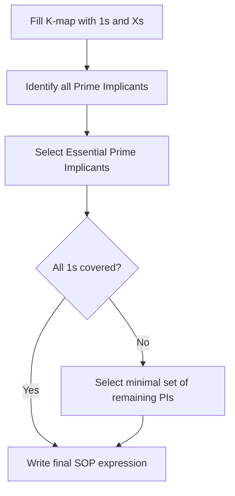

## Introduction

In digital logic design, the complexity of a circuit is directly tied to the complexity of its Boolean expression. A function like $F = A'BC'D + A'BCD + ABC'D + ABCD$ might look daunting to implement, requiring four 4-input AND gates and one 4-input OR gate. However, using Boolean algebra, we can see that $F$ simplifies significantly. While algebraic simplification using identities and De Morgan's laws is powerful, it is also prone to human error and lacks a systematic "stopping point"—how do you know you have found the absolute simplest form?

The **Karnaugh Map** (or **K-map**), introduced by Maurice Karnaugh in 1953, provides a visual method for simplifying Boolean expressions. It transforms the truth table into a grid where adjacent cells represent terms that differ by only one literal. By circling groups of 1s in this grid, we can perform the algebraic identity $XY + XY' = X$ visually. This lesson covers the construction and minimization of 2, 3, and 4-variable K-maps, the identification of essential terms, and the handling of "don't-care" conditions.

**Before you start:** you should be familiar with *Binary Conversions & 2's Complement*, *De Morgan's Laws & Canonical Forms*, and *Universal Gates & Truth Tables*.

## Core theory

### The Geometry of Adjacency

The fundamental principle of a K-map is **logical adjacency**. Two minterms are logically adjacent if they differ by exactly one variable. For example, $ABC$ and $ABC'$ are adjacent because only $C$ changes. In Boolean algebra, we simplify this as:
$$ABC + ABC' = AB(C + C') = AB(1) = AB$$

A K-map arranges minterms in a grid such that cells that are physically adjacent (up, down, left, right) are also logically adjacent. To achieve this in a 2D grid, we use **Gray code** rather than standard binary counting. In Gray code, only one bit changes between successive numbers.

| Decimal | Binary | Gray Code |
| :--- | :--- | :--- |
| 0 | 00 | 00 |
| 1 | 01 | 01 |
| 2 | 10 | 11 |
| 3 | 11 | 10 |

By using the sequence $00, 01, 11, 10$ for the rows and columns of our map, we ensure that moving from one cell to the next always results in a single-variable change.

### Map Structures for 2, 3, and 4 Variables

The number of cells in a K-map is $2^n$, where $n$ is the number of input variables.

*   **2-Variable Map:** A $2 \times 2$ grid. Variables $A$ and $B$ define the rows and columns.
*   **3-Variable Map:** A $2 \times 4$ grid. Usually, variable $A$ defines the rows ($0, 1$) and $BC$ defines the columns ($00, 01, 11, 10$).
*   **4-Variable Map:** A $4 \times 4$ grid. Variables $WX$ define the rows and $YZ$ define the columns, both following the Gray code sequence.

The 4-variable map layout is shown below. Note the "jump" in the numbering in the third and fourth rows/columns due to the Gray code $11$ appearing before $10$.

| WX \ YZ | 00 | 01 | 11 | 10 |
| :--- | :--- | :--- | :--- | :--- |
| **00** | $m_0$ | $m_1$ | $m_3$ | $m_2$ |
| **01** | $m_4$ | $m_5$ | $m_7$ | $m_6$ |
| **11** | $m_{12}$ | $m_{13}$ | $m_{15}$ | $m_{14}$ |
| **10** | $m_8$ | $m_9$ | $m_{11}$ | $m_{10}$ |

### Grouping Rules and Minimization

To simplify a function, we place a **1** in every cell corresponding to a minterm where the function is true. We then group these 1s according to specific rules:

1.  **Group Size:** Groups must contain $2^n$ cells (1, 2, 4, 8, 16...).
2.  **Shape:** Groups must be rectangular or square.
3.  **Adjacency:** Only adjacent cells can be grouped. This includes **wrapping** around the edges (the top row is adjacent to the bottom row, and the leftmost column is adjacent to the rightmost column).
4.  **Maximization:** Always aim for the largest possible groups. A larger group eliminates more variables.
5.  **Coverage:** Every **1** must be included in at least one group. A **1** can be part of multiple groups if it helps enlarge others.



### Prime Implicants and Essentiality

Understanding the hierarchy of groups is critical for finding the **Minimal Sum of Products (MSOP)**:

*   **Implicant:** Any single cell with a 1 or any valid group of 1s.
*   **Prime Implicant (PI):** A group of 1s that cannot be doubled in size by merging with another group. It is a "maximal" group.
*   **Essential Prime Implicant (EPI):** A Prime Implicant that covers at least one **1** that is not covered by any other Prime Implicant. These **must** be included in the final Boolean expression.

The minimization process involves finding all EPIs first, then choosing the minimum number of remaining PIs to cover any 1s that are still "uncovered."

### Don't-Care Conditions

In many digital systems, certain input combinations are physically impossible or their output results are irrelevant to the system's operation. These are called **Don't-Care conditions**, denoted by an **X** in the truth table and K-map.

Don't-cares are powerful tools for minimization:
*   You can treat an **X** as a **1** if it helps you form a larger group.
*   You can treat an **X** as a **0** if it does not help or if including it would create a redundant group.
*   You do **not** need to cover all **X**s; you only cover them if they simplify the expression.

## Worked examples

### Example 1: 3-Variable Minimization

Simplify the function $F(A, B, C) = \sum m(0, 2, 4, 5, 6)$.

**Step 1: Map the minterms.**
We place 1s in the cells for 0, 2, 4, 5, and 6.

| A \ BC | 00 | 01 | 11 | 10 |
| :--- | :--- | :--- | :--- | :--- |
| **0** | 1 ($m_0$) | 0 ($m_1$) | 0 ($m_3$) | 1 ($m_2$) |
| **1** | 1 ($m_4$) | 1 ($m_5$) | 0 ($m_7$) | 1 ($m_6$) |

**Step 2: Identify groups.**
*   **Group 1:** Look at the four corners/edges. Minterms $m_0, m_2, m_4, m_6$ are all 1s. Because the map wraps, these four cells form a single $2 \times 2$ group.
    *   In this group, $A$ changes ($0 \to 1$), $B$ changes ($0 \to 1$), but $C$ is always $0$.
    *   Term: $C'$.
*   **Group 2:** Minterm $m_5$ is still uncovered. It is adjacent to $m_4$. We can form a group of two: $(m_4, m_5)$.
    *   In this group, $A$ is always $1$, $B$ is always $0$, and $C$ changes ($0 \to 1$).
    *   Term: $AB'$.

**Step 3: Final Expression.**
All 1s are covered. $F = C' + AB'$.

### Example 2: 4-Variable with Don't-Cares

Simplify $F(W, X, Y, Z) = \sum m(1, 3, 7, 11, 15) + d(0, 2, 5)$.

**Step 1: Map the minterms and don't-cares.**

| WX \ YZ | 00 | 01 | 11 | 10 |
| :--- | :--- | :--- | :--- | :--- |
| **00** | X ($m_0$) | 1 ($m_1$) | 1 ($m_3$) | X ($m_2$) |
| **01** | 0 ($m_4$) | X ($m_5$) | 1 ($m_7$) | 0 ($m_6$) |
| **11** | 0 ($m_{12}$) | 0 ($m_{13}$) | 1 ($m_{15}$) | 0 ($m_{14}$) |
| **10** | 0 ($m_8$) | 0 ($m_9$) | 1 ($m_{11}$) | 0 ($m_{10}$) |

**Step 2: Identify groups.**
*   **Group 1:** The entire column where $YZ = 11$ is filled with 1s ($m_3, m_7, m_{15}, m_{11}$). This is a group of 4.
    *   Variables $W$ and $X$ both change. $Y$ and $Z$ are both 1.
    *   Term: $YZ$.
*   **Group 3:** Minterm $m_1$ is still uncovered. We can group it with $m_3, m_5, m_7$ to form a $2 \times 2$ square. Note that we use the don't-care $m_5$ as a 1 to make the group larger.
    *   In this group $(m_1, m_3, m_5, m_7)$, $W$ is always 0, $X$ changes, $Y$ changes, and $Z$ is always 1.
    *   Term: $W'Z$.
*   **Check:** Are all 1s covered? Yes ($m_1, m_3, m_7, m_{11}, m_{15}$ are all inside at least one group). We do not need to use $m_0$ or $m_2$ because they don't help simplify the existing 1s further.

**Step 3: Final Expression.**
$F = YZ + W'Z$.

### Example 3: Verifying Gray Code Adjacency

The following Python code demonstrates how Gray code ensures that only one bit changes between adjacent indices, which is the mathematical foundation of the K-map.

```python
def binary_to_gray(n):
    """Converts an integer to its Gray code representation."""
    return n ^ (n >> 1)

def count_set_bits(n):
    """Returns the number of set bits (1s) in an integer."""
    return bin(n).count('1')

# Check adjacency for a 2-bit Gray code sequence
sequence = [binary_to_gray(i) for i in range(4)]
print(f"Gray Code Sequence: {[f'{x:02b}' for x in sequence]}")

for i in range(len(sequence)):
    current = sequence[i]
    next_val = sequence[(i + 1) % len(sequence)] # include wrap-around
    diff = current ^ next_val
    print(f"Transition {current:02b} -> {next_val:02b}: {count_set_bits(diff)} bit(s) changed")
```

Output:
```text
Gray Code Sequence: ['00', '01', '11', '10']
Transition 00 -> 01: 1 bit(s) changed
Transition 01 -> 11: 1 bit(s) changed
Transition 11 -> 10: 1 bit(s) changed
Transition 10 -> 00: 1 bit(s) changed
```

## Applications

*   **Logic Gate Reduction:** The primary use is reducing the number of AND/OR gates in a circuit. This reduces the physical size (area) of the chip and the manufacturing cost.
*   **Power Optimization:** Fewer gates and shorter signal paths lead to lower power consumption, which is critical for battery-operated devices like smartphones.
*   **FPGA Synthesis:** Field Programmable Gate Arrays use Look-Up Tables (LUTs) to implement logic. K-map principles help synthesis tools map complex Boolean functions into the smallest number of LUTs.
*   **Hazard Detection:** K-maps can help identify "static hazards" (glitches) in combinational circuits. By adding redundant prime implicants that bridge adjacent groups, designers can ensure smooth transitions between states.
*   **Instruction Decoding:** In CPU design, K-maps are used to simplify the logic that decodes binary opcodes into control signals for the ALU and registers.

## Common mistakes

*   **Grouping non-power-of-2 cells.** A common error is circling 3, 6, or 5 cells. Groups must always be $1, 2, 4, 8, \dots$ cells. If you see a block of 6, you must break it into overlapping groups of 4.
*   **Diagonal grouping.** Cells can only be grouped if they share an edge. Diagonal cells differ by two bits (e.g., $00$ and $11$), so they cannot be simplified using the $XY + XY' = X$ identity.
*   **Forgetting the wrap-around.** The K-map is effectively a torus (a donut shape). The leftmost and rightmost columns are adjacent, as are the top and bottom rows. Missing these "edge" groups often results in a non-minimal expression.
*   **Using standard binary instead of Gray code.** If you label your columns $00, 01, 10, 11$, the adjacency property is destroyed. The transition from $01$ to $10$ changes two bits, making the visual grouping invalid.
*   **Including redundant groups.** Once all 1s are covered, any additional groups are redundant. While the logic remains correct, the expression is no longer "minimal," defeating the purpose of the K-map.

## Revision notes

*   **K-map Size:** $2^n$ cells for $n$ variables.
*   **Gray Code Order:** $00, 01, 11, 10$. This is mandatory for the adjacency property to work.
*   **Adjacency:** Two cells are adjacent if they differ by one variable. This includes wrap-around at the edges.
*   **Group Size:** Must be a power of 2 ($2^n$). Larger groups eliminate more variables.
*   **Variable Elimination:** A group of $2^k$ cells in an $n$-variable map results in a product term with $n-k$ literals.
*   **Prime Implicant (PI):** A group that cannot be further expanded.
*   **Essential Prime Implicant (EPI):** A PI that covers a 1 that no other PI covers. EPIs must be in the final SOP.
*   **Don't-Cares (X):** Use them to make groups larger, but never feel obligated to cover them.

## Practice questions

:::question basic
How many variables are eliminated when you form a group of 4 cells in a 4-variable Karnaugh map?
:::answer
Two variables are eliminated. A group of $2^k$ cells in an $n$-variable map eliminates $k$ variables; since $4 = 2^2$, we eliminate 2 variables, leaving a product term with $4 - 2 = 2$ literals.
:::

:::question basic
In a 3-variable K-map with variables $A$ (rows) and $BC$ (columns), which minterm is adjacent to $m_0$ (000) via the wrap-around property of the columns?
:::answer
Minterm $m_2$ (010) is adjacent to $m_0$. In Gray code, the columns are $00, 01, 11, 10$, so the first column ($00$) and the last column ($10$) differ by only the middle bit ($B$).
:::

:::question intermediate
Simplify $F(A, B, C) = \sum m(1, 3, 5, 7)$. Identify the resulting expression and the number of Prime Implicants used.
:::answer
The expression is $F = C$. The minterms $(1, 3, 5, 7)$ form a single $2 \times 2$ group where $A$ and $B$ both change, but $C$ is always 1. There is only 1 Prime Implicant, and it is essential.
:::

:::question intermediate
A 4-variable K-map has 1s at $m_0, m_2, m_8, m_{10}$. What is the simplified term for this group?
:::answer
The term is $X'Z'$. These four minterms represent the four corners of the 4-variable map ($0000, 0010, 1000, 1010$). Comparing them, $W$ changes ($0 \to 1$) and $Y$ changes ($0 \to 1$), but $X$ is always 0 and $Z$ is always 0.
:::

:::question advanced
Given $F(A, B, C, D) = \sum m(0, 2, 3, 7, 8, 10, 11, 15)$, find the MSOP and identify if there are any redundant Prime Implicants.
:::answer
The MSOP is $F = B'D' + CD$. The group $(0, 2, 8, 10)$ forms $B'D'$ and the group $(3, 7, 11, 15)$ forms $CD$. All 1s are covered by these two Essential Prime Implicants, and there are no redundant groups because every 1 is needed to form these two maximal blocks.
:::

:::question advanced
Explain how you would handle a 5-variable K-map minimization.
:::answer
A 5-variable K-map requires 32 cells, typically visualized as two 4-variable maps (one for $A=0$ and one for $A=1$) placed side-by-side or "stacked." You look for adjacencies within each 16-cell map and also "mirrored" adjacencies between the two maps (cells in the same position in both maps are adjacent because they only differ by the variable $A$).
:::

## Further learning

*   **Next:** *Adders & Multiplexers Design* uses K-map minimization to create efficient circuits for arithmetic units and data routing.
*   **Related:** *Decoders, Encoders & Comparators* explores how large-scale combinational blocks are built from the simplified logic gates derived via K-maps.
*   **Related:** *JK & D Flip-Flop Operation* applies K-maps to determine the "next-state" logic required for sequential circuit transitions.
*   **Textbook:** M. Morris Mano and Michael D. Ciletti, *Digital Design*.
