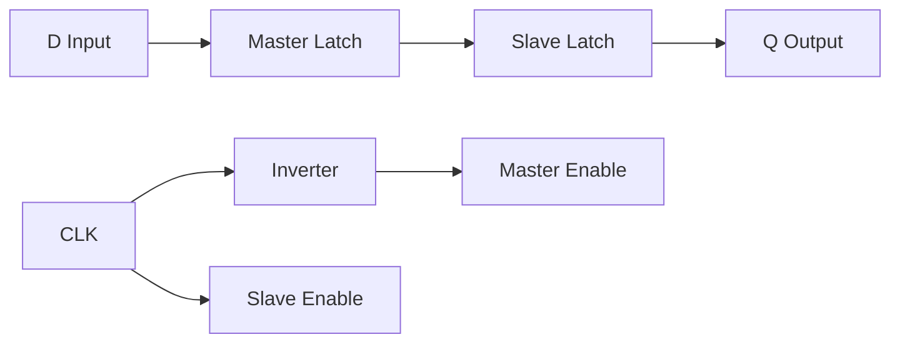

## Introduction

Imagine you are designing a digital camera. When the user presses the shutter button, you need the system to capture the exact state of the image sensor at that specific microsecond. If the "shutter" stayed open too long, the image would blur as the scene changed. In digital logic, we face a similar challenge: when should a storage element "capture" the data on its input wire?

In earlier lessons, you learned about combinational circuits where the output is a direct function of the current inputs. However, to build complex systems like processors, we need memory. We use two primary types of storage elements: **latches** and **flip-flops**. While they may seem similar—both store a single bit of information—their behavior in relation to a clock signal is fundamentally different. A latch is like a door that stays open as long as you hold the handle; a flip-flop is like a camera shutter that snaps a picture only at the moment the button is pressed.

This lesson explores the critical timing differences between these two components. We will examine how they respond to clock signals, the strict timing requirements they impose on designers, and what happens when those requirements are ignored. Understanding these nuances is the difference between a reliable computer and one that crashes randomly due to "glitches."

**Before you start:** you need to be familiar with Universal Gates & Truth Tables, and have a basic understanding of how a D-type input controls a storage element.

## Core theory

### Level-Sensitivity vs. Edge-Triggering

The most fundamental distinction in sequential logic is how a device is "triggered" to update its internal state.

A **latch** is **level-sensitive**. This means the device is "transparent" during a specific level of the enable (or clock) signal. For a high-level sensitive D-latch, as long as the clock ($CLK$) is logic 1, any change at the data input ($D$) will propagate directly to the output ($Q$). When $CLK$ drops to logic 0, the latch "closes," and the last value of $D$ is frozen in $Q$.

A **flip-flop** is **edge-triggered**. It ignores the steady levels of the clock and only responds during a transition—either the **rising edge** (0 to 1) or the **falling edge** (1 to 0). For a positive-edge-triggered D-flip-flop (DFF), the value of $D$ is sampled exactly at the moment $CLK$ rises. At all other times, the output $Q$ remains constant, regardless of what happens at $D$.

### The D-Latch Timing Behavior

To understand the D-latch, we define two states: **Transparent** and **Opaque**.

1.  **Transparent Mode ($CLK=1$):** The latch acts like a wire. The path from $D$ to $Q$ is combinational. If $D$ toggles five times while $CLK$ is high, $Q$ will toggle five times.
2.  **Opaque Mode ($CLK=0$):** The latch is in storage mode. The feedback loop inside the latch maintains the state. Changes at $D$ are ignored.

The propagation delay in a latch depends on which signal changes last. If $D$ changes while the latch is already transparent, we measure the **Data-to-Q delay** ($t_{dq}$). If $D$ is already stable and the $CLK$ goes high, we measure the **Clock-to-Q delay** ($t_{cq}$).

### The D-Flip-Flop and the Master-Slave Concept

Most modern digital systems are "synchronous," meaning they prefer flip-flops over latches. This is because flip-flops provide a precise moment in time when all data is captured, making the system easier to analyze.

A common way to build a D-flip-flop is the **Master-Slave architecture**. It consists of two D-latches connected in series with inverted clocks.

When $CLK=0$, the Master is transparent and the Slave is opaque. The Master tracks $D$, but the Slave blocks it from reaching $Q$. When $CLK$ transitions to 1, the Master becomes opaque (locking in the value of $D$), and the Slave becomes transparent, passing that locked value to $Q$. This creates the illusion of the device only "sampling" at the instant of the rising edge.

### Setup and Hold Times

Storage elements are not instantaneous. They require the input data to be stable for a short window around the clock edge to ensure the internal feedback loops can settle.

*   **Setup Time ($t_s$):** The minimum amount of time the data input $D$ must be stable **before** the active clock edge.
*   **Hold Time ($t_h$):** The minimum amount of time the data input $D$ must remain stable **after** the active clock edge.

If $D$ changes within this $(t_s + t_h)$ window, the behavior of the device is unpredictable. This window is often called the **aperture time**.

### Propagation Delays and Clock Period

In a synchronous circuit, data travels from one flip-flop (the launch FF) through combinational logic to another flip-flop (the capture FF). To ensure the system works, the clock period $T$ must be long enough for the data to arrive at the second flip-flop at least $t_s$ before the next edge.

The total delay is:
$$t_{total} = t_{pcq} + t_{pd,max}$$

Where:
*   $t_{pcq}$ is the **propagation clock-to-Q delay** (time for the first FF to output the data).
*   $t_{pd,max}$ is the maximum delay through the combinational logic (e.g., adders, muxes).

The constraint for the clock period $T$ is:
$$T \ge t_{pcq} + t_{pd,max} + t_{s}$$

If this inequality is violated, we have a **setup violation**, and the circuit must be slowed down (lower frequency).

### Metastability

What happens if we violate $t_s$ or $t_h$? The internal nodes of the flip-flop may get stuck halfway between 0 and 1. This state is called **metastability**.

A metastable output might:
1.  Stay at an intermediate voltage level (neither 0 nor 1).
2.  Oscillate rapidly.
3.  Eventually settle to either 0 or 1, but after a delay much longer than the specified $t_{pcq}$.

Metastability is a major concern when interfacing between two different clock domains (Clock Domain Crossing or CDC), as the data from the first domain can change at any time relative to the second domain's clock.

## Worked examples

### Example 1: Timing Diagram Analysis

Consider a positive-edge-triggered D-flip-flop and a high-level-sensitive D-latch. Both receive the same $D$ and $CLK$ signals. We will trace the output $Q_{FF}$ and $Q_{Latch}$ over 30 ns.

**Initial State:** $Q_{FF} = 0, Q_{Latch} = 0$.
**Signals:**
*   $CLK$: High from 10ns to 20ns, and 30ns to 40ns.
*   $D$: Transitions $0 \to 1$ at 5ns, $1 \to 0$ at 15ns, $0 \to 1$ at 25ns.

**Step-by-step Trace:**

1.  **At $t=5ns$:** $D$ goes high. $CLK$ is low.
    *   $Q_{FF}$ stays 0 (no rising edge).
    *   $Q_{Latch}$ stays 0 (opaque).
2.  **At $t=10ns$:** $CLK$ goes high (Rising Edge).
    *   $Q_{FF}$ samples $D=1$. $Q_{FF}$ becomes 1.
    *   $Q_{Latch}$ becomes transparent. Since $D=1$, $Q_{Latch}$ becomes 1.
3.  **At $t=15ns$:** $D$ goes low. $CLK$ is still high.
    *   $Q_{FF}$ ignores $D$ (it only cares about the edge at 10ns). $Q_{FF}$ stays 1.
    *   $Q_{Latch}$ is transparent. It follows $D$, so $Q_{Latch}$ becomes 0.
4.  **At $t=20ns$:** $CLK$ goes low.
    *   $Q_{FF}$ stays 1.
    *   $Q_{Latch}$ becomes opaque. It locks the current value ($D=0$). $Q_{Latch}$ stays 0.
5.  **At $t=25ns$:** $D$ goes high. $CLK$ is low.
    *   $Q_{FF}$ stays 1.
    *   $Q_{Latch}$ is opaque. $Q_{Latch}$ stays 0.
6.  **At $t=30ns$:** $CLK$ goes high (Rising Edge).
    *   $Q_{FF}$ samples $D=1$. $Q_{FF}$ stays 1.
    *   $Q_{Latch}$ becomes transparent. $Q_{Latch}$ becomes 1.

**Final Answer:**
At $t=35ns$: $Q_{FF} = 1$, $Q_{Latch} = 1$.
Note the difference at $t=15ns$: the latch output changed while the clock was high, but the flip-flop output remained constant.

### Example 2: Maximum Clock Frequency Calculation

A digital circuit has the following timing parameters:
*   Flip-flop $t_{pcq} = 2ns$
*   Flip-flop $t_s = 1.5ns$
*   Flip-flop $t_h = 1ns$
*   Combinational logic delay $t_{pd}$ ranges from $3ns$ to $8ns$.

Calculate the maximum frequency ($f_{max}$) at which this circuit can operate reliably.

**Step 1: Identify the critical path.**
The critical path is the longest delay path. Here, $t_{pd,max} = 8ns$.

**Step 2: Apply the setup time constraint formula.**
$$T \ge t_{pcq} + t_{pd,max} + t_{s}$$
$$T \ge 2ns + 8ns + 1.5ns$$
$$T \ge 11.5ns$$

**Step 3: Calculate frequency.**
$$f = \frac{1}{T}$$
$$f_{max} = \frac{1}{11.5 \times 10^{-9} s} \approx 86.96 \times 10^6 Hz$$

**Step 4: Check for hold time violations.**
The hold time constraint is:
$$t_{pcq} + t_{pd,min} \ge t_h$$
$$2ns + 3ns \ge 1ns$$
$$5ns \ge 1ns$$
The condition is met. (Hold time violations are independent of the clock period).

**Final Answer:** The maximum frequency is **86.96 MHz**.

## Applications

*   **Processor Registers:** CPUs use banks of edge-triggered flip-flops (registers) to store operands for the ALU. Edge-triggering ensures that the input to the ALU remains stable throughout the entire clock cycle while the calculation is performed.
*   **Pipeline Stages:** In high-performance computing, logic is broken into stages separated by flip-flops. This allows different instructions to be processed simultaneously in different parts of the circuit, with the clock edges synchronizing the movement of data between stages.
*   **Input Synchronization:** When a button is pressed by a human, the signal is asynchronous to the system clock. Engineers use a "synchronizer" (usually two flip-flops in series) to reduce the probability of metastability before the signal enters the main logic.
*   **Memory Arrays:** While large RAM uses different structures, small, fast "scratchpad" memories or register files are often built using arrays of latches or flip-flops for immediate data access.

## Common mistakes

*   **The mistake: Treating latches and flip-flops as interchangeable.** Why it is wrong and how to avoid it: Using a latch where a flip-flop is expected can lead to "race conditions" where data flows through multiple stages of logic in a single clock cycle because the latch is transparent. Always check if your design requires level-sensitivity or edge-triggering.
*   **The mistake: Ignoring hold time violations.** Why it is wrong and how to avoid it: Many students focus only on the clock being "too fast" (setup violation). However, if the logic between flip-flops is "too fast" (shorter than the hold time), the data might change before the capture flip-flop has finished locking it in. This cannot be fixed by slowing down the clock; it requires adding buffer delays to the logic path.
*   **The mistake: Assuming zero propagation delay.** Why it is wrong and how to avoid it: In introductory truth tables, we assume outputs change instantly. In timing analysis, every gate and wire adds delay. Always include $t_{pcq}$ and $t_{pd}$ in your calculations.
*   **The mistake: Sampling a signal exactly when it toggles.** Why it is wrong and how to avoid it: If $D$ changes at the exact same nanosecond as the $CLK$ edge, the setup/hold window is violated. In simulations, this might look okay, but in real hardware, it leads to metastability.

## Revision notes

*   **Latches** are level-sensitive (transparent when $CLK$ is high or low).
*   **Flip-flops** are edge-triggered (sample only on the transition).
*   **Setup time ($t_s$)** is the required stability period before the clock edge.
*   **Hold time ($t_h$)** is the required stability period after the clock edge.
*   **Clock-to-Q delay ($t_{pcq}$)** is the time it takes for the output to reflect the sampled input after the clock edge.
*   **Maximum Frequency Formula:** $f_{max} = 1 / (t_{pcq} + t_{pd,max} + t_s)$.
*   **Hold Time Constraint:** $t_{pcq} + t_{pd,min} \ge t_h$.
*   **Metastability** occurs when timing constraints are violated, causing the output to hover between logic states.

## Practice questions

:::question basic
A D-latch is high-level sensitive. If the $CLK$ input is held at a constant logic 1, how does the latch behave?
:::answer
The latch behaves like a simple buffer or a wire. Because it is in its "transparent" phase, any change at the $D$ input will be immediately reflected at the $Q$ output (after a small propagation delay). It effectively ceases to act as a storage element and acts as combinational logic.
:::

:::question basic
Define "Setup Time" in your own words and explain what happens if it is violated.
:::answer
Setup time is the "lead time" data needs to arrive and settle at the input of a flip-flop before the clock edge strikes. If the data arrives too late (violating setup time), the flip-flop may capture the wrong value or enter a metastable state where the output is neither 0 nor 1 for an extended period.
:::

:::question intermediate
A circuit has a clock period of 10ns. The flip-flops have $t_{pcq} = 1ns$ and $t_s = 1ns$. What is the maximum allowable combinational logic delay ($t_{pd,max}$) between any two flip-flops?
:::answer
Using the formula $T \ge t_{pcq} + t_{pd,max} + t_s$, we substitute the known values: $10 \ge 1 + t_{pd,max} + 1$. Solving for $t_{pd,max}$ gives $10 \ge 2 + t_{pd,max}$, so $t_{pd,max} \le 8ns$. The combinational logic cannot exceed 8ns of delay.
:::

:::question intermediate
Explain why a Master-Slave Flip-Flop is not transparent, even though it is built from two transparent latches.
:::answer
The Master-Slave Flip-Flop uses two latches with inverted enable signals. When the clock is low, the first latch (Master) is open but the second (Slave) is closed, blocking the signal from the output. When the clock goes high, the Master closes (locking the value) and the Slave opens to pass that locked value to the output. At no point is there a direct transparent path from the input $D$ to the output $Q$.
:::

:::question advanced
You are designing a high-speed processor. You find a path where $t_{pcq} + t_{pd,min} = 0.5ns$, but the flip-flop requires a hold time $t_h = 0.8ns$. Will slowing down the clock frequency fix this problem? If not, how do you fix it?
:::answer
No, slowing down the clock will not fix a hold time violation. Hold time constraints ($t_{pcq} + t_{pd,min} \ge t_h$) do not depend on the clock period $T$; they only depend on the delays of the components. To fix this, you must increase the minimum delay of the path ($t_{pd,min}$), typically by inserting "buffer" gates that add delay without changing the logic function.
:::

:::question advanced
A synchronizer consists of two D-flip-flops in series. If the first flip-flop enters a metastable state due to an asynchronous input, how does the second flip-flop help?
:::answer
The second flip-flop provides an additional clock cycle for the metastable signal from the first flip-flop to settle to a stable 0 or 1. While it doesn't eliminate the possibility of metastability entirely, it exponentially reduces the probability that the metastable state will propagate into the rest of the synchronous system, as the signal would have to remain metastable for an entire clock period to affect the second flip-flop.
:::

## Further learning

*   **Next:** *JK & D Flip-Flop Operation* explores the internal logic gates and characteristic equations that define these devices beyond simple timing.
*   **Next:** *Mealy & Moore State Machine Design* uses these timing principles to build complex controllers that transition between states on clock edges.
*   **Related:** *Von Neumann Architecture & Performance Metrics* explains how the clock frequency (determined by these timing constraints) directly impacts the MIPS and FLOPS of a computer system.
*   **Textbook:** Mano and Ciletti, *Digital Design*.
