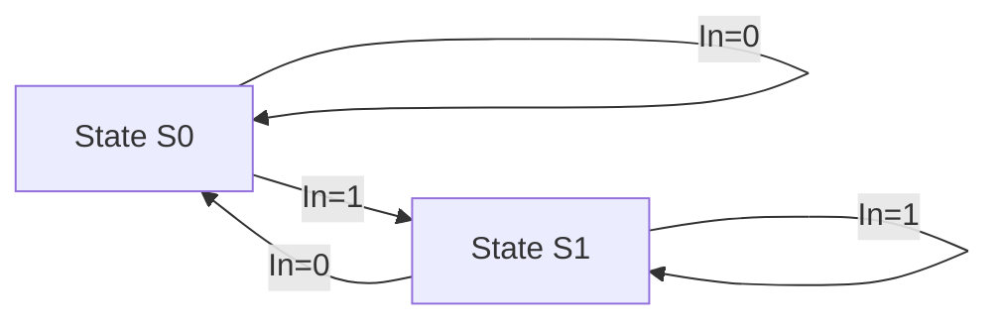

## Introduction

Imagine you are designing the controller for a digital combination lock. The lock should only open if the user enters the sequence 1-0-1. If you used purely combinational logic, the circuit would only look at the current inputs; it would have no "memory" of what was pressed a second ago. To solve this, we need a **Finite State Machine (FSM)**. An FSM allows a system to move through a sequence of conditions (states) based on external inputs, effectively remembering its history to decide what to do next.

In this lesson, we will explore the formal methodology for designing these sequential controllers. We will compare the two primary architectural models—Mealy and Moore—and walk through the rigorous step-by-step process of turning a conceptual state diagram into a physical circuit of flip-flops and logic gates. Whether you are building a simple sequence detector or a complex CPU control unit, the principles of state transition and excitation logic remain the same.

**Before you start:** You should be comfortable with *Karnaugh Map Minimization*, the operation of *JK & D Flip-Flop Operation*, and the general concept of *Synchronous Counter Design*.

## Core theory

### The Anatomy of a Finite State Machine

A **Finite State Machine (FSM)** is a mathematical model of computation used to design both computer programs and sequential logic circuits. In digital hardware, an FSM consists of three main parts:
1.  **Memory Elements:** Usually a set of flip-flops that store the **Current State**.
2.  **Next State Logic:** Combinational circuitry that determines what the next state will be, based on the current state and the external inputs.
3.  **Output Logic:** Combinational circuitry that determines the system outputs.

The number of flip-flops required is determined by the number of states. If a machine has $N$ states, you need at least $n$ flip-flops, where $2^n \ge N$. The binary values stored in these flip-flops are known as **State Variables**.

### Moore vs. Mealy Architectures

There are two fundamental ways to organize the output logic of an FSM.

**Moore Machines** define the output solely as a function of the current state. If you are in "State A," the output is always the same, regardless of what input caused you to enter that state or what the current input is. In a state diagram, the output is usually written inside the state node (e.g., $S_0 / Out=0$).
*   **Pros:** Outputs are synchronous with the clock; they only change when the state changes. This makes the system more stable and less prone to "glitches."
*   **Cons:** Often requires more states than a Mealy machine to perform the same task.

**Mealy Machines** define the output as a function of both the current state and the current inputs. This means the output can change immediately if the input changes, even between clock edges. In a state diagram, the output is written on the transition arrows (e.g., $In=1 / Out=0$).
*   **Pros:** Can often represent complex logic with fewer states.
*   **Cons:** Outputs may be asynchronous and can exhibit "glitches" if the inputs change mid-cycle.

### The Design Flow

Designing an FSM follows a standard engineering pipeline:
1.  **State Diagram:** Create a visual representation of states (circles) and transitions (arrows).
2.  **State Table:** Convert the diagram into a tabular format showing Current State, Input, Next State, and Output.
3.  **State Assignment:** Assign a unique binary code to each state.
4.  **Excitation Table:** Determine the required inputs for the flip-flops (D, J, K, etc.) to trigger the desired transitions.
5.  **Logic Minimization:** Use K-maps to find the simplest Boolean expressions for the Next State and Output logic.
6.  **Circuit Implementation:** Draw the final schematic.

### State Encoding Strategies

How we assign binary numbers to states (Step 3 above) significantly impacts the complexity of the resulting hardware.
*   **Binary Encoding:** Uses the minimum number of bits. For 4 states, we use 00, 01, 10, and 11. This minimizes the number of flip-flops.
*   **Gray Code Encoding:** Ensures that only one bit changes between adjacent states. This is useful for reducing power consumption and preventing race conditions in some asynchronous designs.
*   **One-Hot Encoding:** Uses one flip-flop per state. For 4 states, the codes are 1000, 0100, 0010, and 0001. While this uses more flip-flops, it often makes the combinational logic much simpler and faster because you don't need to decode the state.

### Excitation Equations

To make a flip-flop transition from its current value $Q$ to a desired next value $Q_{next}$, we must provide specific signals to its inputs. These requirements are summarized in an **Excitation Table**.

For a **D Flip-Flop**, the logic is trivial:
$$D = Q_{next}$$

For a **JK Flip-Flop**, the requirements are more complex, involving "don't care" conditions ($X$):

| $Q \to Q_{next}$ | $J$ | $K$ |
| :--- | :--- | :--- |
| $0 \to 0$ | 0 | X |
| $0 \to 1$ | 1 | X |
| $1 \to 0$ | X | 1 |
| $1 \to 1$ | X | 0 |

Using JK flip-flops often results in simpler combinational logic because the "don't cares" allow for larger groupings in Karnaugh maps.



## Worked examples

### Example 1: Moore Machine Sequence Detector

**Goal:** Design a Moore FSM that detects the sequence "11" in a bitstream. The output $Y$ should be 1 when the sequence is detected, and 0 otherwise.

**Step 1: State Diagram**
*   $S_0$: Reset state (No 1s detected). Output $Y=0$.
*   $S_1$: One "1" detected. Output $Y=0$.
*   $S_2$: Two or more "1"s detected. Output $Y=1$.

**Step 2: State Table (Binary Assignment: $S_0=00, S_1=01, S_2=10$)**

| Current State ($Q_1 Q_0$) | Input ($X$) | Next State ($Q_1^+ Q_0^+$) | Output ($Y$) |
| :--- | :--- | :--- | :--- |
| 00 | 0 | 00 | 0 |
| 00 | 1 | 01 | 0 |
| 01 | 0 | 00 | 0 |
| 01 | 1 | 10 | 0 |
| 10 | 0 | 00 | 1 |
| 10 | 1 | 10 | 1 |

**Step 3: Excitation Logic (D Flip-Flops)**
Since $D = Q_{next}$, we derive equations for $D_1$ and $D_0$ using K-maps:
*   $D_1 = Q_1 X + Q_0 X$
*   $D_0 = \overline{Q_1} \cdot \overline{Q_0} \cdot X$
*   $Y = Q_1$ (Note: Output depends only on the state variable $Q_1$).

**Final Answer:** The circuit uses two D flip-flops. The output $Y$ is high whenever the machine is in state 10.

### Example 2: Mealy Machine Parity Generator

**Goal:** Design a Mealy FSM that outputs a 1 if the total number of 1s received so far is odd (Odd Parity).

**Step 1: State Diagram**
*   $S_0$: Even number of 1s received.
*   $S_1$: Odd number of 1s received.

In a Mealy machine, the output is on the transition.
*   From $S_0$: If input is 0, stay in $S_0$, output 0. If input is 1, go to $S_1$, output 1.
*   From $S_1$: If input is 0, stay in $S_1$, output 1. If input is 1, go to $S_0$, output 0.

**Step 2: State Table (Assignment: $S_0=0, S_1=1$)**

| Current State ($Q$) | Input ($X$) | Next State ($Q^+$) | Output ($Y$) |
| :--- | :--- | :--- | :--- |
| 0 | 0 | 0 | 0 |
| 0 | 1 | 1 | 1 |
| 1 | 0 | 1 | 1 |
| 1 | 1 | 0 | 0 |

**Step 3: Logic Derivation**
Looking at the table:
*   $Q^+ = Q \oplus X$
*   $Y = Q \oplus X$

**Final Answer:** For a Mealy parity generator, the Next State and the Output share the same logic: an XOR gate of the current state and the input. This requires only one flip-flop.

### Example 3: FSM Simulation in C++

This program simulates the logic of the Moore sequence detector from Example 1.

```cpp
#include <iostream>
#include <vector>

class MooreDetector {
private:
    int state; // 0: S0, 1: S1, 2: S2
public:
    MooreDetector() : state(0) {}

    int process(int input) {
        // Next State Logic
        if (state == 0) {
            state = (input == 1) ? 1 : 0;
        } else if (state == 1) {
            state = (input == 1) ? 2 : 0;
        } else if (state == 2) {
            state = (input == 1) ? 2 : 0;
        }
        
        // Output Logic (Moore: depends only on state)
        return (state == 2) ? 1 : 0;
    }
};

int main() {
    MooreDetector machine;
    std::vector<int> inputs = {0, 1, 1, 0, 1, 1, 1};
    
    for (int in : inputs) {
        std::cout << machine.process(in) << " ";
    }
    std::cout << std::endl;
    return 0;
}
```

Output:
```text
0 0 1 0 0 1 1 
```

## Applications

*   **Traffic Light Controllers:** FSMs manage the timing and sequencing of lights (Red $\to$ Green $\to$ Yellow) based on timers and vehicle sensors.
*   **Vending Machines:** The machine tracks the "Current Balance" as a state. Transitions occur as coins are inserted, and the output (dispensing a product) occurs when the state reaches the required total.
*   **Microprocessor Control Units:** The "Instruction Cycle" (Fetch, Decode, Execute) is a massive FSM that coordinates data movement between registers, the ALU, and memory.
*   **Communication Protocols:** Hardware implementations of protocols like SPI, I2C, or Ethernet use FSMs to handle frame headers, data payloads, and error checking.
*   **Digital Combination Locks:** As discussed in the introduction, these machines track the progress of a specific input sequence and trigger an "Unlock" signal only upon reaching the final success state.

## Common mistakes

*   **The "Unused State" Trap.** If you have 3 states, you use 2 flip-flops ($2^2 = 4$ possible states). If the hardware accidentally enters the 4th, unused state (e.g., due to electrical noise), it might get stuck. **How to avoid it:** Always define transitions for unused states in your state table, usually pointing them back to a "Reset" state.
*   **Confusing Mealy and Moore Outputs.** A common error is drawing a Moore diagram but writing the output logic as if it were Mealy (dependent on input). **Why it is wrong:** This leads to incorrect K-maps and timing mismatches. Moore outputs must be tied strictly to the state variables.
*   **Ignoring Setup and Hold Times.** In physical implementation, if the "Next State Logic" is too slow, the input to the flip-flop won't be stable before the clock edge. **How to avoid it:** Perform timing analysis to ensure the combinational delay is less than the clock period minus the flip-flop setup time.
*   **Incorrect JK Excitation.** Using the Truth Table instead of the Excitation Table for JK flip-flops. **Why it is wrong:** The truth table tells you what $Q$ becomes given $J, K$. The excitation table tells you what $J, K$ must be to get a specific $Q \to Q_{next}$. Mixing these up results in a circuit that transitions to the wrong states.

## Revision notes

*   **FSM Components:** Next State Logic (Combinational), State Register (Flip-flops), and Output Logic (Combinational).
*   **Moore Machine:** Output $= f(\text{Current State})$.
*   **Mealy Machine:** Output $= f(\text{Current State, Current Input})$.
*   **State Variable Requirement:** $n$ flip-flops can represent up to $2^n$ states.
*   **D-FF Excitation:** $D = Q_{next}$.
*   **JK-FF Excitation:** $0 \to 1$ requires $J=1, K=X$; $1 \to 0$ requires $J=X, K=1$.
*   **One-Hot Encoding:** Uses $N$ flip-flops for $N$ states; simplifies logic but increases area.
*   **Glitches:** Mealy machines are susceptible to input-induced glitches; Moore machines are generally safer for synchronous downstream logic.

## Practice questions

:::question basic
A state machine needs to track 12 distinct states. What is the minimum number of flip-flops required if using binary encoding?
:::answer
To find the number of flip-flops $n$, we use the inequality $2^n \ge 12$. Since $2^3 = 8$ (too small) and $2^4 = 16$ (sufficient), the minimum number of flip-flops required is 4.
:::

:::question basic
In a Moore machine, if the clock frequency is 1 MHz and the input changes 500 ns after a clock edge, when will the output change?
:::answer
In a Moore machine, the output is a function of the current state only. Since the state only changes on the clock edge, the output will not change until the *next* clock edge, which occurs 1000 ns (1 $\mu$s) after the previous one.
:::

:::question intermediate
Convert the following JK excitation requirements for a single state bit $Q$ into a simplified Boolean expression: $J$ must be 1 when $(Q=0, X=1)$, and 0 when $(Q=0, X=0)$. $K$ is always "Don't Care" when $Q=0$.
:::answer
We look at the $J$ column of the K-map for $Q=0$. When $X=1, J=1$. When $X=0, J=0$. For the $Q=1$ half of the map, $J$ values are "Don't Care" because the excitation table for JK flip-flops specifies $J=X$ when the current state is 1. Thus, the simplest expression for $J$ is $J = X$.
:::

:::question intermediate
Compare a Mealy and Moore implementation of the same sequence detector. Which one typically has a "faster" response to an input change, and why?
:::answer
The Mealy machine has a faster response. Because its output logic is a direct function of the input, the output can change as soon as the input changes (within the propagation delay of the gates). In a Moore machine, the input must first trigger a state change on a clock edge before the output logic can react.
:::

:::question advanced
Design the "Next State" logic for a 2-bit Gray code counter ($00 \to 01 \to 11 \to 10 \to 00$) using D flip-flops. Provide the equations for $D_1$ and $D_0$.
:::answer
Let the current state be $Q_1 Q_0$.
For $00 \to 01$: $D_1=0, D_0=1$.
For $01 \to 11$: $D_1=1, D_0=1$.
For $11 \to 10$: $D_1=1, D_0=0$.
For $10 \to 00$: $D_1=0, D_0=0$.
Mapping these: $D_1$ is 1 when $Q_1 Q_0$ is 01 or 11, so $D_1 = Q_0$. $D_0$ is 1 when $Q_1 Q_0$ is 00 or 01, so $D_0 = \overline{Q_1}$.
:::

:::question advanced
A system uses one-hot encoding for a 5-state FSM. If the system experiences a bit-flip error and the state register becomes `01100`, what is the primary risk compared to a binary-encoded system?
:::answer
In a one-hot system, a valid state must have exactly one bit as '1'. The value `01100` represents an "illegal" state where the machine thinks it is in two states simultaneously. This can cause multiple output drivers to activate at once, potentially causing a short circuit or unpredictable system behavior, whereas a binary system would simply transition to a different (but technically valid) binary code.
:::

## Further learning

*   **Next:** *Synchronous Counter Design* applies FSM principles specifically to counting sequences, which is a subset of general FSM design.
*   **Related:** *Karnaugh Map Minimization* is the essential tool used to simplify the Next State and Output logic derived in this lesson.
*   **Related:** *JK & D Flip-Flop Operation* provides the underlying timing and characteristic equations that govern how the FSM memory behaves.
*   **Textbook:** Mano & Ciletti, *Digital Design*.
