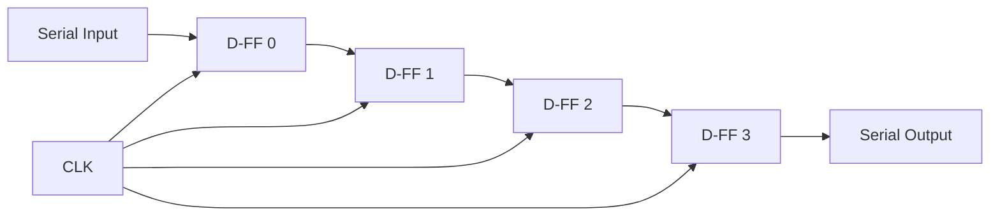

## Introduction

Imagine you are designing a system where a microcontroller needs to send data to a display. The microcontroller processes data in 8-bit chunks (parallel), but to save space and reduce the number of wires on the circuit board, you want to send that data over a single wire (serial). How do you bridge the gap between the "all-at-once" world of parallel processing and the "one-at-a-time" world of serial communication?

The answer lies in the **shift register**. A shift register is a sequential logic circuit primarily used for the storage and transfer of digital data. By connecting flip-flops in a chain, we can "shift" bits from one stage to the next on every clock pulse. This simple mechanism forms the backbone of modern communication protocols like USB, Ethernet, and SPI, where data must be squeezed through narrow serial channels and then expanded back into parallel form for the computer to use.

In this lesson, we will examine the four primary architectures of shift registers—SISO, SIPO, PISO, and PIPO—and conclude with the **Universal Shift Register**, a versatile component that can perform all these functions based on a set of control inputs.

**Before you start:** You should be comfortable with the operation of **D Flip-Flops**, specifically how they capture the input $D$ at the rising edge of a clock signal and hold it at output $Q$. Familiarity with **Multiplexers** will also be helpful when we discuss universal architectures.

## Core theory

### The Basic Building Block: The D Flip-Flop Chain

A **register** is a group of flip-flops used to store a multi-bit word. A **shift register** is a specialized register where the flip-flops are connected such that the output of one flip-flop becomes the input of the next. 

In a standard $n$-bit shift register, we use $n$ flip-flops, usually **D Flip-Flops** (DFFs), because they are the most straightforward for data storage. All flip-flops in the register share a common **Clock (CLK)** signal, making the shift register a synchronous circuit. On every active clock edge, the bit stored in stage $i$ moves to stage $i+1$.

### SISO: Serial-In, Serial-Out

The **Serial-In, Serial-Out (SISO)** shift register is the simplest form. It has one input pin and one output pin. Data is fed in one bit at a time, and after a certain number of clock cycles, it emerges from the other end.

*   **Loading:** To load an $n$-bit word, it takes $n$ clock pulses.
*   **Retrieval:** To read the $n$-bit word out, it takes another $n$ clock pulses (or $n-1$ if you count the first bit already present at the output).
*   **Use Case:** SISO registers are primarily used as **delay lines**. If you need a signal to arrive exactly four clock cycles later, a 4-bit SISO register is the perfect tool.



### SIPO: Serial-In, Parallel-Out

The **Serial-In, Parallel-Out (SIPO)** register is used for **serial-to-parallel conversion**. It receives data one bit at a time but makes all stored bits available simultaneously at the output pins.

In a 4-bit SIPO, after 4 clock pulses, the 4 bits that were shifted in are sitting in the 4 flip-flops. We simply attach an output wire to the $Q$ terminal of every flip-flop. This allows a system to receive a serial stream (like from a sensor) and then read it as a whole byte.

| Clock Pulse | Serial Input | $Q_A$ | $Q_B$ | $Q_C$ | $Q_D$ |
| :--- | :--- | :--- | :--- | :--- | :--- |
| Initial | - | 0 | 0 | 0 | 0 |
| 1 | 1 | 1 | 0 | 0 | 0 |
| 2 | 0 | 0 | 1 | 0 | 0 |
| 3 | 1 | 1 | 0 | 1 | 0 |
| 4 | 1 | 1 | 1 | 0 | 1 |

### PISO: Parallel-In, Serial-Out

The **Parallel-In, Serial-Out (PISO)** register performs **parallel-to-serial conversion**. This is more complex because the register must support two modes: **Loading** and **Shifting**.

A PISO register typically has a control line called **Shift/$\overline{\text{Load}}$**.
1.  **Load Mode:** When the control line is LOW, the parallel input data is loaded into the flip-flops asynchronously or on the next clock edge.
2.  **Shift Mode:** When the control line is HIGH, the flip-flops behave like a SISO register, moving the data toward the serial output pin.

This requires a combination of logic gates (usually a small multiplexer) before each D input to choose between the "parallel bit" and the "previous flip-flop's output."

### PIPO: Parallel-In, Parallel-Out

The **Parallel-In, Parallel-Out (PIPO)** register is used for temporary data storage (a buffer). It does not "shift" data in the traditional sense between stages. Instead, it loads all bits at once and outputs them all at once.

*   **Loading:** 1 clock pulse.
*   **Retrieval:** Available immediately (0 additional clock pulses).
*   **Latency:** This is the fastest architecture for moving data but requires the most pins ($n$ inputs and $n$ outputs).

### The Universal Shift Register

A **Universal Shift Register** is a high-end component (like the 74HC194 IC) that can perform all the functions mentioned above. It can shift left, shift right, load in parallel, or hold its current state. To achieve this, each flip-flop is preceded by a **4-to-1 Multiplexer**.

The multiplexer selects the input for the D flip-flop based on two select lines, $S_1$ and $S_0$:

| $S_1$ | $S_0$ | Mode | Description |
| :--- | :--- | :--- | :--- |
| 0 | 0 | **Hold** | The output $Q$ is fed back to input $D$. No change. |
| 0 | 1 | **Shift Right** | Input $D_i$ receives $Q_{i-1}$. |
| 1 | 0 | **Shift Left** | Input $D_i$ receives $Q_{i+1}$. |
| 1 | 1 | **Parallel Load** | Input $D_i$ receives external parallel input $I_i$. |

The ability to shift in both directions makes this a **bidirectional** register.

## Worked examples

### Example 1: Tracing a 4-bit SISO Register

Suppose we have a 4-bit SISO shift register, initially cleared (all 0s). We want to shift in the binary sequence **1011**, where the rightmost bit is the first bit to enter the register. Let's trace the state of the flip-flops ($Q_3 Q_2 Q_1 Q_0$) after each clock pulse.

**Step 1: Initial State**
$Q_3=0, Q_2=0, Q_1=0, Q_0=0$.

**Step 2: Pulse 1 (Input = 1)**
The input 1 enters $Q_3$. The old $Q_3$ moves to $Q_2$, and so on.
State: $Q_3=1, Q_2=0, Q_1=0, Q_0=0$.

**Step 3: Pulse 2 (Input = 1)**
The next bit (1) enters $Q_3$. The previous 1 moves to $Q_2$.
State: $Q_3=1, Q_2=1, Q_1=0, Q_0=0$.

**Step 4: Pulse 3 (Input = 0)**
The bit 0 enters $Q_3$.
State: $Q_3=0, Q_2=1, Q_1=1, Q_0=0$.

**Step 5: Pulse 4 (Input = 1)**
The final bit 1 enters $Q_3$.
State: $Q_3=1, Q_2=0, Q_1=1, Q_0=1$.

**Final Answer:** After 4 clock pulses, the register contains **1011**. Note that to see the first bit (the 1 we entered in Step 2) at the serial output ($Q_0$), we needed exactly 4 pulses.

### Example 2: Python Simulation of a Shift Register

We can model the behavior of a shift register using a simple Python script. This helps visualize how the bits "move" through the array.

```python
class ShiftRegister:
    def __init__(self, size):
        self.stages = [0] * size

    def clock_tick(self, serial_in):
        # The last bit is pushed out (SISO output)
        serial_out = self.stages[-1]
        
        # Shift all bits to the right
        # We iterate backwards to avoid overwriting
        for i in range(len(self.stages) - 1, 0, -1):
            self.stages[i] = self.stages[i-1]
            
        # New bit enters the first stage
        self.stages[0] = serial_in
        return serial_out

    def __repr__(self):
        return str(self.stages)

# Simulate a 4-bit register
reg = ShiftRegister(4)
input_sequence = [1, 1, 0, 1] # Entering LSB first: 1, then 0, then 1, then 1

print("Initial: ", reg)
for bit in input_sequence:
    out = reg.clock_tick(bit)
    print(f"Input {bit} -> Register {reg} -> Out {out}")
```

Output:
```text
Initial:  [0, 0, 0, 0]
Input 1 -> Register [1, 0, 0, 0] -> Out 0
Input 1 -> Register [1, 1, 0, 0] -> Out 0
Input 0 -> Register [0, 1, 1, 0] -> Out 0
Input 1 -> Register [1, 0, 1, 1] -> Out 0
```

### Example 3: Timing Analysis of a PISO Register

A 4-bit PISO register is used to transmit the byte `1010` serially. The clock frequency is 1 MHz ($T = 1 \mu s$). How long does it take from the moment the "Load" signal is triggered until the entire byte has been shifted out?

**Step 1: Loading**
The parallel load happens in 1 clock cycle (or asynchronously, but usually we count 1 cycle for the synchronous load).
Time: $1 \mu s$.
Register state: `1010`. The first bit (`0`, the LSB) is already available at the serial output pin.

**Step 2: Shifting**
To get the remaining 3 bits out, we need 3 more clock pulses.
- Pulse 2: Second bit (`1`) moves to output.
- Pulse 3: Third bit (`0`) moves to output.
- Pulse 4: Fourth bit (`1`) moves to output.

**Step 3: Total Calculation**
Total pulses = 1 (load) + 3 (shifts) = 4 pulses.
Total time = $4 \times 1 \mu s = 4 \mu s$.

**Final Answer:** It takes $4 \mu s$ to load and completely shift out a 4-bit word in a PISO register.

## Applications

*   **Serial-to-Parallel Conversion (SIPO):** Used in computer mice and keyboards. The device sends data serially to save on cable thickness, and the computer's USB controller converts it back to parallel for the CPU.
*   **Parallel-to-Serial Conversion (PISO):** Used in transmitters. A CPU writes a whole byte to a register, which then "clocks out" the bits one by one over a radio frequency or fiber optic link.
*   **Digital Delay Lines:** SISO registers are used to delay a signal by a fixed number of clock cycles. This is vital in digital signal processing (DSP) for aligning signals or creating echo effects.
*   **Arithmetic Operations:** Shifting a binary number one position to the left is equivalent to multiplying by 2. Shifting one position to the right is equivalent to integer division by 2. Shift registers are the core components of hardware multipliers and dividers.
*   **LED Matrix Drivers:** To control a large grid of LEDs (like a scrolling marquee), SIPO shift registers (like the 74HC595) are used to expand a few microcontroller pins into dozens of outputs.

## Common mistakes

*   **The "Off-by-One" Clock Error.** Thinking an $n$-bit SISO register requires $n$ pulses to shift data *out*. In reality, the first bit is available at the output as soon as it reaches the last flip-flop. However, to shift $n$ bits *through* a register and clear it, you do need $n$ pulses.
*   **Confusing Shift Direction.** In many diagrams, the "first" flip-flop is on the left, and data shifts right. However, in some contexts (like LSB-first communication), the data might appear to move "backward." Always check if the serial input enters at the MSB (Most Significant Bit) or LSB (Least Significant Bit) stage.
*   **Ignoring Propagation Delay.** In high-speed circuits, the time it takes for a bit to move from $D$ to $Q$ ($t_{pd}$) must be less than the clock period. If the clock is too fast, the second flip-flop might try to capture the first flip-flop's output before it has stabilized.
*   **Asynchronous vs. Synchronous Load.** In PISO registers, some designs load data the moment the "Load" button is pressed (asynchronous), while others wait for the next clock edge (synchronous). Mixing these up leads to timing errors in simulations.
*   **Floating Inputs.** In a shift register, if the serial input is left "floating" (not connected to 0 or 1), the register will fill with random noise as bits shift through. Always tie unused inputs to a defined logic level.

## Revision notes

*   **SISO (Serial-In, Serial-Out):** Data enters one bit at a time and exits one bit at a time. Used for delays.
*   **SIPO (Serial-In, Parallel-Out):** Data enters serially and is read in parallel. Used for serial-to-parallel conversion.
*   **PISO (Parallel-In, Serial-Out):** Data is loaded all at once and shifted out bit by bit. Requires a Shift/Load control line.
*   **PIPO (Parallel-In, Parallel-Out):** Data is loaded and read in parallel. Acts as a temporary buffer.
*   **Universal Shift Register:** Can shift left, shift right, load parallel, or hold. Controlled by select lines ($S_1, S_0$).
*   **Clock Cycles:**
    *   To load $n$ bits serially: $n$ cycles.
    *   To load $n$ bits in parallel: 1 cycle.
    *   To shift out $n$ bits serially: $n$ cycles.
*   **Multiplication/Division:** Shift Left = $\times 2$; Shift Right = $\div 2$.
*   **Hardware:** Most shift registers are built using **D Flip-Flops** because they directly store the input state.

## Practice questions

:::question basic
A 4-bit SIPO shift register is used to receive the sequence `1, 0, 1, 1` (entered in that order). After 4 clock pulses, what are the values of the parallel outputs $Q_3, Q_2, Q_1, Q_0$? Assume $Q_3$ is the first flip-flop in the chain.
:::answer
The first bit (1) shifts through all stages and ends up at $Q_0$. The second bit (0) ends up at $Q_1$. The third bit (1) ends up at $Q_2$. The fourth bit (1) ends up at $Q_3$. Therefore, the outputs are $Q_3=1, Q_2=1, Q_1=0, Q_0=1$.
:::

:::question basic
Which shift register architecture is most suitable for a "Buffer" where data must be stored momentarily and then retrieved as quickly as possible?
:::answer
The PIPO (Parallel-In, Parallel-Out) register is most suitable. It allows all bits to be loaded in a single clock cycle and retrieved immediately without any shifting, providing the lowest latency.
:::

:::question intermediate
You have an 8-bit PISO register. If the clock frequency is 2 MHz, how much time is required to load a byte and shift it out completely? Assume the load operation takes one clock cycle.
:::answer
An 8-bit PISO requires 1 cycle to load and 7 additional cycles to shift out the remaining bits (the first bit is available immediately after loading). Total cycles = 8. At 2 MHz, the period $T = 1 / (2 \times 10^6) = 0.5 \mu s$. Total time = $8 \times 0.5 \mu s = 4 \mu s$.
:::

:::question intermediate
In a Universal Shift Register, the control lines are set to $S_1=1, S_0=0$. If the current state is `1011` and the "Serial Input Left" pin is tied to `0`, what will be the state after one clock pulse?
:::answer
The mode $S_1=1, S_0=0$ corresponds to **Shift Left**. In a shift left operation, bits move toward the MSB (left). The LSB ($Q_0$) receives the "Serial Input Left" value (0). The old $Q_0$ moves to $Q_1$, $Q_1$ to $Q_2$, and $Q_2$ to $Q_3$. The old $Q_3$ is discarded. Result: `0110`.
:::

:::question advanced
Design a logic circuit for a single stage of a PISO register. You have a D Flip-Flop, a Shift/$\overline{\text{Load}}$ control line, a Parallel Input ($I$), and the output of the previous flip-flop ($Q_{prev}$).
:::answer
You need a 2-to-1 Multiplexer (or equivalent gate logic) to drive the $D$ input of the flip-flop. The logic expression is $D = (Shift \cdot Q_{prev}) + (\overline{Shift} \cdot I)$. When $Shift=1$, the flip-flop takes the value from the previous stage (shifting). When $Shift=0$, it takes the value from the parallel input (loading).
:::

:::question advanced
A 16-bit SISO register is used as a delay line in a system with a 100 MHz clock. A pulse is detected at the input. How many nanoseconds later will that pulse appear at the serial output?
:::answer
In a SISO register, a bit enters the first flip-flop on the first clock edge and reaches the output of the 16th flip-flop on the 16th clock edge. The delay is 16 clock cycles. $T = 1 / 100 \text{ MHz} = 10 \text{ ns}$. Total delay = $16 \times 10 \text{ ns} = 160 \text{ ns}$.
:::

## Further learning

*   **Next:** *Synchronous Counter Design* builds on these concepts by adding combinational logic to the feedback path, allowing registers to count in specific sequences rather than just shifting.
*   **Related:** *Latches vs Flip-Flops Timing* is essential for understanding the setup and hold times that govern how fast a shift register can reliably operate.
*   **Related:** *Von Neumann Architecture & Performance Metrics* explains how registers (like the Program Counter and Instruction Register) function within the broader context of a CPU.
*   **Textbook:** M. Morris Mano and Michael Ciletti, *Digital Design*. This is the definitive reference for the gate-level implementation of universal shift registers and their timing diagrams.
