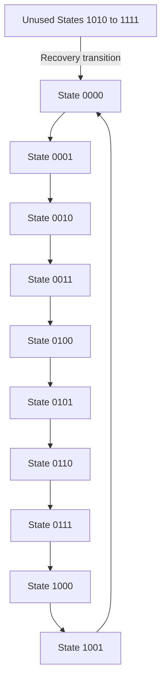

## Introduction

Imagine designing a digital clock, a baud rate generator for high-speed networking, or an address generator for a processor memory controller. If you connected a chain of flip-flops so that each stage triggered the next—an asynchronous ripple counter—the accumulated propagation delays across stages would cause intermediate state glitches and severely constrain the maximum operating frequency.

To overcome timing skew and operating speed limits, digital systems rely on **synchronous counters**. In a synchronous counter, every flip-flop is connected to a shared master clock signal. Because all flip-flops update simultaneously on the active clock edge, state transitions occur in parallel, enabling predictable timing and glitch-free state decoding at high clock rates.

In this lesson, you will learn the step-by-step methodology for designing synchronous modulo-$N$ and non-sequential counters. We will derive flip-flop excitation requirements, synthesize minimal combinational control logic using Karnaugh maps, and analyze unused states to ensure your designs are self-starting.

**Before you start:** you need to be familiar with *Karnaugh Map Minimization*, *JK & D Flip-Flop Operation*, and basic Boolean logic expressions.

## Core theory

### Synchronous vs. Asynchronous Architecture

A **synchronous counter** is a sequential logic circuit in which the clock inputs of all constituent flip-flops are tied to a single, common **clock signal** ($\text{CLK}$). State transitions across all flip-flops occur simultaneously on the active clock edge.

In an **asynchronous counter** (or ripple counter), the output of one flip-flop acts as the clock input for the next. This creates a cascade of propagation delays ($t_{\text{pd,FF}}$), so that an $n$-bit ripple counter takes $n \cdot t_{\text{pd,FF}}$ seconds for a change at the least significant bit (LSB) to propagate to the most significant bit (MSB). During this transition period, the counter outputs briefly display incorrect intermediate binary values known as **decoding glitches**.

In contrast, the maximum clock frequency ($f_{\text{max}}$) of an $n$-bit synchronous counter is bounded by a single flip-flop delay plus the delay of the input combinational logic ($t_{\text{comb}}$) and setup time ($t_{\text{setup}}$):

$$f_{\text{max}} = \frac{1}{t_{\text{pd,FF}} + t_{\text{comb}} + t_{\text{setup}}}$$

Because $f_{\text{max}}$ is independent of the number of counter bits $n$, synchronous architectures scale efficiently to wide bit-widths.

### Flip-Flop Excitation Tables

A **characteristic table** predicts a flip-flop's next state ($Q^+$) given its present state ($Q$) and control inputs. Counter design requires the inverse process: given a desired transition from present state $Q$ to next state $Q^+$, what inputs must be applied to the flip-flop? 

An **excitation table** tabulates these required input signals for every possible state transition.

| Present State ($Q$) | Next State ($Q^+$) | D Input ($D$) | T Input ($T$) | J Input ($J$) | K Input ($K$) |
| :---: | :---: | :---: | :---: | :---: | :---: |
| 0 | 0 | 0 | 0 | 0 | $\text{X}$ |
| 0 | 1 | 1 | 1 | 1 | $\text{X}$ |
| 1 | 0 | 0 | 1 | $\text{X}$ | 1 |
| 1 | 1 | 1 | 0 | $\text{X}$ | 0 |

The symbol $\text{X}$ represents a **don't-care condition**, meaning the input may be set to either 0 or 1 without affecting the targeted state transition. Exploiting these don't-care entries during logic simplification significantly reduces gate count.

From this table, the characteristic excitation relations for D and T flip-flops are expressed directly as:

$$D = Q^+$$

$$T = Q \oplus Q^+$$

### The Synchronous Counter Synthesis Algorithm

Designing any synchronous counter requires a structured five-step procedure:

1. **State Requirements:** Identify the modulus $N$ (number of unique states) and the required state sequence. Calculate the minimum flip-flop count $n$:
   $$n = \lceil \log_2 N \rceil$$
2. **State Transition Table:** Construct a table listing each present state $(Q_{n-1} \dots Q_0)$ alongside its designated next state $(Q_{n-1}^+ \dots Q_0^+)$.
3. **Excitation Mapping:** Use the excitation table for the chosen flip-flop type (D, T, or JK) to determine the required excitation values for each flip-flop input across all valid transitions.
4. **Logic Minimization:** Plot the excitation values for each flip-flop input on separate $n$-variable Karnaugh maps (K-maps). Assign unused binary states ($2^n - N$) as don't-care conditions ($\text{X}$) to obtain minimal Boolean functions.
5. **Circuit Implementation:** Connect the output signals of the flip-flops back to their inputs through the synthesized combinational logic gates.

### Modulo-N and Decade Counter Architectures

A **modulo-N counter** (or mod-$N$ counter) cycles repeatedly through a sequence of $N$ distinct states. When $N = 2^n$, the counter cycles through every binary combination achievable by $n$ flip-flops. When $N < 2^n$, the counter skips $2^n - N$ states.

A common example is the **decade counter** (modulo-10 counter), which counts in Binary Coded Decimal (BCD) from $0000_2$ (0) to $1001_2$ (9) before returning to $0000_2$. A decade counter requires $n = \lceil \log_2 10 \rceil = 4$ flip-flops. The remaining six binary combinations ($1010_2$ through $1111_2$) are **unused states**.



### Unused States and Self-Starting Counters

When $N < 2^n$, power-up transients or electromagnetic interference can force a flip-flop register into an unused state. If the next-state logic maps an unused state into another unused state indefinitely, the counter enters a **lock-up condition** (or invalid cycle).

A counter is **self-starting** if, when forced into any unused state, it transitions into the valid operational counting sequence within a finite number of clock cycles. 

To verify self-starting operation:
1. Substitute each unused state vector into the minimized flip-flop input logic functions.
2. Calculate the resulting next state $Q^+$ for each unused state.
3. Verify that all trajectories terminate inside the main counting loop. If an isolated closed loop among unused states exists, re-synthesize the input logic by replacing specific don't-care entries with fixed 0 or 1 values.

## Worked examples

### Example 1: Designing a Modulo-5 Counter with D Flip-Flops

Design a synchronous modulo-5 counter using D flip-flops that cycles through states $0 \to 1 \to 2 \to 3 \to 4 \to 0$. Verify that the resulting circuit is self-starting for all unused states.

**Step 1: Determine flip-flop count**
For $N = 5$, $n = \lceil \log_2 5 \rceil = 3$ flip-flops are needed ($Q_2, Q_1, Q_0$). Unused states are 5 ($101_2$), 6 ($110_2$), and 7 ($111_2$).

**Step 2 & 3: State transition and excitation table**
Since $D_i = Q_i^+$, the required D flip-flop inputs match the next state variables directly.

| Present State ($Q_2 Q_1 Q_0$) | Next State ($Q_2^+ Q_1^+ Q_0^+$) | $D_2$ | $D_1$ | $D_0$ |
| :---: | :---: | :---: | :---: | :---: |
| 000 (0) | 001 (1) | 0 | 0 | 1 |
| 001 (1) | 010 (2) | 0 | 1 | 0 |
| 010 (2) | 011 (3) | 0 | 1 | 1 |
| 011 (3) | 100 (4) | 1 | 0 | 0 |
| 100 (4) | 000 (0) | 0 | 0 | 0 |
| 101 (5) | $\text{X X X}$ | $\text{X}$ | $\text{X}$ | $\text{X}$ |
| 110 (6) | $\text{X X X}$ | $\text{X}$ | $\text{X}$ | $\text{X}$ |
| 111 (7) | $\text{X X X}$ | $\text{X}$ | $\text{X}$ | $\text{X}$ |

**Step 4: K-Map minimization**

For $D_2$:
- Minterm 3 ($011_2$) is 1. Don't-cares at 5, 6, 7.
- Grouping cell 3 ($011_2$) with cell 7 ($111_2$) yields:
  $$D_2 = Q_1 Q_0$$

For $D_1$:
- Minterms 1 ($001_2$) and 2 ($010_2$) are 1. Don't-cares at 5, 6, 7.
- Grouping cell 1 ($001_2$) with cell 5 ($101_2$) yields $\overline{Q_1} Q_0$.
- Grouping cell 2 ($010_2$) with cell 6 ($110_2$) yields $Q_1 \overline{Q_0}$.
- Combining gives:
  $$D_1 = \overline{Q_1} Q_0 + Q_1 \overline{Q_0} = Q_1 \oplus Q_0$$

For $D_0$:
- Minterms 0 ($000_2$) and 2 ($010_2$) are 1. Don't-cares at 5, 6, 7.
- Grouping cells 0 ($000_2$) and 2 ($010_2$) yields:
  $$D_0 = \overline{Q_2} \overline{Q_0}$$

**Step 5: Verification of self-starting behavior**

Let's test all states using a simulation script in Python to verify both the main sequence and unused state recovery transitions:

```python
def mod5_step(q2, q1, q0):
    d2 = q1 & q0
    d1 = q1 ^ q0
    d0 = (not q2) & (not q0)
    return int(d2), int(d1), int(d0)

# Trace main sequence starting from 000
state = (0, 0, 0)
main_seq = []
for _ in range(6):
    val = state[0]*4 + state[1]*2 + state[2]
    main_seq.append(val)
    state = mod5_step(*state)

print("Main sequence:", main_seq)

# Test recovery from unused states 5, 6, and 7
for unused in (5, 6, 7):
    q2, q1, q0 = (unused >> 2) & 1, (unused >> 1) & 1, unused & 1
    next_q = mod5_step(q2, q1, q0)
    next_val = next_q[0]*4 + next_q[1]*2 + next_q[2]
    print(f"Unused state {unused} ({q2}{q1}{q0}) -> State {next_val}")
```

Output:

```text
Main sequence: [0, 1, 2, 3, 4, 0]
Unused state 5 (101) -> State 2
Unused state 6 (110) -> State 2
Unused state 7 (111) -> State 4
```

Every unused state transitions directly into a valid state ($2$ or $4$) in one clock cycle. The counter is fully self-starting.

### Example 2: Designing a Non-Sequential Synchronous Counter with JK Flip-Flops

Synthesize a 2-bit counter using JK flip-flops that follows the non-binary sequence $00 \to 10 \to 11 \to 01 \to 00$.

**Step 1 & 2: State transition table**
Since all $2^2 = 4$ states are used ($00_2, 10_2, 11_2, 01_2$), there are no unused states.

**Step 3: Excitation Mapping**
Map transitions using the JK excitation rules:
- $0 \to 0 \implies J=0, K=\text{X}$
- $0 \to 1 \implies J=1, K=\text{X}$
- $1 \to 0 \implies J=\text{X}, K=1$
- $1 \to 1 \implies J=\text{X}, K=0$

| Present State ($Q_1 Q_0$) | Next State ($Q_1^+ Q_0^+$) | $J_1$ | $K_1$ | $J_0$ | $K_0$ |
| :---: | :---: | :---: | :---: | :---: | :---: |
| 00 (0) | 10 (2) | 1 | $\text{X}$ | 0 | $\text{X}$ |
| 10 (2) | 11 (3) | $\text{X}$ | 0 | 1 | $\text{X}$ |
| 11 (3) | 01 (1) | $\text{X}$ | 1 | $\text{X}$ | 0 |
| 01 (1) | 00 (0) | 0 | $\text{X}$ | $\text{X}$ | 1 |

**Step 4: K-Map minimization**

For $J_1$ and $K_1$:
- $J_1$: 1 at state $00_2$, 0 at $01_2$, don't-cares at $10_2, 11_2$. Grouping cells $00_2$ and $10_2$ gives:
  $$J_1 = \overline{Q_0}$$
- $K_1$: 1 at state $11_2$, 0 at $10_2$, don't-cares at $00_2, 01_2$. Grouping cells $11_2$ and $01_2$ gives:
  $$K_1 = Q_0$$

For $J_0$ and $K_0$:
- $J_0$: 1 at state $10_2$, 0 at $00_2$, don't-cares at $01_2, 11_2$. Grouping cells $10_2$ and $11_2$ gives:
  $$J_0 = Q_1$$
- $K_0$: 1 at state $01_2$, 0 at $11_2$, don't-cares at $00_2, 10_2$. Grouping cells $01_2$ and $00_2$ gives:
  $$K_0 = \overline{Q_1}$$

**Final Equations:**
$$J_1 = \overline{Q_0}, \quad K_1 = Q_0$$
$$J_0 = Q_1, \quad K_0 = \overline{Q_1}$$

This requires no external logic gates beyond cross-connecting flip-flop inverted outputs to inputs.

## Applications

- **Real-Time Clocks and Digital Timers:** Cascaded modulo-10 (BCD decade) and modulo-6 synchronous counters form the base timing engines for hours, minutes, and seconds displays in embedded systems.
- **Baud Rate Generators:** Microcontrollers use programmable modulo-$N$ synchronous counters as clock dividers to step down master system clock rates to standard communication frequencies (such as 9600 or 115200 baud for UART interfaces).
- **Direct Memory Access (DMA) Address Generators:** High-speed synchronous up-counters automatically increment target memory address lines on every clock cycle during burst data transfers between peripherals and RAM.
- **Control Unit Sequencers:** Finite state machine controllers inside CPU instruction pipelines rely on synchronous sequence counters to step through multi-cycle micro-operations systematically.

## Common mistakes

- **Cascading clock inputs in high-frequency designs.** Connecting a flip-flop's output to the next stage's clock pin forms an asynchronous ripple counter rather than a synchronous counter. This leads to propagation delay accumulation and transient decoding glitches. Always connect every flip-flop clock pin to the single global master clock line.
- **Skipping lock-up verification for unused states.** Assuming that don't-care assignments ($\text{X}$) on K-maps will automatically yield safe state transitions can cause a counter to lock up in an invalid loop upon power-up. Always evaluate next-state logic for all $2^n - N$ unused states to confirm self-starting behavior.
- **Confusing present state and next state columns during lookup.** Using $Q^+$ as present state and $Q$ as next state inverts the transition table logic, producing inverted control signals. Always keep present state ($Q$) as the K-map input variable and desired next state ($Q^+$) as the target output.
- **Fixing don't-care entries to 0 or 1 prematurely.** Over-constraining unused state outputs to specific values during initial step-by-step drafting prevents K-map minimization from combining adjacent terms. Keep unused states as don't-care conditions ($\text{X}$) during initial synthesis, and alter them only if lock-up conditions are detected.
- **Confusing flip-flop characteristic equations with excitation rules.** Applying characteristic equations ($Q^+ = J\overline{Q} + \overline{K}Q$) instead of excitation lookups forces manual algebraic solving rather than direct synthesis. Use excitation tables to determine required input excitation directly from $Q \to Q^+$.

## Revision notes

- **Synchronous Advantage:** All flip-flops trigger simultaneously on a shared master clock edge, eliminating cumulative propagation delays and intermediate glitching.
- **Flip-Flop Requirement:** An $N$-state counter requires $n = \lceil \log_2 N \rceil$ flip-flops.
- **Excitation Equations:**
  - D Flip-Flop: $D = Q^+$
  - T Flip-Flop: $T = Q \oplus Q^+$
  - JK Flip-Flop: $0\to0 (J=0, K=\text{X})$, $0\to1 (J=1, K=\text{X})$, $1\to0 (J=\text{X}, K=1)$, $1\to1 (J=\text{X}, K=0)$.
- **Synthesis Workflow:** State sequence definition $\to$ State transition table $\to$ Excitation mapping $\to$ K-map minimization $\to$ Gate logic synthesis.
- **Unused States ($2^n - N$):** Binary states not present in the main counting sequence; initially marked as don't-cares ($\text{X}$) on K-maps to minimize logic complexity.
- **Self-Starting Condition:** A circuit is self-starting if every unused state reaches a valid state in a finite number of clock cycles.
- **Lock-Up Condition:** An invalid loop formed among unused states that prevents the counter from ever reaching valid states without an external reset.

## Practice questions

:::question basic
A synchronous counter must cycle through seven states (0 through 6). How many flip-flops are required to construct this counter, and how many unused states will exist?
:::answer
To count seven states ($N = 7$), the required flip-flop count is $n = \lceil \log_2 7 \rceil = 3$ flip-flops. Three flip-flops provide $2^3 = 8$ total binary combinations, leaving $8 - 7 = 1$ unused state (binary $111_2$, or 7).
:::

:::question basic
What input values must be applied to a JK flip-flop to cause a state transition from present state $Q = 1$ to next state $Q^+ = 0$?
:::answer
From the JK excitation table, a $1 \to 0$ transition requires $J = \text{X}$ and $K = 1$. This is because setting $K=1$ either resets the flip-flop (if $J=0$) or toggles it (if $J=1$), making $J$'s value irrelevant to forcing $Q^+ = 0$.
:::

:::question intermediate
Derive the minimal T flip-flop input expressions ($T_1, T_0$) for a 2-bit binary synchronous up-counter cycling through states $00 \to 01 \to 10 \to 11 \to 00$.
:::answer
Construct the state transition and T excitation table ($T_i = Q_i \oplus Q_i^+$):
- For $00 \to 01$: $T_1 = 0 \oplus 0 = 0$, $T_0 = 0 \oplus 1 = 1$.
- For $01 \to 10$: $T_1 = 0 \oplus 1 = 1$, $T_0 = 1 \oplus 0 = 1$.
- For $10 \to 11$: $T_1 = 1 \oplus 1 = 0$, $T_0 = 0 \oplus 1 = 1$.
- For $11 \to 00$: $T_1 = 1 \oplus 0 = 1$, $T_0 = 1 \oplus 0 = 1$.

Mapping to K-maps gives $T_0 = 1$ (it toggles on every clock cycle) and $T_1 = Q_0$ (it toggles whenever $Q_0 = 1$).
:::

:::question intermediate
A 3-bit D flip-flop counter has the synthesized next-state equation $D_0 = \overline{Q_0}$. If the counter accidentally enters the unused state $Q_2 Q_1 Q_0 = 110_2$, what will be the state of $Q_0$ on the next clock pulse? Is $Q_0$ locked up?
:::answer
Evaluating the next-state equation for $Q_0$ yields $D_0 = \overline{0} = 1$, so $Q_0$ becomes 1 on the next clock edge, taking the counter state to $111_2$. Because $D_0$ continues to invert $Q_0$ on every clock pulse regardless of $Q_2$ and $Q_1$, $Q_0$ toggles continuously and is not locked up in a static state.
:::

:::question advanced
Design a synchronous modulo-3 counter using JK flip-flops with the state sequence $00 \to 01 \to 10 \to 00$. Derive the minimal equations for $J_1, K_1, J_0, K_0$ using don't-cares for the unused state $11_2$, and determine the next state reached from state $11_2$.
:::answer
Map valid transitions and assign $\text{X}$ to unused present state $11_2$:
- $00 \to 01$: $J_1=0, K_1=\text{X}, J_0=1, K_0=\text{X}$
- $01 \to 10$: $J_1=1, K_1=\text{X}, J_0=\text{X}, K_0=1$
- $10 \to 00$: $J_1=\text{X}, K_1=1, J_0=0, K_0=\text{X}$
- $11 \to \text{X}$: $J_1=\text{X}, K_1=\text{X}, J_0=\text{X}, K_0=\text{X}$

K-map minimization yields $J_1 = Q_0$, $K_1 = 1$, $J_0 = \overline{Q_1}$, and $K_0 = 1$.

Now test unused state $11_2$:
- $J_1 = 1, K_1 = 1 \implies Q_1^+ = \overline{Q_1} = 0$
- $J_0 = 0, K_0 = 1 \implies Q_0^+ = 0$

Thus, from unused state $11_2$, the counter transitions directly to valid state $00_2$ in a single clock cycle, proving it is self-starting.
:::

:::question advanced
A synchronous BCD decade counter uses D flip-flops with input functions $D_3 = Q_3 \overline{Q_0} + Q_2 Q_1 Q_0$, $D_2 = Q_2 \oplus (Q_1 Q_0)$, $D_1 = \overline{Q_3} Q_1 \overline{Q_0} + \overline{Q_1} Q_0$, and $D_0 = \overline{Q_0}$. Trace the state transitions starting from the invalid unused state $1101_2$ (13) until a valid BCD state ($0000_2$ to $1001_2$) is reached.
:::answer
Substitute present state $Q_3 Q_2 Q_1 Q_0 = 1101_2$ ($Q_3=1, Q_2=1, Q_1=0, Q_0=1$) into the excitation equations:
- $D_3 = (1 \cdot \overline{1}) + (1 \cdot 0 \cdot 1) = 0 + 0 = 0$
- $D_2 = 1 \oplus (0 \cdot 1) = 1 \oplus 0 = 1$
- $D_1 = (\overline{1} \cdot 0 \cdot \overline{1}) + (\overline{0} \cdot 1) = 0 + 1 = 1$
- $D_0 = \overline{1} = 0$

The calculated next state is $Q_3^+ Q_2^+ Q_1^+ Q_0^+ = 0110_2$ (binary 6). Because 6 lies within the valid BCD range ($0 \le 6 \le 9$), the counter recovers to a valid counting sequence in exactly 1 clock cycle.
:::

## Further learning

- **Next:** *Mealy & Moore State Machine Design* generalizes synchronous counter synthesis to arbitrary finite state machines with external inputs and control outputs.
- **Related:** *JK & D Flip-Flop Operation* details flip-flop timing parameters, setup and hold times, and edge-triggering logic mechanisms.
- **Related:** *Karnaugh Map Minimization* provides the foundational algebraic optimization techniques used to simplify counter excitation functions.
- M. Morris Mano and Michael D. Ciletti, *Digital Design*.
