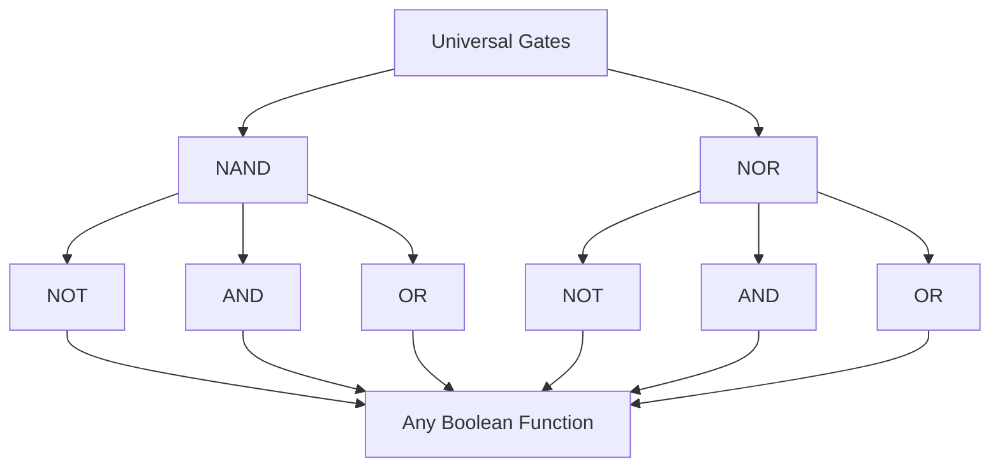

## Introduction

In an ideal manufacturing world, consistency is king. Imagine a construction company that only needs one specific type of multi-purpose brick to build foundations, walls, and chimneys. In digital electronics, we face a similar challenge. While the basic logic set of **NOT**, **AND**, and **OR** can describe any logical operation, fabricating three different types of physical gates on a silicon chip is less efficient than mass-producing just one.

This is where **universal gates** come in. A universal gate is a logic gate that can be used to implement any Boolean function without the need for any other gate type. The two primary universal gates are **NAND** (Not-AND) and **NOR** (Not-OR). Because they are easier and cheaper to manufacture using CMOS (Complementary Metal-Oxide-Semiconductor) technology, almost all modern integrated circuits are built primarily from NAND gates.

In this lesson, we will explore the truth tables for these gates, prove their universality by deriving the basic logic operations from them, and learn how to swap standard gates for their universal equivalents using "bubbled" logic.

**Before you start:** You should be comfortable with basic logic gates (AND, OR, NOT) and understand *De Morgan's Laws & Canonical Forms*, as we will use these laws to prove gate equivalencies.

## Core theory

### The NAND Gate

The **NAND gate** is the complement of the AND gate. Its output is **LOW** (0) only when all of its inputs are **HIGH** (1). If any input is 0, the output is 1. Mathematically, for two inputs $A$ and $B$, the output $Y$ is expressed as:

$$Y = \overline{A \cdot B}$$

The truth table for a 2-input NAND gate is as follows:

| Input A | Input B | Output Y (NAND) |
| :--- | :--- | :--- |
| 0 | 0 | 1 |
| 0 | 1 | 1 |
| 1 | 0 | 1 |
| 1 | 1 | 0 |

In circuit diagrams, the NAND gate is represented by an AND gate symbol with a small circle (a "bubble") at the output, indicating the inversion.

### The NOR Gate

The **NOR gate** is the complement of the OR gate. Its output is **HIGH** (1) only when all of its inputs are **LOW** (0). If any input is 1, the output is 0. For two inputs $A$ and $B$, the output $Y$ is:

$$Y = \overline{A + B}$$

The truth table for a 2-input NOR gate is:

| Input A | Input B | Output Y (NOR) |
| :--- | :--- | :--- |
| 0 | 0 | 1 |
| 0 | 1 | 0 |
| 1 | 0 | 0 |
| 1 | 1 | 0 |

Like the NAND gate, the NOR gate is represented by an OR gate symbol with a bubble at the output.

### Functional Completeness

A set of logical operators is called **functionally complete** if every possible Boolean function can be expressed using only members of that set. The standard set $\{NOT, AND, OR\}$ is functionally complete. 

To prove that a single gate is universal, we must demonstrate that it can replicate the behavior of NOT, AND, and OR. If a NAND gate can act as a NOT gate, an AND gate, and an OR gate, then any circuit built with $\{NOT, AND, OR\}$ can be rebuilt using only NAND gates.

### NAND as a Universal Gate

We can implement the three basic operations using only NAND gates through the following configurations:

1.  **NOT Implementation**: Tie both inputs of a NAND gate together. Since $A \cdot A = A$ (Idempotent Law), the output becomes $\overline{A \cdot A} = \overline{A}$.
2.  **AND Implementation**: An AND gate is simply an inverted NAND gate. We take the output of a NAND gate and pass it through a NAND-configured NOT gate.
    $$Y = \overline{\overline{A \cdot B}} = A \cdot B$$
3.  **OR Implementation**: According to De Morgan's Law, $A + B = \overline{\overline{A} \cdot \overline{B}}$. To implement this, we invert inputs $A$ and $B$ (using NAND-NOTs) and feed the results into a third NAND gate.
    $$Y = \overline{\overline{A} \cdot \overline{B}} = \overline{\overline{A}} + \overline{\overline{B}} = A + B$$

### NOR as a Universal Gate

Similarly, the NOR gate can replicate the basic set:

1.  **NOT Implementation**: Tie both inputs of a NOR gate together. $\overline{A + A} = \overline{A}$.
2.  **OR Implementation**: A NOR gate followed by a NOR-configured NOT gate.
    $$Y = \overline{\overline{A + B}} = A + B$$
3.  **AND Implementation**: Using De Morgan's Law, $A \cdot B = \overline{\overline{A} + \overline{B}}$. Invert the inputs using NOR-NOTs and feed them into a NOR gate.
    $$Y = \overline{\overline{A} + \overline{B}} = \overline{\overline{A}} \cdot \overline{\overline{B}} = A \cdot B$$

### Bubbled Gate Equivalence

A useful visualization tool in digital logic is the **bubbled gate**. A bubble represents a NOT operation. De Morgan's Laws provide two critical equivalencies that help in converting circuits:

*   **Bubbled OR**: A NAND gate is equivalent to an OR gate with inverted inputs.
    $$\overline{A \cdot B} = \overline{A} + \overline{B}$$
*   **Bubbled AND**: A NOR gate is equivalent to an AND gate with inverted inputs.
    $$\overline{A + B} = \overline{A} \cdot \overline{B}$$

This means if you see an OR gate with bubbles on its inputs, it is functionally a NAND gate. If you see an AND gate with bubbles on its inputs, it is functionally a NOR gate.



## Worked examples

### Example 1: Implementing a Sum-of-Products (SOP) expression with NAND gates

Consider the Boolean function $F = (A \cdot B) + (C \cdot D)$. This is a standard two-level AND-OR circuit. We want to implement this using only 2-input NAND gates.

**Step 1: Analyze the structure.**
The expression has two AND terms fed into one OR gate.

**Step 2: Apply double inversion.**
A fundamental trick in logic design is that $\overline{\overline{F}} = F$. Let's apply this to the whole expression:
$$F = \overline{\overline{(A \cdot B) + (C \cdot D)}}$$

**Step 3: Apply De Morgan's Law to the inner bar.**
$$\overline{(A \cdot B) + (C \cdot D)} = \overline{(A \cdot B)} \cdot \overline{(C \cdot D)}$$
Now, substitute this back into the double-inverted expression:
$$F = \overline{\overline{(A \cdot B)} \cdot \overline{(C \cdot D)}}$$

**Step 4: Identify the NAND operations.**
1.  $G_1 = \overline{A \cdot B}$ (NAND gate 1)
2.  $G_2 = \overline{C \cdot D}$ (NAND gate 2)
3.  $F = \overline{G_1 \cdot G_2}$ (NAND gate 3)

**Final Answer:** The SOP expression $AB + CD$ can be implemented using exactly three NAND gates: two to perform the initial NANDing of the pairs, and one to NAND those results together.

### Example 2: Verifying XOR implementation using NAND gates

The XOR operation $Y = A \oplus B$ is defined as $A\overline{B} + \overline{A}B$. A common efficient implementation uses four NAND gates. Let's trace the logic to ensure the output matches the XOR truth table.

The four-gate NAND XOR circuit is defined by these intermediate steps:
1.  $N_1 = \overline{A \cdot B}$
2.  $N_2 = \overline{A \cdot N_1}$
3.  $N_3 = \overline{B \cdot N_1}$
4.  $Y = \overline{N_2 \cdot N_3}$

Let's calculate the output for $A=1, B=1$:
1.  $N_1 = \overline{1 \cdot 1} = 0$
2.  $N_2 = \overline{1 \cdot 0} = 1$
3.  $N_3 = \overline{1 \cdot 0} = 1$
4.  $Y = \overline{1 \cdot 1} = 0$
This matches the XOR result for $(1,1)$.

We can verify this for all inputs using a Python script:

```python
def nand(a, b):
    return int(not (a and b))

def xor_nand(a, b):
    # Gate 1: NAND of inputs
    n1 = nand(a, b)
    # Gate 2 and 3: NAND inputs with n1
    n2 = nand(a, n1)
    n3 = nand(b, n1)
    # Gate 4: Final NAND
    return nand(n2, n3)

print("A B | Output")
for a in [0, 1]:
    for b in [0, 1]:
        print(f"{a} {b} | {xor_nand(a, b)}")
```

Output:
```text
A B | Output
0 0 | 0
0 1 | 1
1 0 | 1
1 1 | 0
```

**Final Answer:** The truth table confirms that the four-NAND configuration successfully implements the XOR function.

## Applications

*   **ASIC and FPGA Design:** In Application-Specific Integrated Circuits (ASICs), using a single gate type like NAND simplifies the physical layout and routing of the chip. It allows for a highly regular structure in the silicon.
*   **NAND Flash Memory:** As the name suggests, this ubiquitous storage technology (found in SSDs and USB drives) uses NAND gate structures to store data bits. The simplicity of the NAND structure allows for extremely high density.
*   **Cost Reduction in Manufacturing:** Purchasing millions of units of a single component (e.g., a Quad 2-input NAND IC like the 74HC00) is significantly cheaper than buying smaller quantities of various different gate types.
*   **Logic Minimization:** Engineers often convert designs to all-NAND or all-NOR logic to reduce the total number of transistors. In CMOS, a NAND gate requires 4 transistors, whereas an AND gate requires 6 (a NAND followed by an inverter).

## Common mistakes

*   **The mistake:** Thinking that a NAND gate with one input tied to ground (0) acts as an inverter.
    **Why it is wrong:** If one input of a NAND is 0, the output is always 1, regardless of the other input ($\overline{A \cdot 0} = \overline{0} = 1$). To create an inverter, you must tie the inputs together or tie the unused input to VCC (Logic 1).
*   **The mistake:** Forgetting the final inversion when converting OR to NAND.
    **Why it is wrong:** Beginners often think $A+B$ is just NANDing $A$ and $B$. In reality, $A+B$ requires inverting the inputs *before* NANDing them.
*   **The mistake:** Misapplying De Morgan's Law during manual conversion.
    **Why it is wrong:** Students often forget to change the operator when breaking a bar. Remember: "Break the bar, change the sign." $\overline{A \cdot B}$ becomes $\overline{A} + \overline{B}$, not $\overline{A} \cdot \overline{B}$.
*   **The mistake:** Assuming NOR and NAND logic are interchangeable without changing the circuit topology.
    **Why it is wrong:** While both are universal, the way they implement basic gates is "mirrored." For example, an AND gate is a NAND followed by a NOT, but it is a NOR with inverted inputs.

## Revision notes

*   **NAND Definition:** $Y = \overline{A \cdot B}$. Output is 0 only if all inputs are 1.
*   **NOR Definition:** $Y = \overline{A + B}$. Output is 1 only if all inputs are 0.
*   **Universal Property:** Both NAND and NOR can implement NOT, AND, and OR.
*   **NAND as NOT:** Connect all inputs together.
*   **NAND as AND:** A NAND gate followed by a NAND-inverter.
*   **NAND as OR:** Invert inputs using NANDs, then feed into a NAND gate.
*   **NOR as NOT:** Connect all inputs together.
*   **NOR as OR:** A NOR gate followed by a NOR-inverter.
*   **NOR as AND:** Invert inputs using NORs, then feed into a NOR gate.
*   **De Morgan's Equivalency:** NAND is a bubbled-OR; NOR is a bubbled-AND.

## Practice questions

:::question basic
What is the output of a 3-input NAND gate if the inputs are $A=1, B=0, C=1$?
:::answer
The output is 1. A NAND gate output is 0 only if **all** inputs are 1. Since input $B$ is 0, the product $A \cdot B \cdot C = 0$, and the inversion $\overline{0} = 1$.
:::

:::question basic
How many NOR gates are required to create a single NOT gate, and how are the inputs connected?
:::answer
One NOR gate is required. The inputs must be tied together so that the same signal is applied to both, resulting in $\overline{A + A} = \overline{A}$.
:::

:::question intermediate
Using only NAND gates, how would you implement the function $Y = \overline{A} + B$?
:::answer
First, recognize that by De Morgan's Law, $\overline{A} + B = \overline{A \cdot \overline{B}}$. To implement this with NAND gates:
1. Use one NAND gate as an inverter to produce $\overline{B}$ from $B$.
2. Feed $A$ and $\overline{B}$ into a second NAND gate.
The result is $\overline{A \cdot \overline{B}}$, which is equivalent to $\overline{A} + B$.
:::

:::question intermediate
A circuit consists of an AND gate followed by a NOR gate. If the inputs to the AND gate are $A$ and $B$, and the other input to the NOR gate is $C$, write the Boolean expression and determine the output when $A=1, B=1, C=0$.
:::answer
The expression is $Y = \overline{(A \cdot B) + C}$. 
For $A=1, B=1, C=0$:
1. $A \cdot B = 1 \cdot 1 = 1$.
2. $(1) + C = 1 + 0 = 1$.
3. $\overline{1} = 0$.
The final output is 0.
:::

:::question advanced
Prove that a 2-input NAND gate can be used to implement a 2-input NOR gate. How many NAND gates are needed?
:::answer
To implement NOR ($Y = \overline{A+B}$) using NAND, we use De Morgan's: $\overline{A+B} = \overline{A} \cdot \overline{B}$. 
1. Invert $A$ using a NAND-NOT (Gate 1).
2. Invert $B$ using a NAND-NOT (Gate 2).
3. AND the results: $\overline{A} \cdot \overline{B}$. Since an AND is a NAND followed by a NOT, we NAND the results (Gate 3) and then invert that output (Gate 4).
However, we can simplify: $\overline{A} \cdot \overline{B}$ is the same as $\overline{\overline{\overline{A} \cdot \overline{B}}}$. 
Wait, the standard OR is $\overline{\overline{A} \cdot \overline{B}}$. To get NOR, we just invert the OR.
So: Invert $A$ (Gate 1), Invert $B$ (Gate 2), NAND them (Gate 3) to get OR, then Invert the result (Gate 4) to get NOR.
Total: 4 NAND gates.
:::

:::question advanced
In CMOS technology, a NAND gate is faster and smaller than a NOR gate. If you are designing a high-speed decoder, why might you prefer a NAND-NAND implementation over an AND-OR implementation?
:::answer
An AND-OR implementation physically requires three stages of inversion (NAND + NOT for AND, then the OR stage), leading to higher propagation delay. A NAND-NAND implementation is logically equivalent to AND-OR but uses only two stages of NAND gates. Because each NAND gate in CMOS has fewer series transistors than a NOR gate of the same size, the NAND-NAND structure minimizes both the transistor count and the total propagation delay, resulting in a faster circuit.
:::

## Further learning

*   **Next:** *Karnaugh Map Minimization* shows you how to take the Boolean expressions derived here and simplify them to the absolute minimum number of gates before converting them to universal forms.
*   **Next:** *Adders & Multiplexers Design* applies universal gate theory to build functional arithmetic units, which are the core of any CPU.
*   **Related:** *De Morgan's Laws & Canonical Forms* provides the algebraic foundation used to prove the equivalencies discussed in this lesson.
*   **Related:** *Latches vs Flip-Flops Timing* explores how cross-coupled NAND or NOR gates can be used to create memory elements that store bits.
*   **Textbook:** "Digital Design" by M. Morris Mano and Michael D. Ciletti is an excellent resource for visualizing gate conversions and understanding the transistor-level logic of universal gates.
