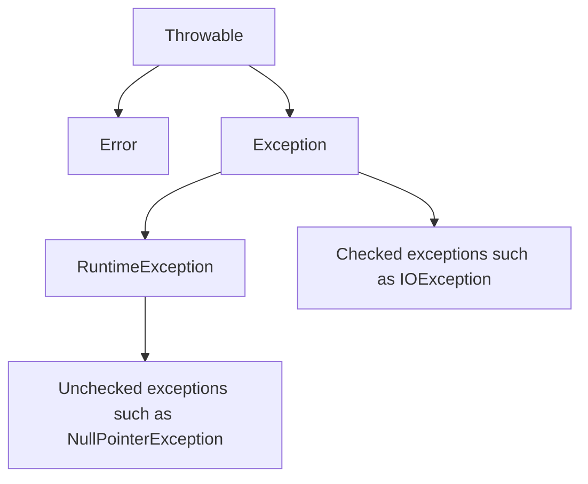

## Introduction

Java takes errors seriously enough to make some of them part of a method's type. If a method can fail in a way the caller should plan for, such as a missing file, it must **declare** that exception, and every caller must handle it or declare it too. Other failures, such as a null reference or a bad index, are programming bugs that can happen anywhere and are not declared. Understanding this split, and the clean-up tools that go with it, is essential for writing reliable Java.

**Before you start:** you should know classes, inheritance, and interfaces.

## Core theory

### The Throwable hierarchy



- **`Error`**: serious JVM problems such as `OutOfMemoryError` and `StackOverflowError`; applications normally do not catch these.
- **Checked exceptions**: subclasses of `Exception` that are not `RuntimeException`, such as `IOException` and `SQLException`. They represent recoverable conditions outside the program's control.
- **Unchecked exceptions**: `RuntimeException` and its subclasses, such as `NullPointerException`, `IllegalArgumentException`, `IndexOutOfBoundsException`, and `ArithmeticException`, usually caused by bugs or invalid arguments.

### The catch-or-declare rule

For checked exceptions, the compiler enforces that every method that can throw one either **catches** it or **declares** it with `throws`: `String read(Path p) throws IOException`. Unchecked exceptions need no declaration. The rule makes recoverable failure modes visible in method signatures.

### try, catch, finally

```java
try {
    risky();
} catch (FileNotFoundException e) {
    ...
} catch (IOException | ParseException e) {   // multi-catch
    ...
} finally {
    ...                                       // always runs
}
```

Catch clauses are tested in order, so more specific types must come first; the compiler rejects a clause that can never be reached. `finally` runs whether the block completes normally, throws, or returns, so it is used for clean-up. Avoid `return` inside `finally`, which silently discards any pending exception.

### try-with-resources

Any object implementing **`AutoCloseable`** (files, streams, sockets, database connections) can be declared in a try-with-resources statement:

```java
try (BufferedReader in = Files.newBufferedReader(path)) {
    ...
}
```

Its `close()` method is called automatically when the block ends, in reverse order of declaration if there are several resources, even if an exception is thrown. If both the body and `close()` throw, the body's exception propagates and the close exception is attached as a **suppressed** exception (`getSuppressed()`), so no information is lost.

### Throwing, custom exceptions, and chaining

`throw new IllegalArgumentException("age must be positive")` signals an error. Custom exceptions extend `Exception` (checked) or `RuntimeException` (unchecked) and pass a message, and optionally a cause, to the superclass constructor. When translating a low-level exception into a higher-level one, pass the original as the **cause**: `throw new ReportException("could not load sales data", e);`. The stack trace then shows both, with "Caused by:".

### Choosing checked or unchecked

Use a **checked** exception when the caller can reasonably recover, such as a file that might not exist. Use an **unchecked** exception for programming errors and violated preconditions, such as a null argument, which the caller should fix rather than handle. Never swallow exceptions silently with an empty `catch`.

## Worked examples

### Example 1: Order of handlers, finally, and a custom checked exception

```java
public class Main {
    static class InsufficientFundsException extends Exception {
        private final double shortBy;
        InsufficientFundsException(double shortBy) {
            super("short by " + shortBy);
            this.shortBy = shortBy;
        }
        double getShortBy() { return shortBy; }
    }

    static double withdraw(double balance, double amount) throws InsufficientFundsException {
        if (amount <= 0) throw new IllegalArgumentException("amount must be positive");
        if (amount > balance) throw new InsufficientFundsException(amount - balance);
        return balance - amount;
    }

    public static void main(String[] args) {
        double[] requests = {30, 250, -5};
        for (double amount : requests) {
            try {
                System.out.println("new balance " + withdraw(100, amount));
            } catch (InsufficientFundsException e) {
                System.out.println("declined: " + e.getMessage() + " (needs " + e.getShortBy() + " more)");
            } catch (IllegalArgumentException e) {
                System.out.println("invalid: " + e.getMessage());
            } finally {
                System.out.println("request for " + amount + " logged");
            }
        }
    }
}
```

Output:

```text
new balance 70.0
request for 30.0 logged
declined: short by 150.0 (needs 150.0 more)
request for 250.0 logged
invalid: amount must be positive
request for -5.0 logged
```

`withdraw` must declare the checked `InsufficientFundsException`, and `main` must handle it; the unchecked `IllegalArgumentException` needs no declaration. The `finally` block runs after every request.

### Example 2: try-with-resources, suppressed exceptions, and chaining

```java
public class Main {
    static class Resource implements AutoCloseable {
        private final String name;
        private final boolean failOnClose;
        Resource(String name, boolean failOnClose) {
            this.name = name;
            this.failOnClose = failOnClose;
            System.out.println("open " + name);
        }
        @Override public void close() {
            System.out.println("close " + name);
            if (failOnClose) throw new IllegalStateException("close failed for " + name);
        }
    }

    static class ReportException extends RuntimeException {
        ReportException(String message, Throwable cause) { super(message, cause); }
    }

    static void buildReport() {
        try (Resource db = new Resource("db", false); Resource file = new Resource("file", true)) {
            throw new IllegalStateException("query failed");
        } catch (IllegalStateException e) {
            System.out.println("caught: " + e.getMessage() + ", suppressed: " + e.getSuppressed()[0].getMessage());
            throw new ReportException("report could not be built", e);
        }
    }

    public static void main(String[] args) {
        try {
            buildReport();
        } catch (ReportException e) {
            System.out.println(e.getMessage() + " <- caused by: " + e.getCause().getMessage());
        }
    }
}
```

Output:

```text
open db
open file
close file
close db
caught: query failed, suppressed: close failed for file
report could not be built <- caused by: query failed
```

Both resources are closed automatically, in reverse order, before the `catch` runs. The failure in `file.close()` does not hide the original error: it is recorded as a suppressed exception. Wrapping the error in `ReportException` with its cause keeps the full story for whoever reads the logs.

## Applications

- **File and network code:** checked `IOException`s force callers to plan for failures.
- **Input validation:** `IllegalArgumentException` reports bad arguments immediately.
- **Database access:** try-with-resources closes connections and statements reliably.
- **Layered applications:** each layer translates exceptions into its own vocabulary, chaining the cause.

## Common mistakes

- **Empty catch blocks.** They hide failures; at least log the exception.
- **Catching `Exception` or `Throwable` too early.** It also catches bugs you want to see; catch specific types.
- **Closing resources manually in `finally`.** It is verbose and easy to get wrong; use try-with-resources.
- **Losing the cause when rethrowing.** Pass the original exception to the new one's constructor.
- **Returning from `finally`.** It discards pending exceptions.

## Revision notes

- `Throwable` → `Error` (do not catch) and `Exception` → checked and `RuntimeException` (unchecked).
- Checked exceptions must be caught or declared with `throws`.
- Catch specific types first; multi-catch with `|`; `finally` always runs.
- try-with-resources closes `AutoCloseable` resources in reverse order; close failures are suppressed.
- Custom exceptions extend `Exception` or `RuntimeException`; chain causes.
- Checked for recoverable conditions, unchecked for programming errors.

## Practice questions

:::question basic
What is the difference between a checked and an unchecked exception?
:::answer
A checked exception (a subclass of `Exception` but not of `RuntimeException`) must be caught or declared with `throws`, and the compiler enforces this. An unchecked exception (`RuntimeException` or its subclasses) needs no declaration and usually indicates a programming error.
:::

:::question basic
When does a `finally` block run?
:::answer
After the `try` block and any matching `catch` block, whether the `try` completed normally, threw an exception (caught or not), or executed a `return`. It is skipped only in extreme cases such as the JVM exiting.
:::

:::question intermediate
Why does the compiler reject `catch (IOException e) { } catch (FileNotFoundException e) { }`?
:::answer
`FileNotFoundException` is a subclass of `IOException`, so the first clause already catches every `FileNotFoundException`, and the second clause is unreachable. The specific type must come before the general one.
:::

:::question intermediate
What happens if both the body of a try-with-resources statement and the resource's `close()` throw exceptions?
:::answer
The exception from the body is the one that propagates, and the exception from `close()` is attached to it as a suppressed exception, retrievable with `getSuppressed()`. This preserves the original failure while not losing the clean-up failure.
:::

:::question advanced
A data-access method catches `SQLException` and throws `new DataAccessException("save failed")`. In production, the logs show only "save failed". What went wrong, and how should it be written?
:::answer
The new exception was created without its cause, so the original `SQLException`, with its message, error code, and stack trace, was discarded. Pass it as the cause: `throw new DataAccessException("save failed", e);`, where the custom exception's constructor calls `super(message, cause)`. The stack trace then includes "Caused by: java.sql.SQLException ...".
:::

## Further learning

- **Next:** *Java Collections Framework Core* shows the exceptions collections throw, such as `ConcurrentModificationException`.
- **Related:** *File I/O with java.nio* uses try-with-resources with real files.
