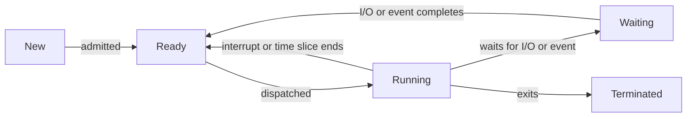

## Introduction

A program is a file: a sequence of instructions sitting on disk, doing nothing. A **process** is a program in execution. Start the same text editor twice and you have two processes running one program, each with its own open documents, its own position in the code, and its own memory. The process is the operating system's fundamental unit of work: it is what gets scheduled, what owns memory and open files, and what is protected from other processes.

At any moment a computer may have hundreds of processes, but only as many can run as there are CPU cores. The rest are waiting for their turn, or waiting for something to happen, such as a key press or a disk read. To juggle them, the kernel keeps a record for each one, the **process control block (PCB)**, and moves each process through a small set of **states**. This lesson describes those states, the PCB, and the **context switch** that lets one CPU run many processes.

**Before you start:** you should know what system calls and interrupts are.

## Core theory

### What a process contains

A process's **address space** is usually laid out in four regions:

| Region | Contents | Growth |
| :--- | :--- | :--- |
| Text (code) | the program's machine instructions, usually read-only | fixed |
| Data | global and static variables (initialised and uninitialised) | fixed |
| Heap | memory allocated at run time (`malloc`, `new`, Python objects) | grows upwards |
| Stack | function call frames: parameters, local variables, return addresses | grows downwards |

Besides memory, a process has an execution state (the program counter and CPU registers), open files and network connections, an owner (user ID) and permissions, and accounting information.

### The five-state model



- **New:** the process is being created; the kernel is allocating its PCB and memory.
- **Ready:** it could run and is waiting only for a CPU. Ready processes sit in the **ready queue**.
- **Running:** its instructions are executing on a CPU. On a machine with $k$ cores, at most $k$ processes are running at once.
- **Waiting (blocked):** it cannot continue until some event occurs, such as a disk read completing, a key being pressed, or a lock being released. Waiting processes sit in **device or event queues**.
- **Terminated:** it has finished; the kernel is reclaiming its resources.

Two transitions are worth noticing. A process never goes directly from **waiting to running**: when its event occurs, it becomes ready and must be chosen by the scheduler again. And the transition from **running to ready** happens only in **preemptive** systems, when a timer interrupt ends the process's time slice or a higher-priority process becomes ready.

Many systems add **suspended** states (ready-suspended and waiting-suspended) for processes whose memory has been swapped out to disk; they must be brought back into memory before they can run.

### The process control block

The PCB (called `task_struct` in Linux) is the kernel's data structure for a process. Typical fields:

| Field | Why it is needed |
| :--- | :--- |
| Process ID (PID), parent's PID | identify the process and its family |
| Process state | ready, running, waiting, and so on |
| Program counter and CPU registers | saved on a context switch so the process can resume exactly where it stopped |
| CPU-scheduling information | priority, time used, pointers into scheduling queues |
| Memory-management information | page-table base or segment registers, memory limits |
| Accounting information | CPU time consumed, start time, resource limits |
| I/O status information | open file table, devices allocated, pending I/O |
| Credentials | user and group IDs used for permission checks |

The kernel organises PCBs into queues: one ready queue, and a waiting queue for each device or event. Moving a process between states mostly means moving its PCB from one queue to another.

### The context switch

When the CPU switches from process A to process B, the kernel:

1. Enters kernel mode (because of an interrupt, a system call, or an exception).
2. Saves A's registers and program counter into A's PCB, and updates A's state (to ready or waiting).
3. Chooses B (the scheduler's job) and marks it running.
4. Switches the memory context to B's address space, by loading B's page-table base register.
5. Restores B's registers and program counter from B's PCB and returns to user mode in B.

A context switch is **pure overhead**: no user work happens during it. The direct cost (saving and restoring state) is typically on the order of microseconds. The **indirect cost** is often larger: B starts with **cold caches** and, unless the hardware tags entries by address space, an emptied **translation lookaside buffer (TLB)**, so its first memory accesses are slow. This is why schedulers avoid switching more often than necessary.

### Creating and ending processes

In UNIX-like systems, a process creates another with **`fork()`**, which makes a nearly identical copy of the caller. Both continue from the point of the call; `fork` returns 0 in the child and the child's PID in the parent. The child often calls **`exec()`** to replace its program with a different one. The parent can call **`wait()`** to block until a child exits and to collect its **exit status**. Windows instead provides `CreateProcess`, which creates a process and loads a new program in one step.

When a process exits, the kernel frees most of its resources but keeps a small entry holding its exit status until the parent collects it. A process in this state is a **zombie**. If a parent exits before its children, the children become **orphans** and are adopted by a system process (`init` or `systemd` on Linux), which collects their exit status so they do not remain zombies forever.

## Worked examples

### Example 1: Tracing the states of three processes

One CPU runs three processes, scheduled in round-robin order. P1 runs and requests a disk read; P2 is dispatched and uses its whole time slice; P3 runs and exits; P1's disk read completes.

| Event | P1 | P2 | P3 |
| :--- | :--- | :--- | :--- |
| start | running | ready | ready |
| P1 requests a disk read | waiting | running | ready |
| timer interrupt ends P2's slice | waiting | ready | running |
| P3 exits | waiting | running | terminated |
| P1's disk read completes (interrupt) | ready | running | terminated |

When the disk interrupt arrives, P1 does not take the CPU from P2; it joins the ready queue. Whether it then preempts P2 depends on the scheduling policy and priorities.

### Example 2: Checking state transitions in code

The five-state model is a small state machine. This simulation rejects transitions the model does not allow.

```python
ALLOWED = {
    ("new", "ready"),           # admitted
    ("ready", "running"),       # dispatched by the scheduler
    ("running", "ready"),       # preempted: interrupt or time slice over
    ("running", "waiting"),     # waits for I/O or an event
    ("waiting", "ready"),       # the I/O or event completes
    ("running", "terminated"),  # exits
}

class PCB:
    def __init__(self, pid):
        self.pid, self.state, self.history = pid, "new", ["new"]

    def move(self, new_state):
        if (self.state, new_state) not in ALLOWED:
            raise ValueError(f"PID {self.pid}: {self.state} -> {new_state} is not a legal transition")
        self.state = new_state
        self.history.append(new_state)

p = PCB(101)
for state in ["ready", "running", "waiting", "ready", "running", "terminated"]:
    p.move(state)
print(" -> ".join(p.history))

q = PCB(102)
q.move("ready")
q.move("running")
q.move("waiting")
try:
    q.move("running")           # skipping the ready queue
except ValueError as error:
    print(error)
```

Output:

```text
new -> ready -> running -> waiting -> ready -> running -> terminated
PID 102: waiting -> running is not a legal transition
```

The second process tries to go straight from waiting to running, which the model forbids: a process whose I/O has completed must first become ready and then be chosen by the scheduler.

### Example 3: Creating a child process and collecting its exit status

On UNIX-like systems, a C program creates a child like this (the PIDs printed depend on the system):

```c
#include <stdio.h>
#include <stdlib.h>
#include <sys/wait.h>
#include <unistd.h>

int main(void) {
    pid_t pid = fork();                 /* returns twice: 0 in the child, the child's PID in the parent */
    if (pid < 0) {
        perror("fork");
        return 1;
    }
    if (pid == 0) {                     /* child */
        printf("child %d running\n", (int)getpid());
        exit(3);
    }
    int status;
    waitpid(pid, &status, 0);           /* parent blocks until the child exits */
    if (WIFEXITED(status))
        printf("child %d exited with status %d\n", (int)pid, WEXITSTATUS(status));
    return 0;
}
```

Until the parent calls `waitpid`, the exited child is a zombie: its memory is freed, but its PCB entry remains so that the exit status 3 can be reported. Python's `subprocess` module wraps the same create-run-wait cycle portably:

```python
import subprocess
import sys

child = subprocess.run(
    [sys.executable, "-c", "import sys; print('child running'); sys.exit(3)"],
    capture_output=True, text=True,
)
print(child.stdout.strip(), "| exit status:", child.returncode)
```

Output:

```text
child running | exit status: 3
```

`subprocess.run` creates the child process, waits for it to terminate, and returns its exit status, just as `fork`, `exec`, and `waitpid` do in C.

## Applications

- **Task managers and `ps`/`top`** display PCB information: PID, state, CPU time, memory use, and owner.
- **Shells** run every command as a child process with `fork` and `exec`, and use `wait` to learn whether it succeeded.
- **Web servers** such as early versions of Apache created a process per connection or kept a pool of worker processes, isolating requests from one another.
- **Browsers** run each site or tab in a separate process, so a crash or a malicious page is contained.
- **Performance tuning:** measuring context-switch rates helps diagnose systems that spend too much time switching instead of working.

## Common mistakes

- **Treating "program" and "process" as synonyms.** One program can be running as many processes at once.
- **Moving a process from waiting directly to running.** It must pass through the ready state.
- **Confusing waiting with ready.** A ready process needs only the CPU; a waiting process cannot run even if the CPU is free.
- **Assuming a context switch costs only register saving.** Cache and TLB effects often dominate.
- **Forgetting to wait for children,** which leaves zombie processes accumulating in a long-running parent.

## Revision notes

- Process = program in execution: text, data, heap, stack, registers, open files, credentials.
- States: new, ready, running, waiting, terminated (plus suspended states when swapped out).
- Ready ↔ running via dispatch and preemption; running → waiting on I/O; waiting → ready when the event completes.
- PCB: PID, state, saved registers and PC, scheduling data, memory-management data, accounting, I/O status, credentials.
- Context switch: save the old PCB, pick the next process, switch the address space, restore its PCB. Pure overhead, with cache and TLB costs.
- `fork` copies the process, `exec` replaces the program, `wait` collects the exit status; zombies await collection, orphans are adopted.

## Practice questions

:::question basic
What is the difference between the ready state and the waiting state?
:::answer
A ready process has everything it needs except a CPU; it would run immediately if the scheduler chose it. A waiting (blocked) process cannot make progress even if a CPU is free, because it needs an event to happen first, such as I/O completing or a lock becoming available.
:::

:::question basic
Why does the PCB store the program counter and the CPU registers?
:::answer
When a process is switched out, the CPU's registers are overwritten by the next process. To resume the first process later exactly where it stopped, the kernel must restore the program counter (the next instruction to execute) and every register value it was using. The PCB is where these are kept between runs.
:::

:::question intermediate
For each transition, name an event that causes it: ready to running, running to ready, running to waiting, and waiting to ready.
:::answer
Ready to running: the scheduler dispatches the process, for example because the running process blocked or its time slice ended. Running to ready: a timer interrupt ends the time slice, or a higher-priority process becomes ready and preempts it. Running to waiting: the process requests I/O, such as reading a file, or waits for a lock or a child process. Waiting to ready: the I/O completes (signalled by an interrupt), the lock is released, or the awaited event occurs.
:::

:::question intermediate
A context switch takes 5 microseconds and the scheduler switches every 1 millisecond. What fraction of CPU time is spent switching? What if it switched every 10 microseconds?
:::answer
Each 1 ms slice carries 5 µs of switching, so the overhead is $5 / (1000 + 5) \approx 0.5\%$. With 10 µs slices, the overhead is $5 / (10 + 5) \approx 33\%$: a third of the CPU's time is wasted on switching, even before counting the cache and TLB effects. This is why time slices must be much longer than the context-switch time.
:::

:::question intermediate
After `fork()`, how does the code know whether it is running in the parent or the child?
:::answer
By the return value. `fork` returns 0 in the child and the child's PID (a positive number) in the parent. A negative value means the fork failed and no child was created. Programs typically use an `if` statement on this value to give the parent and the child different work.
:::

:::question advanced
A long-running server forks a child for each request but never calls `wait`. What happens over time, and how can it be fixed?
:::answer
Each child that exits becomes a zombie, because its parent never collects its exit status. Zombies use no memory for code or data, but each occupies a process-table entry and a PID. After many requests, the system can run out of PIDs or process slots, and new processes cannot be created. Fixes: call `waitpid` with the `WNOHANG` option periodically or in a `SIGCHLD` signal handler to reap finished children, or set the handling of `SIGCHLD` to ignore so the kernel reaps them automatically (on systems that support this behaviour).
:::

## Further learning

- **Next:** *Kernel vs User Threads* splits a process into several threads that share its address space.
- **Related:** *Scheduling Criteria & Dispatcher* explains how the scheduler chooses among ready processes.
- **Related:** *System Calls & Dual-Mode Execution* covers the traps that cause many state transitions.
