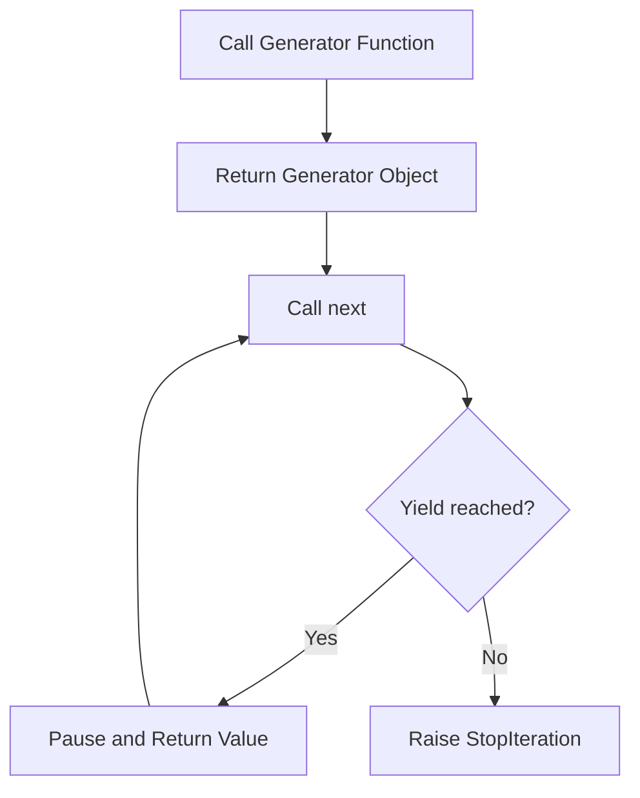

## Introduction

Imagine you are tasked with analyzing a server log file that is 100 gigabytes in size. If you attempt to read the entire file into a Python list using `f.readlines()`, your program will likely crash as it exceeds the available RAM. However, you only need to process one line at a time to calculate the total number of error messages. This is the fundamental problem solved by **lazy evaluation**.

In Python, iterators and generators allow us to handle data streams of arbitrary size—even infinite ones—by producing items only when they are specifically requested. Instead of storing a collection in memory, we store the *logic* required to generate the next item. This lesson covers the mechanics of the iteration protocol, the creation of generator functions, and the architectural patterns used to build efficient data pipelines.

**Before you start:** you should be familiar with *Python Variables & Data Types*, *Conditional Branching & Loops*, and *Defining Functions & Scope Resolution*.

## Core theory

### The Iteration Protocol

The **iteration protocol** is a standard interface that allows Python objects to be used in `for` loops, comprehensions, and other contexts that require a sequence of values. It consists of two primary components:

1.  **Iterables**: An object is an **iterable** if it defines an `__iter__` method that returns an iterator. Examples include lists, strings, and dictionaries.
2.  **Iterators**: An object is an **iterator** if it defines a `__next__` method that returns the next value in the sequence or raises a `StopIteration` exception when no more values are available. Iterators must also define an `__iter__` method that returns `self`.

When you write `for item in collection:`, Python internally calls `iter(collection)` to get an iterator and then repeatedly calls `next(iterator)` until `StopIteration` is raised.

### Iterables vs. Iterators

While every iterator is an iterable, not every iterable is an iterator. This distinction is crucial for understanding how state is managed during iteration.

| Feature | Iterable | Iterator |
| :--- | :--- | :--- |
| **Method required** | `__iter__` | `__iter__` and `__next__` |
| **State** | Usually represents a collection. | Represents a position in a stream. |
| **Reusability** | Can often be iterated multiple times. | Exhausted after one pass. |
| **Example** | `[1, 2, 3]` (a list) | `iter([1, 2, 3])` (a list iterator) |

### Generator Functions and the yield Keyword

A **generator function** is a special type of function that returns a **generator object**. Unlike regular functions that use `return` to send a value and terminate, generator functions use the **yield** keyword.

When a generator function is called, it does not execute the body immediately. Instead, it returns a generator object that adheres to the iteration protocol. When `next()` is called on this object, the function executes until it reaches a `yield` statement. At that point:
- The function's state (local variables, instruction pointer) is suspended.
- The yielded value is returned to the caller.
- The next time `next()` is called, execution resumes exactly where it left off.



### Generator Expressions

Just as list comprehensions provide a concise syntax for creating lists, **generator expressions** provide a concise way to create generators. They use parentheses instead of square brackets.

The primary difference is memory consumption. A list comprehension computes all values immediately and stores them in RAM:
$$M_{list} \approx \text{size of element} \times n$$
A generator expression computes values on demand, maintaining a constant memory footprint:
$$M_{gen} \approx \text{constant state overhead}$$

### Lazy Pipelines

Generators can be chained together to form **lazy pipelines**. In this pattern, each stage of the pipeline "pulls" data from the previous stage only when needed. This is highly efficient for data processing because:
- No intermediate lists are created.
- The CPU can process one item through the entire pipeline before moving to the next, improving cache locality.
- Processing can stop early (e.g., finding the first 10 matches in a billion-row dataset) without processing the entire source.

## Worked examples

### Example 1: Creating a Custom Iterator

We will implement a class `Countdown` that counts down from a starting number to zero. This demonstrates the manual implementation of `__iter__` and `__next__`.

```python
class Countdown:
    def __init__(self, start):
        self.current = start

    def __iter__(self):
        return self

    def __next__(self):
        if self.current < 0:
            raise StopIteration
        val = self.current
        self.current -= 1
        return val

counter = Countdown(3)
for num in counter:
    print(num)
```

**Step-by-step execution:**
1.  `counter = Countdown(3)`: Initializes `self.current` to 3.
2.  `for num in counter`: Calls `iter(counter)`, which returns the object itself.
3.  First iteration: Calls `next(counter)`. `self.current` (3) is not less than 0. `val` becomes 3, `self.current` becomes 2. Returns 3.
4.  Second iteration: Calls `next(counter)`. `self.current` (2) is not less than 0. `val` becomes 2, `self.current` becomes 1. Returns 2.
5.  Third iteration: Calls `next(counter)`. `self.current` (1) is not less than 0. `val` becomes 1, `self.current` becomes 0. Returns 1.
6.  Fourth iteration: Calls `next(counter)`. `self.current` (0) is not less than 0. `val` becomes 0, `self.current` becomes -1. Returns 0.
7.  Fifth iteration: Calls `next(counter)`. `self.current` (-1) is less than 0. Raises `StopIteration`. The loop terminates.

Output:
```text
3
2
1
0
```

### Example 2: Building a Generator Pipeline

We will create a pipeline that takes a range of numbers, filters for even numbers, and squares them. We will compare a list-based approach with a generator-based approach.

```python
# Generator approach
def get_numbers(n):
    for i in range(n):
        yield i

def filter_even(numbers):
    for n in numbers:
        if n % 2 == 0:
            yield n

def square(numbers):
    for n in numbers:
        yield n * n

# Constructing the pipeline
nums = get_numbers(6)
evens = filter_even(nums)
squared_evens = square(evens)

for result in squared_evens:
    print(result)
```

**Step-by-step execution:**
1.  `get_numbers(6)` returns a generator object. No numbers are produced yet.
2.  `filter_even(nums)` returns a generator object. It wraps the first generator.
3.  `square(evens)` returns a generator object. It wraps the second generator.
4.  The `for` loop calls `next()` on `squared_evens`.
5.  `squared_evens` calls `next()` on `evens`, which calls `next()` on `nums`.
6.  `nums` yields 0. `evens` checks `0 % 2 == 0` (True) and yields 0. `squared_evens` yields `0 * 0 = 0`.
7.  The loop calls `next()` again. `nums` yields 1. `evens` checks `1 % 2 == 0` (False) and requests the next value from `nums`.
8.  `nums` yields 2. `evens` checks `2 % 2 == 0` (True) and yields 2. `squared_evens` yields `2 * 2 = 4`.
9.  This continues until `nums` is exhausted.

Output:
```text
0
4
16
```

## Applications

*   **Large File Processing:** Reading logs or CSV files line-by-line using generators prevents memory exhaustion. Standard file objects in Python are themselves iterators that yield lines.
*   **Infinite Sequences:** Generators can represent sequences that never end, such as a stream of prime numbers, sensor readings, or UUIDs, because they only calculate the next value when requested.
*   **Data Science Pipelines:** Tools like TensorFlow and PyTorch use generator-like patterns (DataLoaders) to stream batches of images or text from disk to the GPU, ensuring the system doesn't try to load a terabyte of data into RAM at once.
*   **Web Scraping:** When crawling thousands of pages, generators allow a program to start processing the first page's data while the second page is still being downloaded.

## Common mistakes

*   **Exhausting an Iterator.** Iterators are stateful and one-way. Once you have iterated through an iterator (e.g., using a `for` loop or `list()`), it is empty. If you try to iterate over it again, it will immediately raise `StopIteration`. To iterate again, you must create a new iterator object.
*   **Calling the Generator Function instead of the Generator Object.** If you have `def my_gen(): yield 1`, calling `my_gen` refers to the function. Calling `my_gen()` returns the generator object. Beginners often forget the parentheses or try to call `next(my_gen)` instead of `next(my_gen())`.
*   **Confusing yield with return.** A `return` statement in a generator function raises `StopIteration` and terminates the generator. It does not "yield" a final value in the way many expect. Any code after a `return` or the end of the function body is unreachable by the iterator.
*   **Using a List when a Generator suffices.** Creating a list via `[x for x in range(1000000)]` consumes significant memory. If you only need to loop over the values once, a generator expression `(x for x in range(1000000))` is much more efficient.
*   **Modifying a collection while iterating.** This is a general Python mistake but frequently occurs with iterators. Modifying a list (adding/removing items) while an iterator is tracking its index can lead to skipped items or `RuntimeError`.

## Revision notes

*   **Iterable:** An object with `__iter__` that returns an iterator.
*   **Iterator:** An object with `__next__` (returns next value or raises `StopIteration`) and `__iter__` (returns `self`).
*   **Generator Function:** Uses `yield` to return values lazily and suspend state.
*   **Generator Object:** The instance returned by calling a generator function.
*   **Generator Expression:** `(expression for item in iterable)`—a memory-efficient version of a list comprehension.
*   **Lazy Evaluation:** Computing values only at the moment they are needed.
*   **Memory Complexity:** Generators provide $O(1)$ space complexity for sequence traversal, whereas lists require $O(n)$.
*   **StopIteration:** The built-in exception used to signal the end of an iteration.

## Practice questions

:::question basic
What is the difference between a list and a generator expression in terms of memory and execution timing?
:::answer
A list comprehension executes immediately and stores all resulting elements in memory, requiring $O(n)$ space. A generator expression is lazy; it only calculates the next value when requested and uses $O(1)$ space regardless of the number of elements it will eventually produce.
:::

:::question basic
What happens if you call `next()` on an iterator that has already reached the end of its sequence?
:::answer
The iterator will raise a `StopIteration` exception. This is the standard signal in the iteration protocol to inform the caller (like a `for` loop) that no more data is available.
:::

:::question intermediate
Write a generator function named `powers_of_two` that yields powers of 2 starting from $2^0$ up to $2^n$.
:::answer
```python
def powers_of_two(n):
    for i in range(n + 1):
        yield 2**i
```
This function uses a loop to yield values one by one. Each time `next()` is called, it calculates the next power, yields it, and pauses until the next request.
:::

:::question intermediate
Why must an iterator's `__iter__` method return `self`?
:::answer
This allows an iterator to be used in contexts that expect an iterable, such as a `for` loop. By returning `self`, the iterator satisfies the requirement that an iterable must provide an `__iter__` method, ensuring that you can pass an already-active iterator into any function that accepts a collection.
:::

:::question advanced
Consider a generator function that contains a `try...finally` block. If a generator is partially consumed and then garbage collected, does the `finally` block execute?
:::answer
Yes, Python ensures that the `finally` block executes. When a generator is closed (either explicitly via `.close()` or when it is garbage collected), Python raises a `GeneratorExit` exception inside the generator at the point where it was suspended, triggering any `finally` clauses.
:::

:::question advanced
Explain how you would use generators to find the first 5 lines containing the word "ERROR" in a 500GB log file without loading the file into memory.
:::answer
You would create a generator pipeline: first, an iterator over the file object (which yields lines one by one); second, a generator expression or function that filters these lines for the string "ERROR"; and third, a loop or `itertools.islice` that takes only the first 5 results. Because of lazy evaluation, only the lines up to the 5th error are ever read from the disk, and only one line is in memory at any given time.
:::

## Further learning

*   **Next:** *Closures & Decorators* explores how functions can wrap other functions, building on the concept of function state and execution flow.
*   **Related:** *Lists, Dictionaries & Comprehensions* provides a comparison of eager collection types versus the lazy generators learned here.
*   **Related:** *Try-Except Blocks & Custom Exceptions* is essential for understanding how to handle `StopIteration` and `GeneratorExit` in complex iteration logic.
*   **Related:** *Algorithmic Patterns in Python* demonstrates how iterators are used to implement efficient searching and sorting algorithms.
*   **Textbook:** Lutz, *Learning Python*.
