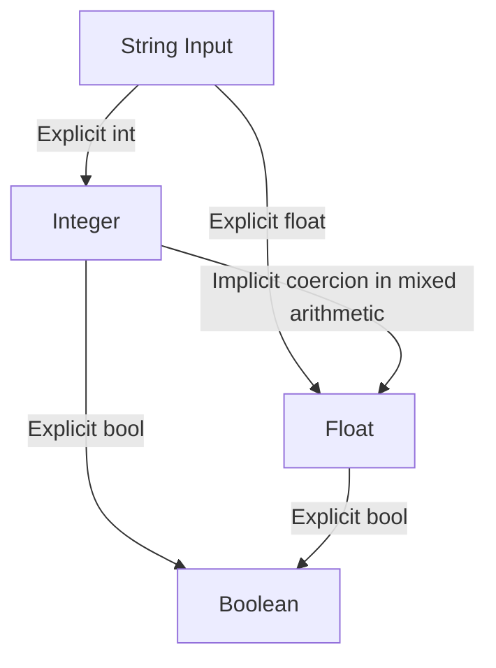

## Introduction

Programs frequently receive data from external sources—such as HTTP request parameters, file streams, or user inputs—in string format. If a script reads the user inputs `"20"` and `"30"` and attempts to combine them using the `+` operator, Python performs string concatenation to produce `"2030"` rather than calculating the numerical sum `50`. To process this data accurately, the program must transform string representations into numeric values.

Understanding how Python shifts data between types and how its operators interact with those types is central to predictable program execution. This lesson covers **type casting** (converting values between types explicitly or implicitly) alongside Python's full complement of operators: arithmetic, relational, logical, bitwise, identity, and membership.

**Before you start:** you need to be familiar with *Python Variables & Data Types*, including basic data types like `int`, `float`, `str`, and `bool`.

## Core theory

### Implicit coercion vs. explicit casting

Python is a dynamically and strongly typed language. It does not automatically convert incompatible types (for example, adding a string to an integer raises a `TypeError`), but it does perform automatic conversions between numeric types when no data precision is lost.

**Implicit type coercion** occurs when Python automatically converts one primitive numeric type to another during an operation. When evaluating an expression combining an integer (`int`) and a floating-point number (`float`), Python coerces the integer into a float before executing the operation to prevent precision loss.

```python
x = 10      # int
y = 2.5     # float
z = x + y   # z becomes 12.5 (float)
```

**Explicit type casting** is the intentional conversion of a value from one data type to another using built-in constructor functions: `int()`, `float()`, `str()`, and `bool()`.

```python
raw_age = "21"
age = int(raw_age)  # Explicitly cast str to int
```



When casting to `bool()`, Python evaluates the **truthiness** or **falsiness** of the object. A value is considered **falsy** if it evaluates to `False` in a boolean context. In Python, the following values are falsy:
- The boolean literal `False`
- `None`
- Numeric zeroes: `0`, `0.0`, `0j`
- Empty collections and sequences: `""`, `()`, `[]`, `{}`, `set()`, `range(0)`

All other values are considered **truthy**, meaning `bool(x)` returns `True`.

### Arithmetic operators and numeric behaviour

Python provides standard arithmetic operators alongside specific division operations:

| Operator | Name | Description | Example ($a=7, b=3$) |
| :--- | :--- | :--- | :--- |
| `+` | Addition | Sum of operands | $7 + 3 = 10$ |
| `-` | Subtraction | Difference of operands | $7 - 3 = 4$ |
| `*` | Multiplication | Product of operands | $7 \times 3 = 21$ |
| `/` | True Division | Quotient as a `float` | $7 / 3 = 2.3333...$ |
| `//` | Floor Division | Quotient rounded down to nearest integer | $7 // 3 = 2$ |
| `%` | Modulo | Remainder of floor division | $7 \% 3 = 1$ |
| `**` | Exponentiation | Left operand raised to the power of right | $7 ** 3 = 343$ |

**True division** (`/`) always returns a `float`, even if the two operands are integers and divide evenly (e.g., `6 / 2` evaluates to `3.0`).

**Floor division** (`//`) truncates the mathematical quotient toward negative infinity:

$$a // b = \lfloor \frac{a}{b} \rfloor$$

For positive numbers, floor division appears to simply drop the decimal part. However, with negative operands, it rounds away from zero toward the lower integer:

$$-7 // 2 = \lfloor -3.5 \rfloor = -4$$

The **modulo operator** (`%`) computes the remainder of floor division using the mathematical identity:

$$a \% b = a - b \times (a // b)$$

Because Python's floor division rounds toward negative infinity, the modulo result always takes the sign of the divisor $b$:

$$-7 \% 2 = -7 - 2 \times (-4) = -7 + 8 = 1$$

### Relational, identity, and membership operators

**Relational operators** compare two operands and evaluate to a boolean `True` or `False`:
- Equal to: `==`
- Not equal to: `!=`
- Greater than: `>`
- Less than: `<`
- Greater than or equal to: `>=`
- Less than or equal to: `<=`

Python supports **chained comparisons**. An expression such as `a < b <= c` is evaluated as `(a < b) and (b <= c)`, with the middle operand `b` evaluated only once.

```python
x = 15
is_valid = 10 <= x < 20  # True
```

The **identity operator** (`is` and `is not`) tests whether two variables point to the exact same memory location (i.e., `id(a) == id(b)`). This differs from the equality operator (`==`), which checks whether two variables store equivalent values.

```python
list_a = [1, 2, 3]
list_b = [1, 2, 3]

print(list_a == list_b)  # True (values are equal)
print(list_a is list_b)  # False (different objects in memory)
```

**Membership operators** (`in` and `not in`) verify whether a value exists within a sequence or container (such as a string, list, tuple, or set).

### Boolean logic and short-circuit evaluation

Python provides three logical operators: `and`, `or`, and `not`.

Logical operators in Python utilize **short-circuit evaluation**. Evaluation proceeds from left to right and stops as soon as the final result is guaranteed:
- For `x or y`: If `x` is truthy, Python does not evaluate `y` and immediately returns `x`. If `x` is falsy, it evaluates and returns `y`.
- For `x and y`: If `x` is falsy, Python does not evaluate `y` and immediately returns `x`. If `x` is truthy, it evaluates and returns `y`.

Rather than strictly returning `True` or `False`, `and` and `or` return the value of the operand that determined the outcome of the expression.

### Bitwise operators

**Bitwise operators** treat integer operands as sequences of binary bits (using 2's complement format for negative values) and perform bit-by-bit operations:

| Operator | Name | Bitwise Operation |
| :--- | :--- | :--- |
| `&` | Bitwise AND | Sets bit to 1 if both bits are 1 |
| `\|` | Bitwise OR | Sets bit to 1 if at least one bit is 1 |
| `^` | Bitwise XOR | Sets bit to 1 if exactly one bit is 1 |
| `~` | Bitwise NOT | Inverts all bits ($\sim x = -x - 1$) |
| `<<` | Left Shift | Shifts bits left, filling with zeros ($x \times 2^n$) |
| `>>` | Right Shift | Shifts bits right ($\lfloor x / 2^n \rfloor$) |

### Operator precedence and associativity

When an expression contains multiple operators, Python determines the order of evaluation using **operator precedence**. Operators higher in the table take precedence over lower ones.

| Precedence Group | Operators | Description | Associativity |
| :--- | :--- | :--- | :--- |
| 1 (Highest) | `()` | Expressions inside parentheses | Left-to-right |
| 2 | `**` | Exponentiation | Right-to-left |
| 3 | `+x`, `-x`, `~x` | Unary positive, unary negative, bitwise NOT | Right-to-left |
| 4 | `*`, `/`, `//`, `%` | Multiplication, division, floor division, modulo | Left-to-right |
| 5 | `+`, `-` | Addition, subtraction | Left-to-right |
| 6 | `<<`, `>>` | Bitwise shift operators | Left-to-right |
| 7 | `&` | Bitwise AND | Left-to-right |
| 8 | `^` | Bitwise XOR | Left-to-right |
| 9 | `\|` | Bitwise OR | Left-to-right |
| 10 | `==`, `!=`, `<`, `<=`, `>`, `>=`, `is`, `in` | Comparisons, identity, membership | Left-to-right |
| 11 | `not` | Logical NOT | Right-to-left |
| 12 | `and` | Logical AND | Left-to-right |
| 13 (Lowest) | `or` | Logical OR | Left-to-right |

**Associativity** dictates the direction of evaluation when operators of identical precedence appear together. Most operators are left-associative, but exponentiation (`**`) is right-associative:

$$2 ** 3 ** 2 = 2 ** (3 ** 2) = 2 ** 9 = 512$$

## Worked examples

### Example 1: Type casting and floor division with negative numbers

This script demonstrates explicit string conversion, implicit coercion during arithmetic with floating-point numbers, and the mechanics of floor division and modulo arithmetic on negative integers.

```python
raw_input = "25"
factor = 4.0

# Explicit cast from str to int, followed by implicit coercion to float
converted_val = int(raw_input)
total = converted_val + factor

# Floor division and modulo arithmetic with negative integers
quotient = -22 // 5
remainder = -22 % 5

print(f"Total: {total} ({type(total).__name__})")
print(f"Quotient: {quotient}")
print(f"Remainder: {remainder}")
```

Output:

```text
Total: 29.0 (float)
Quotient: -5
Remainder: 3
```

**Step-by-step reasoning:**
1. `int("25")` explicitly transforms the string `"25"` into the integer `25`.
2. Adding `25` (`int`) and `4.0` (`float`) causes Python to implicitly coerce `25` into `25.0`. The sum is `29.0`, stored as a `float`.
3. True division of $-22 / 5$ yields $-4.4$. Floor division (`//`) rounds toward negative infinity to produce $\lfloor -4.4 \rfloor = -5$.
4. Modulo calculation applies the identity $a \% b = a - b \times (a // b)$:
   $$-22 - 5 \times (-5) = -22 + 25 = 3$$

### Example 2: Short-circuit logic and fallback selection

This example illustrates how logical `or` and `and` return operand values rather than raw boolean flags.

```python
user_theme = ""
default_theme = "dark_mode"

# Short-circuit fallback pattern
selected_theme = user_theme or default_theme

# Logical AND evaluation
auth_token = "token_abc123"
user_status = auth_token and "Access Granted"

# Short-circuiting execution avoidance
empty_list = []
result = empty_list and empty_list.pop()

print(f"Selected Theme: {selected_theme}")
print(f"User Status: {user_status}")
print(f"Result: {result}")
```

Output:

```text
Selected Theme: dark_mode
User Status: Access Granted
Result: []
```

**Step-by-step reasoning:**
1. `user_theme` holds an empty string `""`, which is falsy. The `or` operator encounters a falsy left operand, so it evaluates and returns the right operand `"dark_mode"`.
2. `auth_token` holds `"token_abc123"`, which is truthy. The `and` operator encounters a truthy left operand, so it evaluates and returns the right operand `"Access Granted"`.
3. `empty_list` holds `[]`, which is falsy. The `and` operator short-circuits immediately upon encountering the falsy left operand and returns `[]`. The expression `empty_list.pop()` is never evaluated, avoiding an `IndexError`.

### Example 3: Bitwise operations and precedence handling

This program uses bitwise operators for setting and checking permission flags, alongside operator precedence evaluation.

```python
READ = 1 << 0   # Bit 0: 0001 (1)
WRITE = 1 << 1  # Bit 1: 0010 (2)
EXEC = 1 << 2   # Bit 2: 0100 (4)

# Combine READ and EXEC permissions using bitwise OR
user_permissions = READ | EXEC  # 0101 (5)

# Check permissions using bitwise AND
has_read = bool(user_permissions & READ)
has_write = bool(user_permissions & WRITE)

# Precedence calculation
calc_result = 2 + 3 * 2 ** 3

print(f"Has Read: {has_read}")
print(f"Has Write: {has_write}")
print(f"Calculation Result: {calc_result}")
```

Output:

```text
Has Read: True
Has Write: False
Calculation Result: 26
```

**Step-by-step reasoning:**
1. `READ` is $1 \ll 0 = 1$. `EXEC` is $1 \ll 2 = 4$. Bitwise OR (`1 | 4`) calculates $0001_2 \mid 0100_2 = 0101_2 = 5$.
2. `user_permissions & READ` evaluates $0101_2 \mathrel{\&} 0001_2 = 0001_2 = 1$. `bool(1)` evaluates to `True`.
3. `user_permissions & WRITE` evaluates $0101_2 \mathrel{\&} 0010_2 = 0000_2 = 0$. `bool(0)` evaluates to `False`.
4. For `2 + 3 * 2 ** 3`, operator precedence rules dictate execution order:
   - Exponentiation (`**`) first: $2^3 = 8$.
   - Multiplication (`*`) second: $3 \times 8 = 24$.
   - Addition (`+`) last: $2 + 24 = 26$.

## Applications

- **Input parsing and API request handling:** Web frameworks and command-line interfaces receive arguments as strings. Explicit type casting converts string inputs into structured integers, floats, or booleans before database insertion or computation.
- **Bitwise permission masking:** Security systems encode access rights (read, write, execute) as single-bit flags inside an integer bitmask. Bitwise `&`, `|`, and `~` operators efficiently evaluate and toggle permissions.
- **Short-circuiting configuration defaults:** Developers use `val = external_input or default_value` to set default configurations cleanly when inputs are missing, empty, or `None`.
- **Cyclic indexing and buffer wrapping:** The modulo operator (`%`) wraps array indexes inside circular buffers or pagination bounds (e.g., `index = (current_index + 1) % buffer_size`).

## Common mistakes

- **Using `is` to compare primitive values instead of `==`.** Why it is wrong and how to avoid it: The `is` operator checks object identity (memory location), whereas `==` checks value equality. CPython caches ("interns") small integers between -5 and 257, so `a = 100; b = 100; a is b` evaluates to `True`, but `a = 1000; b = 1000; a is b` evaluates to `False`. Always use `==` when comparing values.
- **Assuming true division (`/`) yields an integer when given identical factors.** Why it is wrong and how to avoid it: In Python 3, `/` always returns a `float` (e.g., `10 / 2` yields `5.0`). If integer arithmetic is required for indexing or count operations, use floor division `//` explicitly.
- **Misunderstanding negative floor division.** Why it is wrong and how to avoid it: Expecting `-7 // 2` to yield `-3` by truncating toward zero leads to off-by-one errors. Python truncates toward negative infinity ($\lfloor -3.5 \rfloor = -4$). Use `int(-7 / 2)` if truncation toward zero is explicitly needed.
- **Confusing exponentiation precedence with unary negation.** Why it is wrong and how to avoid it: Writing `-3 ** 2` evaluates to `-9` rather than `9` because exponentiation (`**`) binds tighter than unary negation (`-`). Wrap negative bases in parentheses `(-3) ** 2` to obtain `9`.
- **Expecting `and` or `or` to strictly return boolean literals.** Why it is wrong and how to avoid it: Logical operators in Python return one of the actual operands evaluated during short-circuiting. If a true boolean output (`True` or `False`) is strictly required, wrap the logical expression in `bool(...)`.

## Revision notes

- **Implicit Coercion:** Python automatically converts integers to floats in mixed-type numeric expressions to preserve precision.
- **Explicit Casting:** Use `int()`, `float()`, `str()`, and `bool()` to explicitly convert between data types.
- **Falsy Values:** `False`, `None`, numeric zeros (`0`, `0.0`), and empty collections/strings (`""`, `[]`, `()`, `{}`) evaluate to `False` in boolean contexts.
- **True vs. Floor Division:** `/` always produces a `float`. `//` truncates the quotient down toward negative infinity ($\lfloor a/b \rfloor$).
- **Modulo Identity:** Python calculates modulo via $a \% b = a - b \times (a // b)$, preserving the sign of the divisor $b$.
- **Short-circuiting:** `or` returns the first truthy value (or the last operand); `and` returns the first falsy value (or the last operand).
- **Identity vs Equality:** `==` checks whether two objects have equivalent values; `is` checks whether two variables share the same memory identity (`id(a) == id(b)`).
- **Right Associativity:** Exponentiation (`**`) evaluates right-to-left: $a ** b ** c = a ** (b ** c)$.

## Practice questions

:::question basic
What is the result and data type of evaluating the expression `x = 12 / 3 + 2` in Python?
:::answer
The value of `x` is `6.0` and its data type is `float`. 

True division (`/`) always returns a `float` regardless of whether the division is even. Thus, `12 / 3` evaluates to `4.0`. Adding integer `2` implicitly coerces `2` to `2.0`, resulting in `6.0`.
:::

:::question basic
Evaluate the output of `bool("False")` versus `bool("")`.
:::answer
`bool("False")` evaluates to `True`, while `bool("")` evaluates to `False`.

In Python, any non-empty string is truthy regardless of its text content, so `"False"` evaluates to `True`. Conversely, an empty string `""` is falsy, so `bool("")` yields `False`.
:::

:::question intermediate
What does the expression `-17 // 5` evaluate to, and what is the output of `-17 % 5`? Show the mathematical steps.
:::answer
`-17 // 5` evaluates to `-4`, and `-17 % 5` evaluates to `3`.

Floor division rounds down toward negative infinity: $-17 / 5 = -3.4$, and $\lfloor -3.4 \rfloor = -4$. 

Applying the modulo identity $a \% b = a - b \times (a // b)$:
$$-17 - 5 \times (-4) = -17 + 20 = 3$$
:::

:::question intermediate
Predict the exact return value of the expression `val = [] or 0 or "Python" and 100`.
:::answer
The return value is `100`.

Evaluating from left to right:
1. `[]` is falsy, so `[] or 0` moves to evaluate `0`.
2. `0` is falsy, so `0 or "Python" and 100` moves to evaluate the right branch `"Python" and 100`.
3. For `"Python" and 100`, `"Python"` is a non-empty string (truthy). Because the left operand of `and` is truthy, the operator evaluates and returns the right operand, which is `100`.
:::

:::question advanced
Explain why the expression `-2 ** 4` evaluates to `-16`, whereas `(-2) ** 4` evaluates to `16`.
:::answer
This occurs due to operator precedence rules in Python. 

The exponentiation operator `**` has higher precedence than unary negation `-`. Therefore, `-2 ** 4` is parsed as `-(2 ** 4)`, calculating $2^4 = 16$ first and then applying unary negation to yield `-16`. Enclosing `-2` in parentheses forces the negation to be evaluated first, calculating $(-2)^4 = 16$.
:::

:::question advanced
Consider the following statements executed in Python:
```python
a = 256
b = 256
print(a is b)

x = 257
y = 257
print(x is y)
```
Why might the first statement print `True` while the second could print `False` depending on the environment?
:::answer
CPython implements an optimization technique known as integer interning (or caching) for small integers in the range `[-5, 256]`. 

When `a` and `b` are assigned `256`, both point to the exact same pre-allocated integer object in memory, making `a is b` evaluate to `True`. For integers outside this range (such as `257`), CPython does not guarantee interning across separate allocations, creating distinct memory objects for `x` and `y` (leading `x is y` to evaluate to `False`). Note that in compiled Python scripts or code blocks, the compiler may intern constants across a single code object, but the architectural standard guarantee applies only to the `[-5, 256]` range.
:::

## Further learning

- **Next:** *Conditional Branching & Loops* introduces control structures that rely on boolean operators and comparison expressions to branch execution flow.
- **Related:** *Defining Functions & Scope Resolution* explores default argument evaluation and functional parameter casting.
- **Related:** *String Formatting & Methods* detail how strings interact with casting, operators, and formatting specifications.
- **Textbook reference:** Mark Lutz, *Learning Python* (O'Reilly Media) provides exhaustive coverage of Python operator precedence, object types, and expression syntax.
